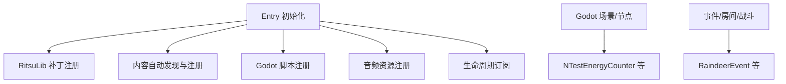
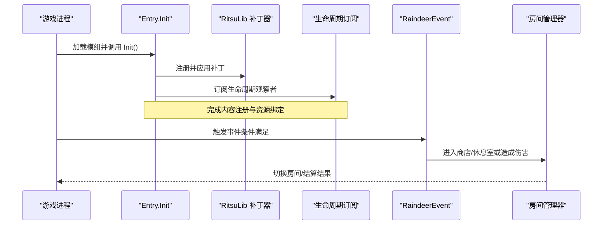
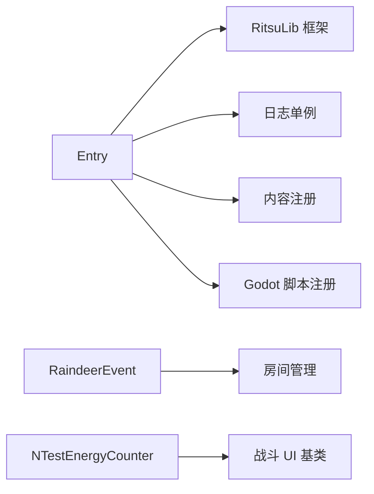

# 测试和调试

<cite>
**本文引用的文件**
- [Entry.cs](file://Scripts/Entry.cs)
- [LogSingleton.cs](file://Scripts/patches/Singleton/LogSingleton.cs)
- [NTestEnergyCounter.cs](file://Godot/EnergyLable/NTestEnergyCounter.cs)
- [RaindeerEvent.cs](file://Scripts/Event/RaindeerEvent.cs)
- [mod_manifest.json](file://mod_manifest.json)
- [project.godot](file://project.godot)
- [log.txt](file://log.txt)
</cite>

## 目录
1. [简介](#简介)
2. [项目结构](#项目结构)
3. [核心组件](#核心组件)
4. [架构总览](#架构总览)
5. [详细组件分析](#详细组件分析)
6. [依赖关系分析](#依赖关系分析)
7. [性能考虑](#性能考虑)
8. [故障排查指南](#故障排查指南)
9. [结论](#结论)
10. [附录](#附录)

## 简介
本指南面向“雨世界蛞蝓猫”模组的测试与调试实践，覆盖单元测试编写、集成测试策略、自动化测试流程、调试工具使用、日志系统配置、性能分析技巧、常见问题诊断、错误追踪与修复策略、开发环境设置、调试器配置、代码审查要点、测试驱动开发（TDD）最佳实践、覆盖率分析与持续集成（CI）配置，并提供针对模组功能的示例化测试思路。

## 项目结构
该模组基于 STS2（杀戮尖塔2）的 RitsuLib 框架进行扩展，包含：
- C# 逻辑层：卡牌、能力、事件、怪物、药水、遗物等
- Godot 脚本层：UI、能量计数器等可视化元素
- 补丁与单例：对游戏生命周期与运行时状态进行钩子注入
- 本地化与资源：多语言文本与音效资源
- 构建与清单：模组清单、Godot 工程配置

图表来源
- [Entry.cs:20-76](file://Scripts/Entry.cs#L20-L76)
- [NTestEnergyCounter.cs:5-8](file://Godot/EnergyLable/NTestEnergyCounter.cs#L5-L8)
- [RaindeerEvent.cs:27-67](file://Scripts/Event/RaindeerEvent.cs#L27-L67)

章节来源
- [Entry.cs:20-76](file://Scripts/Entry.cs#L20-L76)
- [project.godot:11-28](file://project.godot#L11-L28)

## 核心组件
- 模组入口与初始化：负责补丁注册、内容发现、Godot 脚本注册、音频资源绑定、生命周期订阅。
- 日志单例：通过 HookedSingletonModel 在运行期提供统一日志上下文。
- Godot 测试节点：用于验证 UI/能量计数器等显示逻辑。
- 事件系统：以 ModEventTemplate 为基础实现可配置的事件流程。

章节来源
- [Entry.cs:20-76](file://Scripts/Entry.cs#L20-L76)
- [LogSingleton.cs:23-33](file://Scripts/patches/Singleton/LogSingleton.cs#L23-L33)
- [NTestEnergyCounter.cs:5-8](file://Godot/EnergyLable/NTestEnergyCounter.cs#L5-L8)
- [RaindeerEvent.cs:27-67](file://Scripts/Event/RaindeerEvent.cs#L27-L67)

## 架构总览
下图展示模组启动到事件执行的典型调用链，便于定位测试与调试切入点。

图表来源
- [Entry.cs:26-74](file://Scripts/Entry.cs#L26-L74)
- [RaindeerEvent.cs:42-67](file://Scripts/Event/RaindeerEvent.cs#L42-L67)
- [RaindeerEvent.cs:105-133](file://Scripts/Event/RaindeerEvent.cs#L105-L133)

## 详细组件分析

### 模组入口与初始化（Entry）
- 职责：创建日志、注册补丁、注册配置、注册次级资源、注册 Godot 脚本、自动发现内容、注册卡牌手牌轮廓规则、注册音频、订阅生命周期。
- 测试建议：
  - 单元测试：验证补丁是否全部注册成功；内容发现是否包含预期类型；音频资源路径是否正确。
  - 集成测试：启动后检查关键服务是否可用（如日志、配置、资源）。
- 调试建议：
  - 在 Init 前后记录关键步骤耗时，识别启动瓶颈。
  - 若 PatchAll 失败，捕获异常并输出详细堆栈。

章节来源
- [Entry.cs:20-76](file://Scripts/Entry.cs#L20-L76)

### 日志系统（LogSingleton）
- 职责：作为运行期单例，提供统一的日志上下文与钩子点。
- 测试建议：
  - 单元测试：验证日志写入是否生效、日志级别过滤是否符合预期。
  - 集成测试：在事件/战斗流程中插入断点日志，确认执行顺序。
- 调试建议：
  - 在关键分支处输出上下文信息（角色、回合、资源值）。
  - 结合外部日志查看工具，按时间线回溯问题。

章节来源
- [LogSingleton.cs:23-33](file://Scripts/patches/Singleton/LogSingleton.cs#L23-L33)

### Godot 测试节点（NTestEnergyCounter）
- 职责：继承自 NEnergyCounter，可用于验证能量计数器的显示与交互。
- 测试建议：
  - 单元测试：构造最小场景，验证能量增减后的 UI 更新。
  - 集成测试：在战斗场景中多次操作，观察计数器是否一致。
- 调试建议：
  - 使用 Godot 编辑器附加调试器，逐步检查属性变化。
  - 打印内部状态，对比期望与实际值。

章节来源
- [NTestEnergyCounter.cs:5-8](file://Godot/EnergyLable/NTestEnergyCounter.cs#L5-L8)

### 事件系统（RaindeerEvent）
- 职责：定义事件选项、条件判断、页面跳转与效果执行（如伤害、进入房间）。
- 测试建议：
  - 单元测试：验证 IsAllowed 条件、选项生成、动态变量计算。
  - 集成测试：模拟不同金币/生命状态，验证事件分支与房间切换。
- 调试建议：
  - 在关键方法入口/出口打点日志，记录参数与返回值。
  - 使用断点跟踪异步流程（async Task），避免竞态条件。

章节来源
- [RaindeerEvent.cs:27-67](file://Scripts/Event/RaindeerEvent.cs#L27-L67)
- [RaindeerEvent.cs:105-133](file://Scripts/Event/RaindeerEvent.cs#L105-L133)

### 构建与清单（mod_manifest.json、project.godot）
- 职责：声明模组元数据、依赖、引擎配置与渲染设置。
- 测试建议：
  - 验证清单版本与最低游戏版本兼容性。
  - 确保 Godot 工程配置与目标平台一致。
- 调试建议：
  - 当导出或加载失败时，优先核对清单与工程配置。

章节来源
- [mod_manifest.json:1-14](file://mod_manifest.json#L1-L14)
- [project.godot:11-28](file://project.godot#L11-L28)

## 依赖关系分析
- 外部依赖：STS2-RitsuLib（补丁、生命周期、内容脚手架）。
- 内部依赖：Entry 依赖补丁器、日志、内容注册；事件依赖房间管理与命令系统；Godot 节点依赖战斗 UI 基类。

图表来源
- [Entry.cs:26-74](file://Scripts/Entry.cs#L26-L74)
- [RaindeerEvent.cs:42-67](file://Scripts/Event/RaindeerEvent.cs#L42-L67)
- [NTestEnergyCounter.cs:5-8](file://Godot/EnergyLable/NTestEnergyCounter.cs#L5-L8)

章节来源
- [mod_manifest.json:10-12](file://mod_manifest.json#L10-L12)
- [Entry.cs:26-74](file://Scripts/Entry.cs#L26-L74)

## 性能考虑
- 启动阶段：记录补丁注册与内容发现的耗时，避免阻塞主线程。
- 事件处理：减少不必要的对象分配，复用临时数据结构。
- UI 更新：批量更新能量计数器等 UI 元素，降低帧率抖动。
- 日志输出：在生产环境降低日志级别，避免 I/O 瓶颈。

## 故障排查指南
- 常见症状与定位：
  - 启动崩溃：检查 Entry.Init 中的补丁注册与资源绑定是否成功。
  - 事件不触发：核对 IsAllowed 条件与配置开关。
  - UI 显示异常：验证 Godot 节点属性与战斗 UI 基类状态。
- 日志与回放：
  - 在关键路径添加日志，结合 log.txt 的版本记录，快速定位回归问题。
- 修复策略：
  - 先复现最小用例，再逐步扩大范围。
  - 使用断点与日志双轨验证假设。
  - 提交前增加对应单元测试与集成测试用例。

章节来源
- [log.txt:167-215](file://log.txt#L167-L215)

## 结论
通过清晰的入口初始化、完善的日志体系、可插拔的事件系统与 Godot 测试节点，本项目具备良好的可测试性与可调试性。建议在新增功能时同步补充单元与集成测试，并在 CI 中固化质量门禁。

## 附录

### 单元测试编写指南
- 目标：覆盖核心逻辑的最小可测单元（如事件条件、数值计算、UI 更新）。
- 方法：
  - 隔离外部依赖：使用桩/替身模拟房间管理、随机数、网络请求。
  - 断言：验证输入到输出的映射关系，关注边界与异常分支。
- 示例（概念）：
  - 测试 RaindeerEvent.IsAllowed 在不同配置下的返回。
  - 测试 NTestEnergyCounter 在多次能量变化后显示值正确。

### 集成测试策略
- 目标：验证模块间协作（事件→房间→战斗→UI）。
- 方法：
  - 使用真实或轻量化的游戏上下文，执行端到端流程。
  - 录制关键状态快照，便于失败时对比。
- 示例（概念）：
  - 模拟玩家金币≥60，触发温顺巨兽事件，验证进入商店或休息室的分支。

### 自动化测试流程
- 本地：编译→单元测试→集成测试→静态检查。
- CI：拉取代码→安装依赖→构建→运行测试→上传报告。
- 频率：每次提交触发；发布前全量回归。

### 调试工具与日志配置
- 调试器：VS/VS Code 附加到游戏进程，设置断点于 Entry.Init、事件方法、UI 更新处。
- 日志：在关键路径输出上下文信息；生产环境降低级别；集中收集与分析。
- 可视化：使用 Godot 编辑器附加调试，观察节点树与属性变化。

### 性能分析技巧
- 采样分析：定位热点函数与频繁分配。
- 帧分析：监控 UI 更新与事件处理的帧占用。
- 优化建议：减少 GC 压力、合并 I/O、延迟加载资源。

### 常见问题诊断与修复
- 事件未出现：检查配置开关与生成条件。
- 软锁定：核对异步流程与房间切换逻辑，避免死循环。
- 资源加载失败：核对路径与清单依赖。

### 开发环境与调试器设置
- 环境：安装 .NET SDK、Godot 引擎、Steam 与游戏本体。
- 调试器：配置附加进程、启用符号服务器、设置断点与条件断点。
- 代码审查：关注可测试性、日志完备性、异常处理与性能影响。

### 测试驱动开发（TDD）最佳实践
- 红-绿-重构：先写失败的测试，再实现最小代码使其通过，最后重构。
- 覆盖率：目标行覆盖率≥80%，重点覆盖分支与异常路径。
- 持续集成：将覆盖率阈值纳入门禁，失败阻止合并。

### 具体示例：如何测试模组功能
- 事件分支测试：
  - 输入：不同金币与生命状态
  - 过程：触发 RaindeerEvent
  - 输出：进入商店/休息室或受到伤害
- UI 更新测试：
  - 输入：多次能量增减
  - 过程：调用 NTestEnergyCounter 相关逻辑
  - 输出：UI 显示与内部状态一致