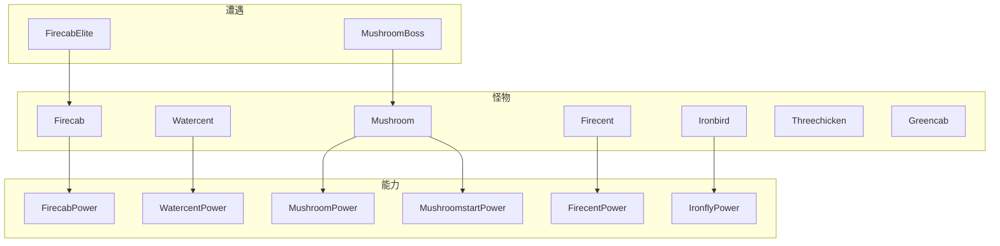
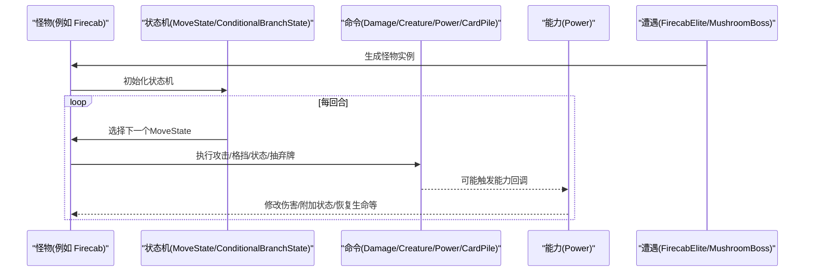
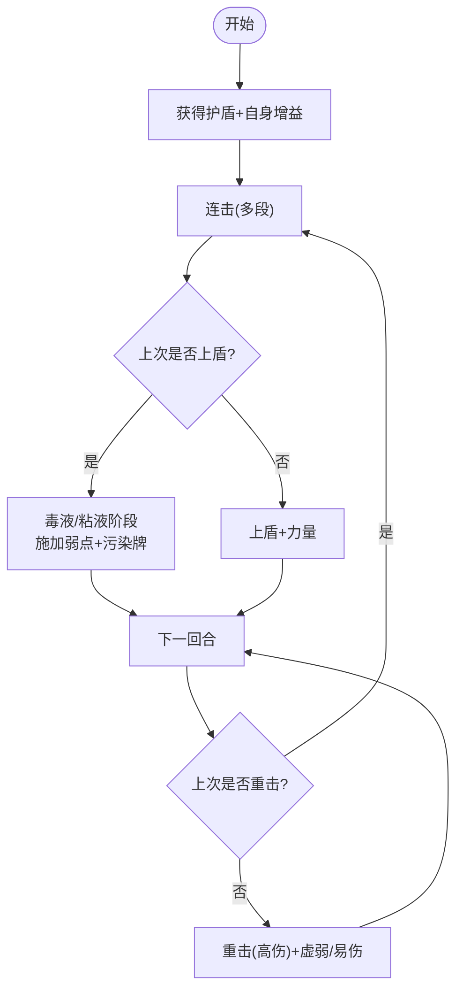
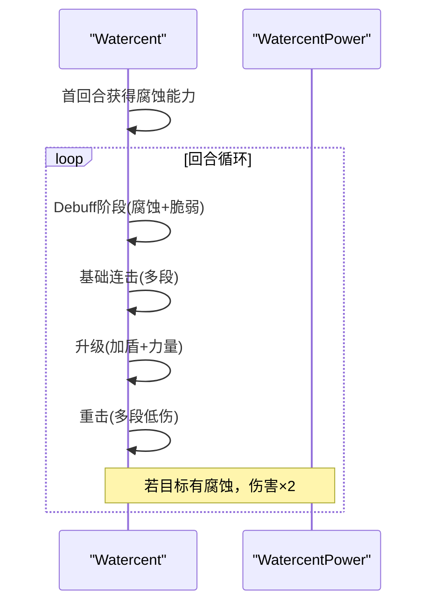
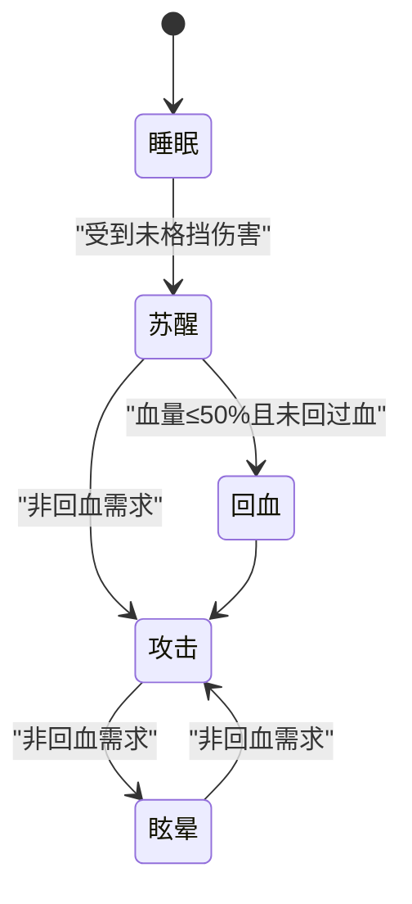
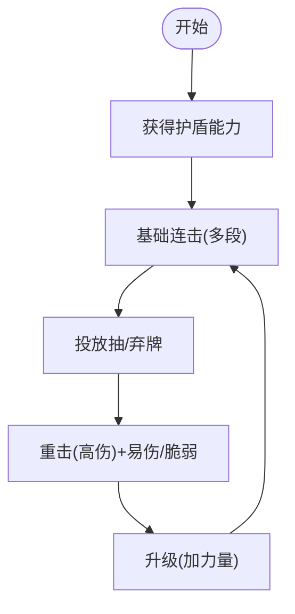
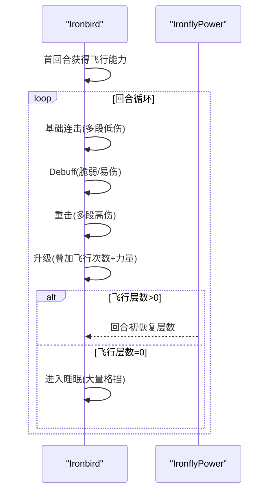
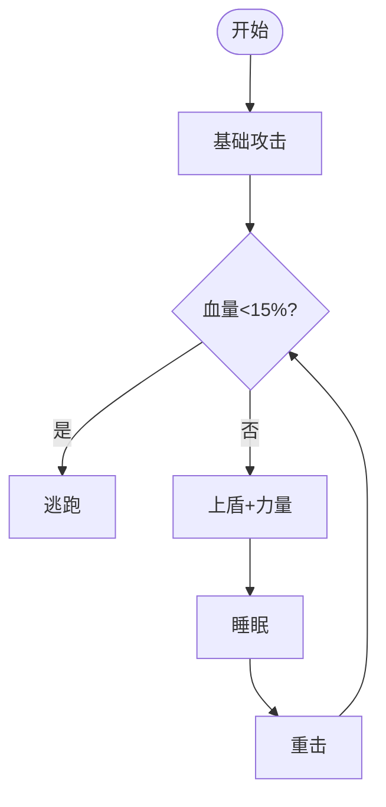
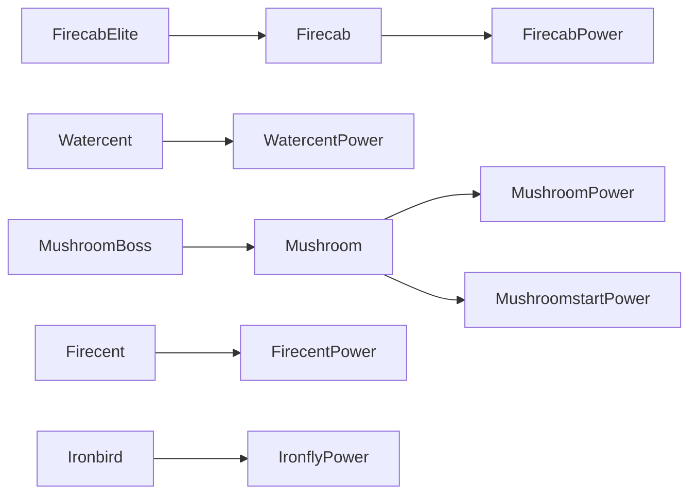

# 怪物能力系统

<cite>
**本文引用的文件**
- [Firecab.cs](file://Scripts/Monster/Firecab.cs)
- [Watercent.cs](file://Scripts/Monster/Watercent.cs)
- [Mushroom.cs](file://Scripts/Monster/Mushroom.cs)
- [Firecent.cs](file://Scripts/Monster/Firecent.cs)
- [Ironbird.cs](file://Scripts/Monster/Ironbird.cs)
- [Threechicken.cs](file://Scripts/Monster/Threechicken.cs)
- [Greencab.cs](file://Scripts/Monster/Greencab.cs)
- [FirecabPower.cs](file://Scripts/Powers/Monster/FirecabPower.cs)
- [WatercentPower.cs](file://Scripts/Powers/Monster/WatercentPower.cs)
- [MushroomPower.cs](file://Scripts/Powers/Monster/MushroomPower.cs)
- [FirecentPower.cs](file://Scripts/Powers/Monster/FirecentPower.cs)
- [IronflyPower.cs](file://Scripts/Powers/Monster/IronflyPower.cs)
- [MushroomstartPower.cs](file://Scripts/Powers/Monster/MushroomstartPower.cs)
- [FirecabElite.cs](file://Scripts/Monster/FirecabElite.cs)
- [MushroomBoss.cs](file://Scripts/Monster/MushroomBoss.cs)
</cite>

## 目录
1. [简介](#简介)
2. [项目结构](#项目结构)
3. [核心组件](#核心组件)
4. [架构总览](#架构总览)
5. [详细组件分析](#详细组件分析)
6. [依赖关系分析](#依赖关系分析)
7. [性能考量](#性能考量)
8. [故障排查指南](#故障排查指南)
9. [结论](#结论)
10. [附录：自定义与调试指南](#附录自定义与调试指南)

## 简介
本文件系统化梳理并说明“怪物能力系统”的实现，覆盖多种怪物的特殊能力、触发逻辑、伤害计算、状态施加与AI行为影响；同时涵盖精英怪物的强化机制与Boss的特殊流程。最后提供自定义怪物能力的开发指南与调试方法，帮助开发者快速扩展与排错。

## 项目结构
- 怪物脚本位于 Scripts/Monster 下，每个怪物继承 ModMonsterTemplate，通过 GenerateMoveStateMachine 定义意图（MoveState）与状态机流转，使用 DamageCmd/CreatureCmd/PowerCmd/CardPileCmd 等命令执行攻击、格挡、Buff/Debuff、抽弃牌堆等操作。
- 能力（Power）位于 Scripts/Powers/Monster 下，继承 ModPowerTemplate，通过重写生命周期回调实现被动效果（如伤害倍率修改、回合事件、受击事件等）。
- 精英/Boss 通过 ModEncounterTemplate 注册到特定 Act 房间类型，生成对应怪物实例。



图表来源
- [Firecab.cs:26-144](file://Scripts/Monster/Firecab.cs#L26-L144)
- [Watercent.cs:27-124](file://Scripts/Monster/Watercent.cs#L27-L124)
- [Mushroom.cs:30-167](file://Scripts/Monster/Mushroom.cs#L30-L167)
- [Firecent.cs:28-146](file://Scripts/Monster/Firecent.cs#L28-L146)
- [Ironbird.cs:29-145](file://Scripts/Monster/Ironbird.cs#L29-L145)
- [Threechicken.cs:28-174](file://Scripts/Monster/Threechicken.cs#L28-L174)
- [Greencab.cs:26-127](file://Scripts/Monster/Greencab.cs#L26-L127)
- [FirecabPower.cs:31-52](file://Scripts/Powers/Monster/FirecabPower.cs#L31-L52)
- [WatercentPower.cs:31-55](file://Scripts/Powers/Monster/WatercentPower.cs#L31-L55)
- [MushroomPower.cs:30-94](file://Scripts/Powers/Monster/MushroomPower.cs#L30-L94)
- [FirecentPower.cs:31-84](file://Scripts/Powers/Monster/FirecentPower.cs#L31-L84)
- [IronflyPower.cs:31-89](file://Scripts/Powers/Monster/IronflyPower.cs#L31-L89)
- [MushroomstartPower.cs:32-100](file://Scripts/Powers/Monster/MushroomstartPower.cs#L32-L100)
- [FirecabElite.cs:10-34](file://Scripts/Monster/FirecabElite.cs#L10-L34)
- [MushroomBoss.cs:10-34](file://Scripts/Monster/MushroomBoss.cs#L10-L34)

章节来源
- [Firecab.cs:26-144](file://Scripts/Monster/Firecab.cs#L26-L144)
- [Watercent.cs:27-124](file://Scripts/Monster/Watercent.cs#L27-L124)
- [Mushroom.cs:30-167](file://Scripts/Monster/Mushroom.cs#L30-L167)
- [Firecent.cs:28-146](file://Scripts/Monster/Firecent.cs#L28-L146)
- [Ironbird.cs:29-145](file://Scripts/Monster/Ironbird.cs#L29-L145)
- [Threechicken.cs:28-174](file://Scripts/Monster/Threechicken.cs#L28-L174)
- [Greencab.cs:26-127](file://Scripts/Monster/Greencab.cs#L26-L127)
- [FirecabPower.cs:31-52](file://Scripts/Powers/Monster/FirecabPower.cs#L31-L52)
- [WatercentPower.cs:31-55](file://Scripts/Powers/Monster/WatercentPower.cs#L31-L55)
- [MushroomPower.cs:30-94](file://Scripts/Powers/Monster/MushroomPower.cs#L30-L94)
- [FirecentPower.cs:31-84](file://Scripts/Powers/Monster/FirecentPower.cs#L31-L84)
- [IronflyPower.cs:31-89](file://Scripts/Powers/Monster/IronflyPower.cs#L31-L89)
- [MushroomstartPower.cs:32-100](file://Scripts/Powers/Monster/MushroomstartPower.cs#L32-L100)
- [FirecabElite.cs:10-34](file://Scripts/Monster/FirecabElite.cs#L10-L34)
- [MushroomBoss.cs:10-34](file://Scripts/Monster/MushroomBoss.cs#L10-L34)

## 核心组件
- 怪物基类与状态机：所有怪物继承 ModMonsterTemplate，通过 GenerateMoveStateMachine 构建 MoveState 与 ConditionalBranchState，控制意图循环与条件分支。
- 命令系统：DamageCmd 负责伤害与连击；CreatureCmd 负责格挡、治疗、动画、逃跑等；PowerCmd 负责 Buff/Debuff 的添加、移除与数值修改；CardPileCmd 负责向抽牌堆/弃牌堆添加卡牌或移除卡牌。
- 能力系统：通过 ModPowerTemplate 的生命周期钩子（如 AfterSideTurnStart、AfterBlockBroken、AfterPlayerTurnStart、AfterDamageReceived、AfterCardExhausted、AfterAttack 等）实现被动效果。
- 遭遇模板：ModEncounterTemplate 用于精英/Boss 房间配置，指定房间类型、背景、BGM、地图节点等，并生成怪物实例。

章节来源
- [Firecab.cs:65-144](file://Scripts/Monster/Firecab.cs#L65-L144)
- [Watercent.cs:60-124](file://Scripts/Monster/Watercent.cs#L60-L124)
- [Mushroom.cs:89-167](file://Scripts/Monster/Mushroom.cs#L89-L167)
- [Firecent.cs:93-146](file://Scripts/Monster/Firecent.cs#L93-L146)
- [Ironbird.cs:80-145](file://Scripts/Monster/Ironbird.cs#L80-L145)
- [Threechicken.cs:101-174](file://Scripts/Monster/Threechicken.cs#L101-L174)
- [Greencab.cs:62-127](file://Scripts/Monster/Greencab.cs#L62-L127)
- [FirecabPower.cs:31-52](file://Scripts/Powers/Monster/FirecabPower.cs#L31-L52)
- [WatercentPower.cs:31-55](file://Scripts/Powers/Monster/WatercentPower.cs#L31-L55)
- [MushroomPower.cs:30-94](file://Scripts/Powers/Monster/MushroomPower.cs#L30-L94)
- [FirecentPower.cs:31-84](file://Scripts/Powers/Monster/FirecentPower.cs#L31-L84)
- [IronflyPower.cs:31-89](file://Scripts/Powers/Monster/IronflyPower.cs#L31-L89)
- [MushroomstartPower.cs:32-100](file://Scripts/Powers/Monster/MushroomstartPower.cs#L32-L100)
- [FirecabElite.cs:10-34](file://Scripts/Monster/FirecabElite.cs#L10-L34)
- [MushroomBoss.cs:10-34](file://Scripts/Monster/MushroomBoss.cs#L10-L34)

## 架构总览
下图展示怪物、能力与遭遇之间的关系及关键数据流。



图表来源
- [Firecab.cs:65-144](file://Scripts/Monster/Firecab.cs#L65-L144)
- [Watercent.cs:60-124](file://Scripts/Monster/Watercent.cs#L60-L124)
- [Mushroom.cs:89-167](file://Scripts/Monster/Mushroom.cs#L89-L167)
- [Firecent.cs:93-146](file://Scripts/Monster/Firecent.cs#L93-L146)
- [Ironbird.cs:80-145](file://Scripts/Monster/Ironbird.cs#L80-L145)
- [Threechicken.cs:101-174](file://Scripts/Monster/Threechicken.cs#L101-L174)
- [Greencab.cs:62-127](file://Scripts/Monster/Greencab.cs#L62-L127)
- [FirecabPower.cs:31-52](file://Scripts/Powers/Monster/FirecabPower.cs#L31-L52)
- [WatercentPower.cs:31-55](file://Scripts/Powers/Monster/WatercentPower.cs#L31-L55)
- [MushroomPower.cs:30-94](file://Scripts/Powers/Monster/MushroomPower.cs#L30-L94)
- [FirecentPower.cs:31-84](file://Scripts/Powers/Monster/FirecentPower.cs#L31-L84)
- [IronflyPower.cs:31-89](file://Scripts/Powers/Monster/IronflyPower.cs#L31-L89)
- [MushroomstartPower.cs:32-100](file://Scripts/Powers/Monster/MushroomstartPower.cs#L32-L100)
- [FirecabElite.cs:10-34](file://Scripts/Monster/FirecabElite.cs#L10-L34)
- [MushroomBoss.cs:10-34](file://Scripts/Monster/MushroomBoss.cs#L10-L34)

## 详细组件分析

### 火焰甲虫（Firecab）
- 能力概述
  - 初始获得护盾与自身增益（力量/活力），具备连击与重击两种主要攻击。
  - 重击附带虚弱/易伤等减益，部分回合可进入“毒液/粘液”状态对玩家施加弱点和污染牌。
- 触发逻辑
  - 首回合先加盾与自身增益，随后进入基础连击；根据上次是否重击与是否上盾决定后续分支。
  - 低血量时倾向逃跑。
- 伤害与状态
  - 连击为多次命中；重击为单次高伤；状态阶段对目标施加弱点与污染牌数量随进阶变化。
- AI行为
  - 使用 ConditionalBranchState 根据 lastmoveblock/lastattackheavy 切换下一意图。
- 可视化


图表来源
- [Firecab.cs:58-144](file://Scripts/Monster/Firecab.cs#L58-L144)
- [FirecabPower.cs:31-52](file://Scripts/Powers/Monster/FirecabPower.cs#L31-L52)

章节来源
- [Firecab.cs:26-198](file://Scripts/Monster/Firecab.cs#L26-L198)
- [FirecabPower.cs:31-52](file://Scripts/Powers/Monster/FirecabPower.cs#L31-L52)

### 水中心（Watercent）
- 能力概述
  - 具备腐蚀（Corrode）与脆弱（Frail）的复合Debuff；拥有升级阶段提升格挡与力量。
  - 能力 WatercentPower 在存在腐蚀时使伤害翻倍。
- 触发逻辑
  - 首回合获得腐蚀能力；循环：Debuff → 基础连击 → 升级（加盾+力量）→ 重击（多段低伤）→ Debuff。
- 伤害与状态
  - 基础连击为多段；重击为多段低伤；Debuff阶段施加腐蚀层数与脆弱层数。
- AI行为
  - 固定顺序的状态机，便于预测与反制。
- 可视化


图表来源
- [Watercent.cs:54-124](file://Scripts/Monster/Watercent.cs#L54-L124)
- [WatercentPower.cs:31-55](file://Scripts/Powers/Monster/WatercentPower.cs#L31-L55)

章节来源
- [Watercent.cs:27-157](file://Scripts/Monster/Watercent.cs#L27-L157)
- [WatercentPower.cs:31-55](file://Scripts/Powers/Monster/WatercentPower.cs#L31-L55)

### 蘑菇（Mushroom）
- 能力概述
  - 睡眠/苏醒机制：战斗开始时处于睡眠，受到未格挡伤害后苏醒；苏醒后获得强力能力（蘑菇能力）并在每回合末回复最大生命值一定比例。
  - 具备眩晕（Dazed）投掷与高爆发重击。
- 触发逻辑
  - 睡眠阶段不行动；苏醒后进入攻击/眩晕/回血分支，依据当前血量决定是否回血。
- 伤害与状态
  - 基础连击与重击；眩晕阶段向抽牌堆/弃牌堆添加眩晕牌；苏醒后获得蘑菇能力，每消耗一张牌回复生命并增加力量。
- AI行为
  - 使用 ConditionalBranchState 根据 needHealth 与 _isAwake 切换分支。
- 可视化


图表来源
- [Mushroom.cs:84-167](file://Scripts/Monster/Mushroom.cs#L84-L167)
- [MushroomstartPower.cs:45-100](file://Scripts/Powers/Monster/MushroomstartPower.cs#L45-L100)
- [MushroomPower.cs:30-94](file://Scripts/Powers/Monster/MushroomPower.cs#L30-L94)

章节来源
- [Mushroom.cs:30-214](file://Scripts/Monster/Mushroom.cs#L30-L214)
- [MushroomstartPower.cs:32-100](file://Scripts/Powers/Monster/MushroomstartPower.cs#L32-L100)
- [MushroomPower.cs:30-94](file://Scripts/Powers/Monster/MushroomPower.cs#L30-L94)

### 火心（Firecent）
- 能力概述
  - 拥有护盾吸收与皮肤切换机制：当护盾被打破时逐步更换外观并重新获得护盾，直至能力移除。
  - 具备眩晕牌投放与重击附带易伤/脆弱。
- 触发逻辑
  - 首回合获得护盾能力；循环：基础连击 → 投放两张牌（一抽一弃） → 重击 → 升级（加力量） → 回到基础连击。
- 伤害与状态
  - 基础连击为多段；重击为单发高伤；升级阶段增加力量；护盾破裂时按阶段恢复护盾并切换皮肤。
- AI行为
  - 固定顺序状态机；皮肤切换由 FirecentPower 管理。
- 可视化


图表来源
- [Firecent.cs:86-146](file://Scripts/Monster/Firecent.cs#L86-L146)
- [FirecentPower.cs:45-84](file://Scripts/Powers/Monster/FirecentPower.cs#L45-L84)

章节来源
- [Firecent.cs:28-191](file://Scripts/Monster/Firecent.cs#L28-L191)
- [FirecentPower.cs:31-84](file://Scripts/Powers/Monster/FirecentPower.cs#L31-L84)

### 铁鸟（Ironbird）
- 能力概述
  - 飞行能力（IronflyPower）提供伤害减免与回合初恢复层数；层数为0时陷入眩晕并进入睡眠状态。
  - 具备睡眠/苏醒、升级、Debuff（脆弱/易伤）等阶段。
- 触发逻辑
  - 首回合获得飞行能力；循环：基础连击 → Debuff → 重击 → 升级（叠加飞行次数与力量） → 睡眠/苏醒。
- 伤害与状态
  - 基础连击多段低伤；重击多段高伤；飞行能力降低受到的伤害，并在玩家回合开始恢复层数；层数耗尽进入睡眠。
- AI行为
  - 使用 IsDazed 控制动画与可攻击性；睡眠阶段获得大量格挡。
- 可视化


图表来源
- [Ironbird.cs:71-145](file://Scripts/Monster/Ironbird.cs#L71-L145)
- [IronflyPower.cs:45-89](file://Scripts/Powers/Monster/IronflyPower.cs#L45-L89)

章节来源
- [Ironbird.cs:29-217](file://Scripts/Monster/Ironbird.cs#L29-L217)
- [IronflyPower.cs:31-89](file://Scripts/Powers/Monster/IronflyPower.cs#L31-L89)

### 三鸡（Threechicken）
- 能力概述
  - 偷取玩家卡牌并削减其最大生命值；具备观察（Watch）阶段增强捕获能力。
- 触发逻辑
  - 循环：攻击 → 偷取/削血 → 攻击；观察阶段增强捕获能力。
- 伤害与状态
  - 攻击次数由外部事件变量控制；偷取优先级基于稀有度与附魔状态。
- AI行为
  - 简单循环，配合事件变量动态调整强度。
- 可视化
```mermaid
flowchart TD
Start(["开始"]) --> Attack["攻击(次数由事件决定)"]
Attack --> Steal["偷取卡牌+削减最大生命"]
Steal --> Attack
note right of Attack: 观察阶段增强捕获能力
```

图表来源
- [Threechicken.cs:96-174](file://Scripts/Monster/Threechicken.cs#L96-L174)

章节来源
- [Threechicken.cs:28-206](file://Scripts/Monster/Threechicken.cs#L28-L206)

### 绿甲虫（Greencab）
- 能力概述
  - 自带减速（Slow）；具备逃跑机制；低血量时优先逃跑。
- 触发逻辑
  - 循环：攻击 → 上盾/力量 → 睡眠 → 重击；低血量时逃跑。
- 伤害与状态
  - 基础攻击与重击；睡眠阶段无行动；上盾阶段获得力量。
- AI行为
  - 使用 ConditionalBranchState 判断血量阈值以决定逃跑或常规动作。
- 可视化


图表来源
- [Greencab.cs:51-127](file://Scripts/Monster/Greencab.cs#L51-L127)

章节来源
- [Greencab.cs:26-172](file://Scripts/Monster/Greencab.cs#L26-L172)

## 依赖关系分析
- 怪物与能力耦合
  - FirecabPower 在数值减少时给所有者施加活力（Vigor）。
  - WatercentPower 在目标或施法者具有腐蚀时伤害翻倍。
  - MushroomPower 在卡牌耗尽时回复生命并增加力量；在攻击时对玩家造成眩晕牌。
  - FirecentPower 在护盾被打破时切换皮肤并恢复护盾，直至移除。
  - IronflyPower 提供伤害减免、回合初恢复层数、受击递减层数，并在移除时让怪物进入睡眠。
  - MushroomstartPower 在受到未格挡伤害时移除自身并唤醒怪物；回合末回复生命并递减层数；移除时播放动画并标记苏醒。
- 遭遇与怪物
  - FirecabElite 将 Firecab 作为精英遭遇。
  - MushroomBoss 将 Mushroom 作为Boss遭遇，并设置自定义BGM与地图节点。



图表来源
- [FirecabPower.cs:31-52](file://Scripts/Powers/Monster/FirecabPower.cs#L31-L52)
- [WatercentPower.cs:31-55](file://Scripts/Powers/Monster/WatercentPower.cs#L31-L55)
- [MushroomPower.cs:30-94](file://Scripts/Powers/Monster/MushroomPower.cs#L30-L94)
- [MushroomstartPower.cs:32-100](file://Scripts/Powers/Monster/MushroomstartPower.cs#L32-L100)
- [FirecentPower.cs:31-84](file://Scripts/Powers/Monster/FirecentPower.cs#L31-L84)
- [IronflyPower.cs:31-89](file://Scripts/Powers/Monster/IronflyPower.cs#L31-L89)
- [FirecabElite.cs:10-34](file://Scripts/Monster/FirecabElite.cs#L10-L34)
- [MushroomBoss.cs:10-34](file://Scripts/Monster/MushroomBoss.cs#L10-L34)

章节来源
- [FirecabPower.cs:31-52](file://Scripts/Powers/Monster/FirecabPower.cs#L31-L52)
- [WatercentPower.cs:31-55](file://Scripts/Powers/Monster/WatercentPower.cs#L31-L55)
- [MushroomPower.cs:30-94](file://Scripts/Powers/Monster/MushroomPower.cs#L30-L94)
- [MushroomstartPower.cs:32-100](file://Scripts/Powers/Monster/MushroomstartPower.cs#L32-L100)
- [FirecentPower.cs:31-84](file://Scripts/Powers/Monster/FirecentPower.cs#L31-L84)
- [IronflyPower.cs:31-89](file://Scripts/Powers/Monster/IronflyPower.cs#L31-L89)
- [FirecabElite.cs:10-34](file://Scripts/Monster/FirecabElite.cs#L10-L34)
- [MushroomBoss.cs:10-34](file://Scripts/Monster/MushroomBoss.cs#L10-L34)

## 性能考量
- 状态机复杂度：多数怪物使用少量 MoveState 与 ConditionalBranchState，逻辑清晰，开销较低。复杂分支（如蘑菇）需注意条件判断频率。
- 命令调用：DamageCmd/CreatureCmd/PowerCmd/CardPileCmd 在每回合可能被多次调用，应避免不必要的重复操作。
- 动画与特效：WithAttackerAnim/WithHitFx 会触发渲染与音效，建议仅在必要时机使用。
- 多人模式：部分数值基于 CombatState.Players.Count 动态缩放，注意平衡性与性能。

## 故障排查指南
- 怪物未进入预期状态
  - 检查 FollowUpState 是否正确设置，以及 ConditionalBranchState 的条件函数是否符合预期。
  - 参考：[Firecab.cs:125-144](file://Scripts/Monster/Firecab.cs#L125-L144)、[Mushroom.cs:138-167](file://Scripts/Monster/Mushroom.cs#L138-L167)。
- 能力未生效
  - 确认能力已正确应用（AfterAddedToRoom/BeforeCombatStart），并检查生命周期回调是否被触发。
  - 参考：[Watercent.cs:54-58](file://Scripts/Monster/Watercent.cs#L54-L58)、[FirecentPower.cs:45-84](file://Scripts/Powers/Monster/FirecentPower.cs#L45-L84)。
- 伤害异常
  - 检查 ModifyDamageMultiplicative 或其他伤害修改回调是否被错误覆盖。
  - 参考：[WatercentPower.cs:45-52](file://Scripts/Powers/Monster/WatercentPower.cs#L45-L52)。
- 动画不播放
  - 确保 SetupCustomCreatureAnimator 中状态绑定正确，且 TriggerAnim 名称匹配。
  - 参考：[Firecab.cs:169-196](file://Scripts/Monster/Firecab.cs#L169-L196)、[Ironbird.cs:186-214](file://Scripts/Monster/Ironbird.cs#L186-L214)。
- 精英/Boss 未出现
  - 检查 Encounter 注册与 RoomType 配置是否正确。
  - 参考：[FirecabElite.cs:10-34](file://Scripts/Monster/FirecabElite.cs#L10-L34)、[MushroomBoss.cs:10-34](file://Scripts/Monster/MushroomBoss.cs#L10-L34)。

章节来源
- [Firecab.cs:125-144](file://Scripts/Monster/Firecab.cs#L125-L144)
- [Mushroom.cs:138-167](file://Scripts/Monster/Mushroom.cs#L138-L167)
- [Watercent.cs:54-58](file://Scripts/Monster/Watercent.cs#L54-L58)
- [FirecentPower.cs:45-84](file://Scripts/Powers/Monster/FirecentPower.cs#L45-L84)
- [WatercentPower.cs:45-52](file://Scripts/Powers/Monster/WatercentPower.cs#L45-L52)
- [Firecab.cs:169-196](file://Scripts/Monster/Firecab.cs#L169-L196)
- [Ironbird.cs:186-214](file://Scripts/Monster/Ironbird.cs#L186-L214)
- [FirecabElite.cs:10-34](file://Scripts/Monster/FirecabElite.cs#L10-L34)
- [MushroomBoss.cs:10-34](file://Scripts/Monster/MushroomBoss.cs#L10-L34)

## 结论
该怪物能力系统通过“怪物状态机 + 能力生命周期回调”的组合，实现了丰富的战斗行为与策略深度。各怪物具备独特的能力与AI模式，精英与Boss通过遭遇模板进行统一管理与扩展。开发者可基于现有框架快速定制新怪物与能力，并通过日志与断点定位问题。

## 附录：自定义与调试指南
- 新增怪物步骤
  - 创建继承 ModMonsterTemplate 的类，定义资产路径、初始HP、数值与状态机。
  - 在 GenerateMoveStateMachine 中定义 MoveState 与 ConditionalBranchState，并设置 FollowUpState。
  - 如需被动能力，新建 Power 继承 ModPowerTemplate，重写相应生命周期回调。
  - 如需精英/Boss，新建 Encounter 继承 ModEncounterTemplate，设置 RoomType 与 GenerateMonsters。
- 调试建议
  - 在关键回调（AfterAddedToRoom、AfterSideTurnStart、AfterDamageReceived、AfterBlockBroken 等）加入日志输出。
  - 使用断点验证状态机流转与条件分支是否符合预期。
  - 检查命令调用链（Damage/Creature/Power/CardPile）是否按预期执行。
- 最佳实践
  - 避免在高频回调中进行昂贵计算；将复杂逻辑拆分到独立方法。
  - 合理使用动画与特效，避免过度渲染。
  - 针对多人模式进行数值平衡测试，确保体验一致。

章节来源
- [Firecab.cs:26-198](file://Scripts/Monster/Firecab.cs#L26-L198)
- [Watercent.cs:27-157](file://Scripts/Monster/Watercent.cs#L27-L157)
- [Mushroom.cs:30-214](file://Scripts/Monster/Mushroom.cs#L30-L214)
- [Firecent.cs:28-191](file://Scripts/Monster/Firecent.cs#L28-L191)
- [Ironbird.cs:29-217](file://Scripts/Monster/Ironbird.cs#L29-L217)
- [Threechicken.cs:28-206](file://Scripts/Monster/Threechicken.cs#L28-L206)
- [Greencab.cs:26-172](file://Scripts/Monster/Greencab.cs#L26-L172)
- [FirecabPower.cs:31-52](file://Scripts/Powers/Monster/FirecabPower.cs#L31-L52)
- [WatercentPower.cs:31-55](file://Scripts/Powers/Monster/WatercentPower.cs#L31-L55)
- [MushroomPower.cs:30-94](file://Scripts/Powers/Monster/MushroomPower.cs#L30-L94)
- [FirecentPower.cs:31-84](file://Scripts/Powers/Monster/FirecentPower.cs#L31-L84)
- [IronflyPower.cs:31-89](file://Scripts/Powers/Monster/IronflyPower.cs#L31-L89)
- [MushroomstartPower.cs:32-100](file://Scripts/Powers/Monster/MushroomstartPower.cs#L32-L100)
- [FirecabElite.cs:10-34](file://Scripts/Monster/FirecabElite.cs#L10-L34)
- [MushroomBoss.cs:10-34](file://Scripts/Monster/MushroomBoss.cs#L10-L34)