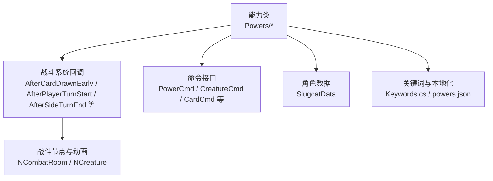
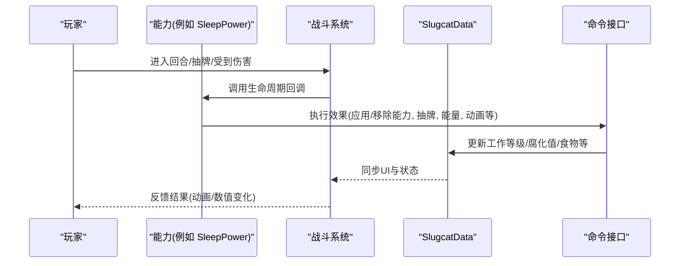
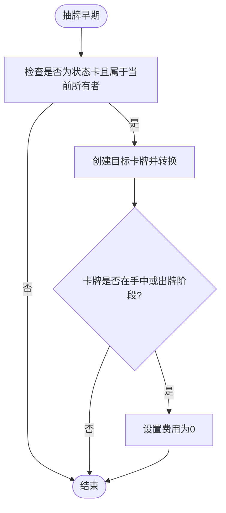
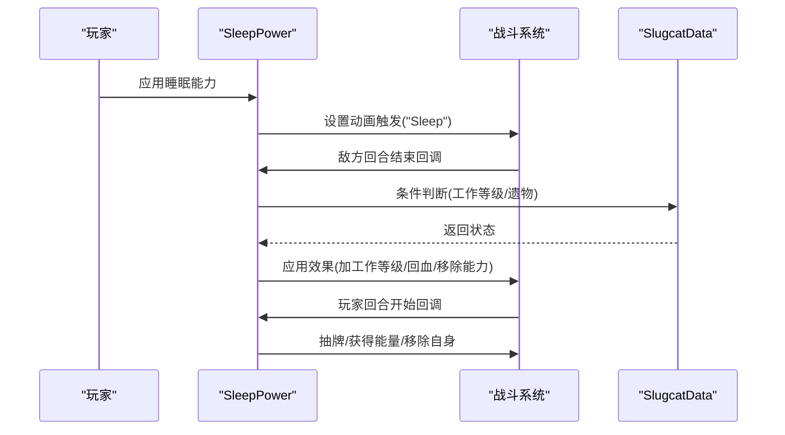
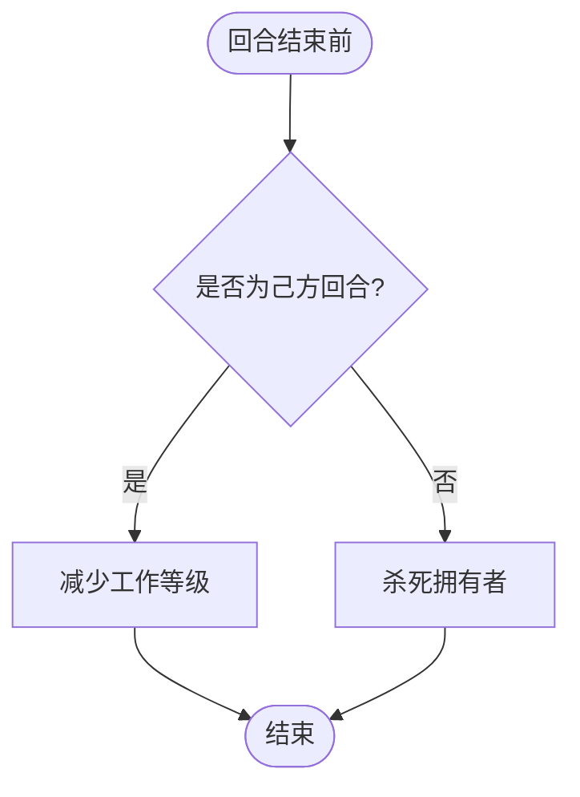
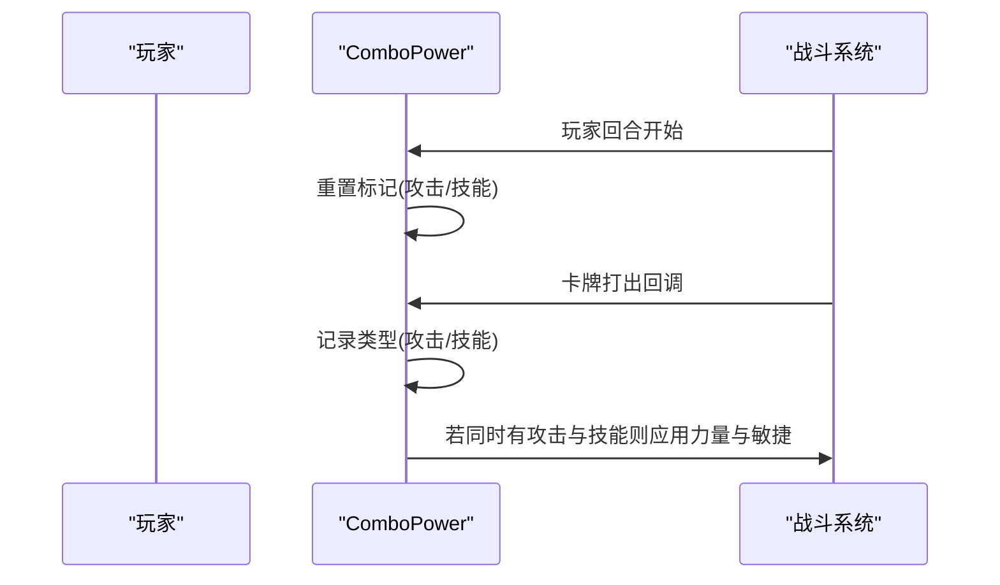
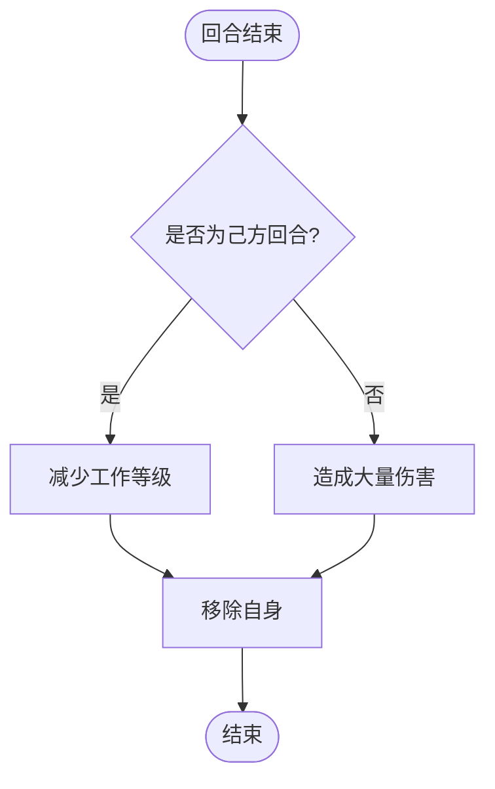
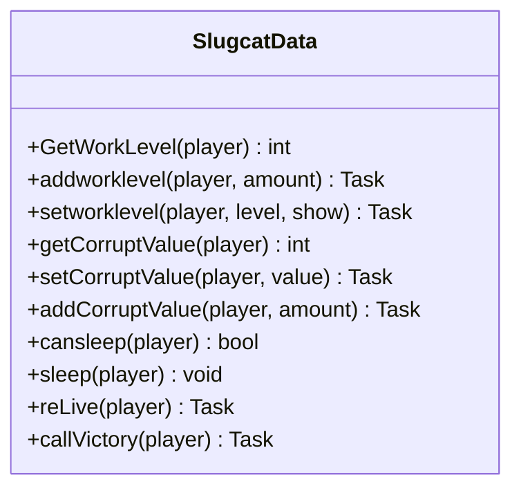
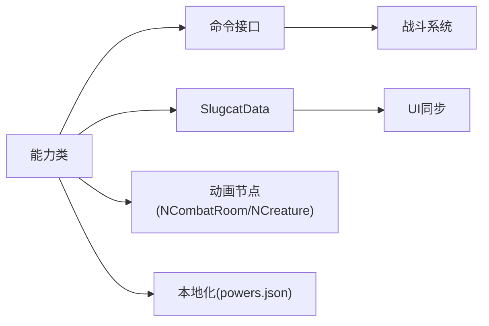

# 能力和状态效果

<cite>
**本文引用的文件**
- [MetabolizePower.cs](file://Scripts/Powers/MetabolizePower.cs)
- [SleepPower.cs](file://Scripts/Powers/SleepPower.cs)
- [BecausePower.cs](file://Scripts/Powers/BecausePower.cs)
- [ComboPower.cs](file://Scripts/Powers/ComboPower.cs)
- [TiredPower.cs](file://Scripts/Powers/Liver/TiredPower.cs)
- [WorklockPower.cs](file://Scripts/Powers/WorklockPower.cs)
- [SlugcatData.cs](file://Scripts/Slugcat/SlugcatData.cs)
- [Keywords.cs](file://Scripts/Keywords.cs)
- [powers.json（英文）](file://SlugcatTheSpireII/localization/eng/powers.json)
</cite>

## 目录
1. [简介](#简介)
2. [项目结构](#项目结构)
3. [核心组件](#核心组件)
4. [架构总览](#架构总览)
5. [详细组件分析](#详细组件分析)
6. [依赖关系分析](#依赖关系分析)
7. [性能考虑](#性能考虑)
8. [故障排查指南](#故障排查指南)
9. [结论](#结论)
10. [附录](#附录)

## 简介
本文件围绕“能力与状态效果系统”的实现进行系统化说明，聚焦以下方面：
- 能力系统的架构设计与生命周期管理
- 状态效果的触发机制、执行流程与优先级处理
- 冲突解决策略与组合模式
- 预定义能力的实现示例：代谢能力、睡眠能力、因为能力等
- 自定义能力的创建方法、能力效果定义与游戏逻辑集成
- 能力组合、链式反应与条件触发的实现方式
- 性能优化建议与调试技巧

## 项目结构
本项目将能力（Power）以独立类形式组织在 Scripts/Powers 目录下，并通过注册特性自动注入到战斗系统中。能力通过重写基类的生命周期回调来响应战斗事件（如抽牌、回合开始/结束、受到伤害等）。数据与状态由 SlugcatData 统一管理，关键词与本地化描述分别由 Keywords.cs 与 powers.json 维护。

图表来源
- [MetabolizePower.cs:43-82](file://Scripts/Powers/MetabolizePower.cs#L43-L82)
- [SleepPower.cs:45-112](file://Scripts/Powers/SleepPower.cs#L45-L112)
- [BecausePower.cs:40-58](file://Scripts/Powers/BecausePower.cs#L40-L58)
- [SlugcatData.cs:185-221](file://Scripts/Slugcat/SlugcatData.cs#L185-L221)
- [Keywords.cs:9-50](file://Scripts/Keywords.cs#L9-L50)
- [powers.json（英文）:56-102](file://SlugcatTheSpireII/localization/eng/powers.json#L56-L102)

章节来源
- [MetabolizePower.cs:1-84](file://Scripts/Powers/MetabolizePower.cs#L1-L84)
- [SleepPower.cs:1-115](file://Scripts/Powers/SleepPower.cs#L1-L115)
- [BecausePower.cs:1-61](file://Scripts/Powers/BecausePower.cs#L1-L61)
- [SlugcatData.cs:1-367](file://Scripts/Slugcat/SlugcatData.cs#L1-L367)
- [Keywords.cs:1-50](file://Scripts/Keywords.cs#L1-L50)
- [powers.json（英文）:1-328](file://SlugcatTheSpireII/localization/eng/powers.json#L1-L328)

## 核心组件
- 能力基类与生命周期：所有能力继承自 ModPowerTemplate，通过重写 AfterCardDrawnEarly、AfterPlayerTurnStart、AfterSideTurnEnd、BeforeSideTurnEnd、AfterDamageReceived、AfterApplied、AfterRemoved 等回调接入战斗流程。
- 命令接口：使用 PowerCmd、CreatureCmd、CardCmd、CardPileCmd、PlayerCmd、SecondaryResourceCmd 等命令执行能力效果（应用/移除能力、造成伤害/治疗、抽牌、能量获取、修改资源值等）。
- 数据与状态：SlugcatData 提供工作等级、食物、腐化值等持久化数据的读写与同步；结合关键词与本地化完成 UI 展示与提示。
- 注册与类型：能力通过 [RegisterPower] 自动注册；Type 指定 Buff/Debuff；StackType 支持 Single/Counter 等堆叠策略。

章节来源
- [MetabolizePower.cs:29-40](file://Scripts/Powers/MetabolizePower.cs#L29-L40)
- [SleepPower.cs:32-43](file://Scripts/Powers/SleepPower.cs#L32-L43)
- [BecausePower.cs:26-38](file://Scripts/Powers/BecausePower.cs#L26-L38)
- [ComboPower.cs:27-38](file://Scripts/Powers/ComboPower.cs#L27-L38)
- [TiredPower.cs:26-37](file://Scripts/Powers/Liver/TiredPower.cs#L26-L37)
- [SlugcatData.cs:32-66](file://Scripts/Slugcat/SlugcatData.cs#L32-L66)

## 架构总览
能力系统采用“事件驱动 + 命令执行”的架构：
- 事件驱动：能力通过重写生命周期回调监听战斗事件（抽牌、回合阶段、伤害等）。
- 命令执行：在回调中调用命令接口执行具体效果（应用/移除能力、改变数值、播放动画等）。
- 数据同步：通过 SlugcatData 对关键数据进行集中管理与持久化，确保 UI 与战斗状态一致。
- 本地化与关键词：通过 Keywords 与 powers.json 为能力提供多语言描述与显示名称。

图表来源
- [SleepPower.cs:45-112](file://Scripts/Powers/SleepPower.cs#L45-L112)
- [MetabolizePower.cs:43-82](file://Scripts/Powers/MetabolizePower.cs#L43-L82)
- [SlugcatData.cs:185-221](file://Scripts/Slugcat/SlugcatData.cs#L185-L221)

## 详细组件分析

### 代谢能力（MetabolizePower）
- 功能概述：当玩家抽取状态卡时，将其转换为特定卡牌；并对特定卡牌的费用进行修改（在手中或出牌阶段免费）。
- 生命周期：
  - AfterCardDrawnEarly：检测抽到的状态卡并转换为目标卡牌。
  - TryModifyEnergyCostInCombat：对目标卡牌在手中或出牌阶段设置费用为0。
- 数据交互：通过 CombatState.CreateCard 与 CardCmd.Transform 完成卡牌转换；通过 TryModifyEnergyCostInCombat 修改费用。
- 适用场景：构建“状态卡转攻击/技能”的策略体系，配合其他能力形成连锁反应。

图表来源
- [MetabolizePower.cs:43-82](file://Scripts/Powers/MetabolizePower.cs#L43-L82)

章节来源
- [MetabolizePower.cs:29-82](file://Scripts/Powers/MetabolizePower.cs#L29-L82)

### 睡眠能力（SleepPower）
- 功能概述：进入睡眠状态后，若敌方回合未受到未被格挡的伤害，则提升工作等级或回满生命；若持有特定遗物则在玩家回合开始时抽牌并获得能量；受到伤害时退出睡眠。
- 生命周期：
  - AfterApplied：设置角色动画触发“Sleep”，抑制受伤动画。
  - AfterSideTurnEnd：在敌方回合结束时根据条件增加工作等级或回血，清理相关能力。
  - AfterPlayerTurnStart：若有遗物则抽牌并获能，随后移除自身。
  - AfterDamageReceived：若收到未被格挡的伤害且无特定遗物，则移除自身。
  - AfterRemoved：恢复动画状态。
- 数据交互：通过 NCombatRoom 与 NCreature 控制动画；通过 PowerCmd/CreatureCmd/SlugcatData 调整状态。

图表来源
- [SleepPower.cs:45-112](file://Scripts/Powers/SleepPower.cs#L45-L112)
- [SlugcatData.cs:185-221](file://Scripts/Slugcat/SlugcatData.cs#L185-L221)

章节来源
- [SleepPower.cs:32-115](file://Scripts/Powers/SleepPower.cs#L32-L115)
- [SlugcatData.cs:185-221](file://Scripts/Slugcat/SlugcatData.cs#L185-L221)

### 因为能力（BecausePower）
- 功能概述：在己方回合结束时减少工作等级；若非玩家角色则直接杀死拥有者。
- 生命周期：
  - BeforeSideTurnEnd：在己方回合结束前执行效果。
- 数据交互：通过 SlugcatData.addworklevel 调整工作等级；通过 CreatureCmd.Kill 处理非玩家角色的死亡。

图表来源
- [BecausePower.cs:40-58](file://Scripts/Powers/BecausePower.cs#L40-L58)

章节来源
- [BecausePower.cs:26-61](file://Scripts/Powers/BecausePower.cs#L26-L61)

### 连击能力（ComboPower）
- 功能概述：在同一回合内打出攻击与技能各一张后，获得力量与敏捷。
- 生命周期：
  - AfterPlayerTurnStart：重置标记位。
  - AfterCardPlayed：记录已打出的攻击与技能类型，满足条件时应用力量与敏捷。
- 数据交互：通过 PowerCmd.Apply 应用增益能力。

图表来源
- [ComboPower.cs:43-66](file://Scripts/Powers/ComboPower.cs#L43-L66)

章节来源
- [ComboPower.cs:27-68](file://Scripts/Powers/ComboPower.cs#L27-L68)

### 疲惫能力（TiredPower）
- 功能概述：在己方回合结束时减少工作等级；若非玩家角色则造成大量伤害。
- 生命周期：
  - AfterSideTurnEnd：执行效果并移除自身。
- 数据交互：通过 SlugcatData.addworklevel 调整工作等级；通过 DamageCmd.Attack 对非玩家角色造成伤害。

图表来源
- [TiredPower.cs:40-60](file://Scripts/Powers/Liver/TiredPower.cs#L40-L60)

章节来源
- [TiredPower.cs:26-61](file://Scripts/Powers/Liver/TiredPower.cs#L26-L61)

### 工作锁能力（WorklockPower）
- 功能概述：作为状态标识，用于限制某些行为（如阻止死亡或影响复活逻辑）。
- 生命周期：无特殊回调，主要作为状态标志与其他能力/数据逻辑联动。
- 数据交互：在 SlugcatData.canbekill 中被检测，决定是否允许死亡或触发复活逻辑。

章节来源
- [WorklockPower.cs:27-41](file://Scripts/Powers/WorklockPower.cs#L27-L41)
- [SlugcatData.cs:106-115](file://Scripts/Slugcat/SlugcatData.cs#L106-L115)

### 数据与状态管理（SlugcatData）
- 工作等级：提供 addworklevel、setworklevel、getMaxWorkLevel 等方法，并在边界条件下触发死亡或回血。
- 食物与最大食物：addfood 管理食物增减，并与 FatworldPower 联动转化为力量。
- 腐化值：setCorruptValue/addCorruptValue 管理腐化值，联动多种能力（如 CreatesongPower、MixPower、TwistformPower、RedmushroomPower）。
- 睡眠与复活：cansleep/sleep 控制睡眠；reLive 处理复活逻辑与工作等级调整。
- 胜利奖励：callVictory/getRewordFood 根据房间类型给予食物与工作等级奖励。

图表来源
- [SlugcatData.cs:32-66](file://Scripts/Slugcat/SlugcatData.cs#L32-L66)
- [SlugcatData.cs:185-221](file://Scripts/Slugcat/SlugcatData.cs#L185-L221)
- [SlugcatData.cs:239-325](file://Scripts/Slugcat/SlugcatData.cs#L239-L325)
- [SlugcatData.cs:327-365](file://Scripts/Slugcat/SlugcatData.cs#L327-L365)

章节来源
- [SlugcatData.cs:1-367](file://Scripts/Slugcat/SlugcatData.cs#L1-L367)

### 关键词与本地化（Keywords 与 powers.json）
- 关键词：通过 RegisterOwnedCardKeyword 注册自定义关键词（如 Spear、Treasure、Corrupt、Food、Worklevel 等），供卡牌与能力描述使用。
- 本地化：powers.json 提供能力的标题与描述，支持智能变量替换（如 Amount），便于在不同语言环境下显示。

章节来源
- [Keywords.cs:9-50](file://Scripts/Keywords.cs#L9-L50)
- [powers.json（英文）:56-102](file://SlugcatTheSpireII/localization/eng/powers.json#L56-L102)

## 依赖关系分析
- 能力与命令：能力通过命令接口与战斗系统交互，避免直接耦合底层实现，提高可测试性与扩展性。
- 能力与数据：能力通过 SlugcatData 访问与修改共享状态，保证数据一致性。
- 能力与动画：通过 NCombatRoom/NCreature 控制角色动画，增强表现力。
- 能力与本地化：通过 keywords 与 powers.json 提供多语言支持，提升用户体验。

图表来源
- [MetabolizePower.cs:43-82](file://Scripts/Powers/MetabolizePower.cs#L43-L82)
- [SleepPower.cs:45-112](file://Scripts/Powers/SleepPower.cs#L45-L112)
- [SlugcatData.cs:185-221](file://Scripts/Slugcat/SlugcatData.cs#L185-L221)
- [powers.json（英文）:56-102](file://SlugcatTheSpireII/localization/eng/powers.json#L56-L102)

章节来源
- [MetabolizePower.cs:29-82](file://Scripts/Powers/MetabolizePower.cs#L29-L82)
- [SleepPower.cs:32-115](file://Scripts/Powers/SleepPower.cs#L32-L115)
- [SlugcatData.cs:185-221](file://Scripts/Slugcat/SlugcatData.cs#L185-L221)
- [powers.json（英文）:56-102](file://SlugcatTheSpireII/localization/eng/powers.json#L56-L102)

## 性能考虑
- 批量操作：尽量合并多次数据修改，减少 UI 刷新频率（例如在回合结束时统一更新工作等级与腐化值）。
- 条件判断前置：在回调中尽早进行条件判断，避免不必要的命令调用（如 SleepPower 在受到伤害时快速移除自身）。
- 动画与音效：仅在必要时触发动画与音效，避免频繁调用导致卡顿。
- 异步任务：合理使用 async/await，避免阻塞主线程（如抽牌、能量获取等操作）。

## 故障排查指南
- 能力未生效：检查是否正确注册（[RegisterPower]）、生命周期回调是否被调用、条件判断是否符合预期。
- 数据不同步：确认通过 SlugcatData 修改数据后是否调用了 SavetoRelic 或 UI 同步方法。
- 动画异常：检查 NCombatRoom/NCreature 的动画触发是否正确，确保在 AfterRemoved 中恢复默认状态。
- 本地化缺失：确认 powers.json 中是否存在对应键值，关键词是否正确注册。

章节来源
- [SleepPower.cs:92-103](file://Scripts/Powers/SleepPower.cs#L92-L103)
- [SlugcatData.cs:157-163](file://Scripts/Slugcat/SlugcatData.cs#L157-L163)
- [Keywords.cs:9-50](file://Scripts/Keywords.cs#L9-L50)
- [powers.json（英文）:56-102](file://SlugcatTheSpireII/localization/eng/powers.json#L56-L102)

## 结论
能力与状态效果系统通过事件驱动与命令执行的架构，实现了灵活、可扩展的能力体系。通过 SlugcatData 统一管理状态，结合关键词与本地化，提供了良好的用户体验。预定义能力（代谢、睡眠、因为、连击、疲惫等）展示了典型的使用模式，可作为自定义能力开发的参考。建议在开发中遵循生命周期回调规范，合理使用命令接口，关注性能与调试，以实现稳定高效的游戏逻辑。

## 附录
- 自定义能力创建步骤：
  1. 新建能力类并继承 ModPowerTemplate，添加 [RegisterPower] 特性。
  2. 配置 AssetProfile、Type、StackType。
  3. 重写所需生命周期回调（如 AfterCardDrawnEarly、AfterPlayerTurnStart、AfterSideTurnEnd）。
  4. 在回调中使用命令接口执行效果（PowerCmd、CreatureCmd、CardCmd 等）。
  5. 通过 SlugcatData 管理共享状态，确保 UI 同步。
  6. 在 powers.json 中添加本地化描述，在 Keywords.cs 中注册关键词（如需）。
- 能力组合与链式反应：
  - 通过多个能力监听同一事件，形成组合效果（如 ComboPower 监听卡牌打出）。
  - 利用数据状态（如工作等级、腐化值）触发连锁反应（如 BecausePower 减少工作等级，触发死亡或复活逻辑）。
- 条件触发：
  - 在回调中进行条件判断（如 SleepPower 检查遗物与伤害）。
  - 使用 HasPower/GetPowerAmount 等方法查询状态，动态调整效果。