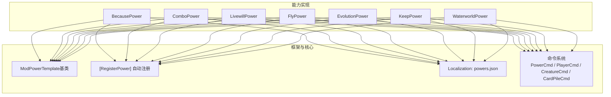
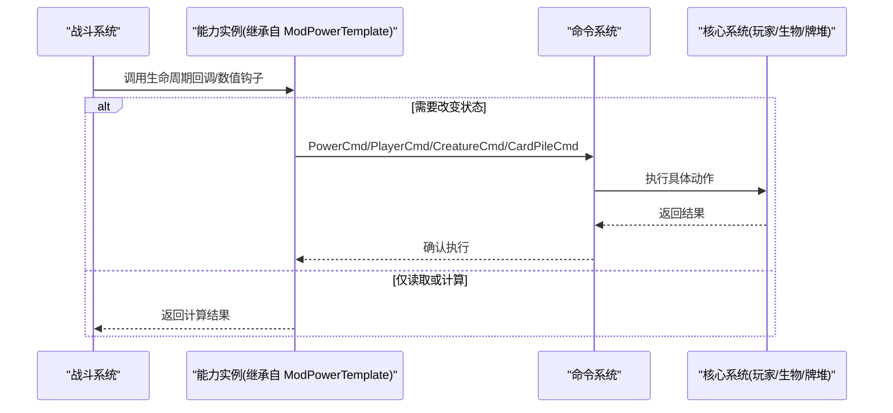
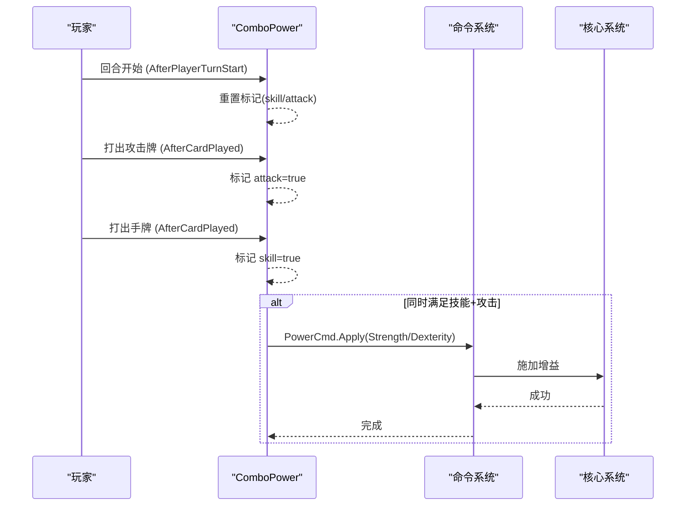
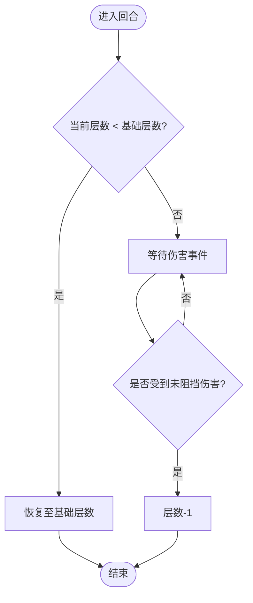
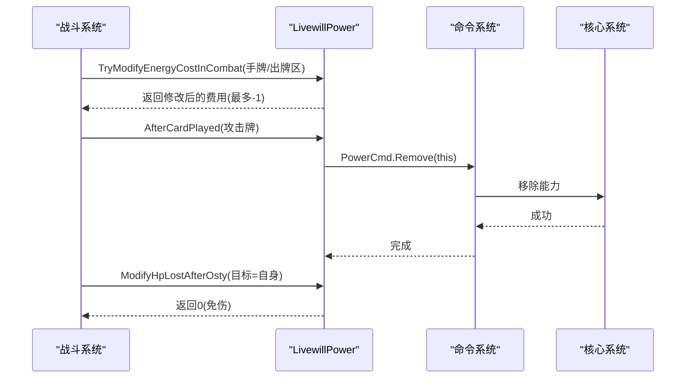
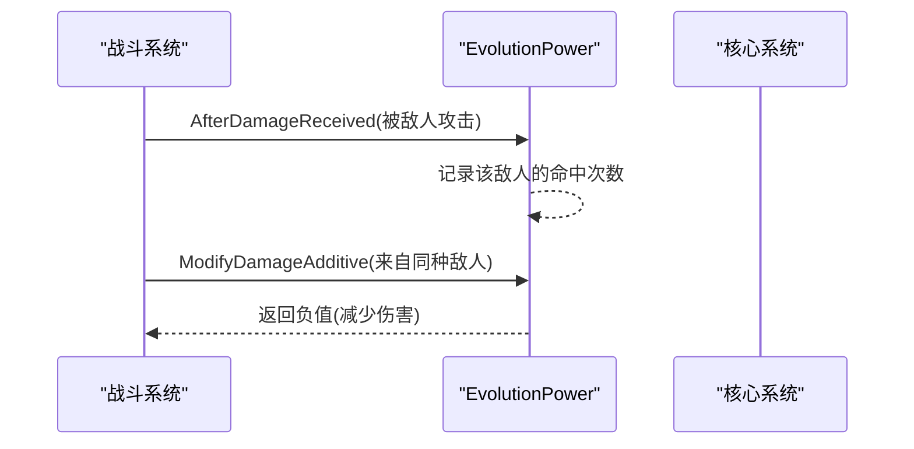
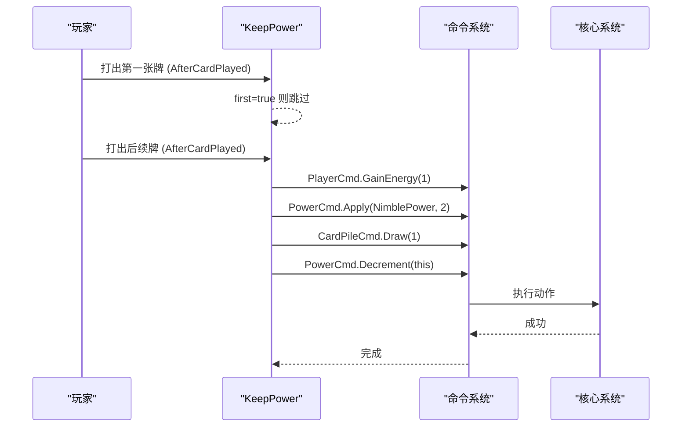
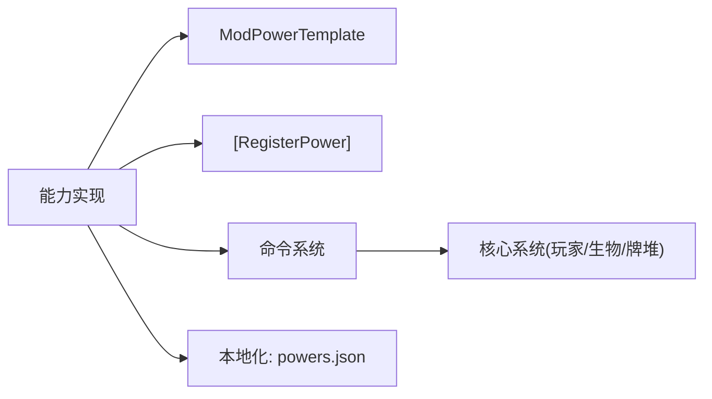

# 能力系统架构

<cite>
**本文引用的文件**
- [BecausePower.cs](file://Scripts/Powers/BecausePower.cs)
- [ComboPower.cs](file://Scripts/Powers/ComboPower.cs)
- [LivewillPower.cs](file://Scripts/Powers/LivewillPower.cs)
- [FlyPower.cs](file://Scripts/Powers/Liver/FlyPower.cs)
- [EvolutionPower.cs](file://Scripts/Powers/RedCat/EvolutionPower.cs)
- [KeepPower.cs](file://Scripts/Powers/Liver/KeepPower.cs)
- [WaterworldPower.cs](file://Scripts/Powers/River/WaterworldPower.cs)
- [powers.json（英文）](file://SlugcatTheSpireII/localization/eng/powers.json)
- [powers.json（简中）](file://SlugcatTheSpireII/localization/zhs/powers.json)
</cite>

## 目录
1. [简介](#简介)
2. [项目结构](#项目结构)
3. [核心组件](#核心组件)
4. [架构总览](#架构总览)
5. [详细组件分析](#详细组件分析)
6. [依赖关系分析](#依赖关系分析)
7. [性能考量](#性能考量)
8. [故障排查指南](#故障排查指南)
9. [结论](#结论)
10. [附录](#附录)

## 简介
本技术文档围绕“能力系统”展开，聚焦于基于 ModPowerTemplate 的能力基类设计模式、能力生命周期管理、类型系统与注册机制；并说明能力的属性配置、图标资源管理、堆叠类型与效果触发时机。同时给出能力与游戏核心系统的集成方式（战斗侧、生物实体、命令系统等），以及能力开发的最佳实践与性能优化建议。

## 项目结构
- 能力实现位于 Scripts/Powers 及其子目录（按角色/阵营组织：Liver、RedCat、River、Monster 等）。
- 每个能力以 sealed class 形式继承自 ModPowerTemplate，并通过 [RegisterPower] 特性完成自动注册。
- 能力外观与本地化文案通过 PowerAssetProfile 与 localization 下的 powers.json 配置。
- 能力逻辑通过重写生命周期回调与数值修改钩子，结合 PowerCmd / PlayerCmd / CreatureCmd / CardPileCmd 等命令系统驱动战斗状态变更。

图表来源
- [BecausePower.cs:26-38](file://Scripts/Powers/BecausePower.cs#L26-L38)
- [ComboPower.cs:27-38](file://Scripts/Powers/ComboPower.cs#L27-L38)
- [LivewillPower.cs:27-38](file://Scripts/Powers/LivewillPower.cs#L27-L38)
- [FlyPower.cs:29-40](file://Scripts/Powers/Liver/FlyPower.cs#L29-L40)
- [EvolutionPower.cs:28-39](file://Scripts/Powers/RedCat/EvolutionPower.cs#L28-L39)
- [KeepPower.cs:23-40](file://Scripts/Powers/Liver/KeepPower.cs#L23-L40)
- [WaterworldPower.cs:17-28](file://Scripts/Powers/River/WaterworldPower.cs#L17-L28)
- [powers.json（英文）](file://SlugcatTheSpireII/localization/eng/powers.json)
- [powers.json（简中）](file://SlugcatTheSpireII/localization/zhs/powers.json)

章节来源
- [BecausePower.cs:26-38](file://Scripts/Powers/BecausePower.cs#L26-L38)
- [ComboPower.cs:27-38](file://Scripts/Powers/ComboPower.cs#L27-L38)
- [LivewillPower.cs:27-38](file://Scripts/Powers/LivewillPower.cs#L27-L38)
- [FlyPower.cs:29-40](file://Scripts/Powers/Liver/FlyPower.cs#L29-L40)
- [EvolutionPower.cs:28-39](file://Scripts/Powers/RedCat/EvolutionPower.cs#L28-L39)
- [KeepPower.cs:23-40](file://Scripts/Powers/Liver/KeepPower.cs#L23-L40)
- [WaterworldPower.cs:17-28](file://Scripts/Powers/River/WaterworldPower.cs#L17-L28)

## 核心组件
- 能力基类与模板：所有能力均继承自 ModPowerTemplate，统一提供生命周期回调、数值修改钩子、资源与类型声明入口。
- 自动注册：使用 [RegisterPower] 特性将能力纳入框架的运行时发现与装配流程。
- 类型与堆叠：
  - PowerType：用于标识能力类别（如 Buff）。
  - PowerStackType：控制能力叠加行为（Counter 计数型、Single 单次型等）。
- 资源与本地化：
  - AssetProfile 指定图标路径（IconPath/BigIconPath）。
  - 名称与描述由 localization 下 powers.json 提供多语言支持。
- 命令系统：
  - PowerCmd：对能力实例进行应用、移除、增减层数等操作。
  - PlayerCmd/CreatureCmd/CardPileCmd：对玩家、生物、牌堆等核心对象执行动作。

章节来源
- [BecausePower.cs:26-38](file://Scripts/Powers/BecausePower.cs#L26-L38)
- [ComboPower.cs:27-38](file://Scripts/Powers/ComboPower.cs#L27-L38)
- [LivewillPower.cs:27-38](file://Scripts/Powers/LivewillPower.cs#L27-L38)
- [FlyPower.cs:29-40](file://Scripts/Powers/Liver/FlyPower.cs#L29-L40)
- [EvolutionPower.cs:28-39](file://Scripts/Powers/RedCat/EvolutionPower.cs#L28-L39)
- [KeepPower.cs:23-40](file://Scripts/Powers/Liver/KeepPower.cs#L23-L40)
- [WaterworldPower.cs:17-28](file://Scripts/Powers/River/WaterworldPower.cs#L17-L28)
- [powers.json（英文）](file://SlugcatTheSpireII/localization/eng/powers.json)
- [powers.json（简中）](file://SlugcatTheSpireII/localization/zhs/powers.json)

## 架构总览
能力系统采用“模板 + 钩子 + 命令”的分层架构：
- 模板层：ModPowerTemplate 提供统一的生命周期与数值修改接口。
- 扩展层：各具体能力通过重写回调与钩子实现业务逻辑。
- 命令层：通过命令系统对战斗状态进行原子化操作，保证一致性与可追踪性。
- 资源与本地化：通过 AssetProfile 与 powers.json 解耦表现与内容。

图表来源
- [BecausePower.cs:40-58](file://Scripts/Powers/BecausePower.cs#L40-L58)
- [ComboPower.cs:43-66](file://Scripts/Powers/ComboPower.cs#L43-L66)
- [LivewillPower.cs:42-100](file://Scripts/Powers/LivewillPower.cs#L42-L100)
- [FlyPower.cs:42-72](file://Scripts/Powers/Liver/FlyPower.cs#L42-L72)
- [EvolutionPower.cs:42-62](file://Scripts/Powers/RedCat/EvolutionPower.cs#L42-L62)
- [KeepPower.cs:41-57](file://Scripts/Powers/Liver/KeepPower.cs#L41-L57)

## 详细组件分析

### 能力基类与生命周期
- 生命周期回调（示例）：
  - BeforeSideTurnEnd：在回合结束前触发，常用于清理或结算。
  - AfterPlayerTurnStart：在玩家回合开始时重置状态或发放资源。
  - AfterCardPlayed：在卡牌打出后触发，适合组合判定与连锁。
  - AfterDamageReceived：在受到伤害时触发，适合防御/反制逻辑。
  - ModifyHpLostAfterOsty / ModifyHpLostAfterOstyLate：在伤害结算阶段调整实际损失。
  - TryModifyEnergyCostInCombat：在战斗中尝试修改卡牌能量消耗。
  - AfterModifyingDamageAmount：在伤害修改完成后触发视觉反馈等。
- 这些回调使能力能够精准嵌入战斗流程的关键节点，配合命令系统完成状态变更。

章节来源
- [BecausePower.cs:40-58](file://Scripts/Powers/BecausePower.cs#L40-L58)
- [ComboPower.cs:43-66](file://Scripts/Powers/ComboPower.cs#L43-L66)
- [LivewillPower.cs:42-100](file://Scripts/Powers/LivewillPower.cs#L42-L100)
- [FlyPower.cs:42-72](file://Scripts/Powers/Liver/FlyPower.cs#L42-L72)
- [EvolutionPower.cs:42-62](file://Scripts/Powers/RedCat/EvolutionPower.cs#L42-L62)
- [KeepPower.cs:41-57](file://Scripts/Powers/Liver/KeepPower.cs#L41-L57)

### 类型系统与注册机制
- 类型：
  - PowerType：标识能力类别（例如 Buff）。
  - PowerStackType：定义叠加策略（Counter 计数型、Single 单次型）。
- 注册：
  - 使用 [RegisterPower] 特性声明能力，由框架自动发现并注册到运行时。
- 资源：
  - AssetProfile.IconPath/BigIconPath 指向资源路径，便于 UI 渲染。
- 本地化：
  - powers.json 提供标题与描述的多语言文本，确保显示一致性。

章节来源
- [BecausePower.cs:26-38](file://Scripts/Powers/BecausePower.cs#L26-L38)
- [ComboPower.cs:27-38](file://Scripts/Powers/ComboPower.cs#L27-L38)
- [LivewillPower.cs:27-38](file://Scripts/Powers/LivewillPower.cs#L27-L38)
- [FlyPower.cs:29-40](file://Scripts/Powers/Liver/FlyPower.cs#L29-L40)
- [EvolutionPower.cs:28-39](file://Scripts/Powers/RedCat/EvolutionPower.cs#L28-L39)
- [KeepPower.cs:23-40](file://Scripts/Powers/Liver/KeepPower.cs#L23-L40)
- [WaterworldPower.cs:17-28](file://Scripts/Powers/River/WaterworldPower.cs#L17-L28)
- [powers.json（英文）](file://SlugcatTheSpireII/localization/eng/powers.json)
- [powers.json（简中）](file://SlugcatTheSpireII/localization/zhs/powers.json)

### 能力与核心系统集成
- 战斗侧：
  - 通过 BeforeSideTurnEnd、AfterPlayerTurnStart 等回调参与回合流程。
  - 通过 Modify* 系列钩子参与伤害/护甲/能量等数值计算。
- 生物实体：
  - 使用 CreatureCmd.Kill 等命令直接作用于生物实体。
- 命令系统：
  - PowerCmd：应用/移除/增减能力层数。
  - PlayerCmd：为玩家增加能量、抽牌等。
  - CardPileCmd：对牌堆进行操作（如抽牌）。
  - 这些命令封装了底层操作，保证状态变更的一致性与可追踪性。

章节来源
- [BecausePower.cs:40-58](file://Scripts/Powers/BecausePower.cs#L40-L58)
- [ComboPower.cs:43-66](file://Scripts/Powers/ComboPower.cs#L43-L66)
- [LivewillPower.cs:42-100](file://Scripts/Powers/LivewillPower.cs#L42-L100)
- [FlyPower.cs:42-72](file://Scripts/Powers/Liver/FlyPower.cs#L42-L72)
- [EvolutionPower.cs:42-62](file://Scripts/Powers/RedCat/EvolutionPower.cs#L42-L62)
- [KeepPower.cs:41-57](file://Scripts/Powers/Liver/KeepPower.cs#L41-L57)

### 能力属性配置与图标资源管理
- 属性配置：
  - Type：能力类型（如 Buff）。
  - StackType：堆叠类型（Counter/Single）。
  - CanonicalVars：动态变量（如 EnergyVar）用于本地化展示。
- 图标资源：
  - IconPath/BigIconPath 指向资源路径，支持按角色分目录组织。
- 本地化：
  - powers.json 中的键值对应能力 ID，提供 title/description/smartDescription 等多语言文案。

章节来源
- [FlyPower.cs:29-40](file://Scripts/Powers/Liver/FlyPower.cs#L29-L40)
- [WaterworldPower.cs:17-28](file://Scripts/Powers/River/WaterworldPower.cs#L17-L28)
- [KeepPower.cs:31-40](file://Scripts/Powers/Liver/KeepPower.cs#L31-L40)
- [powers.json（英文）](file://SlugcatTheSpireII/localization/eng/powers.json)
- [powers.json（简中）](file://SlugcatTheSpireII/localization/zhs/powers.json)

### 堆叠类型与效果触发时机
- 堆叠类型：
  - Counter：计数型叠加，适用于随层数变化的增益/减益。
  - Single：单次生效，适用于一次性效果。
- 触发时机：
  - 回合开始/结束：BeforeSideTurnEnd、AfterPlayerTurnStart。
  - 卡牌交互：AfterCardPlayed、TryModifyEnergyCostInCombat。
  - 伤害交互：AfterDamageReceived、ModifyHpLostAfterOsty(-Late)、AfterModifyingDamageAmount。

章节来源
- [BecausePower.cs:26-38](file://Scripts/Powers/BecausePower.cs#L26-L38)
- [ComboPower.cs:27-38](file://Scripts/Powers/ComboPower.cs#L27-L38)
- [LivewillPower.cs:27-38](file://Scripts/Powers/LivewillPower.cs#L27-L38)
- [FlyPower.cs:29-40](file://Scripts/Powers/Liver/FlyPower.cs#L29-L40)
- [EvolutionPower.cs:28-39](file://Scripts/Powers/RedCat/EvolutionPower.cs#L28-L39)
- [KeepPower.cs:23-40](file://Scripts/Powers/Liver/KeepPower.cs#L23-L40)
- [WaterworldPower.cs:17-28](file://Scripts/Powers/River/WaterworldPower.cs#L17-L28)

### 典型能力流程时序图

#### ComboPower：连击加成

图表来源
- [ComboPower.cs:43-66](file://Scripts/Powers/ComboPower.cs#L43-L66)

章节来源
- [ComboPower.cs:43-66](file://Scripts/Powers/ComboPower.cs#L43-L66)

#### FlyPower：受伤衰减与恢复

图表来源
- [FlyPower.cs:42-72](file://Scripts/Powers/Liver/FlyPower.cs#L42-L72)

章节来源
- [FlyPower.cs:42-72](file://Scripts/Powers/Liver/FlyPower.cs#L42-L72)

#### LivewillPower：费用减免与伤害修正

图表来源
- [LivewillPower.cs:42-100](file://Scripts/Powers/LivewillPower.cs#L42-L100)

章节来源
- [LivewillPower.cs:42-100](file://Scripts/Powers/LivewillPower.cs#L42-L100)

#### EvolutionPower：同种敌人伤害减免

图表来源
- [EvolutionPower.cs:42-62](file://Scripts/Powers/RedCat/EvolutionPower.cs#L42-L62)

章节来源
- [EvolutionPower.cs:42-62](file://Scripts/Powers/RedCat/EvolutionPower.cs#L42-L62)

#### KeepPower：首张牌后奖励

图表来源
- [KeepPower.cs:41-57](file://Scripts/Powers/Liver/KeepPower.cs#L41-L57)

章节来源
- [KeepPower.cs:41-57](file://Scripts/Powers/Liver/KeepPower.cs#L41-L57)

## 依赖关系分析
- 内部依赖：
  - 所有能力依赖 ModPowerTemplate 提供的生命周期与数值修改接口。
  - 通过 [RegisterPower] 与框架的自动注册机制耦合。
- 外部依赖：
  - 命令系统（PowerCmd/PlayerCmd/CreatureCmd/CardPileCmd）用于状态变更。
  - 本地化资源（powers.json）提供多语言文案。
- 耦合与内聚：
  - 高内聚：每个能力专注于单一机制，通过少量回调与命令完成逻辑。
  - 低耦合：通过命令系统与核心系统交互，避免直接侵入核心逻辑。

图表来源
- [BecausePower.cs:26-38](file://Scripts/Powers/BecausePower.cs#L26-L38)
- [ComboPower.cs:27-38](file://Scripts/Powers/ComboPower.cs#L27-L38)
- [LivewillPower.cs:27-38](file://Scripts/Powers/LivewillPower.cs#L27-L38)
- [FlyPower.cs:29-40](file://Scripts/Powers/Liver/FlyPower.cs#L29-L40)
- [EvolutionPower.cs:28-39](file://Scripts/Powers/RedCat/EvolutionPower.cs#L28-L39)
- [KeepPower.cs:23-40](file://Scripts/Powers/Liver/KeepPower.cs#L23-L40)
- [WaterworldPower.cs:17-28](file://Scripts/Powers/River/WaterworldPower.cs#L17-L28)
- [powers.json（英文）](file://SlugcatTheSpireII/localization/eng/powers.json)
- [powers.json（简中）](file://SlugcatTheSpireII/localization/zhs/powers.json)

章节来源
- [BecausePower.cs:26-38](file://Scripts/Powers/BecausePower.cs#L26-L38)
- [ComboPower.cs:27-38](file://Scripts/Powers/ComboPower.cs#L27-L38)
- [LivewillPower.cs:27-38](file://Scripts/Powers/LivewillPower.cs#L27-L38)
- [FlyPower.cs:29-40](file://Scripts/Powers/Liver/FlyPower.cs#L29-L40)
- [EvolutionPower.cs:28-39](file://Scripts/Powers/RedCat/EvolutionPower.cs#L28-L39)
- [KeepPower.cs:23-40](file://Scripts/Powers/Liver/KeepPower.cs#L23-L40)
- [WaterworldPower.cs:17-28](file://Scripts/Powers/River/WaterworldPower.cs#L17-L28)

## 性能考量
- 最小化副作用：在回调中只做必要计算，复杂逻辑延迟到合适时机。
- 合理使用命令：批量状态变更尽量合并为一次命令调用，减少多次 IO。
- 避免频繁分配：复用临时对象，减少 GC 压力（如在高频回调中）。
- 条件判断前置：尽早过滤无效分支，降低无用计算。
- 资源路径与本地化：集中管理资源路径，避免重复解析。

## 故障排查指南
- 能力未生效：
  - 检查是否正确添加 [RegisterPower] 并编译通过。
  - 确认回调是否被正确重写且参数匹配。
- 图标不显示：
  - 核对 AssetProfile 的 IconPath/BigIconPath 是否存在。
  - 检查资源路径是否与打包配置一致。
- 本地化文案缺失：
  - 核对 powers.json 中的键名与能力 ID 是否一致。
  - 确认多语言文件已包含相应条目。
- 命令执行失败：
  - 检查命令调用上下文（如目标是否为空、权限是否允许）。
  - 查看日志输出定位异常位置。

章节来源
- [BecausePower.cs:26-38](file://Scripts/Powers/BecausePower.cs#L26-L38)
- [FlyPower.cs:29-40](file://Scripts/Powers/Liver/FlyPower.cs#L29-L40)
- [KeepPower.cs:23-40](file://Scripts/Powers/Liver/KeepPower.cs#L23-L40)
- [WaterworldPower.cs:17-28](file://Scripts/Powers/River/WaterworldPower.cs#L17-L28)
- [powers.json（英文）](file://SlugcatTheSpireII/localization/eng/powers.json)
- [powers.json（简中）](file://SlugcatTheSpireII/localization/zhs/powers.json)

## 结论
本能力系统以 ModPowerTemplate 为核心，结合自动注册、生命周期回调与命令系统，实现了高内聚、低耦合的可扩展架构。通过统一的类型与堆叠模型、完善的资源与本地化支持，开发者可以高效地实现各类能力，并与战斗侧、生物实体、命令系统等核心模块无缝集成。遵循最佳实践与性能优化建议，可进一步提升稳定性与运行效率。

## 附录
- 开发建议：
  - 优先使用命令系统进行状态变更，避免直接修改核心对象。
  - 在回调中进行轻量计算，复杂逻辑拆分到独立方法。
  - 合理选择堆叠类型，避免不必要的层数管理开销。
  - 使用本地化文案提升用户体验，保持键名一致性。
- 参考文件：
  - 能力实现：Scripts/Powers 及其子目录
  - 本地化：SlugcatTheSpireII/localization/*/powers.json