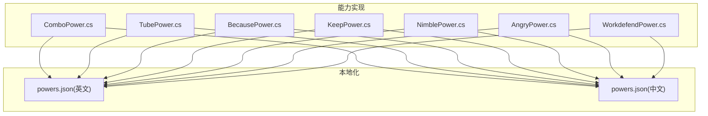
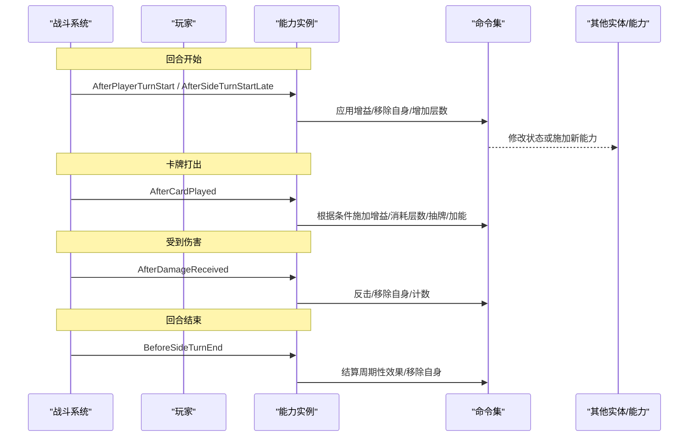
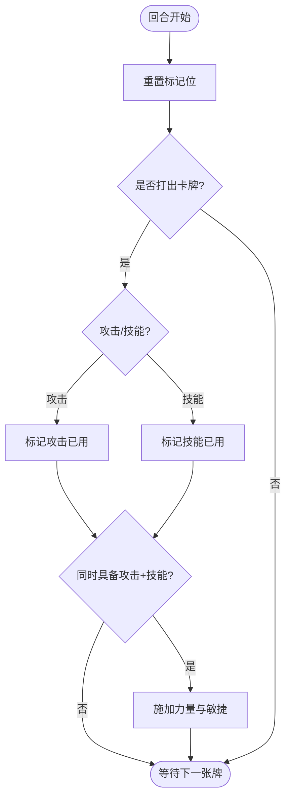
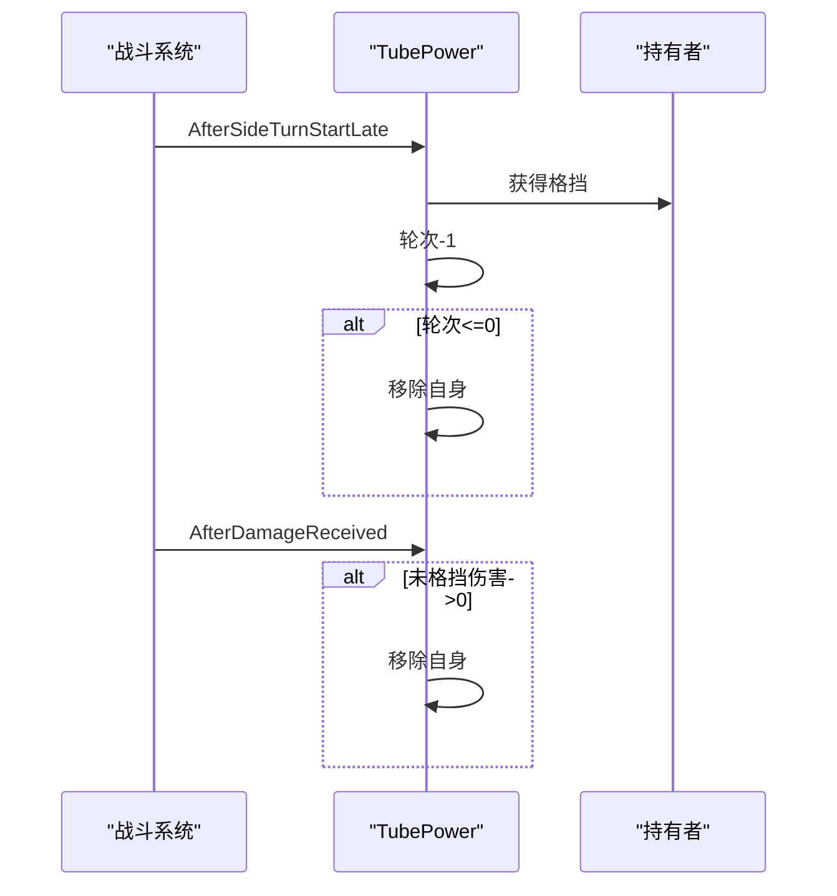
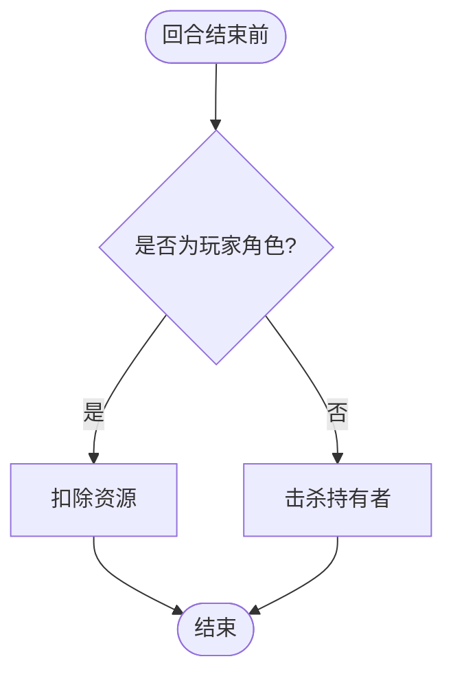
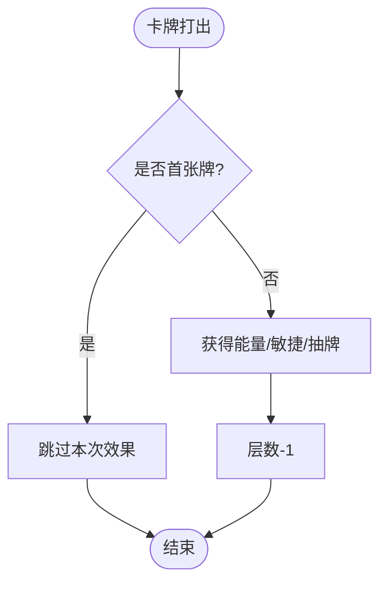
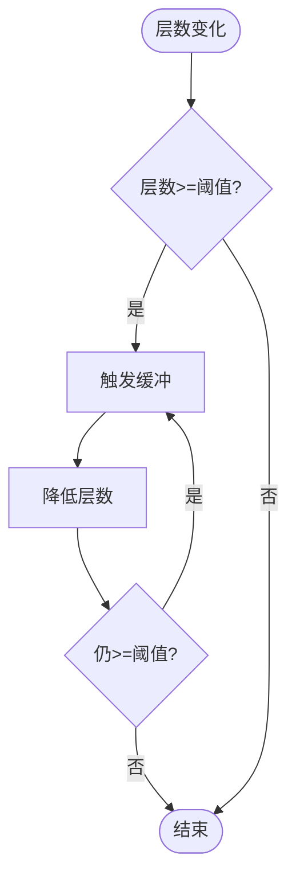
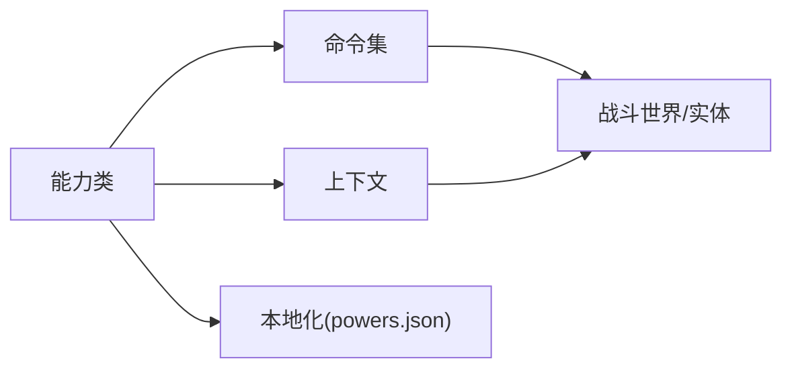

# 自定义能力开发

<cite>
**本文引用的文件**
- [ComboPower.cs](file://Scripts/Powers/ComboPower.cs)
- [TubePower.cs](file://Scripts/Powers/TubePower.cs)
- [BecausePower.cs](file://Scripts/Powers/BecausePower.cs)
- [KeepPower.cs](file://Scripts/Powers/Liver/KeepPower.cs)
- [NimblePower.cs](file://Scripts/Powers/Liver/NimblePower.cs)
- [AngryPower.cs](file://Scripts/Powers/RedCat/AngryPower.cs)
- [WorkdefendPower.cs](file://Scripts/Powers/Liver/WorkdefendPower.cs)
- [powers.json（英文）](file://SlugcatTheSpireII/localization/eng/powers.json)
- [powers.json（中文）](file://SlugcatTheSpireII/localization/zhs/powers.json)
</cite>

## 目录
1. [简介](#简介)
2. [项目结构](#项目结构)
3. [核心组件](#核心组件)
4. [架构总览](#架构总览)
5. [详细组件分析](#详细组件分析)
6. [依赖关系分析](#依赖关系分析)
7. [性能注意事项](#性能注意事项)
8. [故障排查指南](#故障排查指南)
9. [结论](#结论)
10. [附录](#附录)

## 简介
本指南面向希望在项目中实现“自定义能力”的开发者，围绕如何继承 ModPowerTemplate、实现能力接口、配置能力属性与效果逻辑展开。文档结合仓库中的现有能力实现，系统讲解能力生命周期钩子的使用方法（回合开始/结束、受到伤害、卡牌打出等），并提供测试方法、调试技巧与性能优化建议，以及常见能力模式的实现示例与最佳实践。

## 项目结构
本项目采用按功能域组织代码的方式：
- 能力脚本位于 Scripts/Powers 及其子目录（如 Liver、RedCat、River、Monster 等），每个能力一个类，统一继承自 ModPowerTemplate。
- 本地化文案位于 SlugcatTheSpireII/localization/{lang}/powers.json，用于能力的标题与描述。
- 其他模块（卡牌、怪物、事件、遗物等）通过命令与上下文与能力交互。

图表来源
- [ComboPower.cs:27-68](file://Scripts/Powers/ComboPower.cs#L27-L68)
- [TubePower.cs:25-66](file://Scripts/Powers/TubePower.cs#L25-L66)
- [BecausePower.cs:26-61](file://Scripts/Powers/BecausePower.cs#L26-L61)
- [KeepPower.cs:23-59](file://Scripts/Powers/Liver/KeepPower.cs#L23-L59)
- [NimblePower.cs:26-53](file://Scripts/Powers/Liver/NimblePower.cs#L26-L53)
- [AngryPower.cs:27-48](file://Scripts/Powers/RedCat/AngryPower.cs#L27-L48)
- [WorkdefendPower.cs:28-56](file://Scripts/Powers/Liver/WorkdefendPower.cs#L28-L56)
- [powers.json（英文）:49-129](file://SlugcatTheSpireII/localization/eng/powers.json#L49-L129)
- [powers.json（中文）:210-273](file://SlugcatTheSpireII/localization/zhs/powers.json#L210-L273)

章节来源
- [ComboPower.cs:27-68](file://Scripts/Powers/ComboPower.cs#L27-L68)
- [TubePower.cs:25-66](file://Scripts/Powers/TubePower.cs#L25-L66)
- [BecausePower.cs:26-61](file://Scripts/Powers/BecausePower.cs#L26-L61)
- [KeepPower.cs:23-59](file://Scripts/Powers/Liver/KeepPower.cs#L23-L59)
- [NimblePower.cs:26-53](file://Scripts/Powers/Liver/NimblePower.cs#L26-L53)
- [AngryPower.cs:27-48](file://Scripts/Powers/RedCat/AngryPower.cs#L27-L48)
- [WorkdefendPower.cs:28-56](file://Scripts/Powers/Liver/WorkdefendPower.cs#L28-L56)
- [powers.json（英文）:49-129](file://SlugcatTheSpireII/localization/eng/powers.json#L49-L129)
- [powers.json（中文）:210-273](file://SlugcatTheSpireII/localization/zhs/powers.json#L210-L273)

## 核心组件
- 基类与注册
  - 所有能力均继承自 ModPowerTemplate，并通过 [RegisterPower] 特性进行自动注册。
  - 需要定义资源信息（图标）、能力类型（Buff/Debuff 等）、堆叠类型（Counter/Duration 等）。
- 动态变量与展示
  - 通过 CanonicalVars 暴露动态变量（例如能量、层数等），便于 UI 与本地化显示。
- 命令与上下文
  - 使用 PowerCmd、CreatureCmd、PlayerCmd、CardPileCmd 等命令执行增删改查。
  - 使用 PlayerChoiceContext、BlockingPlayerChoiceContext、ThrowingPlayerChoiceContext 等上下文传递调用方信息。
- 本地化
  - 在 powers.json 中为能力提供标题与描述，支持智能描述占位符（如 {Amount}）。

章节来源
- [ComboPower.cs:27-38](file://Scripts/Powers/ComboPower.cs#L27-L38)
- [TubePower.cs:25-38](file://Scripts/Powers/TubePower.cs#L25-L38)
- [BecausePower.cs:26-38](file://Scripts/Powers/BecausePower.cs#L26-L38)
- [KeepPower.cs:23-40](file://Scripts/Powers/Liver/KeepPower.cs#L23-L40)
- [NimblePower.cs:26-37](file://Scripts/Powers/Liver/NimblePower.cs#L26-L37)
- [AngryPower.cs:27-42](file://Scripts/Powers/RedCat/AngryPower.cs#L27-L42)
- [WorkdefendPower.cs:28-39](file://Scripts/Powers/Liver/WorkdefendPower.cs#L28-L39)
- [powers.json（英文）:49-129](file://SlugcatTheSpireII/localization/eng/powers.json#L49-L129)
- [powers.json（中文）:210-273](file://SlugcatTheSpireII/localization/zhs/powers.json#L210-L273)

## 架构总览
下图展示了能力在战斗流程中的关键触发点与典型交互路径：

图表来源
- [ComboPower.cs:43-66](file://Scripts/Powers/ComboPower.cs#L43-L66)
- [TubePower.cs:41-64](file://Scripts/Powers/TubePower.cs#L41-L64)
- [BecausePower.cs:40-58](file://Scripts/Powers/BecausePower.cs#L40-L58)
- [WorkdefendPower.cs:43-55](file://Scripts/Powers/Liver/WorkdefendPower.cs#L43-L55)

## 详细组件分析

### 组合连击能力（ComboPower）
- 目标：在同一回合内打出一张攻击与一张技能后，给予力量与敏捷。
- 关键点：
  - 回合开始时重置标记位，确保每回合独立计算。
  - 在卡牌打出时记录已使用的攻击/技能类型，满足条件即触发效果。
  - 使用 PowerCmd.Apply 施加目标能力。

图表来源
- [ComboPower.cs:43-66](file://Scripts/Powers/ComboPower.cs#L43-L66)

章节来源
- [ComboPower.cs:27-68](file://Scripts/Powers/ComboPower.cs#L27-L68)

### 管状狂热（TubePower）
- 目标：下一回合开始时获得格挡，若受到未格挡伤害则立即失效。
- 关键点：
  - 在侧回合开始后延迟阶段（Late）给目标加格挡并递减轮次。
  - 在受到伤害时检测未格挡伤害并移除自身。

图表来源
- [TubePower.cs:41-64](file://Scripts/Powers/TubePower.cs#L41-L64)

章节来源
- [TubePower.cs:25-66](file://Scripts/Powers/TubePower.cs#L25-L66)

### 因果律（BecausePower）
- 目标：回合结束时对玩家角色扣减某种资源，或对非玩家角色直接击杀。
- 关键点：
  - 在回合结束前（BeforeSideTurnEnd）判断持有者身份并执行不同逻辑。
  - 使用 Flash 提示视觉反馈。

图表来源
- [BecausePower.cs:40-58](file://Scripts/Powers/BecausePower.cs#L40-L58)

章节来源
- [BecausePower.cs:26-61](file://Scripts/Powers/BecausePower.cs#L26-L61)

### 保留与连锁（KeepPower）
- 目标：首次出牌跳过，后续出牌给予能量、敏捷并抽牌，同时递减层数。
- 关键点：
  - 使用 first 标志控制首张牌行为。
  - 在卡牌打出时执行奖励与层数递减。

图表来源
- [KeepPower.cs:41-58](file://Scripts/Powers/Liver/KeepPower.cs#L41-L58)

章节来源
- [KeepPower.cs:23-59](file://Scripts/Powers/Liver/KeepPower.cs#L23-L59)

### 伶俐阈值触发（NimblePower）
- 目标：当伶俐达到阈值时触发缓冲（Buffer）并降低伶俐层数。
- 关键点：
  - 监听能力层数变化（AfterPowerAmountChanged）。
  - 根据持有者是否拥有特定能力调整阈值，循环触发直到低于阈值。

图表来源
- [NimblePower.cs:40-51](file://Scripts/Powers/Liver/NimblePower.cs#L40-L51)

章节来源
- [NimblePower.cs:26-53](file://Scripts/Powers/Liver/NimblePower.cs#L26-L53)

### 愤怒转化（AngryPower）
- 目标：消耗能量时转化为活力。
- 关键点：
  - 监听能量消耗事件（AfterEnergySpent）。
  - 根据消耗量与持有层数计算转化值。

章节来源
- [AngryPower.cs:27-48](file://Scripts/Powers/RedCat/AngryPower.cs#L27-L48)

### 受击反击（WorkdefendPower）
- 目标：受到未格挡伤害时对全体敌人造成伤害并移除自身；回合开始也移除。
- 关键点：
  - 在受到伤害时判断条件并执行反击。
  - 在回合开始时清理自身，避免跨回合残留。

章节来源
- [WorkdefendPower.cs:28-56](file://Scripts/Powers/Liver/WorkdefendPower.cs#L28-L56)

## 依赖关系分析
- 能力与命令
  - 能力通过命令集（PowerCmd、CreatureCmd、PlayerCmd、CardPileCmd）与战斗世界交互。
- 能力与上下文
  - 使用 PlayerChoiceContext/BlockingPlayerChoiceContext/ThrowingPlayerChoiceContext 区分调用来源与阻断策略。
- 能力与本地化
  - 通过 powers.json 提供多语言文本，支持智能描述占位符。

图表来源
- [ComboPower.cs:43-66](file://Scripts/Powers/ComboPower.cs#L43-L66)
- [TubePower.cs:41-64](file://Scripts/Powers/TubePower.cs#L41-L64)
- [BecausePower.cs:40-58](file://Scripts/Powers/BecausePower.cs#L40-L58)
- [KeepPower.cs:41-58](file://Scripts/Powers/Liver/KeepPower.cs#L41-L58)
- [NimblePower.cs:40-51](file://Scripts/Powers/Liver/NimblePower.cs#L40-L51)
- [AngryPower.cs:43-47](file://Scripts/Powers/RedCat/AngryPower.cs#L43-L47)
- [WorkdefendPower.cs:43-55](file://Scripts/Powers/Liver/WorkdefendPower.cs#L43-L55)
- [powers.json（英文）:49-129](file://SlugcatTheSpireII/localization/eng/powers.json#L49-L129)
- [powers.json（中文）:210-273](file://SlugcatTheSpireII/localization/zhs/powers.json#L210-L273)

章节来源
- [ComboPower.cs:27-68](file://Scripts/Powers/ComboPower.cs#L27-L68)
- [TubePower.cs:25-66](file://Scripts/Powers/TubePower.cs#L25-L66)
- [BecausePower.cs:26-61](file://Scripts/Powers/BecausePower.cs#L26-L61)
- [KeepPower.cs:23-59](file://Scripts/Powers/Liver/KeepPower.cs#L23-L59)
- [NimblePower.cs:26-53](file://Scripts/Powers/Liver/NimblePower.cs#L26-L53)
- [AngryPower.cs:27-48](file://Scripts/Powers/RedCat/AngryPower.cs#L27-L48)
- [WorkdefendPower.cs:28-56](file://Scripts/Powers/Liver/WorkdefendPower.cs#L28-L56)
- [powers.json（英文）:49-129](file://SlugcatTheSpireII/localization/eng/powers.json#L49-L129)
- [powers.json（中文）:210-273](file://SlugcatTheSpireII/localization/zhs/powers.json#L210-L273)

## 性能注意事项
- 减少不必要的对象分配：在高频回调（如受到伤害、卡牌打出）中避免创建临时大对象。
- 合理使用层数与计时：优先使用 Counter/Duration 等内置机制管理有效期，避免自行维护复杂计时器。
- 批量操作合并：将多次修改集中在一次回调中完成，减少命令调用次数。
- 谨慎使用全局查询：尽量基于 Owner、CombatState 等局部上下文获取所需数据，避免全图扫描。
- 日志与可视化：仅在必要时输出日志，使用 Flash 提供即时反馈，避免频繁 UI 刷新。

[本节为通用性能建议，不直接分析具体文件]

## 故障排查指南
- 常见问题定位
  - 能力未生效：检查是否正确注册 [RegisterPower]，并确保 Type/StackType 设置合理。
  - 时机错误：确认覆盖的生命周期钩子名称与实际需求匹配（回合开始/结束、受到伤害、卡牌打出等）。
  - 上下文问题：注意不同上下文的使用场景（如 BlockingPlayerChoiceContext 用于阻断式操作）。
  - 本地化缺失：核对 powers.json 中的键名与 ID，确保标题与描述正确绑定。
- 调试技巧
  - 使用 Flash 在关键分支处添加视觉提示，快速验证逻辑是否进入预期分支。
  - 在关键回调前后打印必要上下文信息（如持有者、层数、伤害结果）。
  - 逐步缩小范围：先验证钩子是否被调用，再验证条件判断，最后验证命令执行。
- 常见错误处理
  - 空引用：访问 Owner、CombatState、CardPlay 前做判空。
  - 重复移除：避免在多个回调中重复移除同一能力实例。
  - 层数溢出：对层数增减做边界保护，防止异常增长或负值。

章节来源
- [TubePower.cs:41-64](file://Scripts/Powers/TubePower.cs#L41-L64)
- [BecausePower.cs:40-58](file://Scripts/Powers/BecausePower.cs#L40-L58)
- [WorkdefendPower.cs:43-55](file://Scripts/Powers/Liver/WorkdefendPower.cs#L43-L55)
- [powers.json（英文）:49-129](file://SlugcatTheSpireII/localization/eng/powers.json#L49-L129)
- [powers.json（中文）:210-273](file://SlugcatTheSpireII/localization/zhs/powers.json#L210-L273)

## 结论
通过继承 ModPowerTemplate 并使用生命周期钩子，可以在精确的时机实现丰富的能力逻辑。结合命令系统与本地化，能够快速构建可维护、可扩展的能力体系。建议在实现过程中遵循最小变更原则、清晰的职责划分与完善的本地化配置，以获得更好的可测试性与可维护性。

[本节为总结性内容，不直接分析具体文件]

## 附录
- 常用生命周期钩子参考
  - 回合相关：AfterPlayerTurnStart、AfterSideTurnStartLate、BeforeSideTurnEnd
  - 卡牌相关：AfterCardPlayed
  - 伤害相关：AfterDamageReceived
  - 能量相关：AfterEnergySpent
  - 能力层数变化：AfterPowerAmountChanged
- 常见能力模式
  - 回合定时：在回合开始/结束时施加或移除效果（如 TubePower、BecausePower）。
  - 条件触发：在卡牌打出或受到伤害时根据条件执行（如 ComboPower、WorkdefendPower）。
  - 阈值触发：在层数达到阈值时触发连锁效果（如 NimblePower）。
  - 资源转化：在消耗能量或其他资源时转化为其他增益（如 AngryPower）。
- 本地化要点
  - 在 powers.json 中为能力提供 title 与 description，使用 {Amount} 等占位符实现智能描述。
  - 保持多语言一致性，确保键名与 ID 对应准确。

章节来源
- [ComboPower.cs:43-66](file://Scripts/Powers/ComboPower.cs#L43-L66)
- [TubePower.cs:41-64](file://Scripts/Powers/TubePower.cs#L41-L64)
- [BecausePower.cs:40-58](file://Scripts/Powers/BecausePower.cs#L40-L58)
- [KeepPower.cs:41-58](file://Scripts/Powers/Liver/KeepPower.cs#L41-L58)
- [NimblePower.cs:40-51](file://Scripts/Powers/Liver/NimblePower.cs#L40-L51)
- [AngryPower.cs:43-47](file://Scripts/Powers/RedCat/AngryPower.cs#L43-L47)
- [WorkdefendPower.cs:43-55](file://Scripts/Powers/Liver/WorkdefendPower.cs#L43-L55)
- [powers.json（英文）:49-129](file://SlugcatTheSpireII/localization/eng/powers.json#L49-L129)
- [powers.json（中文）:210-273](file://SlugcatTheSpireII/localization/zhs/powers.json#L210-L273)