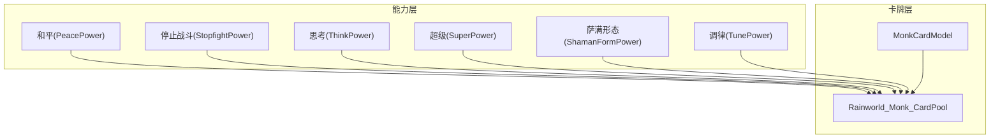
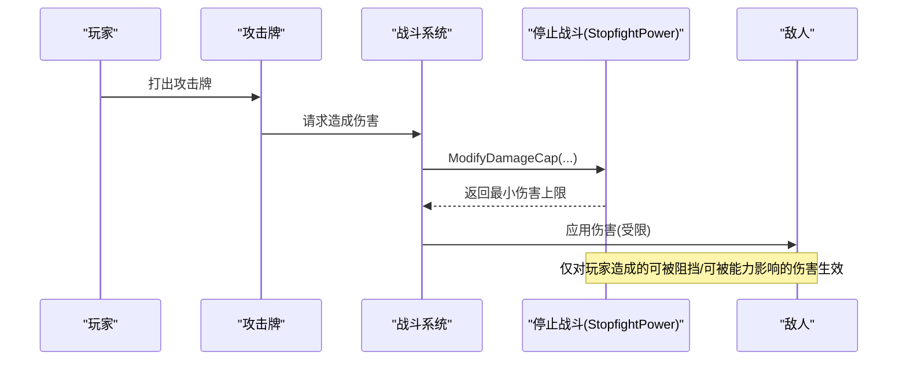
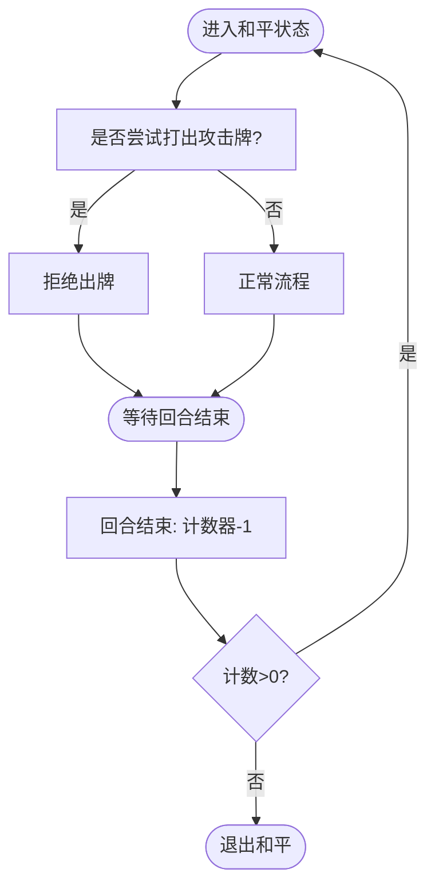
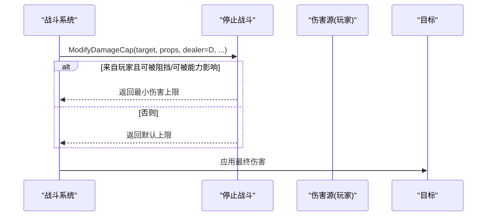
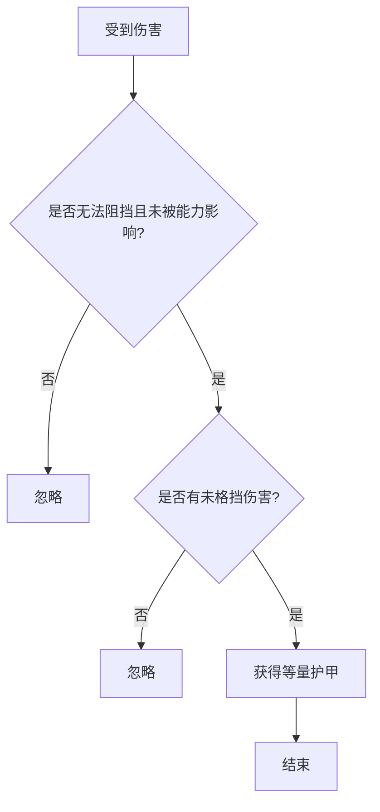
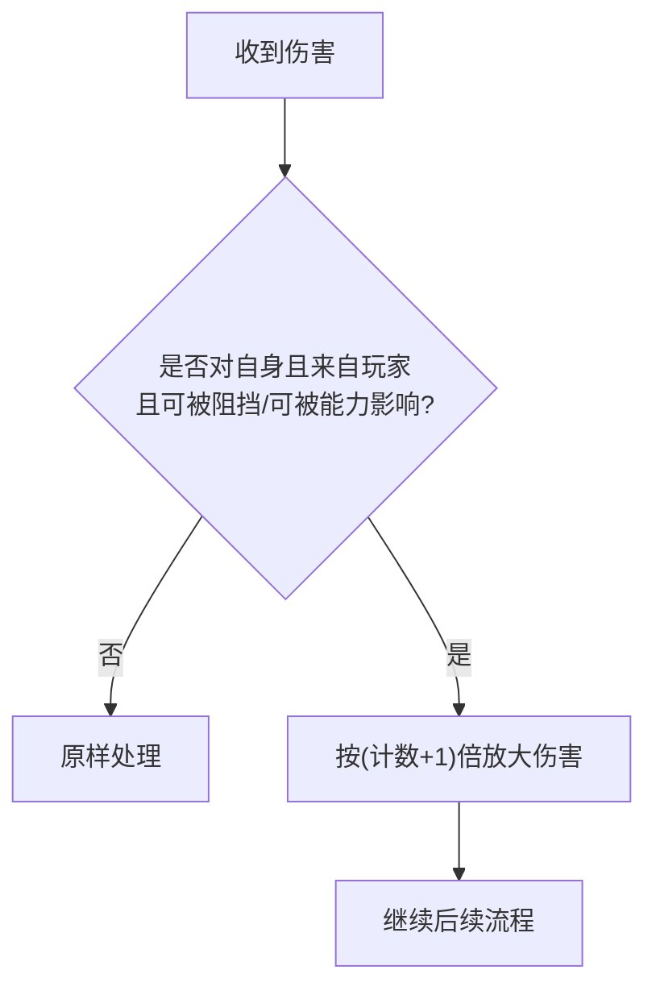
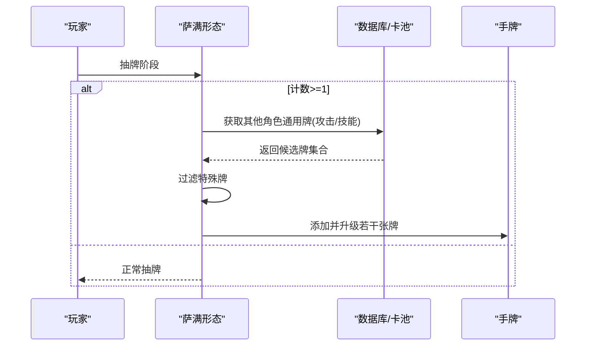
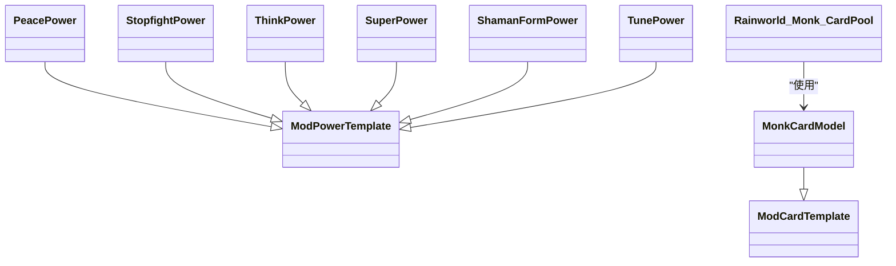

# 僧侣角色能力

<cite>
**本文引用的文件**
- [PeacePower.cs](file://Scripts/Powers/Monk/PeacePower.cs)
- [ShamanFormPower.cs](file://Scripts/Powers/Monk/ShamanFormPower.cs)
- [SuperPower.cs](file://Scripts/Powers/Monk/SuperPower.cs)
- [StopfightPower.cs](file://Scripts/Powers/Monk/StopfightPower.cs)
- [ThinkPower.cs](file://Scripts/Powers/Monk/ThinkPower.cs)
- [TunePower.cs](file://Scripts/Powers/Monk/TunePower.cs)
- [MonkCardModel.cs](file://Scripts/Card/Monk/MonkCardModel.cs)
- [Rainworld_Monk_CardPool.cs](file://Scripts/Card/Monk/Rainworld_Monk_CardPool.cs)
</cite>

## 目录
1. [简介](#简介)
2. [项目结构](#项目结构)
3. [核心组件](#核心组件)
4. [架构总览](#架构总览)
5. [详细组件分析](#详细组件分析)
6. [依赖关系分析](#依赖关系分析)
7. [性能与平衡性考量](#性能与平衡性考量)
8. [故障排查指南](#故障排查指南)
9. [结论](#结论)
10. [附录](#附录)

## 简介
本文件为“僧侣”角色的专属能力提供系统化、可操作的文档。围绕和平机制、萨满形态、冥想系统（以“思考”为核心）、超级状态与停止战斗等核心能力，阐述其设计目标、资源循环、战斗控制策略与非暴力玩法实现。同时说明禅意主题如何贯穿机制设计，以及与其他角色的差异化定位。

## 项目结构
- 能力（Powers）位于 Scripts/Powers/Monk 下，承载状态、回合事件、伤害/护甲修改等核心逻辑。
- 卡牌模型与卡池位于 Scripts/Card/Monk，定义僧侣的视觉风格与能量颜色。
- 各能力通过注册器注入到战斗系统，在关键生命周期钩子中执行（如回合结束、抽牌前、受击后、伤害计算时）。

图表来源
- [PeacePower.cs:14-39](file://Scripts/Powers/Monk/PeacePower.cs#L14-L39)
- [StopfightPower.cs:18-50](file://Scripts/Powers/Monk/StopfightPower.cs#L18-L50)
- [ThinkPower.cs:13-32](file://Scripts/Powers/Monk/ThinkPower.cs#L13-L32)
- [SuperPower.cs:12-35](file://Scripts/Powers/Monk/SuperPower.cs#L12-L35)
- [ShamanFormPower.cs:25-140](file://Scripts/Powers/Monk/ShamanFormPower.cs#L25-L140)
- [TunePower.cs:26-41](file://Scripts/Powers/Monk/TunePower.cs#L26-L41)
- [MonkCardModel.cs:15-39](file://Scripts/Card/Monk/MonkCardModel.cs#L15-L39)
- [Rainworld_Monk_CardPool.cs:9-23](file://Scripts/Card/Monk/Rainworld_Monk_CardPool.cs#L9-L23)

章节来源
- [PeacePower.cs:14-39](file://Scripts/Powers/Monk/PeacePower.cs#L14-L39)
- [StopfightPower.cs:18-50](file://Scripts/Powers/Monk/StopfightPower.cs#L18-L50)
- [ThinkPower.cs:13-32](file://Scripts/Powers/Monk/ThinkPower.cs#L13-L32)
- [SuperPower.cs:12-35](file://Scripts/Powers/Monk/SuperPower.cs#L12-L35)
- [ShamanFormPower.cs:25-140](file://Scripts/Powers/Monk/ShamanFormPower.cs#L25-L140)
- [TunePower.cs:26-41](file://Scripts/Powers/Monk/TunePower.cs#L26-L41)
- [MonkCardModel.cs:15-39](file://Scripts/Card/Monk/MonkCardModel.cs#L15-L39)
- [Rainworld_Monk_CardPool.cs:9-23](file://Scripts/Card/Monk/Rainworld_Monk_CardPool.cs#L9-L23)

## 核心组件
- 和平（PeacePower）：限制玩家攻击牌的使用，并在玩家回合结束时递减计数，形成“非暴力窗口”。
- 停止战斗（StopfightPower）：将玩家造成的伤害上限强制压至最低，体现“止戈”理念；回合末递减。
- 思考（ThinkPower）：在受到无法阻挡且未被能力免疫的伤害时，将未格挡伤害转化为护甲，体现“化伤为守”的禅修思路。
- 超级（SuperPower）：放大自身受到的伤害（用于特定流派或挑战），体现“以身试道”的极端体验。
- 萨满形态（ShamanFormPower）：在抽牌阶段生成并升级其他角色颜色的通用攻击/技能牌，强调“包容与融合”；同时对其他颜色卡牌提供费用减免。
- 调律（TunePower）：作为辅助型能力占位，便于后续扩展节奏/协同效果。

章节来源
- [PeacePower.cs:14-39](file://Scripts/Powers/Monk/PeacePower.cs#L14-L39)
- [StopfightPower.cs:18-50](file://Scripts/Powers/Monk/StopfightPower.cs#L18-L50)
- [ThinkPower.cs:13-32](file://Scripts/Powers/Monk/ThinkPower.cs#L13-L32)
- [SuperPower.cs:12-35](file://Scripts/Powers/Monk/SuperPower.cs#L12-L35)
- [ShamanFormPower.cs:25-140](file://Scripts/Powers/Monk/ShamanFormPower.cs#L25-L140)
- [TunePower.cs:26-41](file://Scripts/Powers/Monk/TunePower.cs#L26-L41)

## 架构总览
以下序列图展示“停止战斗”在战斗中的关键调用链：当玩家造成伤害时，系统会询问该能力的伤害上限修正，若满足条件则返回极小值，从而达成“止战”效果。

图表来源
- [StopfightPower.cs:29-39](file://Scripts/Powers/Monk/StopfightPower.cs#L29-L39)

章节来源
- [StopfightPower.cs:29-39](file://Scripts/Powers/Monk/StopfightPower.cs#L29-L39)

## 详细组件分析

### 和平（PeacePower）
- 设计意图：建立“非暴力回合”，限制攻击牌使用，鼓励防御、调度与资源管理。
- 行为要点：
  - 阻止玩家对自己打出的攻击牌进行常规使用（在出牌判定中拦截）。
  - 在玩家回合结束时递减计数，形成有时限的和平期。
- 战术影响：
  - 适合搭配高护甲、反伤、资源回收类卡牌构建“无伤/低伤”通关路线。
  - 需要精确规划每回合行动，避免浪费关键技能。

图表来源
- [PeacePower.cs:25-37](file://Scripts/Powers/Monk/PeacePower.cs#L25-L37)

章节来源
- [PeacePower.cs:25-37](file://Scripts/Powers/Monk/PeacePower.cs#L25-L37)

### 停止战斗（StopfightPower）
- 设计意图：将玩家造成的伤害压制到极低水平，体现“不战而屈人之兵”的哲学。
- 行为要点：
  - 修改伤害上限：对玩家造成的、可被阻挡且可被能力影响的伤害，返回最小上限。
  - 在玩家回合结束时递减计数，维持短期控制。
- 战术影响：
  - 配合高护甲与反击/反伤体系，可实现“零输出”通关。
  - 需警惕“不可阻挡/不可被能力影响”的例外情况。

图表来源
- [StopfightPower.cs:29-49](file://Scripts/Powers/Monk/StopfightPower.cs#L29-L49)

章节来源
- [StopfightPower.cs:29-49](file://Scripts/Powers/Monk/StopfightPower.cs#L29-L49)

### 思考（ThinkPower）
- 设计意图：将“受伤”转化为“防御”，体现“以痛悟道”的修行观。
- 行为要点：
  - 当玩家受到无法阻挡且未被能力免疫的伤害时，将未格挡伤害量转化为护甲。
- 战术影响：
  - 与高频率受击场景结合，可快速叠甲，形成“越挨打越稳”的节奏。
  - 注意与“不可阻挡/不可被能力影响”的交互边界。

图表来源
- [ThinkPower.cs:24-31](file://Scripts/Powers/Monk/ThinkPower.cs#L24-L31)

章节来源
- [ThinkPower.cs:24-31](file://Scripts/Powers/Monk/ThinkPower.cs#L24-L31)

### 超级（SuperPower）
- 设计意图：提供“自我放大伤害承受”的能力，服务于特殊流派或挑战模式。
- 行为要点：
  - 在满足条件（自身为目标、来源为玩家、且非不可阻挡/不可被能力影响）时，按倍数放大自身受到的伤害。
- 战术影响：
  - 与“思考”联动，可将放大的伤害高效转化为护甲，形成高风险高回报的循环。
  - 需谨慎评估风险，避免过量承伤导致暴毙。

图表来源
- [SuperPower.cs:23-34](file://Scripts/Powers/Monk/SuperPower.cs#L23-L34)

章节来源
- [SuperPower.cs:23-34](file://Scripts/Powers/Monk/SuperPower.cs#L23-L34)

### 萨满形态（ShamanFormPower）
- 设计意图：打破角色界限，抽取并升级其他角色颜色的通用攻击/技能牌，体现“万物一体”的包容理念。
- 行为要点：
  - 在抽牌前，若具备一定计数，则从其他角色卡池中获取若干张通用牌，升级后加入手牌。
  - 对其他角色颜色的攻击/技能牌提供费用减免（在手牌或已打出阶段）。
  - 过滤掉部分特殊牌，确保平衡性与可玩性。
- 战术影响：
  - 可与任意角色卡组组合，形成跨角色协同。
  - 费用减免提升启动速度，升级增强单卡强度。

图表来源
- [ShamanFormPower.cs:44-116](file://Scripts/Powers/Monk/ShamanFormPower.cs#L44-L116)
- [ShamanFormPower.cs:70-98](file://Scripts/Powers/Monk/ShamanFormPower.cs#L70-L98)
- [ShamanFormPower.cs:126-137](file://Scripts/Powers/Monk/ShamanFormPower.cs#L126-L137)

章节来源
- [ShamanFormPower.cs:44-116](file://Scripts/Powers/Monk/ShamanFormPower.cs#L44-L116)
- [ShamanFormPower.cs:70-98](file://Scripts/Powers/Monk/ShamanFormPower.cs#L70-L98)
- [ShamanFormPower.cs:126-137](file://Scripts/Powers/Monk/ShamanFormPower.cs#L126-L137)

### 调律（TunePower）
- 设计意图：作为节奏/协同能力的占位，便于后续扩展（例如与和平、思考、萨满形态的联动）。
- 当前状态：已注册并具备基础属性框架，具体效果可在后续版本中完善。

章节来源
- [TunePower.cs:26-41](file://Scripts/Powers/Monk/TunePower.cs#L26-L41)

## 依赖关系分析
- 能力均继承自统一模板并通过注册器注入，保证与战斗系统的解耦。
- 卡牌层通过 MonkCardModel 与 Rainworld_Monk_CardPool 定义视觉与能量颜色，使僧侣在UI层面具有统一识别度。
- 能力之间可通过“计数/回合事件”产生间接耦合（如和平与停止战斗均在玩家回合末递减），便于构建“非暴力”连携。

图表来源
- [PeacePower.cs:14-39](file://Scripts/Powers/Monk/PeacePower.cs#L14-L39)
- [StopfightPower.cs:18-50](file://Scripts/Powers/Monk/StopfightPower.cs#L18-L50)
- [ThinkPower.cs:13-32](file://Scripts/Powers/Monk/ThinkPower.cs#L13-L32)
- [SuperPower.cs:12-35](file://Scripts/Powers/Monk/SuperPower.cs#L12-L35)
- [ShamanFormPower.cs:25-140](file://Scripts/Powers/Monk/ShamanFormPower.cs#L25-L140)
- [TunePower.cs:26-41](file://Scripts/Powers/Monk/TunePower.cs#L26-L41)
- [MonkCardModel.cs:15-39](file://Scripts/Card/Monk/MonkCardModel.cs#L15-L39)
- [Rainworld_Monk_CardPool.cs:9-23](file://Scripts/Card/Monk/Rainworld_Monk_CardPool.cs#L9-L23)

章节来源
- [PeacePower.cs:14-39](file://Scripts/Powers/Monk/PeacePower.cs#L14-L39)
- [StopfightPower.cs:18-50](file://Scripts/Powers/Monk/StopfightPower.cs#L18-L50)
- [ThinkPower.cs:13-32](file://Scripts/Powers/Monk/ThinkPower.cs#L13-L32)
- [SuperPower.cs:12-35](file://Scripts/Powers/Monk/SuperPower.cs#L12-L35)
- [ShamanFormPower.cs:25-140](file://Scripts/Powers/Monk/ShamanFormPower.cs#L25-L140)
- [TunePower.cs:26-41](file://Scripts/Powers/Monk/TunePower.cs#L26-L41)
- [MonkCardModel.cs:15-39](file://Scripts/Card/Monk/MonkCardModel.cs#L15-L39)
- [Rainworld_Monk_CardPool.cs:9-23](file://Scripts/Card/Monk/Rainworld_Monk_CardPool.cs#L9-L23)

## 性能与平衡性考量
- 性能：
  - 能力多在回合事件与伤害计算钩子触发，开销集中在少量判断与命令调用，整体轻量。
  - 萨满形态在抽牌阶段批量生成并升级卡牌，需注意大量生成时的内存与GC压力（建议控制单次生成数量）。
- 平衡性：
  - 和平与停止战斗共同构成强控场，但均有计数递减与例外条件，避免无限期压制。
  - 思考将伤害转护甲，需与“不可阻挡/不可被能力影响”的边界保持一致，防止过度收益。
  - 超级放大伤害，适合高风险玩法，应与思考形成正向循环但需设置上限或代价。
  - 萨满形态的费用减免与抽牌升级应限制于“通用牌”，避免破坏角色特色。

## 故障排查指南
- 和平状态下仍可打出攻击牌：
  - 检查是否在正确的出牌判定路径中被拦截；确认能力是否处于激活状态且计数>0。
  - 参考：[PeacePower.cs:25-37](file://Scripts/Powers/Monk/PeacePower.cs#L25-L37)
- 停止战斗未生效：
  - 确认伤害来源是否来自玩家，且目标伤害可被阻挡/可被能力影响；检查异常分支（不可阻挡/不可被能力影响）。
  - 参考：[StopfightPower.cs:29-39](file://Scripts/Powers/Monk/StopfightPower.cs#L29-L39)
- 思考未转化护甲：
  - 检查伤害是否“无法阻挡且未被能力影响”，以及是否存在未格挡伤害。
  - 参考：[ThinkPower.cs:24-31](file://Scripts/Powers/Monk/ThinkPower.cs#L24-L31)
- 超级未放大伤害：
  - 确认目标是否为自身、来源是否为玩家，且伤害可被阻挡/可被能力影响。
  - 参考：[SuperPower.cs:23-34](file://Scripts/Powers/Monk/SuperPower.cs#L23-L34)
- 萨满形态未生成牌：
  - 检查计数是否≥1；确认是否成功获取其他角色卡池的通用牌；核对特殊牌过滤逻辑。
  - 参考：[ShamanFormPower.cs:44-116](file://Scripts/Powers/Monk/ShamanFormPower.cs#L44-L116)、[ShamanFormPower.cs:126-137](file://Scripts/Powers/Monk/ShamanFormPower.cs#L126-L137)

章节来源
- [PeacePower.cs:25-37](file://Scripts/Powers/Monk/PeacePower.cs#L25-L37)
- [StopfightPower.cs:29-39](file://Scripts/Powers/Monk/StopfightPower.cs#L29-L39)
- [ThinkPower.cs:24-31](file://Scripts/Powers/Monk/ThinkPower.cs#L24-L31)
- [SuperPower.cs:23-34](file://Scripts/Powers/Monk/SuperPower.cs#L23-L34)
- [ShamanFormPower.cs:44-116](file://Scripts/Powers/Monk/ShamanFormPower.cs#L44-L116)
- [ShamanFormPower.cs:126-137](file://Scripts/Powers/Monk/ShamanFormPower.cs#L126-L137)

## 结论
僧侣角色以“和平—止战—化伤—超我—包容”为主线，构建了独特的非暴力玩法闭环：
- 和平与停止战斗提供强控场与低输出环境；
- 思考将伤害转化为防御，契合禅修“以痛悟道”的理念；
- 超级提供高风险高回报的极端体验；
- 萨满形态打破角色边界，体现“万物一体”的哲学。
通过与不同角色卡组的组合，僧侣既能走“无伤流”也能走“高容错流”，在策略深度与主题表达上具备显著差异化优势。

## 附录
- 卡牌视觉与能量颜色：
  - 卡牌框架与能量色由 MonkCardModel 与 Rainworld_Monk_CardPool 定义，确保僧侣在UI层面的统一识别。
  - 参考：[MonkCardModel.cs:15-39](file://Scripts/Card/Monk/MonkCardModel.cs#L15-L39)、[Rainworld_Monk_CardPool.cs:9-23](file://Scripts/Card/Monk/Rainworld_Monk_CardPool.cs#L9-L23)