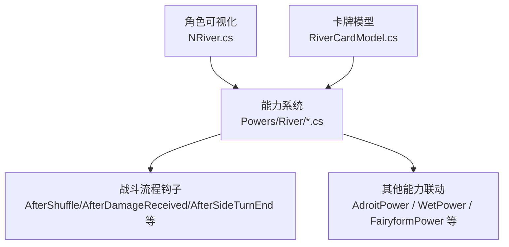
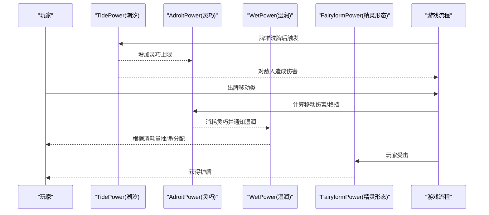
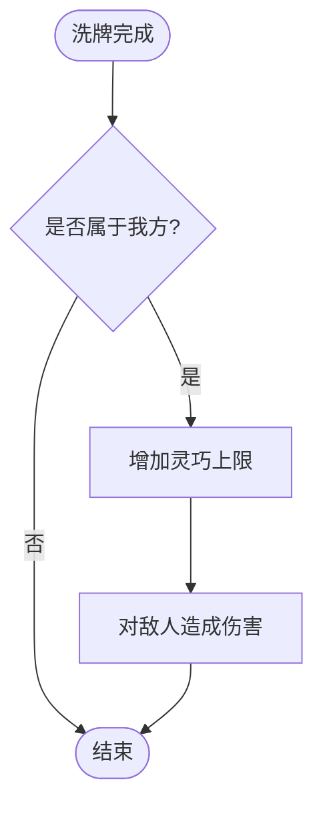
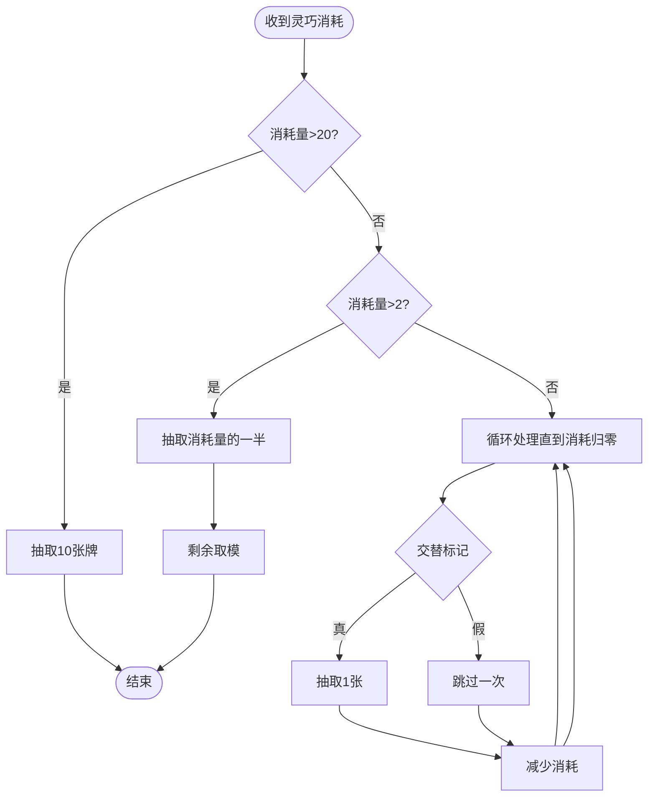
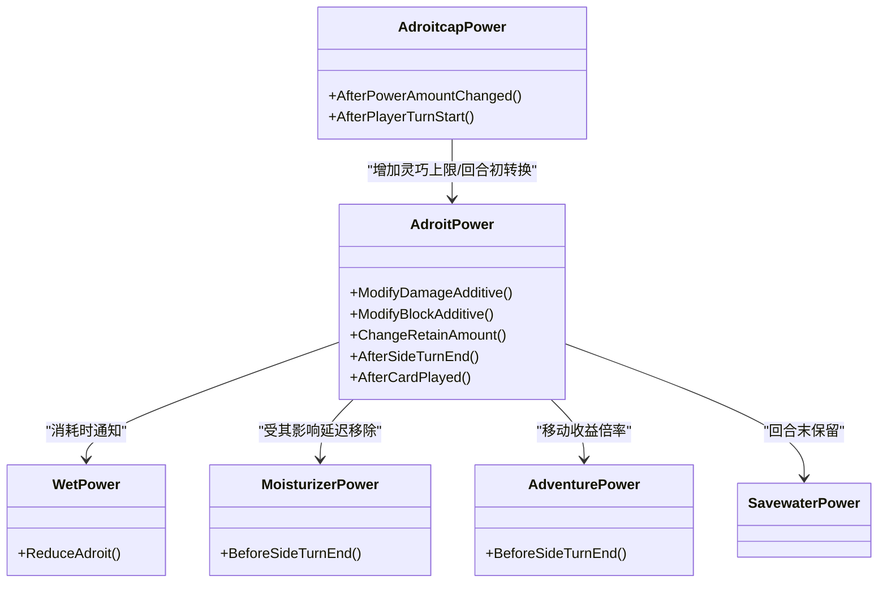
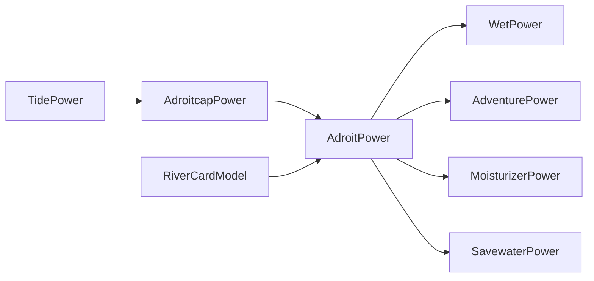

# 河流角色能力

<cite>
**本文引用的文件**
- [NRiver.cs](file://Godot/Character/River/NRiver.cs)
- [WaterworldPower.cs](file://Scripts/Powers/River/WaterworldPower.cs)
- [TidePower.cs](file://Scripts/Powers/River/TidePower.cs)
- [WetPower.cs](file://Scripts/Powers/River/WetPower.cs)
- [FairyformPower.cs](file://Scripts/Powers/River/FairyformPower.cs)
- [AdroitPower.cs](file://Scripts/Powers/River/AdroitPower.cs)
- [MoisturizerPower.cs](file://Scripts/Powers/River/MoisturizerPower.cs)
- [AdventurePower.cs](file://Scripts/Powers/River/AdventurePower.cs)
- [SavewaterPower.cs](file://Scripts/Powers/River/SavewaterPower.cs)
- [AdroitcapPower.cs](file://Scripts/Powers/River/AdroitcapPower.cs)
- [RiverCardModel.cs](file://Scripts/Card/River/RiverCardModel.cs)
</cite>

## 目录
1. [简介](#简介)
2. [项目结构](#项目结构)
3. [核心组件](#核心组件)
4. [架构总览](#架构总览)
5. [详细组件分析](#详细组件分析)
6. [依赖关系分析](#依赖关系分析)
7. [性能考量](#性能考量)
8. [故障排查指南](#故障排查指南)
9. [结论](#结论)
10. [附录](#附录)

## 简介
本文件为“河流”角色的专属能力提供系统化、可操作的文档。围绕以下核心主题展开：水世界领域、潮汐系统、湿润状态、精灵形态、灵巧效果，以及它们之间的连锁反应与环境利用策略。内容涵盖水域环境的构建与管理、潮汐的周期性变化、湿润状态的传播机制、形态转换的条件与效果，并给出攻防平衡建议与最佳实践。

## 项目结构
河流角色能力由“可视化层（角色表现）+ 能力层（Buff/状态）+ 卡牌模型（资源入口）”三部分构成：
- 可视化层：负责角色外观切换与交互反馈（如点击触发音效与动画）。
- 能力层：以“能力（Power）”为核心，实现环境增益、状态传播、回合事件响应等。
- 卡牌模型：统一注册河流系卡牌资源与展示样式，作为能力的来源之一。

图表来源
- [NRiver.cs:17-84](file://Godot/Character/River/NRiver.cs#L17-L84)
- [RiverCardModel.cs:14-39](file://Scripts/Card/River/RiverCardModel.cs#L14-L39)

章节来源
- [NRiver.cs:17-84](file://Godot/Character/River/NRiver.cs#L17-L84)
- [RiverCardModel.cs:14-39](file://Scripts/Card/River/RiverCardModel.cs#L14-L39)

## 核心组件
- 水世界领域（WaterworldPower）：作为河流领域的常驻增益型能力，提供全局性的水系加成基础。
- 潮汐系统（TidePower）：在牌堆洗牌后触发，叠加“灵巧上限”，并对敌方造成伤害，体现“涨潮”的周期性爆发。
- 湿润状态（WetPower）：记录并转化“灵巧消耗”带来的收益，具备抽牌与动态分配逻辑，是“水势”的核心载体。
- 精灵形态（FairyformPower）：受击时转化为护盾，体现“柔韧化形”的防御特性。
- 灵巧效果（AdroitPower/AdroitcapPower）：移动伤害与格挡的核心乘区；通过回合开始或外部来源累积“灵巧上限”，并在出牌时按规则消耗。
- 辅助能力：
  - MoisturizerPower：跨回合维持“灵巧”的持续力。
  - AdventurePower：临时提升移动相关收益，增强机动性。
  - SavewaterPower：保留“灵巧”至下一回合，避免流失。

章节来源
- [WaterworldPower.cs:17-28](file://Scripts/Powers/River/WaterworldPower.cs#L17-L28)
- [TidePower.cs:23-47](file://Scripts/Powers/River/TidePower.cs#L23-L47)
- [WetPower.cs:22-65](file://Scripts/Powers/River/WetPower.cs#L22-L65)
- [FairyformPower.cs:24-45](file://Scripts/Powers/River/FairyformPower.cs#L24-L45)
- [AdroitPower.cs:28-119](file://Scripts/Powers/River/AdroitPower.cs#L28-L119)
- [AdroitcapPower.cs:27-67](file://Scripts/Powers/River/AdroitcapPower.cs#L27-L67)
- [MoisturizerPower.cs:23-46](file://Scripts/Powers/River/MoisturizerPower.cs#L23-L46)
- [AdventurePower.cs:22-44](file://Scripts/Powers/River/AdventurePower.cs#L22-L44)
- [SavewaterPower.cs:18-30](file://Scripts/Powers/River/SavewaterPower.cs#L18-L30)

## 架构总览
河流能力围绕“水”的主题形成闭环：领域提供基础，潮汐周期性注入“灵巧上限”，湿润状态将“灵巧消耗”转化为资源，精灵形态在受击时提供护盾，而移动相关的攻击与格挡则通过“灵巧”放大。

图表来源
- [TidePower.cs:35-45](file://Scripts/Powers/River/TidePower.cs#L35-L45)
- [AdroitPower.cs:40-69](file://Scripts/Powers/River/AdroitPower.cs#L40-L69)
- [WetPower.cs:36-64](file://Scripts/Powers/River/WetPower.cs#L36-L64)
- [FairyformPower.cs:37-44](file://Scripts/Powers/River/FairyformPower.cs#L37-L44)

## 详细组件分析

### 水世界领域（WaterworldPower）
- 类型：增益型能力（Buff），单叠层。
- 作用：作为河流领域的常驻基础，配合其他能力共同生效。
- 设计意图：提供稳定的环境加成，使后续能力（如潮汐、湿润）的收益更可控。

章节来源
- [WaterworldPower.cs:17-28](file://Scripts/Powers/River/WaterworldPower.cs#L17-L28)

### 潮汐系统（TidePower）
- 类型：增益型能力（Buff），计数型叠层。
- 触发时机：牌堆洗牌后。
- 行为：
  - 增加“灵巧上限”。
  - 对当前所有可被攻击的敌人造成伤害。
- 设计意图：模拟“涨潮”的周期性爆发，既强化自身又压制对手。

图表来源
- [TidePower.cs:35-45](file://Scripts/Powers/River/TidePower.cs#L35-L45)

章节来源
- [TidePower.cs:23-47](file://Scripts/Powers/River/TidePower.cs#L23-L47)

### 湿润状态（WetPower）
- 类型：增益型能力（Buff），单叠层。
- 行为：
  - 接收来自“灵巧消耗”的通知。
  - 根据消耗量进行抽牌与动态分配（大额度直接抽牌，中等额度按比例，小额度交替处理）。
- 设计意图：将“灵巧”的消耗转化为资源获取，鼓励围绕移动与灵巧构建连招。

图表来源
- [WetPower.cs:36-64](file://Scripts/Powers/River/WetPower.cs#L36-L64)

章节来源
- [WetPower.cs:22-65](file://Scripts/Powers/River/WetPower.cs#L22-L65)

### 精灵形态（FairyformPower）
- 类型：增益型能力（Buff），计数型叠层。
- 触发时机：受到未阻挡伤害时。
- 行为：将受到的未阻挡伤害量转化为护盾值。
- 设计意图：体现“柔韧化形”的防御理念，鼓励在高风险环境下保持生存。

章节来源
- [FairyformPower.cs:24-45](file://Scripts/Powers/River/FairyformPower.cs#L24-L45)

### 灵巧效果（AdroitPower / AdroitcapPower）
- 灵巧（AdroitPower）：
  - 类型：增益型能力（Buff），计数型叠层。
  - 移动伤害：当由我方发起的移动类攻击时，基于“灵巧”数值增加伤害（状态牌不生效）。
  - 移动格挡：当为我方移动类格挡时，基于“灵巧”数值增加格挡（状态牌不生效）。
  - 消耗：每出一张牌且未被“保湿”覆盖，会递减“灵巧”并执行消耗回调（包括与其他能力的联动）。
  - 回合末：若无“蓄水”能力，则在玩家回合结束时移除。
- 灵巧上限（AdroitcapPower）：
  - 类型：增益型能力（Buff），计数型叠层。
  - 行为：在玩家回合开始时（非首回合）将“灵巧上限”转换为实际“灵巧”；也可通过其他方式增加“灵巧上限”来间接增加“灵巧”。
- 设计意图：将“移动”作为核心资源轴，结合“潮汐”周期性补充、“湿润”回收、“保湿”延长、“蓄水”保留，形成完整的资源循环。

图表来源
- [AdroitPower.cs:40-119](file://Scripts/Powers/River/AdroitPower.cs#L40-L119)
- [AdroitcapPower.cs:41-67](file://Scripts/Powers/River/AdroitcapPower.cs#L41-L67)
- [WetPower.cs:36-64](file://Scripts/Powers/River/WetPower.cs#L36-L64)
- [MoisturizerPower.cs:36-46](file://Scripts/Powers/River/MoisturizerPower.cs#L36-L46)
- [AdventurePower.cs:34-44](file://Scripts/Powers/River/AdventurePower.cs#L34-L44)
- [SavewaterPower.cs:18-30](file://Scripts/Powers/River/SavewaterPower.cs#L18-L30)

章节来源
- [AdroitPower.cs:28-119](file://Scripts/Powers/River/AdroitPower.cs#L28-L119)
- [AdroitcapPower.cs:27-67](file://Scripts/Powers/River/AdroitcapPower.cs#L27-L67)

### 辅助能力
- 保湿（MoisturizerPower）：在敌方回合结束时递减，用于延迟移除“灵巧”，延长资源窗口。
- 冒险（AdventurePower）：在玩家回合结束时移除，提供临时移动收益加成。
- 蓄水（SavewaterPower）：单叠层，允许“灵巧”在回合结束后保留。

章节来源
- [MoisturizerPower.cs:23-46](file://Scripts/Powers/River/MoisturizerPower.cs#L23-L46)
- [AdventurePower.cs:22-44](file://Scripts/Powers/River/AdventurePower.cs#L22-L44)
- [SavewaterPower.cs:18-30](file://Scripts/Powers/River/SavewaterPower.cs#L18-L30)

### 角色可视化与交互（NRiver）
- 功能：
  - 初始化时根据装备决定皮肤名称并应用。
  - 延迟加载骨骼并应用皮肤，确保渲染稳定。
  - 监听鼠标点击，若命中边界区域则播放音效并触发“喵叫”动画。
- 设计意图：强化河流角色的沉浸感与互动反馈，提升操作体验。

章节来源
- [NRiver.cs:17-84](file://Godot/Character/River/NRiver.cs#L17-L84)
- [NRiver.cs:86-114](file://Godot/Character/River/NRiver.cs#L86-L114)

## 依赖关系分析
- 能力间耦合：
  - TidePower → AdroitcapPower → AdroitPower：潮汐提供灵巧上限，回合初转换为实际灵巧。
  - AdroitPower → WetPower：出牌消耗灵巧，湿润将其转化为抽牌收益。
  - AdroitPower ↔ AdventurePower：移动伤害/格挡收益受冒险临时加成。
  - AdroitPower ↔ MoisturizerPower/SavewaterPower：控制灵巧的持续时间与留存。
  - FairyformPower 独立于灵巧轴，提供受击护盾。
- 卡牌模型：
  - RiverCardModel 统一注册河流卡牌资源，作为能力来源的视觉与数据载体。

图表来源
- [TidePower.cs:35-45](file://Scripts/Powers/River/TidePower.cs#L35-L45)
- [AdroitcapPower.cs:41-67](file://Scripts/Powers/River/AdroitcapPower.cs#L41-L67)
- [AdroitPower.cs:40-119](file://Scripts/Powers/River/AdroitPower.cs#L40-L119)
- [WetPower.cs:36-64](file://Scripts/Powers/River/WetPower.cs#L36-L64)
- [AdventurePower.cs:34-44](file://Scripts/Powers/River/AdventurePower.cs#L34-L44)
- [MoisturizerPower.cs:36-46](file://Scripts/Powers/River/MoisturizerPower.cs#L36-L46)
- [SavewaterPower.cs:18-30](file://Scripts/Powers/River/SavewaterPower.cs#L18-L30)
- [RiverCardModel.cs:14-39](file://Scripts/Card/River/RiverCardModel.cs#L14-L39)

章节来源
- [TidePower.cs:23-47](file://Scripts/Powers/River/TidePower.cs#L23-L47)
- [AdroitPower.cs:28-119](file://Scripts/Powers/River/AdroitPower.cs#L28-L119)
- [RiverCardModel.cs:14-39](file://Scripts/Card/River/RiverCardModel.cs#L14-L39)

## 性能考量
- 能力触发频率：
  - 潮汐在每次洗牌后触发，注意控制伤害与附加效果的开销。
  - 湿润在每次灵巧消耗时可能触发多次抽牌逻辑，需关注批量处理的效率。
- 回合事件：
  - 多个能力在回合开始/结束时执行，应避免重复计算与不必要的对象创建。
- 可视化层：
  - 延迟应用皮肤与重试机制已内置，避免频繁重绘导致的卡顿。

[本节为通用指导，无需具体文件引用]

## 故障排查指南
- 灵巧未生效：
  - 检查是否存在“保湿”或“蓄水”导致移除时机变化。
  - 确认是否为移动类攻击/格挡，状态牌不会触发灵巧伤害/格挡。
- 湿润未抽牌：
  - 确认灵巧消耗是否成功传递到湿润。
  - 检查消耗量分支逻辑是否符合预期（大/中/小额度）。
- 潮汐未触发：
  - 确认是否在牌堆洗牌后执行，且所有者为我方。
- 精灵形态未加盾：
  - 确认是否受到未阻挡伤害。

章节来源
- [AdroitPower.cs:40-119](file://Scripts/Powers/River/AdroitPower.cs#L40-L119)
- [WetPower.cs:36-64](file://Scripts/Powers/River/WetPower.cs#L36-L64)
- [TidePower.cs:35-45](file://Scripts/Powers/River/TidePower.cs#L35-L45)
- [FairyformPower.cs:37-44](file://Scripts/Powers/River/FairyformPower.cs#L37-L44)

## 结论
河流角色的能力体系以“水”为核心，通过领域、潮汐、湿润、精灵形态与灵巧五大模块形成自洽的资源循环与攻防策略。建议在实战中优先建立“潮汐→灵巧→湿润”的基础循环，再辅以“保湿/蓄水”延长窗口，使用“精灵形态”提高容错，最终围绕移动类攻击与格挡打出高爆发的连招。

[本节为总结性内容，无需具体文件引用]

## 附录
- 环境利用策略：
  - 在低血量时优先保证生存，利用精灵形态吸收伤害。
  - 在牌堆充裕时主动触发潮汐，快速积累灵巧上限。
  - 通过湿润将灵巧消耗转化为抽牌，维持手牌质量。
- 攻防平衡：
  - 移动类攻击与格挡均受益于灵巧，合理搭配技能与能力，兼顾输出与防御。
  - 谨慎使用状态牌，因其不会触发灵巧伤害/格挡。

[本节为概念性内容，无需具体文件引用]