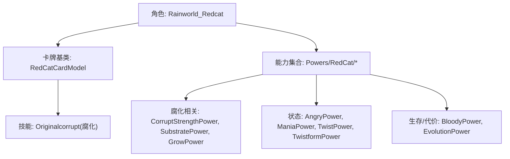
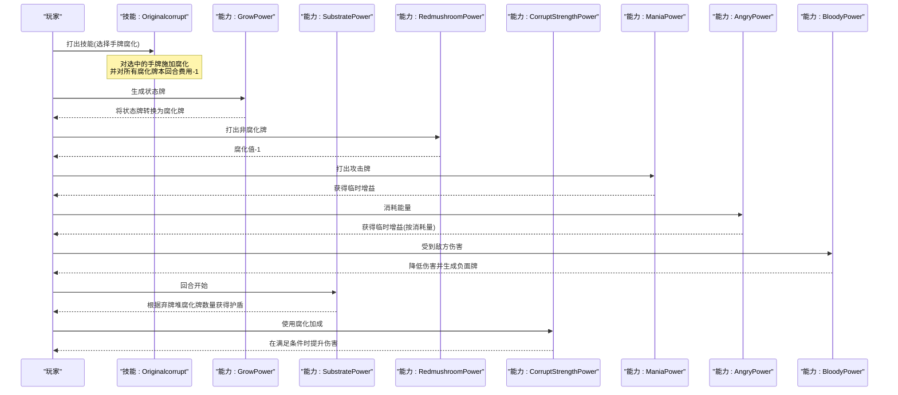
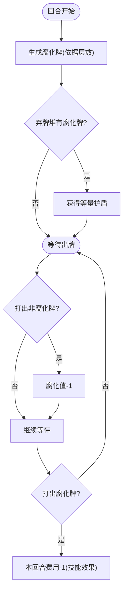
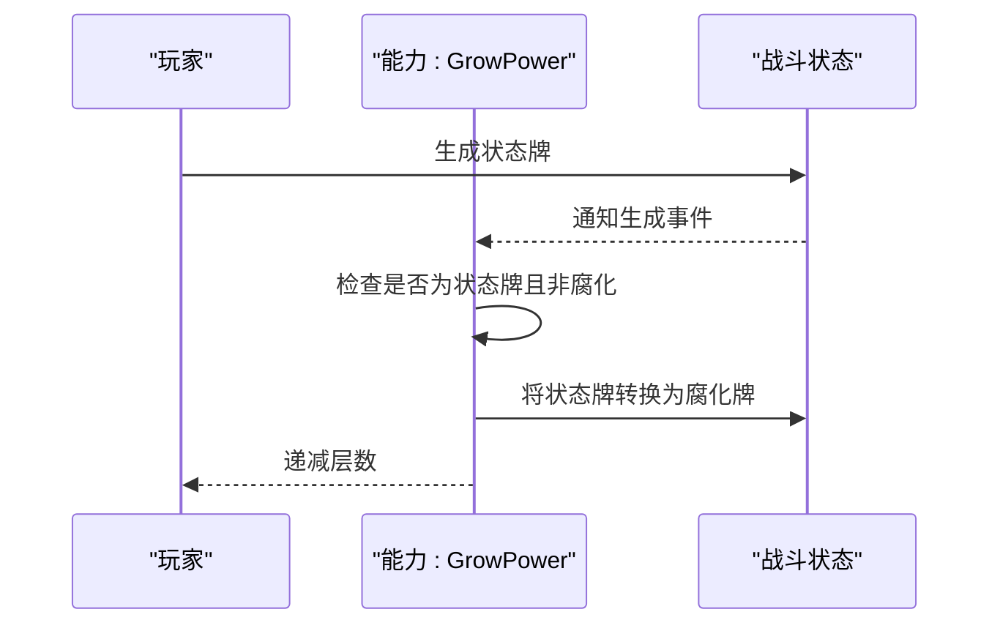
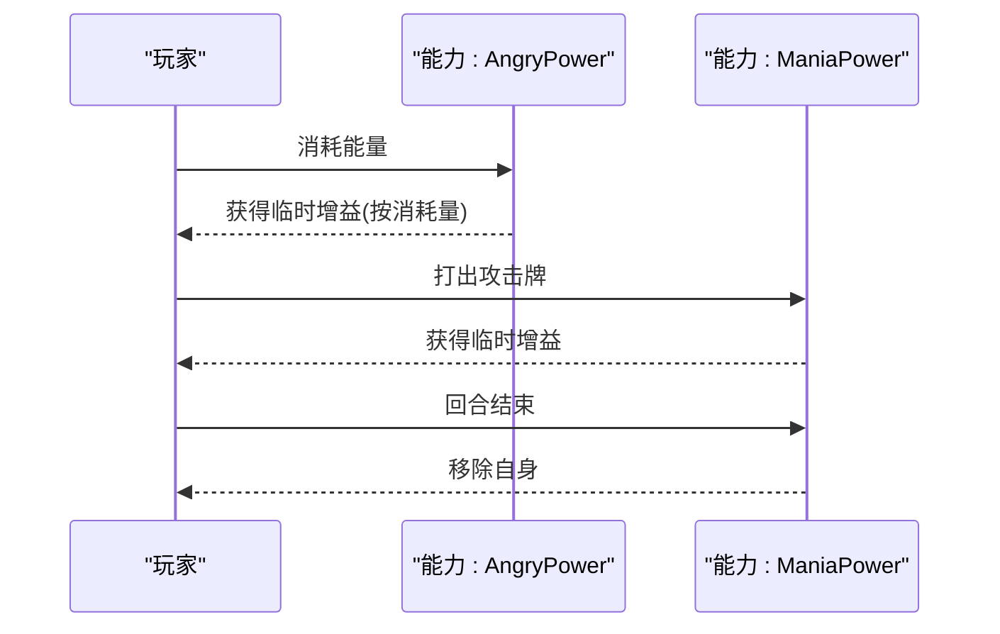
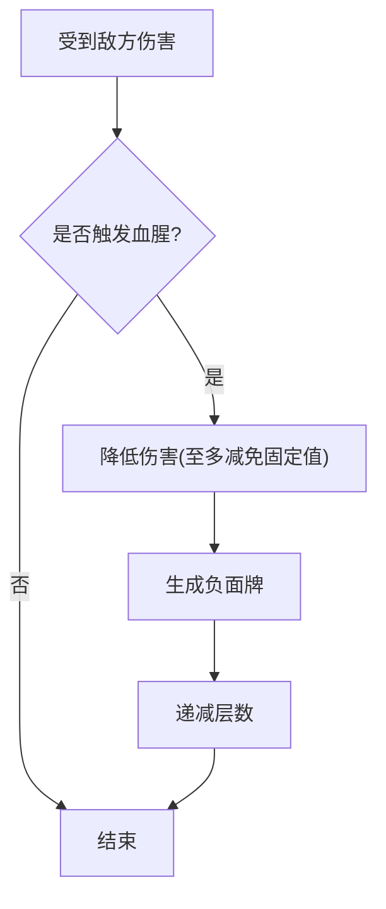
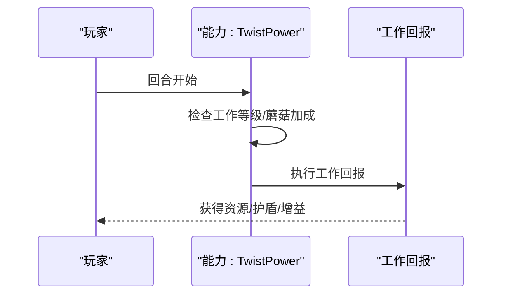
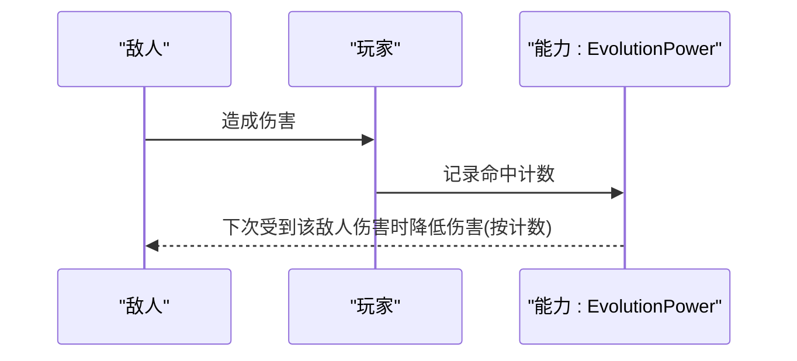
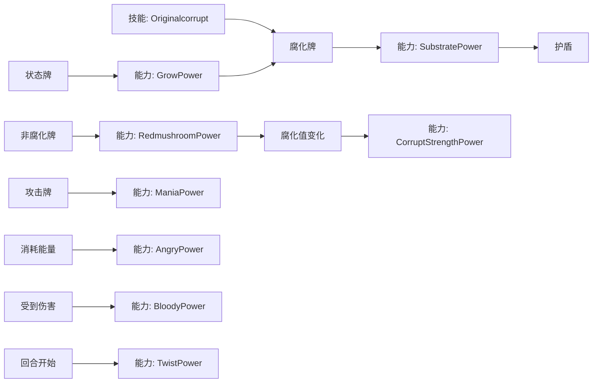

# 红猫角色能力

<cite>
**本文引用的文件**
- [Rainworld_Redcat.cs](file://Scripts/Slugcat/Rainworld_Redcat.cs)
- [RedCatCardModel.cs](file://Scripts/Card/RedCat/RedCatCardModel.cs)
- [Rainworld_Redcat_Originalcorrupt.cs](file://Scripts/Card/RedCat/Skills/Rainworld_Redcat_Originalcorrupt.cs)
- [EvolutionPower.cs](file://Scripts/Powers/RedCat/EvolutionPower.cs)
- [AngryPower.cs](file://Scripts/Powers/RedCat/AngryPower.cs)
- [BloodyPower.cs](file://Scripts/Powers/RedCat/BloodyPower.cs)
- [TwistformPower.cs](file://Scripts/Powers/RedCat/TwistformPower.cs)
- [CorruptStrengthPower.cs](file://Scripts/Powers/RedCat/CorruptStrengthPower.cs)
- [TwistPower.cs](file://Scripts/Powers/RedCat/TwistPower.cs)
- [GrowPower.cs](file://Scripts/Powers/RedCat/GrowPower.cs)
- [ManiaPower.cs](file://Scripts/Powers/RedCat/ManiaPower.cs)
- [SubstratePower.cs](file://Scripts/Powers/RedCat/SubstratePower.cs)
- [RedmushroomPower.cs](file://Scripts/Powers/RedCat/RedmushroomPower.cs)
</cite>

## 目录
1. [简介](#简介)
2. [项目结构](#项目结构)
3. [核心组件](#核心组件)
4. [架构总览](#架构总览)
5. [详细组件分析](#详细组件分析)
6. [依赖关系分析](#依赖关系分析)
7. [性能与平衡性考量](#性能与平衡性考量)
8. [故障排查指南](#故障排查指南)
9. [结论](#结论)
10. [附录](#附录)

## 简介
本文件为“红猫”角色的专属能力文档，聚焦以下核心机制：腐化值系统、进化机制、愤怒状态、血腥效果、扭曲形态。内容涵盖腐化值的累积与影响、进化条件判断逻辑、攻击增强机制、状态转换规则，以及能力间的协同效应、风险与收益平衡、实战应用策略，并解释该角色“高风险高回报”的设计理念。

## 项目结构
红猫能力的实现由“角色定义 + 卡牌模型 + 能力（Power）”三部分构成：
- 角色定义：提供初始属性、起始牌组、资源上限等基础设定。
- 卡牌模型：定义卡牌类型、关键词、费用、目标等，并与能力联动。
- 能力（Power）：在战斗各阶段触发，修改伤害、护盾、费用、生成牌、状态等。

图表来源
- [Rainworld_Redcat.cs:29-105](file://Scripts/Slugcat/Rainworld_Redcat.cs#L29-L105)
- [RedCatCardModel.cs:13-39](file://Scripts/Card/RedCat/RedCatCardModel.cs#L13-L39)
- [Rainworld_Redcat_Originalcorrupt.cs:11-51](file://Scripts/Card/RedCat/Skills/Rainworld_Redcat_Originalcorrupt.cs#L11-L51)
- [CorruptStrengthPower.cs:27-51](file://Scripts/Powers/RedCat/CorruptStrengthPower.cs#L27-L51)
- [SubstratePower.cs:28-71](file://Scripts/Powers/RedCat/SubstratePower.cs#L28-L71)
- [GrowPower.cs:18-41](file://Scripts/Powers/RedCat/GrowPower.cs#L18-L41)
- [AngryPower.cs:27-48](file://Scripts/Powers/RedCat/AngryPower.cs#L27-L48)
- [ManiaPower.cs:27-62](file://Scripts/Powers/RedCat/ManiaPower.cs#L27-L62)
- [TwistPower.cs:27-51](file://Scripts/Powers/RedCat/TwistPower.cs#L27-L51)
- [TwistformPower.cs:27-40](file://Scripts/Powers/RedCat/TwistformPower.cs#L27-L40)
- [BloodyPower.cs:27-65](file://Scripts/Powers/RedCat/BloodyPower.cs#L27-L65)
- [EvolutionPower.cs:27-64](file://Scripts/Powers/RedCat/EvolutionPower.cs#L27-L64)

章节来源
- [Rainworld_Redcat.cs:29-105](file://Scripts/Slugcat/Rainworld_Redcat.cs#L29-L105)
- [RedCatCardModel.cs:13-39](file://Scripts/Card/RedCat/RedCatCardModel.cs#L13-L39)

## 核心组件
- 腐化值系统
  - 通过“腐化”关键词的卡牌参与构建资源循环；部分能力会在每回合或特定事件时生成腐化牌，并在弃牌堆中统计以转化为护盾。
  - 非腐化牌打出后可能减少腐化值；某些能力会基于腐化值提升攻击力或改变行为。
- 进化机制
  - 当玩家生成的状态牌满足条件时，可将其转换为腐化牌，从而加速腐化循环。
- 愤怒状态
  - 消耗能量后获得临时增益；或在打出攻击牌时获得额外增益，但存在回合结束移除的限制。
- 血腥效果
  - 受到伤害时降低实际损失，并生成负面牌；同时扣减对应层数，形成“受击换资源”的代价循环。
- 扭曲形态
  - 在特定条件下于回合开始执行工作回报流程，配合其他能力触发连锁反应。

章节来源
- [SubstratePower.cs:40-58](file://Scripts/Powers/RedCat/SubstratePower.cs#L40-L58)
- [GrowPower.cs:30-40](file://Scripts/Powers/RedCat/GrowPower.cs#L30-L40)
- [AngryPower.cs:43-47](file://Scripts/Powers/RedCat/AngryPower.cs#L43-L47)
- [ManiaPower.cs:46-60](file://Scripts/Powers/RedCat/ManiaPower.cs#L46-L60)
- [BloodyPower.cs:42-62](file://Scripts/Powers/RedCat/BloodyPower.cs#L42-L62)
- [TwistPower.cs:42-49](file://Scripts/Powers/RedCat/TwistPower.cs#L42-L49)

## 架构总览
红猫的核心循环围绕“腐化值”展开：通过技能生成腐化牌，利用能力将状态牌转为腐化牌，再在回合开始时将弃牌堆中的腐化牌转化为护盾；同时，非腐化牌打出会降低腐化值，而拥有腐化加成时能提升输出。愤怒与狂躁能力提供短期爆发，血腥能力提供受击保护与资源回收，扭曲形态在工作回报时触发额外收益。

图表来源
- [Rainworld_Redcat_Originalcorrupt.cs:30-45](file://Scripts/Card/RedCat/Skills/Rainworld_Redcat_Originalcorrupt.cs#L30-L45)
- [GrowPower.cs:30-40](file://Scripts/Powers/RedCat/GrowPower.cs#L30-L40)
- [SubstratePower.cs:40-58](file://Scripts/Powers/RedCat/SubstratePower.cs#L40-L58)
- [RedmushroomPower.cs:44-54](file://Scripts/Powers/RedCat/RedmushroomPower.cs#L44-L54)
- [CorruptStrengthPower.cs:40-48](file://Scripts/Powers/RedCat/CorruptStrengthPower.cs#L40-L48)
- [ManiaPower.cs:46-60](file://Scripts/Powers/RedCat/ManiaPower.cs#L46-L60)
- [AngryPower.cs:43-47](file://Scripts/Powers/RedCat/AngryPower.cs#L43-L47)
- [BloodyPower.cs:42-62](file://Scripts/Powers/RedCat/BloodyPower.cs#L42-L62)

## 详细组件分析

### 腐化值系统与卡牌联动
- 技能“Originalcorrupt”
  - 从手牌中选择一张非腐化且无免疫/不可腐化的牌进行腐化。
  - 对所有已腐化牌在本回合内降低费用，便于快速铺场与连招。
- 能力“SubstratePower”
  - 回合开始时，生成若干张腐化牌；若弃牌堆中存在腐化牌，则将其数量转化为护盾。
- 能力“RedmushroomPower”
  - 打出非腐化牌时减少腐化值；进入/退出特定形态时会附加护盾或移除加成，伴随音效与动画提示。
- 能力“CorruptStrengthPower”
  - 在满足条件时（如未处于无加成状态、由玩家造成、目标非自身、且具备蘑菇加成），将伤害翻倍。

图表来源
- [SubstratePower.cs:40-58](file://Scripts/Powers/RedCat/SubstratePower.cs#L40-L58)
- [RedmushroomPower.cs:44-54](file://Scripts/Powers/RedCat/RedmushroomPower.cs#L44-L54)
- [Rainworld_Redcat_Originalcorrupt.cs:30-45](file://Scripts/Card/RedCat/Skills/Rainworld_Redcat_Originalcorrupt.cs#L30-L45)
- [CorruptStrengthPower.cs:40-48](file://Scripts/Powers/RedCat/CorruptStrengthPower.cs#L40-L48)

章节来源
- [Rainworld_Redcat_Originalcorrupt.cs:11-51](file://Scripts/Card/RedCat/Skills/Rainworld_Redcat_Originalcorrupt.cs#L11-L51)
- [SubstratePower.cs:28-71](file://Scripts/Powers/RedCat/SubstratePower.cs#L28-L71)
- [RedmushroomPower.cs:32-94](file://Scripts/Powers/RedCat/RedmushroomPower.cs#L32-L94)
- [CorruptStrengthPower.cs:27-51](file://Scripts/Powers/RedCat/CorruptStrengthPower.cs#L27-L51)

### 进化机制（状态牌转腐化牌）
- 能力“GrowPower”
  - 当玩家生成状态牌时，若该牌不是腐化牌，则将其转换为腐化牌，并递减自身层数。
- 设计意图
  - 鼓励玩家主动生成状态牌，并通过进化快速建立腐化循环，提高节奏与稳定性。

图表来源
- [GrowPower.cs:30-40](file://Scripts/Powers/RedCat/GrowPower.cs#L30-L40)

章节来源
- [GrowPower.cs:18-41](file://Scripts/Powers/RedCat/GrowPower.cs#L18-L41)

### 愤怒状态与狂躁（爆发与限制）
- 能力“AngryPower”
  - 每次消耗能量时，为玩家获得临时增益，增益量与消耗能量成正比。
- 能力“ManiaPower”
  - 禁止自动选择技能牌；打出攻击牌时获得临时增益；在玩家回合结束时移除自身，避免长期驻场。
- 协同
  - 两者结合可在单回合内集中爆发，但需注意回合结束移除的限制，合理规划出牌顺序。

图表来源
- [AngryPower.cs:43-47](file://Scripts/Powers/RedCat/AngryPower.cs#L43-L47)
- [ManiaPower.cs:39-60](file://Scripts/Powers/RedCat/ManiaPower.cs#L39-L60)

章节来源
- [AngryPower.cs:27-48](file://Scripts/Powers/RedCat/AngryPower.cs#L27-L48)
- [ManiaPower.cs:27-62](file://Scripts/Powers/RedCat/ManiaPower.cs#L27-L62)

### 血腥效果（受击保护与资源回收）
- 能力“BloodyPower”
  - 受到伤害时降低实际损失（最多减免固定数值），并在后续阶段生成一张负面牌，同时递减自身层数。
- 设计意图
  - 提供容错空间，使玩家在高风险环境下仍能维持资源循环；代价是持续产生负面牌，需控制频率。

图表来源
- [BloodyPower.cs:42-62](file://Scripts/Powers/RedCat/BloodyPower.cs#L42-L62)

章节来源
- [BloodyPower.cs:27-65](file://Scripts/Powers/RedCat/BloodyPower.cs#L27-L65)

### 扭曲形态与工作回报
- 能力“TwistPower”
  - 在玩家回合开始时，若工作等级为0或具备蘑菇加成，则执行工作回报流程。
- 能力“TwistformPower”
  - 作为形态标记，配合其他能力触发额外效果（例如视觉或联动）。
- 协同
  - 扭曲形态下，工作回报可与其他能力（如腐化护盾、攻击加成）形成连锁，提升整体收益。

图表来源
- [TwistPower.cs:42-49](file://Scripts/Powers/RedCat/TwistPower.cs#L42-L49)
- [TwistformPower.cs:27-40](file://Scripts/Powers/RedCat/TwistformPower.cs#L27-L40)

章节来源
- [TwistPower.cs:27-51](file://Scripts/Powers/RedCat/TwistPower.cs#L27-L51)
- [TwistformPower.cs:27-40](file://Scripts/Powers/RedCat/TwistformPower.cs#L27-L40)

### 进化与防御的协同（EvolutionPower）
- 能力“EvolutionPower”
  - 记录被敌人击中的次数，并在受到伤害时对相应敌人施加负向修正（降低其伤害）。
- 协同
  - 与血腥效果配合，既能降低受到的伤害，又能反制高频攻击的敌人，提高生存能力。

图表来源
- [EvolutionPower.cs:42-62](file://Scripts/Powers/RedCat/EvolutionPower.cs#L42-L62)

章节来源
- [EvolutionPower.cs:27-64](file://Scripts/Powers/RedCat/EvolutionPower.cs#L27-L64)

## 依赖关系分析
- 卡牌与能力耦合
  - “Originalcorrupt”技能与“SubstratePower”、“GrowPower”紧密耦合，前者负责腐化手牌，后者负责生成与转化腐化牌。
  - “RedmushroomPower”在非腐化牌打出时降低腐化值，影响“CorruptStrengthPower”的触发条件。
- 状态与资源循环
  - “AngryPower”和“ManiaPower”提供短期爆发，需在回合结束前最大化收益。
  - “BloodyPower”提供受击保护，但会产生负面牌，需与腐化循环配合消化。
- 形态与流程
  - “TwistPower”在工作回报时触发，可与腐化护盾、攻击加成形成复合收益。

图表来源
- [Rainworld_Redcat_Originalcorrupt.cs:30-45](file://Scripts/Card/RedCat/Skills/Rainworld_Redcat_Originalcorrupt.cs#L30-L45)
- [SubstratePower.cs:40-58](file://Scripts/Powers/RedCat/SubstratePower.cs#L40-L58)
- [RedmushroomPower.cs:44-54](file://Scripts/Powers/RedCat/RedmushroomPower.cs#L44-L54)
- [CorruptStrengthPower.cs:40-48](file://Scripts/Powers/RedCat/CorruptStrengthPower.cs#L40-L48)
- [GrowPower.cs:30-40](file://Scripts/Powers/RedCat/GrowPower.cs#L30-L40)
- [ManiaPower.cs:46-60](file://Scripts/Powers/RedCat/ManiaPower.cs#L46-L60)
- [AngryPower.cs:43-47](file://Scripts/Powers/RedCat/AngryPower.cs#L43-L47)
- [BloodyPower.cs:42-62](file://Scripts/Powers/RedCat/BloodyPower.cs#L42-L62)
- [TwistPower.cs:42-49](file://Scripts/Powers/RedCat/TwistPower.cs#L42-L49)

章节来源
- [Rainworld_Redcat_Originalcorrupt.cs:11-51](file://Scripts/Card/RedCat/Skills/Rainworld_Redcat_Originalcorrupt.cs#L11-L51)
- [SubstratePower.cs:28-71](file://Scripts/Powers/RedCat/SubstratePower.cs#L28-L71)
- [RedmushroomPower.cs:32-94](file://Scripts/Powers/RedCat/RedmushroomPower.cs#L32-L94)
- [CorruptStrengthPower.cs:27-51](file://Scripts/Powers/RedCat/CorruptStrengthPower.cs#L27-L51)
- [GrowPower.cs:18-41](file://Scripts/Powers/RedCat/GrowPower.cs#L18-L41)
- [ManiaPower.cs:27-62](file://Scripts/Powers/RedCat/ManiaPower.cs#L27-L62)
- [AngryPower.cs:27-48](file://Scripts/Powers/RedCat/AngryPower.cs#L27-L48)
- [BloodyPower.cs:27-65](file://Scripts/Powers/RedCat/BloodyPower.cs#L27-L65)
- [TwistPower.cs:27-51](file://Scripts/Powers/RedCat/TwistPower.cs#L27-L51)

## 性能与平衡性考量
- 高风险高回报
  - 腐化循环需要管理腐化值与非腐化牌的平衡；过度腐化可能导致资源枯竭，不足则无法发挥加成。
  - 愤怒与狂躁提供爆发窗口，但回合结束移除限制要求精准规划。
  - 血腥效果提供容错，但负面牌积累需通过腐化循环消化。
- 优化建议
  - 优先保证腐化牌的费用降低与生成效率，确保每回合稳定产出护盾。
  - 在强敌战中合理使用进化能力，将状态牌快速转为腐化牌，缩短成型周期。
  - 控制非腐化牌的使用频率，避免腐化值过低导致攻击加成失效。

[本节为通用指导，不直接分析具体文件]

## 故障排查指南
- 腐化牌未生效
  - 检查技能是否正确选择手牌并施加腐化；确认目标牌不含免疫或不可腐化关键词。
- 护盾未生成
  - 确认回合开始时是否有腐化牌在弃牌堆；检查能力层数与触发条件。
- 攻击加成未触发
  - 确认当前是否处于无加成状态、是否由玩家造成、目标是否为敌方；检查蘑菇加成是否存在。
- 负面牌过多
  - 评估血腥效果的触发频率；通过腐化循环与技能降低费用来消化负面牌。

章节来源
- [Rainworld_Redcat_Originalcorrupt.cs:30-45](file://Scripts/Card/RedCat/Skills/Rainworld_Redcat_Originalcorrupt.cs#L30-L45)
- [SubstratePower.cs:40-58](file://Scripts/Powers/RedCat/SubstratePower.cs#L40-L58)
- [CorruptStrengthPower.cs:40-48](file://Scripts/Powers/RedCat/CorruptStrengthPower.cs#L40-L48)
- [BloodyPower.cs:42-62](file://Scripts/Powers/RedCat/BloodyPower.cs#L42-L62)

## 结论
红猫角色以“腐化值”为核心，构建了高风险高回报的战斗风格。通过技能与能力的协同，玩家可以在腐化循环中稳定获取护盾与资源，同时在愤怒与狂躁状态下实现爆发输出。血腥效果提供容错空间，扭曲形态与工作回报进一步放大收益。掌握腐化值的管理与能力释放时机，是发挥红猫潜力的关键。

[本节为总结，不直接分析具体文件]

## 附录
- 角色初始设定
  - 起始生命、金币、工作等级、食物上限等基础属性由角色定义提供。
- 卡牌资源
  - 卡牌图标、边框、横幅等资源路径由卡牌基类统一管理，便于扩展与维护。

章节来源
- [Rainworld_Redcat.cs:32-105](file://Scripts/Slugcat/Rainworld_Redcat.cs#L32-L105)
- [RedCatCardModel.cs:17-33](file://Scripts/Card/RedCat/RedCatCardModel.cs#L17-L33)