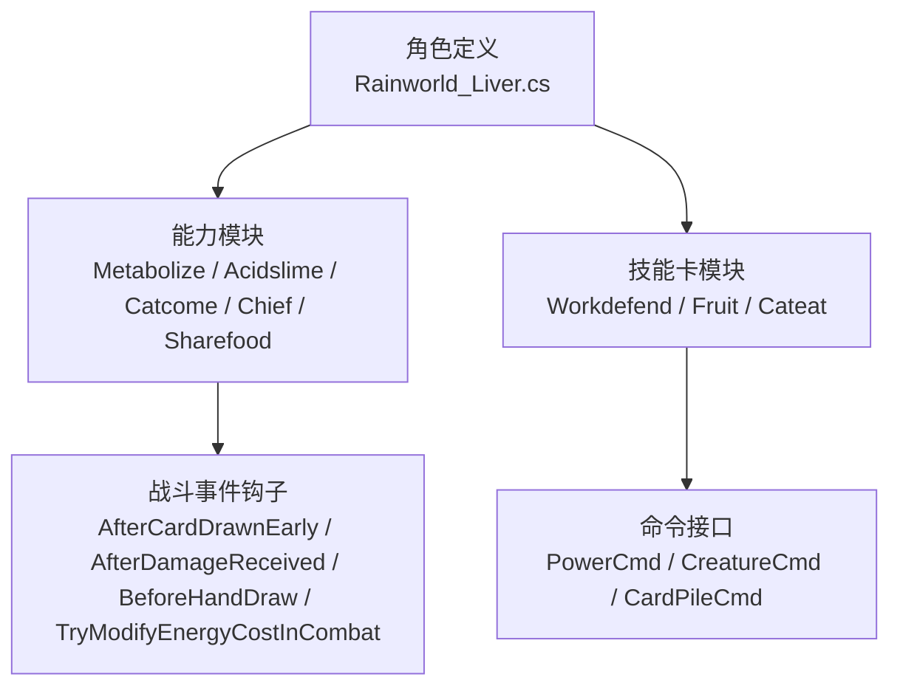
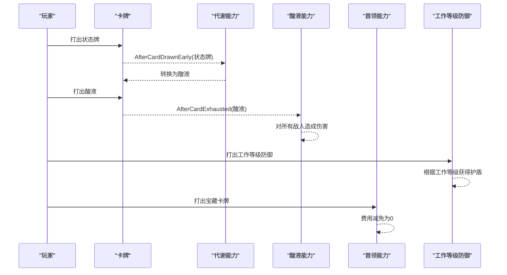
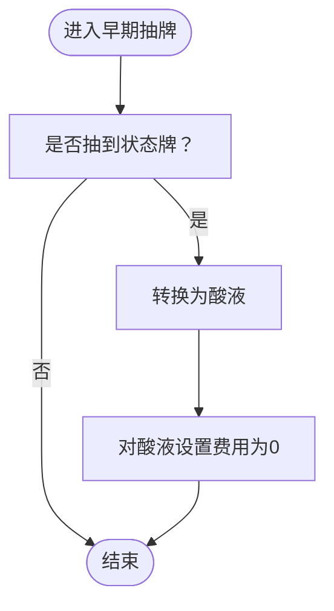
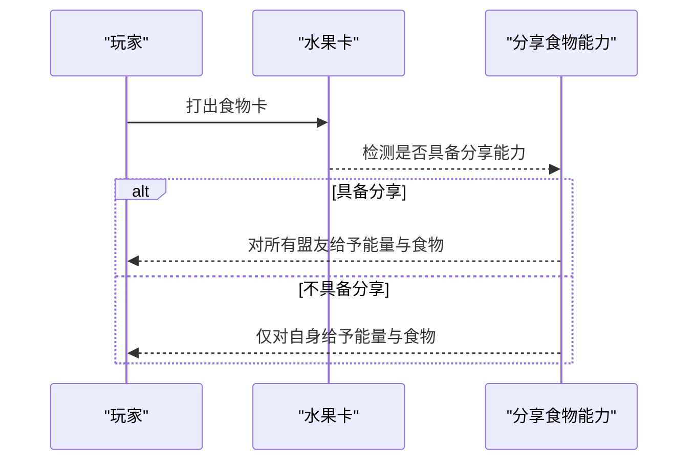
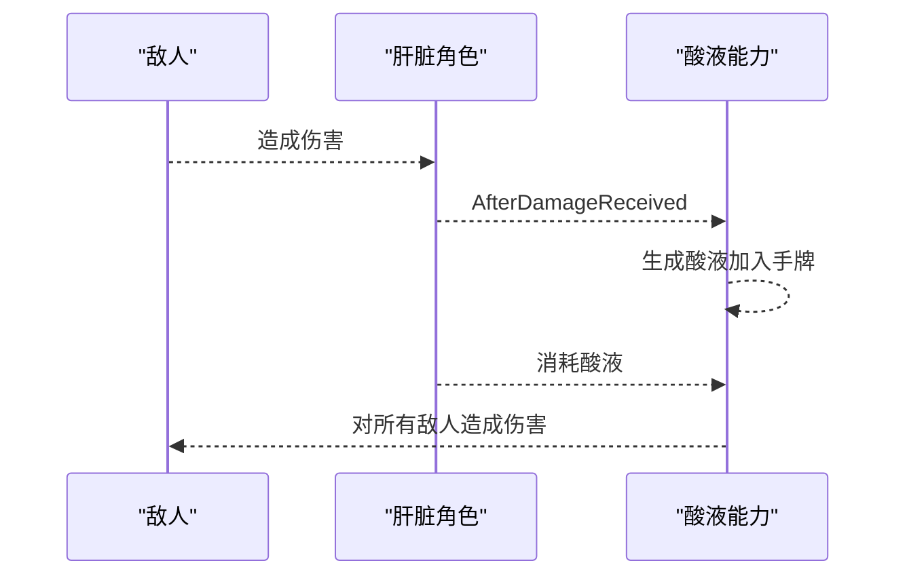
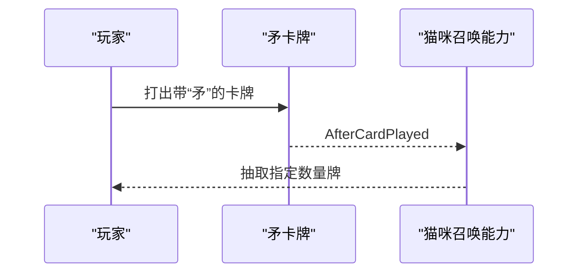
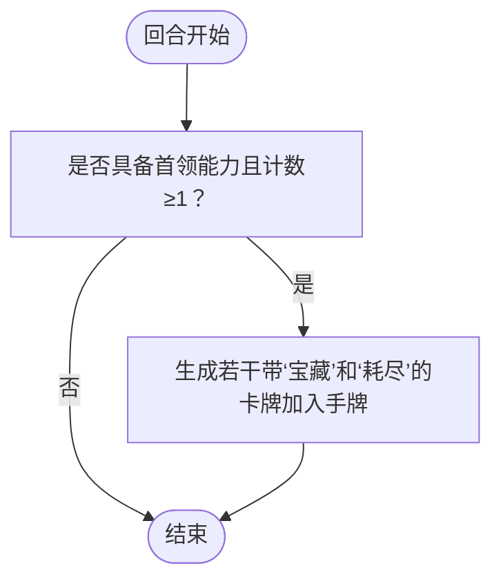
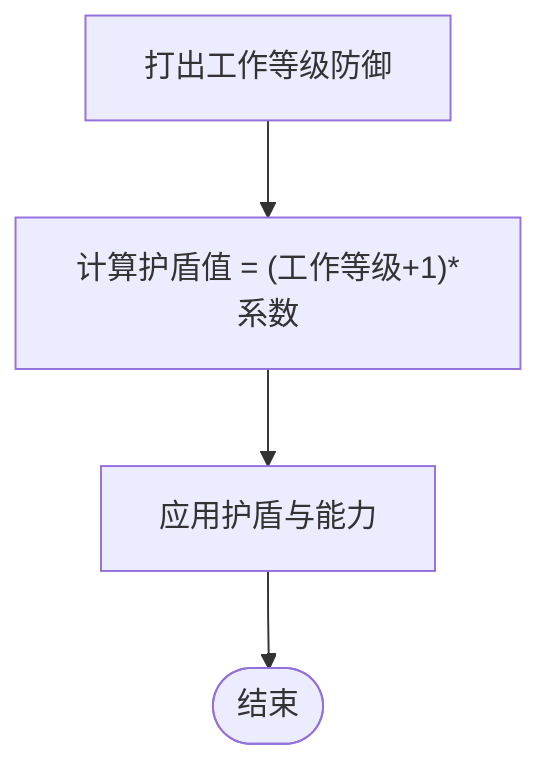
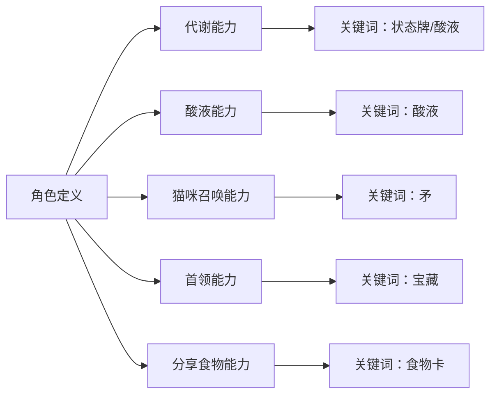

# 肝脏角色能力

<cite>
**本文引用的文件**
- [Rainworld_Liver.cs](file://Scripts/Slugcat/Rainworld_Liver.cs)
- [MetabolizePower.cs](file://Scripts/Powers/MetabolizePower.cs)
- [SharefoodPower.cs](file://Scripts/Powers/Liver/SharefoodPower.cs)
- [AcidslimePower.cs](file://Scripts/Powers/Liver/AcidslimePower.cs)
- [CatcomePower.cs](file://Scripts/Powers/Liver/CatcomePower.cs)
- [ChiefPower.cs](file://Scripts/Powers/Liver/ChiefPower.cs)
- [Rainworld_Liver_Workdefend.cs](file://Scripts/Card/Liver/Skills/Rainworld_Liver_Workdefend.cs)
- [Rainworld_Liver_Fruit.cs](file://Scripts/Card/Liver/Skills/Rainworld_Liver_Fruit.cs)
- [Rainworld_Liver_Cateat.cs](file://Scripts/Card/Liver/Skills/Rainworld_Liver_Cateat.cs)
</cite>

## 目录
1. [简介](#简介)
2. [项目结构](#项目结构)
3. [核心组件](#核心组件)
4. [架构总览](#架构总览)
5. [详细组件分析](#详细组件分析)
6. [依赖关系分析](#依赖关系分析)
7. [性能与平衡性考量](#性能与平衡性考量)
8. [故障排查指南](#故障排查指南)
9. [结论](#结论)
10. [附录：资源管理与生存机制](#附录：资源管理与生存机制)

## 简介
本文件为“肝脏”角色的专属能力提供系统化、可操作的说明，聚焦以下核心主题：
- 代谢系统：状态牌转化与费用减免的联动。
- 分享食物机制：对食物类卡牌的共享与能量分配。
- 酸液效果：受击生成酸液并消耗时触发伤害。
- 猫咪召唤：以“矛”关键词为核心的抽牌联动。
- 首领加成：对“宝藏”关键词卡牌的费用减免与回合初手牌补充。
同时给出能力组合策略、平衡性考虑与实际使用示例，并解释肝脏角色独特的资源管理与生存机制。

## 项目结构
肝脏角色由“角色定义 + 能力（Power）+ 技能卡（Skill）+ 资源管理”构成：
- 角色定义：注册角色、初始卡组、起始遗物、视觉与音频等。
- 能力：通过 ModPowerTemplate 扩展战斗事件钩子，实现被动或主动效果。
- 技能卡：在 OnPlay 中调用命令（如 PowerCmd、CreatureCmd、CardPileCmd）驱动效果。
- 资源管理：工作等级、食物点数等贯穿战斗与休息点。

图表来源
- [Rainworld_Liver.cs:28-117](file://Scripts/Slugcat/Rainworld_Liver.cs#L28-L117)
- [MetabolizePower.cs:29-84](file://Scripts/Powers/MetabolizePower.cs#L29-L84)
- [AcidslimePower.cs:27-59](file://Scripts/Powers/Liver/AcidslimePower.cs#L27-L59)
- [CatcomePower.cs:26-48](file://Scripts/Powers/Liver/CatcomePower.cs#L26-L48)
- [ChiefPower.cs:29-98](file://Scripts/Powers/Liver/ChiefPower.cs#L29-L98)
- [Rainworld_Liver_Workdefend.cs:15-62](file://Scripts/Card/Liver/Skills/Rainworld_Liver_Workdefend.cs#L15-L62)
- [Rainworld_Liver_Fruit.cs:19-115](file://Scripts/Card/Liver/Skills/Rainworld_Liver_Fruit.cs#L19-L115)

章节来源
- [Rainworld_Liver.cs:28-117](file://Scripts/Slugcat/Rainworld_Liver.cs#L28-L117)

## 核心组件
- 代谢系统（MetabolizePower）：将状态牌转化为酸液，并对酸液卡牌提供费用减免，形成“低费循环”。
- 分享食物（SharefoodPower）：使食物类卡牌可共享给所有盟友，提升团队能量与食物积累。
- 酸液效果（AcidslimePower）：受击时生成一张酸液；当酸液被消耗时对所有敌人造成伤害。
- 猫咪召唤（CatcomePower）：打出带“矛”关键词的卡牌后抽牌，强化连动与节奏。
- 首领加成（ChiefPower）：对“宝藏”关键词卡牌免费打出，并在每回合开始时生成若干特殊卡牌加入手牌。
- 工作等级防御（WorkdefendPower）：基于当前工作等级提供护盾，是肝脏生存与资源转换的关键。

章节来源
- [MetabolizePower.cs:29-84](file://Scripts/Powers/MetabolizePower.cs#L29-L84)
- [SharefoodPower.cs:25-41](file://Scripts/Powers/Liver/SharefoodPower.cs#L25-L41)
- [AcidslimePower.cs:27-59](file://Scripts/Powers/Liver/AcidslimePower.cs#L27-L59)
- [CatcomePower.cs:26-48](file://Scripts/Powers/Liver/CatcomePower.cs#L26-L48)
- [ChiefPower.cs:29-98](file://Scripts/Powers/Liver/ChiefPower.cs#L29-L98)
- [Rainworld_Liver_Workdefend.cs:15-62](file://Scripts/Card/Liver/Skills/Rainworld_Liver_Workdefend.cs#L15-L62)

## 架构总览
肝脏能力的整体流程围绕“事件钩子 + 命令接口”展开：
- 事件钩子：在抽牌、出牌、受击、回合开始等时机触发。
- 命令接口：通过 PowerCmd、CreatureCmd、CardPileCmd 等统一执行效果。
- 数据模型：角色属性（工作等级、食物）、卡牌关键词（矛、宝藏、食物卡）、能力堆叠类型（单张/计数）。

图表来源
- [MetabolizePower.cs:43-52](file://Scripts/Powers/MetabolizePower.cs#L43-L52)
- [MetabolizePower.cs:54-82](file://Scripts/Powers/MetabolizePower.cs#L54-L82)
- [AcidslimePower.cs:41-47](file://Scripts/Powers/Liver/AcidslimePower.cs#L41-L47)
- [Rainworld_Liver_Workdefend.cs:48-55](file://Scripts/Card/Liver/Skills/Rainworld_Liver_Workdefend.cs#L48-L55)
- [ChiefPower.cs:41-69](file://Scripts/Powers/Liver/ChiefPower.cs#L41-L69)

## 详细组件分析

### 代谢系统（MetabolizePower）
- 触发条件：
  - 早期抽牌阶段，若抽到状态牌且属于肝脏角色，则将其转换为酸液。
  - 对酸液卡牌提供费用减免（在手中或准备打出时变为0费）。
- 效果计算逻辑：
  - 转换：将状态牌替换为酸液卡牌。
  - 费用：仅对酸液生效，其他卡牌不受影响。
- 持续时间：
  - 酸液作为卡牌存在于手牌/弃牌堆，直到被消耗。
- 与其他系统的交互：
  - 与酸液能力联动：消耗酸液时对敌人造成伤害。
  - 与首领能力配合：若酸液带有“宝藏”关键词，可实现零费循环。
- 复杂度与优化：
  - 转换与费用修改均为 O(1) 操作，适合高频触发。
- 错误处理：
  - 仅在目标卡牌满足条件时执行，避免误改费用。

图表来源
- [MetabolizePower.cs:43-52](file://Scripts/Powers/MetabolizePower.cs#L43-L52)
- [MetabolizePower.cs:54-82](file://Scripts/Powers/MetabolizePower.cs#L54-L82)

章节来源
- [MetabolizePower.cs:29-84](file://Scripts/Powers/MetabolizePower.cs#L29-L84)

### 分享食物机制（SharefoodPower）
- 触发条件：
  - 拥有该能力时，食物类卡牌的目标范围从“自身”扩展到“所有盟友”。
- 效果计算逻辑：
  - 对每个盟友给予能量与食物点数（依据卡牌变量）。
- 持续时间：
  - 能力为常驻被动，无独立持续时间。
- 与其他系统的交互：
  - 与水果卡（Fruit）协同：一次打出可为全队补充能量与食物。
  - 与首领能力结合：若水果卡带有“宝藏”，可实现零费共享。
- 平衡性：
  - 共享范围扩大收益，但需承担更高的资源消耗与风险。

图表来源
- [SharefoodPower.cs:25-41](file://Scripts/Powers/Liver/SharefoodPower.cs#L25-L41)
- [Rainworld_Liver_Fruit.cs:68-94](file://Scripts/Card/Liver/Skills/Rainworld_Liver_Fruit.cs#L68-L94)

章节来源
- [SharefoodPower.cs:25-41](file://Scripts/Powers/Liver/SharefoodPower.cs#L25-L41)
- [Rainworld_Liver_Fruit.cs:19-115](file://Scripts/Card/Liver/Skills/Rainworld_Liver_Fruit.cs#L19-L115)

### 酸液效果（AcidslimePower）
- 触发条件：
  - 肝脏角色受到非“无力量”来源的伤害时，生成一张酸液加入手牌。
  - 当酸液被消耗时，对所有敌人造成固定伤害。
- 效果计算逻辑：
  - 生成：创建酸液卡牌并加入手牌。
  - 伤害：消耗酸液时对所有敌人造成伤害。
- 持续时间：
  - 酸液作为卡牌存在直至被消耗。
- 与其他系统的交互：
  - 与代谢系统联动：状态牌转酸液，降低费用，加速消耗。
  - 与首领能力联动：若酸液带有“宝藏”，可零费消耗。
- 平衡性：
  - 受击即生成，鼓励高风险高回报打法；伤害量需与能力等级匹配。

图表来源
- [AcidslimePower.cs:48-57](file://Scripts/Powers/Liver/AcidslimePower.cs#L48-L57)
- [AcidslimePower.cs:41-47](file://Scripts/Powers/Liver/AcidslimePower.cs#L41-L47)

章节来源
- [AcidslimePower.cs:27-59](file://Scripts/Powers/Liver/AcidslimePower.cs#L27-L59)

### 猫咪召唤（CatcomePower）
- 触发条件：
  - 打出带有“矛”关键词的卡牌时，抽取一定数量的牌。
- 效果计算逻辑：
  - 抽牌数量通常等于能力计数值。
- 持续时间：
  - 能力为常驻被动，无独立持续时间。
- 与其他系统的交互：
  - 与首领能力联动：若“矛”卡牌也带有“宝藏”，可零费打出并抽牌。
  - 与代谢系统联动：通过状态牌转酸液，增加手牌质量与费用控制。
- 平衡性：
  - 抽牌强度与“矛”关键词的获取难度相匹配。

图表来源
- [CatcomePower.cs:40-46](file://Scripts/Powers/Liver/CatcomePower.cs#L40-L46)

章节来源
- [CatcomePower.cs:26-48](file://Scripts/Powers/Liver/CatcomePower.cs#L26-L48)

### 首领加成（ChiefPower）
- 触发条件：
  - 对带有“宝藏”关键词的卡牌进行费用修改时，若处于手牌或准备打出状态，则费用降为0。
  - 每回合开始时，向手牌生成若干特定卡牌（排除少数特殊卡牌）。
- 效果计算逻辑：
  - 费用修改：仅对“宝藏”卡牌生效。
  - 手牌生成：从已解锁卡牌池中筛选攻击/技能且稀有度为普通/罕见/稀有，并添加“宝藏”与“耗尽”关键词。
- 持续时间：
  - 费用修改为单次出牌；手牌生成每回合一次。
- 与其他系统的交互：
  - 与代谢系统联动：酸液若带有“宝藏”，可零费消耗。
  - 与分享食物联动：水果卡若带有“宝藏”，可零费共享。
- 平衡性：
  - 生成卡牌带有“耗尽”，限制无限循环；排除特定卡牌防止过强组合。

图表来源
- [ChiefPower.cs:71-90](file://Scripts/Powers/Liver/ChiefPower.cs#L71-L90)
- [ChiefPower.cs:41-69](file://Scripts/Powers/Liver/ChiefPower.cs#L41-L69)

章节来源
- [ChiefPower.cs:29-98](file://Scripts/Powers/Liver/ChiefPower.cs#L29-L98)

### 工作等级防御（WorkdefendPower）
- 触发条件：
  - 打出工作等级防御卡时，根据当前工作等级计算护盾值。
- 效果计算逻辑：
  - 护盾值 = (工作等级 + 1) × 基础系数（升级后系数更高）。
  - 同时应用对应能力以获得额外增益。
- 持续时间：
  - 护盾持续至被消耗；能力持续时间取决于具体实现。
- 与其他系统的交互：
  - 与食物系统联动：工作等级可能受食物点数影响（见附录）。
  - 与酸液系统联动：高护盾可延长酸液循环时间。
- 平衡性：
  - 护盾强度与工作等级正相关，鼓励资源投入。

图表来源
- [Rainworld_Liver_Workdefend.cs:48-55](file://Scripts/Card/Liver/Skills/Rainworld_Liver_Workdefend.cs#L48-L55)

章节来源
- [Rainworld_Liver_Workdefend.cs:15-62](file://Scripts/Card/Liver/Skills/Rainworld_Liver_Workdefend.cs#L15-L62)

## 依赖关系分析
- 角色定义依赖能力与技能卡：
  - 角色注册了初始卡组与起始遗物，能力与技能卡通过命令接口与角色状态交互。
- 能力之间的耦合：
  - 代谢系统与酸液能力紧密耦合（状态牌→酸液→消耗伤害）。
  - 首领能力与所有“宝藏”卡牌耦合（费用减免与手牌生成）。
  - 分享食物与食物卡耦合（共享范围与能量/食物分配）。
- 外部依赖：
  - 命令接口（PowerCmd、CreatureCmd、CardPileCmd）提供统一的战斗操作。
  - 关键词系统（矛、宝藏、食物卡）用于条件判断与效果绑定。

图表来源
- [Rainworld_Liver.cs:28-117](file://Scripts/Slugcat/Rainworld_Liver.cs#L28-L117)
- [MetabolizePower.cs:29-84](file://Scripts/Powers/MetabolizePower.cs#L29-L84)
- [AcidslimePower.cs:27-59](file://Scripts/Powers/Liver/AcidslimePower.cs#L27-L59)
- [CatcomePower.cs:26-48](file://Scripts/Powers/Liver/CatcomePower.cs#L26-L48)
- [ChiefPower.cs:29-98](file://Scripts/Powers/Liver/ChiefPower.cs#L29-L98)
- [SharefoodPower.cs:25-41](file://Scripts/Powers/Liver/SharefoodPower.cs#L25-L41)

章节来源
- [Rainworld_Liver.cs:28-117](file://Scripts/Slugcat/Rainworld_Liver.cs#L28-L117)

## 性能与平衡性考量
- 性能：
  - 能力事件钩子多为 O(1) 检查与少量集合操作，不会造成显著性能瓶颈。
  - 手牌生成与抽牌操作需注意上限与随机性，避免极端情况下的卡顿。
- 平衡性：
  - 代谢系统提供低成本循环，但酸液伤害需与能力等级匹配。
  - 首领能力的手牌生成带有“耗尽”，防止无限资源。
  - 分享食物增强团队收益，但需承担更高的资源消耗。
  - 猫咪召唤的抽牌强度应与“矛”关键词的获取难度匹配。
- 建议：
  - 监控酸液生成频率与伤害总量，必要时调整伤害基数。
  - 限制首领能力生成的卡牌种类与数量，避免过强组合。
  - 对分享食物的能量与食物数值进行动态调整，确保团队收益合理。

## 故障排查指南
- 常见问题：
  - 酸液未生成：检查是否受到非“无力量”来源的伤害，以及能力是否正确注册。
  - 费用未减免：确认卡牌是否为酸液且处于手牌或准备打出状态。
  - 分享食物无效：确认是否具备分享能力，以及目标是否为盟友。
  - 首领能力未生效：确认卡牌是否带有“宝藏”关键词，以及是否在正确时机触发。
- 调试建议：
  - 使用日志记录关键事件（如 AfterCardDrawnEarly、AfterDamageReceived）。
  - 验证关键词是否正确添加（如“宝藏”、“矛”、“食物卡”）。
  - 检查命令接口的返回值，确保操作成功执行。

章节来源
- [MetabolizePower.cs:43-82](file://Scripts/Powers/MetabolizePower.cs#L43-L82)
- [AcidslimePower.cs:41-57](file://Scripts/Powers/Liver/AcidslimePower.cs#L41-L57)
- [ChiefPower.cs:41-90](file://Scripts/Powers/Liver/ChiefPower.cs#L41-L90)
- [SharefoodPower.cs:25-41](file://Scripts/Powers/Liver/SharefoodPower.cs#L25-L41)

## 结论
肝脏角色通过代谢系统、分享食物、酸液效果、猫咪召唤与首领加成等能力，构建了独特的资源管理与生存体系。其核心在于：
- 低费循环：状态牌转酸液，配合费用减免，形成高效资源利用。
- 团队增益：分享食物提升团队能量与食物积累。
- 高风险高回报：酸液受击生成，消耗时造成范围伤害。
- 灵活组合：与“矛”、“宝藏”等关键词联动，实现多样化战术。
在实际使用中，建议优先构建酸液循环，搭配工作等级防御提升生存，并通过首领能力稳定资源供给。

## 附录：资源管理与生存机制
- 工作等级：
  - 工作等级影响防御强度，可通过工作等级防御卡提升护盾。
  - 工作等级可能与食物点数相关，需在休息点进行维护。
- 食物点数：
  - 食物卡可为自身或盟友提供能量与食物点数。
  - 分享食物能力可将食物效果扩展至全队。
- 生存机制：
  - 高护盾与酸液循环相结合，可在高风险战斗中维持生存。
  - 首领能力的手牌生成提供额外资源，但需注意“耗尽”限制。

章节来源
- [Rainworld_Liver_Workdefend.cs:48-55](file://Scripts/Card/Liver/Skills/Rainworld_Liver_Workdefend.cs#L48-L55)
- [Rainworld_Liver_Fruit.cs:78-94](file://Scripts/Card/Liver/Skills/Rainworld_Liver_Fruit.cs#L78-L94)
- [ChiefPower.cs:71-90](file://Scripts/Powers/Liver/ChiefPower.cs#L71-L90)