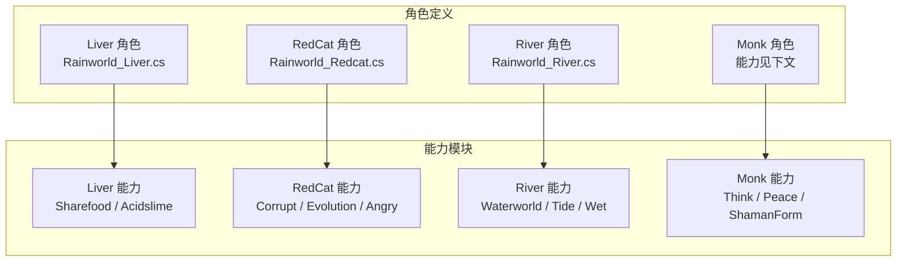
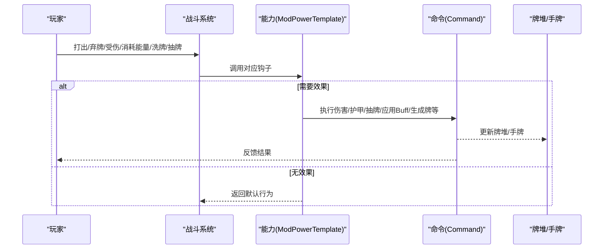
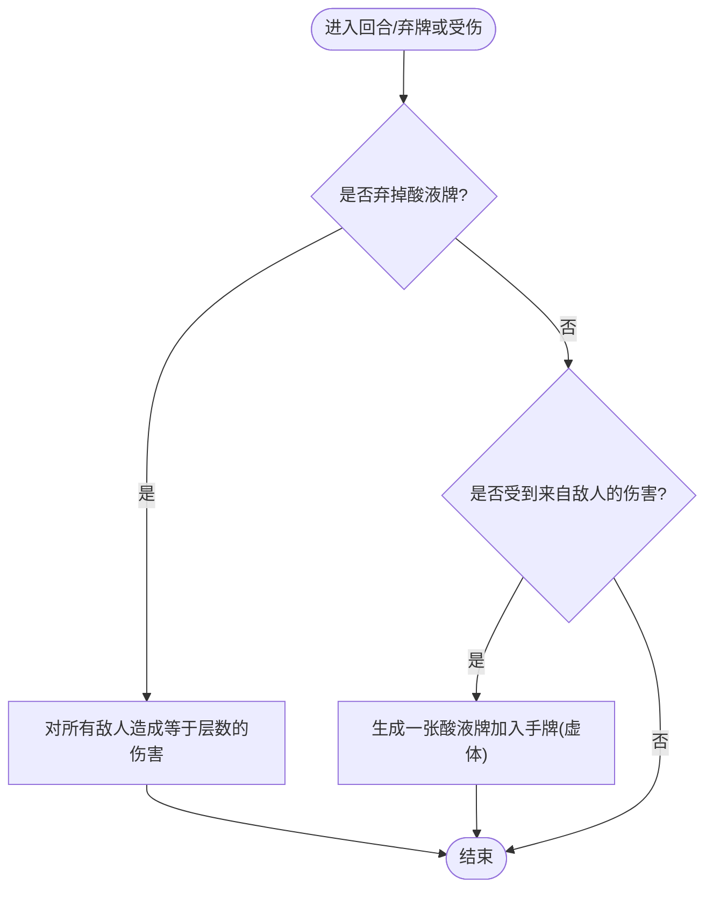
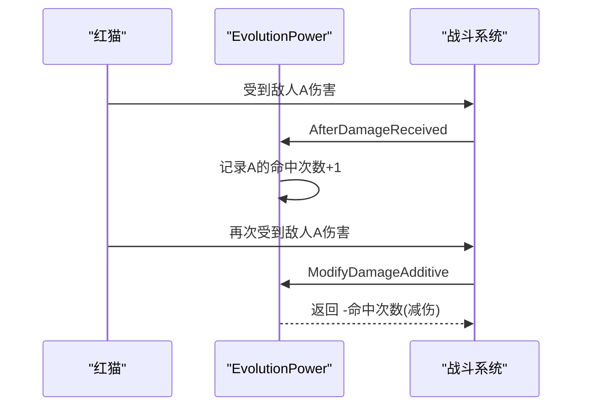
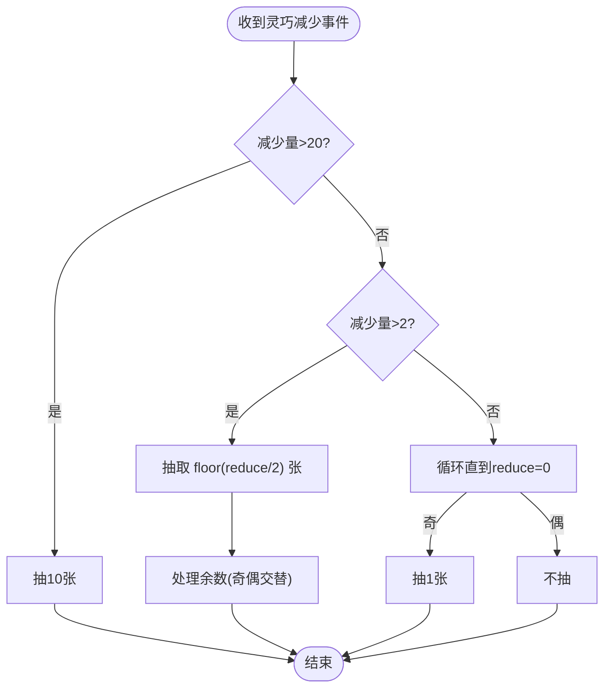
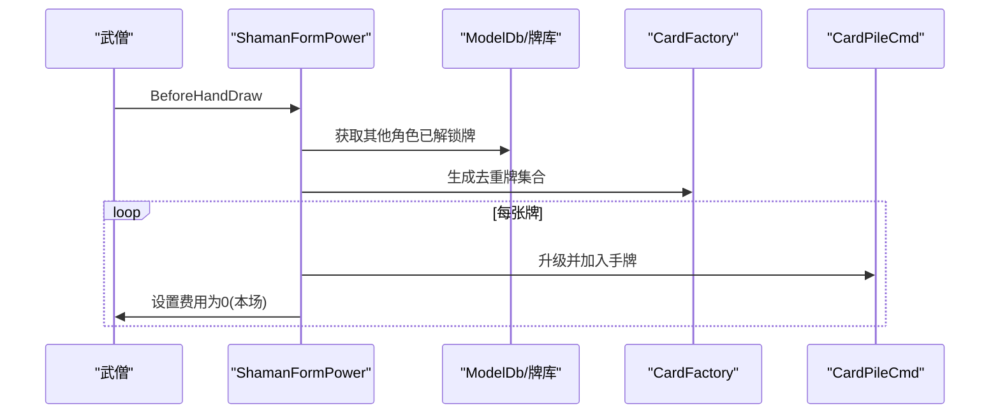
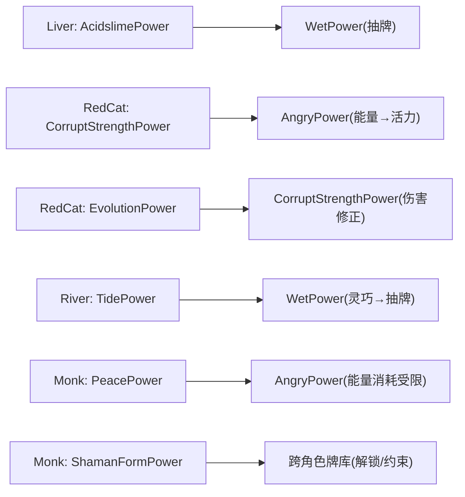

# 角色专属能力

<cite>
**本文引用的文件**
- [Rainworld_Liver.cs](file://Scripts/Slugcat/Rainworld_Liver.cs)
- [Rainworld_Redcat.cs](file://Scripts/Slugcat/Rainworld_Redcat.cs)
- [Rainworld_River.cs](file://Scripts/Slugcat/Rainworld_River.cs)
- [SharefoodPower.cs](file://Scripts/Powers/Liver/SharefoodPower.cs)
- [AcidslimePower.cs](file://Scripts/Powers/Liver/AcidslimePower.cs)
- [CorruptStrengthPower.cs](file://Scripts/Powers/RedCat/CorruptStrengthPower.cs)
- [EvolutionPower.cs](file://Scripts/Powers/RedCat/EvolutionPower.cs)
- [AngryPower.cs](file://Scripts/Powers/RedCat/AngryPower.cs)
- [WaterworldPower.cs](file://Scripts/Powers/River/WaterworldPower.cs)
- [TidePower.cs](file://Scripts/Powers/River/TidePower.cs)
- [WetPower.cs](file://Scripts/Powers/River/WetPower.cs)
- [ThinkPower.cs](file://Scripts/Powers/Monk/ThinkPower.cs)
- [PeacePower.cs](file://Scripts/Powers/Monk/PeacePower.cs)
- [ShamanFormPower.cs](file://Scripts/Powers/Monk/ShamanFormPower.cs)
</cite>

## 目录
1. [简介](#简介)
2. [项目结构](#项目结构)
3. [核心组件](#核心组件)
4. [架构总览](#架构总览)
5. [详细组件分析](#详细组件分析)
6. [依赖关系分析](#依赖关系分析)
7. [性能与平衡性考虑](#性能与平衡性考虑)
8. [故障排查指南](#故障排查指南)
9. [结论](#结论)
10. [附录](#附录)

## 简介
本文件为“各角色专属能力”的实现文档，聚焦以下四类能力的触发条件、效果计算、状态管理与系统交互：
- Liver（肝脏）：代谢、分享食物、酸液等
- RedCat（红猫）：腐化、进化、愤怒等
- River（河童）：水世界、潮汐、湿润等
- Monk（武僧）：冥想、和平、萨满形态等

文档以代码级为依据，结合能力类（Power）与角色定义（Character）的钩子方法，给出清晰的流程图与时序图，帮助开发者理解并扩展这些能力。

## 项目结构
- 角色定义位于 Scripts/Slugcat 下，分别声明起始生命、初始牌组、资源上限与视觉配置。
- 能力实现位于 Scripts/Powers 下，按角色分目录组织，通过 ModPowerTemplate 继承并覆盖生命周期钩子实现效果。
- 卡牌模型与池在 Scripts/Card 中按角色划分，能力常与特定卡牌类型或关键词联动。

图表来源
- [Rainworld_Liver.cs:28-117](file://Scripts/Slugcat/Rainworld_Liver.cs#L28-L117)
- [Rainworld_Redcat.cs:29-128](file://Scripts/Slugcat/Rainworld_Redcat.cs#L29-L128)
- [Rainworld_River.cs:31-114](file://Scripts/Slugcat/Rainworld_River.cs#L31-L114)

章节来源
- [Rainworld_Liver.cs:28-117](file://Scripts/Slugcat/Rainworld_Liver.cs#L28-L117)
- [Rainworld_Redcat.cs:29-128](file://Scripts/Slugcat/Rainworld_Redcat.cs#L29-L128)
- [Rainworld_River.cs:31-114](file://Scripts/Slugcat/Rainworld_River.cs#L31-L114)

## 核心组件
- Liver 角色：具备食物与工作等级等自定义资源；提供分享食物、酸液等能力。
- RedCat 角色：具备更高食物上限与腐化相关能力；提供腐化增伤、进化减伤、愤怒增益等。
- River 角色：具备水世界、潮汐、湿润等环境型能力；围绕抽牌、护甲与伤害联动。
- Monk 角色：具备冥想（受击回盾）、和平（禁攻）、萨满形态（跨角色牌库零费加升级）等。

章节来源
- [Rainworld_Liver.cs:31-43](file://Scripts/Slugcat/Rainworld_Liver.cs#L31-L43)
- [Rainworld_Redcat.cs:32-43](file://Scripts/Slugcat/Rainworld_Redcat.cs#L32-L43)
- [Rainworld_River.cs:34-45](file://Scripts/Slugcat/Rainworld_River.cs#L34-L45)
- [ShamanFormPower.cs:37-67](file://Scripts/Powers/Monk/ShamanFormPower.cs#L37-L67)

## 架构总览
能力通过覆盖 ModPowerTemplate 的生命周期钩子参与战斗流程，常见钩子包括：
- AfterCardExhausted：弃牌后触发
- AfterDamageReceived：受到伤害时触发
- ModifyDamageAdditive：修改伤害数值
- AfterEnergySpent：消耗能量后触发
- AfterShuffle：洗牌后触发
- BeforeHandDraw：抽牌前触发
- ShouldPlay：控制是否可出牌

图表来源
- [AcidslimePower.cs:41-57](file://Scripts/Powers/Liver/AcidslimePower.cs#L41-L57)
- [TidePower.cs:35-45](file://Scripts/Powers/River/TidePower.cs#L35-L45)
- [AngryPower.cs:43-47](file://Scripts/Powers/RedCat/AngryPower.cs#L43-L47)
- [ShamanFormPower.cs:99-116](file://Scripts/Powers/Monk/ShamanFormPower.cs#L99-L116)

## 详细组件分析

### Liver 角色能力
- 分享食物（SharefoodPower）
  - 类型：Buff，单例
  - 关联：通过关键词提示“食物卡”，用于与其他食物机制联动
  - 触发：作为被动标识，具体效果由其他逻辑读取该 Power 存在与否
- 酸液（AcidslimePower）
  - 类型：Buff，计数器
  - 触发条件：
    - 弃牌后：若弃掉的牌是酸液牌，对所有敌人造成基于层数的伤害
    - 受到伤害后：若来源非自身且非不可被力量影响，生成一张酸液牌加入手牌
  - 效果计算：伤害值=当前层数；生成牌带“虚体”关键词
  - 状态管理：使用 Power 层数记录伤害倍率
  - 系统交互：通过命令对敌人造成伤害、向手牌添加生成的牌

图表来源
- [AcidslimePower.cs:41-57](file://Scripts/Powers/Liver/AcidslimePower.cs#L41-L57)

章节来源
- [SharefoodPower.cs:25-41](file://Scripts/Powers/Liver/SharefoodPower.cs#L25-L41)
- [AcidslimePower.cs:27-59](file://Scripts/Powers/Liver/AcidslimePower.cs#L27-L59)

### RedCat 角色能力
- 腐化增伤（CorruptStrengthPower）
  - 类型：Buff，计数器
  - 触发条件：当攻击目标不是自身、来源是自身、且拥有“红菇”能力时生效
  - 效果计算：对符合条件的伤害增加等于层数的数值
  - 状态管理：层数随腐化相关机制增长
  - 系统交互：通过 ModifyDamageAdditive 修改伤害
- 进化（EvolutionPower）
  - 类型：Buff，计数器
  - 触发条件：受到来自不同敌人的伤害时，记录每个敌人的命中次数
  - 效果计算：下次受到相同敌人伤害时，减少等于命中次数的伤害
  - 状态管理：内部字典记录“敌人名称→命中次数”
  - 系统交互：AfterDamageReceived 计数，ModifyDamageAdditive 扣减伤害
- 愤怒（AngryPower）
  - 类型：Buff，计数器
  - 触发条件：消耗能量后
  - 效果计算：获得等于本次消耗能量的“活力”增益（持续一回合）
  - 状态管理：层数决定每次获得的活力量
  - 系统交互：AfterEnergySpent 触发，Apply VigorPower

图表来源
- [EvolutionPower.cs:42-62](file://Scripts/Powers/RedCat/EvolutionPower.cs#L42-L62)

章节来源
- [CorruptStrengthPower.cs:27-51](file://Scripts/Powers/RedCat/CorruptStrengthPower.cs#L27-L51)
- [EvolutionPower.cs:28-64](file://Scripts/Powers/RedCat/EvolutionPower.cs#L28-L64)
- [AngryPower.cs:27-48](file://Scripts/Powers/RedCat/AngryPower.cs#L27-L48)

### River 角色能力
- 水世界（WaterworldPower）
  - 类型：Buff，单例
  - 说明：作为环境标记，配合其他能力（如湿润、潮汐）形成体系
- 潮汐（TidePower）
  - 类型：Buff，计数器
  - 触发条件：玩家洗牌后
  - 效果计算：
    - 给自身施加一层“灵巧帽”（AdroitcapPower）
    - 对所有敌人造成等于层数的伤害
  - 状态管理：层数累积，每次洗牌触发
  - 系统交互：AfterShuffle 触发，Apply AdroitcapPower 与 CreatureCmd.Damage
- 湿润（WetPower）
  - 类型：Buff，单例
  - 功能：将“灵巧”（Adroit）的抽牌惩罚转化为实际抽牌
  - 触发条件：当减少灵巧值时调用 ReduceAdroit
  - 效果计算：
    - 若减少量>20：直接抽10张
    - 若>2：抽取 reduceAmount/2 张，剩余按奇偶交替决定是否抽牌
  - 状态管理：drawToggle 切换控制交替抽牌
  - 系统交互：CardPileCmd.Draw 多次调用

图表来源
- [WetPower.cs:34-65](file://Scripts/Powers/River/WetPower.cs#L34-L65)

章节来源
- [WaterworldPower.cs:17-28](file://Scripts/Powers/River/WaterworldPower.cs#L17-L28)
- [TidePower.cs:23-47](file://Scripts/Powers/River/TidePower.cs#L23-L47)
- [WetPower.cs:22-65](file://Scripts/Powers/River/WetPower.cs#L22-L65)

### Monk 角色能力
- 冥想（ThinkPower）
  - 类型：Buff，单例
  - 触发条件：受到来自自身的未被格挡的伤害（排除不可阻挡/不可被力量影响）
  - 效果计算：获得等于未格挡伤害值的护甲
  - 状态管理：无额外状态，仅响应单次事件
  - 系统交互：AfterDamageReceived → CreatureCmd.GainBlock
- 和平（PeacePower）
  - 类型：Debuff，计数器
  - 触发条件：每回合结束时递减层数
  - 效果计算：禁止玩家打出攻击牌（ShouldPlay 拦截）
  - 状态管理：层数递减，直至解除
  - 系统交互：AfterSideTurnEnd → PowerCmd.Decrement；ShouldPlay 拦截攻击
- 萨满形态（ShamanFormPower）
  - 类型：Buff，计数器
  - 触发条件：每回合开始抽牌前（BeforeHandDraw），若层数≥1
  - 效果计算：
    - 从其他 Slugcat 牌库中抽取若干张普通/稀有/罕见攻击或技能牌
    - 过滤特殊牌，确保唯一性
    - 将抽取的牌升级并加入手牌
    - 同时使这些牌在本场战斗中费用降为0（TryModifyEnergyCostInCombat）
  - 状态管理：AmountOnTurnStart 控制抽取数量
  - 系统交互：GetUnlockedCards、CardFactory.GetDistinctForCombat、CardCmd.Upgrade、CardPileCmd.AddGeneratedCardToCombat

图表来源
- [ShamanFormPower.cs:99-116](file://Scripts/Powers/Monk/ShamanFormPower.cs#L99-L116)
- [ShamanFormPower.cs:70-98](file://Scripts/Powers/Monk/ShamanFormPower.cs#L70-L98)

章节来源
- [ThinkPower.cs:13-32](file://Scripts/Powers/Monk/ThinkPower.cs#L13-L32)
- [PeacePower.cs:14-39](file://Scripts/Powers/Monk/PeacePower.cs#L14-L39)
- [ShamanFormPower.cs:25-140](file://Scripts/Powers/Monk/ShamanFormPower.cs#L25-L140)

## 依赖关系分析
- 能力与角色：
  - Liver 能力依赖“食物”与“酸液牌”类型；可通过 SharefoodPower 的存在进行判定。
  - RedCat 能力依赖“红菇”能力与“腐化”层数；EvolutionPower 依赖敌我伤害来源识别。
  - River 能力依赖“灵巧”系统与牌堆洗牌事件；TidePower 与 WetPower 共同构建水世界体系。
  - Monk 能力依赖牌库查询与战斗内费用修改；ShamanFormPower 跨角色牌库访问需保证解锁状态一致。
- 能力间耦合：
  - AcidslimePower 与 WetPower 均涉及抽牌与伤害，注意避免重复触发导致过强。
  - PeacePower 限制攻击，可能影响 RedCat 的愤怒收益（AngryPower 依赖能量消耗）。
  - EvolutionPower 与 CorruptStrengthPower 可在同一回合叠加，需注意伤害修正顺序。

图表来源
- [AcidslimePower.cs:41-57](file://Scripts/Powers/Liver/AcidslimePower.cs#L41-L57)
- [WetPower.cs:34-65](file://Scripts/Powers/River/WetPower.cs#L34-L65)
- [CorruptStrengthPower.cs:40-48](file://Scripts/Powers/RedCat/CorruptStrengthPower.cs#L40-L48)
- [AngryPower.cs:43-47](file://Scripts/Powers/RedCat/AngryPower.cs#L43-L47)
- [EvolutionPower.cs:42-62](file://Scripts/Powers/RedCat/EvolutionPower.cs#L42-L62)
- [TidePower.cs:35-45](file://Scripts/Powers/River/TidePower.cs#L35-L45)
- [PeacePower.cs:25-30](file://Scripts/Powers/Monk/PeacePower.cs#L25-L30)
- [ShamanFormPower.cs:44-67](file://Scripts/Powers/Monk/ShamanFormPower.cs#L44-L67)

章节来源
- [AcidslimePower.cs:27-59](file://Scripts/Powers/Liver/AcidslimePower.cs#L27-L59)
- [WetPower.cs:22-65](file://Scripts/Powers/River/WetPower.cs#L22-L65)
- [CorruptStrengthPower.cs:27-51](file://Scripts/Powers/RedCat/CorruptStrengthPower.cs#L27-L51)
- [AngryPower.cs:27-48](file://Scripts/Powers/RedCat/AngryPower.cs#L27-L48)
- [EvolutionPower.cs:28-64](file://Scripts/Powers/RedCat/EvolutionPower.cs#L28-L64)
- [TidePower.cs:23-47](file://Scripts/Powers/River/TidePower.cs#L23-L47)
- [PeacePower.cs:14-39](file://Scripts/Powers/Monk/PeacePower.cs#L14-L39)
- [ShamanFormPower.cs:25-140](file://Scripts/Powers/Monk/ShamanFormPower.cs#L25-L140)

## 性能与平衡性考虑
- 性能
  - 频繁抽牌（WetPower、TidePower）应限制最大抽牌量，避免帧率下降。
  - 跨牌库查询（ShamanFormPower）仅在回合开始时执行，降低运行时开销。
  - 伤害修正（CorruptStrengthPower、EvolutionPower）应在统一入口集中处理，避免重复计算。
- 平衡性
  - AcidslimePower 的弃牌触发与受击生成需设定上限或衰减，防止无限刷牌。
  - EvolutionPower 的减伤应与敌人数量/强度挂钩，避免对单体Boss过强。
  - PeacePower 的禁攻范围应明确边界，避免误伤策略组合。
  - ShamanFormPower 的抽取数量与稀有度需与角色强度匹配，防止超模。

[本节为通用指导，不直接分析具体文件]

## 故障排查指南
- 能力未触发
  - 检查是否正确注册 Power（RegisterPower）与 Character（RegisterCharacter）。
  - 确认钩子方法参数与条件判断是否符合预期（如 Owner、Dealer、ValueProp）。
- 效果异常
  - 核对层数（Amount）是否正确递增/递减。
  - 检查命令调用顺序（先 Apply Buff，再执行伤害/抽牌）。
  - 验证牌堆操作（AddGeneratedCardToCombat）是否在合法时机调用。
- 冲突与互斥
  - PeacePower 与需要攻击的策略冲突，需在 UI 或提示中明确。
  - AcidslimePower 与 WetPower 同时存在时，注意抽牌与伤害的叠加效应。

章节来源
- [AcidslimePower.cs:41-57](file://Scripts/Powers/Liver/AcidslimePower.cs#L41-L57)
- [TidePower.cs:35-45](file://Scripts/Powers/River/TidePower.cs#L35-L45)
- [PeacePower.cs:25-30](file://Scripts/Powers/Monk/PeacePower.cs#L25-L30)
- [ShamanFormPower.cs:99-116](file://Scripts/Powers/Monk/ShamanFormPower.cs#L99-L116)

## 结论
本实现通过统一的 Power 框架与角色定义，构建了 Liver、RedCat、River、Monk 四套风格鲜明的能力体系。各能力围绕触发条件、效果计算、状态管理与系统交互展开，既保证了玩法深度，又兼顾了可扩展性与平衡性。建议后续根据实战数据调整层数、阈值与触发频率，进一步优化体验。

[本节为总结，不直接分析具体文件]

## 附录
- 能力组合策略
  - Liver：酸液 + 分享食物，利用弃牌与受击生成酸液牌，配合高频率弃牌策略。
  - RedCat：腐化增伤 + 愤怒，快速叠层后爆发；进化减伤提升生存。
  - River：水世界 + 潮汐 + 湿润，通过洗牌与灵巧转化实现稳定抽牌与伤害。
  - Monk：冥想 + 和平 + 萨满形态，防御与跨角色资源调度结合。
- 平衡性建议
  - 为高频触发能力设置全局上限或衰减曲线。
  - 对跨牌库能力（萨满形态）限制稀有度与数量。
  - 对伤害修正类能力（腐化、进化）引入敌人维度限制。

[本节为概念性内容，不直接分析具体文件]