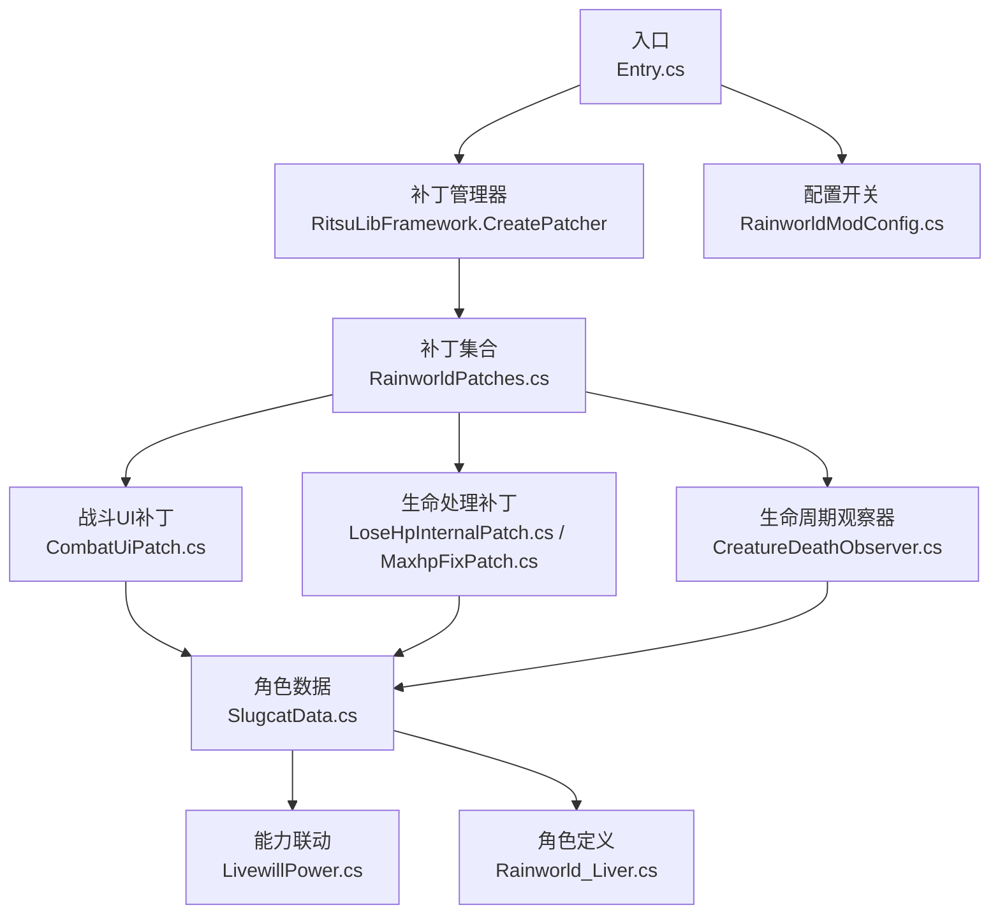
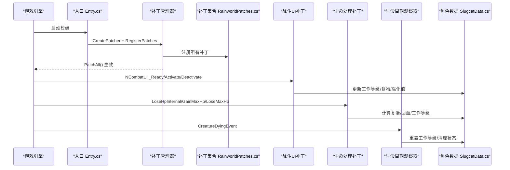
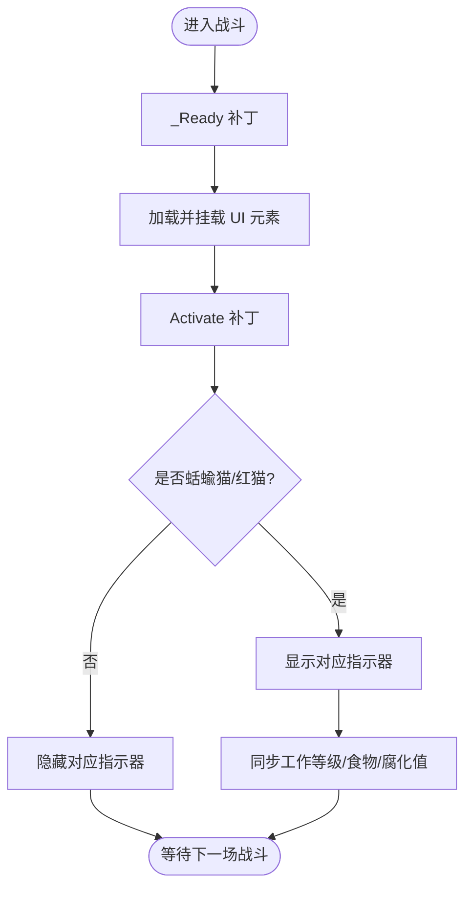
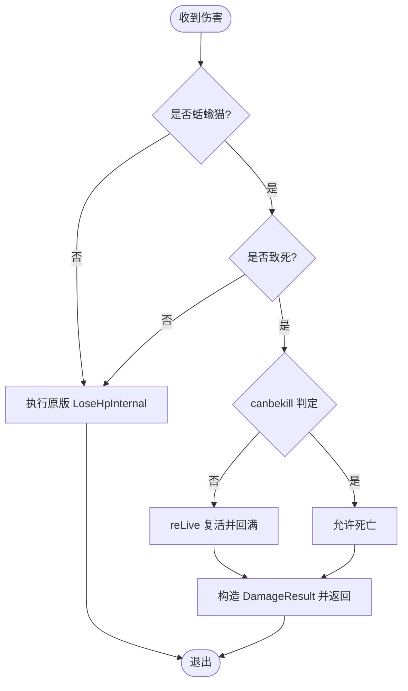
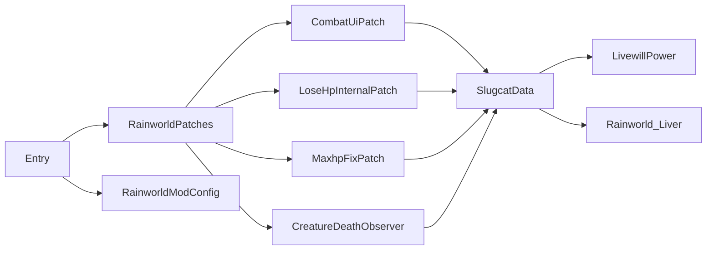

# 补丁系统

<cite>
**本文引用的文件**
- [Entry.cs](file://Scripts/Entry.cs)
- [RainworldPatches.cs](file://Scripts/patches/RainworldPatches.cs)
- [CombatUiPatch.cs](file://Scripts/patches/CombatUiPatch.cs)
- [LoseHpInternalPatch.cs](file://Scripts/patches/LoseHpInternalPatch.cs)
- [MaxhpFixPatch.cs](file://Scripts/patches/MaxhpFixPatch.cs)
- [CreatureDeathObserver.cs](file://Scripts/patches/Lifecycle/CreatureDeathObserver.cs)
- [SlugcatData.cs](file://Scripts/Slugcat/SlugcatData.cs)
- [LivewillPower.cs](file://Scripts/powers/LivewillPower.cs)
- [Rainworld_Liver.cs](file://Scripts/Slugcat/Rainworld_Liver.cs)
- [RainworldModConfig.cs](file://Scripts/RainworldModConfig.cs)
</cite>

## 目录
1. [简介](#简介)
2. [项目结构](#项目结构)
3. [核心组件](#核心组件)
4. [架构总览](#架构总览)
5. [详细组件分析](#详细组件分析)
6. [依赖关系分析](#依赖关系分析)
7. [性能与兼容性](#性能与兼容性)
8. [故障排查指南](#故障排查指南)
9. [结论](#结论)
10. [附录：自定义补丁开发指南](#附录自定义补丁开发指南)

## 简介
本技术文档围绕“补丁系统”展开，聚焦于基于 RitsuLib 的补丁框架在《杀戮尖塔》二创模组中的使用方式。内容涵盖：
- Harmony 风格补丁的注册、生命周期管理与优先级控制
- 游戏代码修改点（如战斗 UI、生命值处理、事件过滤等）
- 兼容性与冲突处理策略
- 具体补丁实现（战斗界面补丁、生命值处理补丁等）
- 自定义补丁创建、注入逻辑、行为修改的最佳实践
- 调试技巧与性能考虑
- 标准模式的代码示例路径指引

## 项目结构
本项目采用模块化组织，补丁相关代码集中在 Scripts/patches 目录下，并通过统一的入口进行初始化与注册。关键结构如下：
- 入口与初始化：Entry.cs
- 补丁集合注册：RainworldPatches.cs
- 战斗界面补丁：CombatUiPatch.cs
- 生命值与死亡处理：LoseHpInternalPatch.cs、MaxhpFixPatch.cs
- 生命周期观察器：Lifecycle/CreatureDeathObserver.cs
- 角色数据与状态管理：SlugcatData.cs
- 能力与机制联动：LivewillPower.cs
- 角色定义与资源绑定：Rainworld_Liver.cs
- 配置开关：RainworldModConfig.cs

**图示来源**
- [Entry.cs:26-34](file://Scripts/Entry.cs#L26-L34)
- [RainworldPatches.cs:10-33](file://Scripts/patches/RainworldPatches.cs#L10-L33)
- [CombatUiPatch.cs:138-277](file://Scripts/patches/CombatUiPatch.cs#L138-L277)
- [LoseHpInternalPatch.cs:21-147](file://Scripts/patches/LoseHpInternalPatch.cs#L21-L147)
- [MaxhpFixPatch.cs:11-91](file://Scripts/patches/MaxhpFixPatch.cs#L11-L91)
- [CreatureDeathObserver.cs:11-27](file://Scripts/patches/Lifecycle/CreatureDeathObserver.cs#L11-L27)
- [SlugcatData.cs:32-367](file://Scripts/Slugcat/SlugcatData.cs#L32-L367)
- [LivewillPower.cs:27-102](file://Scripts/powers/LivewillPower.cs#L27-L102)
- [Rainworld_Liver.cs:28-117](file://Scripts/Slugcat/Rainworld_Liver.cs#L28-L117)
- [RainworldModConfig.cs:11-235](file://Scripts/RainworldModConfig.cs#L11-L235)

**章节来源**
- [Entry.cs:26-34](file://Scripts/Entry.cs#L26-L34)
- [RainworldPatches.cs:10-33](file://Scripts/patches/RainworldPatches.cs#L10-L33)

## 核心组件
- 入口与补丁初始化
  - 通过 RitsuLibFramework.CreatePatcher 创建补丁器并注册补丁集合，随后调用 PatchAll 完成所有补丁的加载与生效。
  - 同时注册模组配置、Godot 脚本、自动发现内容、卡牌手牌轮廓规则、FMOD 音频资源等。
- 补丁集合注册
  - RainworldPatches 集中声明需要注册的各类补丁，包括战斗 UI、生命值修复、事件过滤、Godot 修复等。
- 战斗界面补丁
  - 在战斗 UI 就绪时动态加载并挂载 Godot 场景（睡眠按钮、工作等级指示器、腐化指示器），并在激活/停用阶段控制可见性与状态。
- 生命值与死亡处理
  - 拦截 Creature.LoseHpInternal 以支持蛞蝓猫的特殊复活逻辑；拦截 CreatureCmd.GainMaxHp/LoseMaxHp 调整生命上限变化；拦截 Hook.ModifyHpLost 使特定卡牌伤害穿透能力。
- 生命周期观察器
  - 订阅 CreatureDyingEvent，在蛞蝓猫死亡时根据条件重置工作等级或清理状态。
- 角色数据与状态管理
  - SlugcatData 提供工作等级、食物、腐化值等二次资源的读写、同步到 UI、以及胜利奖励、睡眠、复活等流程。
- 能力联动
  - LivewillPower 展示能力如何参与战斗流程（如修改能量消耗、影响伤害/掉血、回合结束递减）。
- 角色定义
  - Rainworld_Liver 定义角色资产、起始卡组、遗物、视觉与音频资源等。
- 配置开关
  - RainworldModConfig 提供可配置的开关项，供补丁与运行时逻辑读取，便于兼容性与调优。

**章节来源**
- [Entry.cs:26-77](file://Scripts/Entry.cs#L26-L77)
- [RainworldPatches.cs:10-33](file://Scripts/patches/RainworldPatches.cs#L10-L33)
- [CombatUiPatch.cs:16-277](file://Scripts/patches/CombatUiPatch.cs#L16-L277)
- [LoseHpInternalPatch.cs:21-147](file://Scripts/patches/LoseHpInternalPatch.cs#L21-L147)
- [MaxhpFixPatch.cs:11-91](file://Scripts/patches/MaxhpFixPatch.cs#L11-L91)
- [CreatureDeathObserver.cs:11-27](file://Scripts/patches/Lifecycle/CreatureDeathObserver.cs#L11-L27)
- [SlugcatData.cs:32-367](file://Scripts/Slugcat/SlugcatData.cs#L32-L367)
- [LivewillPower.cs:27-102](file://Scripts/powers/LivewillPower.cs#L27-L102)
- [Rainworld_Liver.cs:28-117](file://Scripts/Slugcat/Rainworld_Liver.cs#L28-L117)
- [RainworldModConfig.cs:11-235](file://Scripts/RainworldModConfig.cs#L11-L235)

## 架构总览
下图展示了从入口到补丁执行、再到游戏逻辑修改的整体流程，以及各模块之间的交互关系。

**图示来源**
- [Entry.cs:26-34](file://Scripts/Entry.cs#L26-L34)
- [RainworldPatches.cs:10-33](file://Scripts/patches/RainworldPatches.cs#L10-L33)
- [CombatUiPatch.cs:138-277](file://Scripts/patches/CombatUiPatch.cs#L138-L277)
- [LoseHpInternalPatch.cs:21-147](file://Scripts/patches/LoseHpInternalPatch.cs#L21-L147)
- [MaxhpFixPatch.cs:11-91](file://Scripts/patches/MaxhpFixPatch.cs#L11-L91)
- [CreatureDeathObserver.cs:11-27](file://Scripts/patches/Lifecycle/CreatureDeathObserver.cs#L11-L27)
- [SlugcatData.cs:32-367](file://Scripts/Slugcat/SlugcatData.cs#L32-L367)

## 详细组件分析

### 战斗界面补丁（CombatUiPatch）
- 目标与方法
  - 在 NCombatUi 的 _Ready、Activate、Deactivate 方法上打 Postfix 补丁，用于加载和显示 Godot 场景元素（睡眠按钮、工作等级指示器、腐化指示器）。
- 生命周期管理
  - Ready：实例化并添加子节点，设置布局锚点与偏移，监听 TreeExiting 释放引用。
  - Activate：根据当前玩家角色类型控制可见性，初始化数据（工作等级、食物、腐化值）。
  - Deactivate：隐藏或禁用对应 UI 元素。
- 数据同步
  - 通过静态字段持有 UI 引用，并提供 UpdateWorkLevel、Setfood、SetCorruptValue 等方法由其他模块调用以刷新 UI。
- 兼容性处理
  - 对 GodotObject 实例有效性进行检查，避免空引用异常；对不同角色类型分别处理显示逻辑。

**图示来源**
- [CombatUiPatch.cs:138-277](file://Scripts/patches/CombatUiPatch.cs#L138-L277)

**章节来源**
- [CombatUiPatch.cs:16-277](file://Scripts/patches/CombatUiPatch.cs#L16-L277)

### 生命值处理补丁（LoseHpInternalPatch、MaxhpFixPatch）
- 目标与方法
  - LoseHpInternalPatch：拦截 Creature.LoseHpInternal，针对蛞蝓猫实现致死时的特殊复活逻辑，并阻止原方法执行。
  - MaxhpFixPatch：拦截 CreatureCmd.GainMaxHp/LoseMaxHp，将增益转为增加食物或限制单次损失为固定值。
  - StrangeBomb_ModifyHpLostBeforeOstyPatch：拦截 Hook.ModifyHpLost，使特定卡牌的伤害穿透所有能力。
- 处理逻辑
  - 判断是否为蛞蝓猫、是否具备复活条件（工作等级、能力、遗物）、是否致死，决定复活或正常扣血。
  - 对 GainMaxHp 进行分流：大于阈值则提升真实生命上限并治疗，否则增加食物。
  - 对 LoseMaxHp 根据配置在战斗中禁止损失或固定为 1。
- 返回值控制
  - Prefix 中设置 __result 并返回 false 以阻止原方法执行；或返回 true 继续原版逻辑。

**图示来源**
- [LoseHpInternalPatch.cs:21-94](file://Scripts/patches/LoseHpInternalPatch.cs#L21-L94)
- [MaxhpFixPatch.cs:11-91](file://Scripts/patches/MaxhpFixPatch.cs#L11-L91)
- [SlugcatData.cs:165-221](file://Scripts/Slugcat/SlugcatData.cs#L165-L221)

**章节来源**
- [LoseHpInternalPatch.cs:21-147](file://Scripts/patches/LoseHpInternalPatch.cs#L21-L147)
- [MaxhpFixPatch.cs:11-91](file://Scripts/patches/MaxhpFixPatch.cs#L11-L91)
- [SlugcatData.cs:106-221](file://Scripts/Slugcat/SlugcatData.cs#L106-L221)

### 生命周期观察器（CreatureDeathObserver）
- 目标与触发
  - 订阅 CreatureDyingEvent，当玩家角色为蛞蝓猫且满足条件时重置工作等级。
- 作用
  - 确保死亡后状态一致性，配合复活逻辑与工作等级系统。

**章节来源**
- [CreatureDeathObserver.cs:11-27](file://Scripts/patches/Lifecycle/CreatureDeathObserver.cs#L11-L27)

### 角色数据与状态管理（SlugcatData）
- 功能概览
  - 提供工作等级、食物、腐化值的获取与修改；胜利奖励发放；睡眠与复活流程；与 UI 同步。
- 关键点
  - canbekill：综合遗物、能力与工作等级判断是否允许死亡。
  - reLive：根据能力与遗物选择回满生命或降低工作等级。
  - setworklevel/addworklevel：边界检查、音效播放、UI 同步、保存至遗物。
  - setCorruptValue/addCorruptValue：腐化值范围限制、能力联动（力量、护盾、自伤等）。
- 与补丁协作
  - 被战斗 UI 补丁与生命处理补丁调用，统一状态变更入口，保证一致性与可维护性。

**章节来源**
- [SlugcatData.cs:32-367](file://Scripts/Slugcat/SlugcatData.cs#L32-L367)

### 能力联动（LivewillPower）
- 功能
  - 修改手牌/打出阶段卡牌的能量消耗；在攻击后移除自身；影响掉血与伤害；回合结束时递减。
- 设计模式
  - 通过 ModPowerTemplate 重写生命周期回调，体现能力与战斗流程的深度集成。

**章节来源**
- [LivewillPower.cs:27-102](file://Scripts/powers/LivewillPower.cs#L27-L102)

### 角色定义（Rainworld_Liver）
- 内容
  - 定义角色资产、起始卡组、遗物、视觉与音频资源、多人模式图标等。
- 意义
  - 作为补丁与 UI 的目标角色类型识别依据，支撑差异化逻辑。

**章节来源**
- [Rainworld_Liver.cs:28-117](file://Scripts/Slugcat/Rainworld_Liver.cs#L28-L117)

### 配置开关（RainworldModConfig）
- 内容
  - 提供多项布尔开关，如战斗中禁止损失生命上限、怪物启用开关、事件启用开关等。
- 使用
  - 补丁与运行时逻辑读取配置以决定行为分支，便于兼容性与用户自定义。

**章节来源**
- [RainworldModConfig.cs:11-235](file://Scripts/RainworldModConfig.cs#L11-L235)

## 依赖关系分析
- 入口依赖
  - Entry 依赖 RitsuLibFramework 创建补丁器并注册补丁集合，同时注册配置与内容。
- 补丁集合依赖
  - RainworldPatches 集中注册所有补丁，形成补丁中心化管理。
- 补丁间耦合
  - 战斗 UI 补丁与角色数据强耦合（通过静态字段与公共方法同步状态）。
  - 生命处理补丁与角色数据紧密协作（复活、工作等级、腐化值）。
  - 生命周期观察器与角色数据协作（死亡时重置状态）。
- 外部依赖
  - Godot 场景加载与节点管理（战斗 UI 补丁）。
  - 命令与上下文（MegaCrit.Sts2.Core.*）用于游戏内操作。
  - RitsuLib 提供的补丁模型与生命周期接口。

**图示来源**
- [Entry.cs:26-77](file://Scripts/Entry.cs#L26-L77)
- [RainworldPatches.cs:10-33](file://Scripts/patches/RainworldPatches.cs#L10-L33)
- [CombatUiPatch.cs:138-277](file://Scripts/patches/CombatUiPatch.cs#L138-L277)
- [LoseHpInternalPatch.cs:21-147](file://Scripts/patches/LoseHpInternalPatch.cs#L21-L147)
- [MaxhpFixPatch.cs:11-91](file://Scripts/patches/MaxhpFixPatch.cs#L11-L91)
- [CreatureDeathObserver.cs:11-27](file://Scripts/patches/Lifecycle/CreatureDeathObserver.cs#L11-L27)
- [SlugcatData.cs:32-367](file://Scripts/Slugcat/SlugcatData.cs#L32-L367)
- [LivewillPower.cs:27-102](file://Scripts/powers/LivewillPower.cs#L27-L102)
- [Rainworld_Liver.cs:28-117](file://Scripts/Slugcat/Rainworld_Liver.cs#L28-L117)
- [RainworldModConfig.cs:11-235](file://Scripts/RainworldModConfig.cs#L11-L235)

**章节来源**
- [Entry.cs:26-77](file://Scripts/Entry.cs#L26-L77)
- [RainworldPatches.cs:10-33](file://Scripts/patches/RainworldPatches.cs#L10-L33)

## 性能与兼容性
- 性能考虑
  - 在战斗 UI 加载时仅实例化一次场景，并缓存引用；在 TreeExiting 中释放引用，避免内存泄漏。
  - 对 Godot 对象进行有效性检查，减少无效调用与异常开销。
  - 使用异步命令（如 CreatureCmd.Heal/Damage）避免阻塞主线程。
- 兼容性处理
  - 通过配置开关控制行为分支，便于不同版本或不同模组环境下的兼容。
  - 补丁目标明确（类名与方法签名），避免误匹配导致的不稳定。
  - 对多角色类型进行区分处理，确保非目标角色不受影响。
- 冲突解决
  - 若多个补丁修改同一方法，应通过明确的 PatchId 与 Description 标识，必要时拆分职责或使用更细粒度的钩子。
  - 利用 Prefix/Postfix 的组合，先前置校验再后置补充，降低相互干扰。

[本节为通用指导，不直接分析具体文件]

## 故障排查指南
- 常见问题
  - UI 未显示：检查战斗 UI 补丁是否在 _Ready 中成功加载场景，确认 Godot 路径正确与实例有效。
  - 复活无效：检查 canbekill 判定逻辑、工作等级、能力与遗物状态；查看日志输出。
  - 生命上限变化异常：确认 GainMaxHp/LoseMaxHp 补丁是否按预期分支执行，检查配置开关。
- 调试技巧
  - 在关键分支加入日志输出（Entry.Logger 或 Log.Info/Debug），记录参数与状态。
  - 使用断点或日志定位问题，优先验证输入参数与条件判断。
  - 逐步缩小范围：先确认补丁是否注册成功，再确认目标方法是否被命中。
- 恢复策略
  - 临时关闭相关补丁或配置项，验证是否为该补丁引起的问题。
  - 回滚到稳定版本，对比差异定位问题。

**章节来源**
- [Entry.cs:26-77](file://Scripts/Entry.cs#L26-L77)
- [CombatUiPatch.cs:138-277](file://Scripts/patches/CombatUiPatch.cs#L138-L277)
- [LoseHpInternalPatch.cs:21-147](file://Scripts/patches/LoseHpInternalPatch.cs#L21-L147)
- [MaxhpFixPatch.cs:11-91](file://Scripts/patches/MaxhpFixPatch.cs#L11-L91)
- [SlugcatData.cs:106-221](file://Scripts/Slugcat/SlugcatData.cs#L106-L221)

## 结论
本项目的补丁系统基于 RitsuLib 的补丁框架，实现了战斗界面增强、生命值处理、生命周期管理等核心功能。通过集中注册、明确的目标方法与返回值控制，保证了补丁的可维护性与稳定性。角色数据统一管理状态变更，能力与角色定义提供了扩展点。配置开关提升了兼容性与可调性。整体架构清晰，适合进一步扩展与优化。

[本节为总结，不直接分析具体文件]

## 附录：自定义补丁开发指南
- 创建步骤
  - 新建补丁类并实现 IPatchMethod，定义 PatchId、Description、IsCritical。
  - 在 GetTargets 中指定目标类与方法签名。
  - 实现 Prefix/Postfix 逻辑，合理设置返回值与 __result。
  - 在 RainworldPatches.AddTo 中注册新补丁。
- 注入与修改
  - 使用 Prefix 拦截并替换逻辑，或 Postfix 在原版之后追加行为。
  - 通过 SlugcatData 统一修改角色状态，确保一致性。
  - 与 UI 交互时，调用 CombatUiPatch 的公开方法刷新显示。
- 最佳实践
  - 保持补丁职责单一，避免在一个补丁中处理过多逻辑。
  - 对 Godot 对象进行有效性检查，避免空引用异常。
  - 使用配置开关控制可选行为，提升兼容性。
  - 加入日志与错误捕获，便于调试与定位问题。
- 调试技巧
  - 在关键分支输出日志，记录参数与状态变化。
  - 使用断点与单步执行，验证补丁命中与执行顺序。
  - 逐步关闭补丁或配置项，隔离问题来源。
- 性能考虑
  - 避免在高频调用路径中进行重计算或 I/O。
  - 使用异步命令与延迟加载，减少卡顿。
  - 缓存常用引用与结果，减少重复实例化。

[本节为通用指导，不直接分析具体文件]