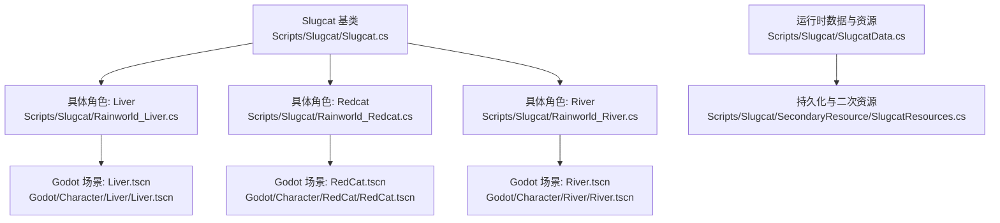
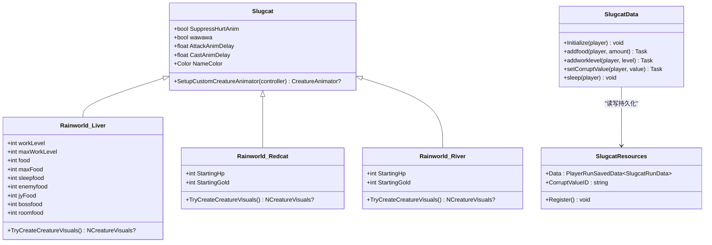
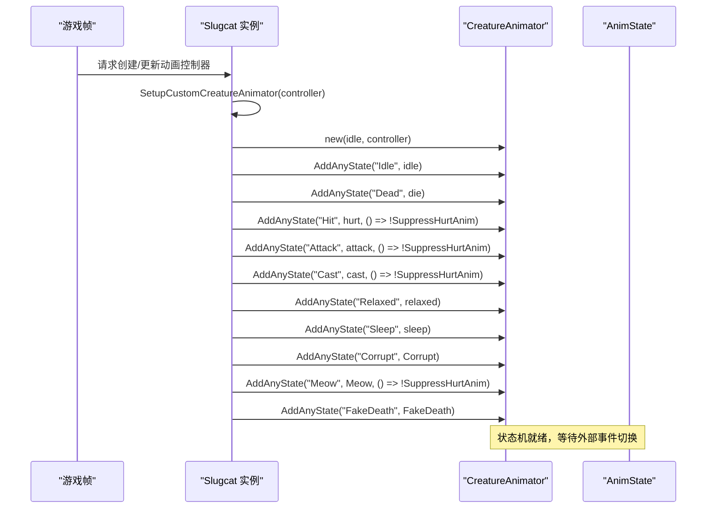
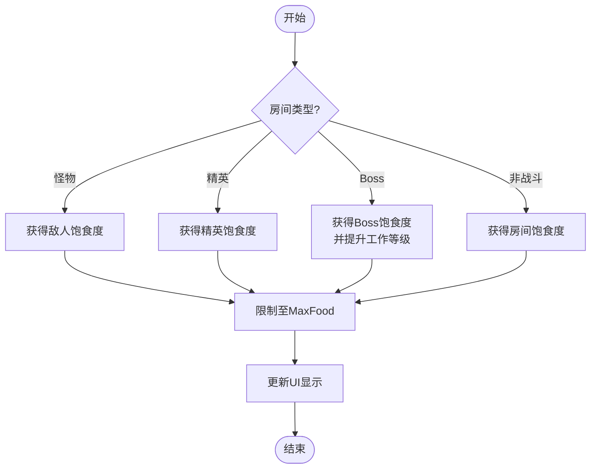
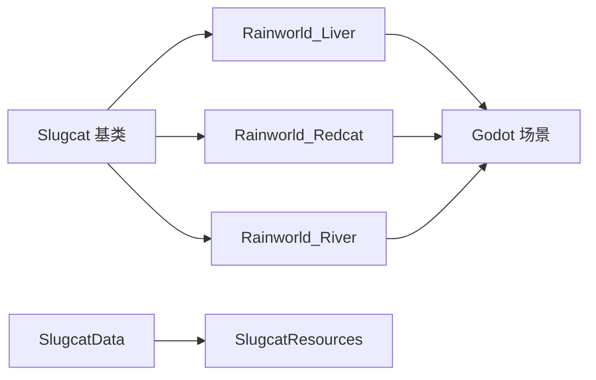

# Slugcat基类设计

<cite>
**本文引用的文件**
- [Scripts/Slugcat/Slugcat.cs](file://Scripts/Slugcat/Slugcat.cs)
- [Scripts/Slugcat/SlugcatData.cs](file://Scripts/Slugcat/SlugcatData.cs)
- [Scripts/Slugcat/Rainworld_Liver.cs](file://Scripts/Slugcat/Rainworld_Liver.cs)
- [Scripts/Slugcat/Rainworld_Redcat.cs](file://Scripts/Slugcat/Rainworld_Redcat.cs)
- [Scripts/Slugcat/Rainworld_River.cs](file://Scripts/Slugcat/Rainworld_River.cs)
- [Scripts/Slugcat/SecondaryResource/SlugcatResources.cs](file://Scripts/Slugcat/SecondaryResource/SlugcatResources.cs)
- [Godot/Character/Liver/NLiver.cs](file://Godot/Character/Liver/NLiver.cs)
- [Godot/Character/RedCat/NRedCat.cs](file://Godot/Character/RedCat/NRedCat.cs)
- [Godot/Character/River/NRiver.cs](file://Godot/Character/River/NRiver.cs)
</cite>

## 目录
1. [简介](#简介)
2. [项目结构](#项目结构)
3. [核心组件](#核心组件)
4. [架构总览](#架构总览)
5. [详细组件分析](#详细组件分析)
6. [依赖关系分析](#依赖关系分析)
7. [性能考量](#性能考量)
8. [故障排查指南](#故障排查指南)
9. [结论](#结论)
10. [附录：继承与自定义示例](#附录：继承与自定义示例)

## 简介
本技术文档围绕 Slugcat 基类展开，系统性阐述其抽象基类设计模式、泛型约束 TCardPool/TRelicPool/TPotionPool 的作用与实现原理；深入解析角色动画系统（CreatureAnimator）的初始化、状态机设计与状态转换逻辑；并详细说明工作等级、食物等核心属性的管理方式，以及 SuppressHurtAnim 和 wawawa 等特殊状态的实现。最后给出如何基于该基类创建新角色的实践方法，以及与 Godot 引擎和 MegaCrit 框架的集成适配机制说明。

## 项目结构
本项目采用“按特性/模块组织”的结构：
- Scripts/Slugcat：角色基类与具体角色实现、运行时数据与资源注册
- Godot/Character：各角色的 Godot 场景与可视化节点
- Scripts/Card/Potions/Relics/Powers：卡牌、药水、遗物、能力等扩展内容
- localization：多语言文本配置
- patches：对游戏运行时的补丁与钩子

图表来源
- [Scripts/Slugcat/Slugcat.cs:61-133](file://Scripts/Slugcat/Slugcat.cs#L61-L133)
- [Scripts/Slugcat/Rainworld_Liver.cs:28-117](file://Scripts/Slugcat/Rainworld_Liver.cs#L28-L117)
- [Scripts/Slugcat/Rainworld_Redcat.cs:29-128](file://Scripts/Slugcat/Rainworld_Redcat.cs#L29-L128)
- [Scripts/Slugcat/Rainworld_River.cs:31-114](file://Scripts/Slugcat/Rainworld_River.cs#L31-L114)
- [Scripts/Slugcat/SlugcatData.cs:32-367](file://Scripts/Slugcat/SlugcatData.cs#L32-L367)
- [Scripts/Slugcat/SecondaryResource/SlugcatResources.cs:7-49](file://Scripts/Slugcat/SecondaryResource/SlugcatResources.cs#L7-L49)

章节来源
- [Scripts/Slugcat/Slugcat.cs:61-133](file://Scripts/Slugcat/Slugcat.cs#L61-L133)
- [Scripts/Slugcat/SlugcatData.cs:32-367](file://Scripts/Slugcat/SlugcatData.cs#L32-L367)
- [Scripts/Slugcat/SecondaryResource/SlugcatResources.cs:7-49](file://Scripts/Slugcat/SecondaryResource/SlugcatResources.cs#L7-L49)

## 核心组件
- Slugcat 抽象基类：定义通用行为与动画状态机，提供泛型约束以绑定各角色的卡池、遗物池、药水池类型。
- 具体角色实现：Rainworld_Liver、Rainworld_Redcat、Rainworld_River，分别配置初始卡组、起始遗物、资产路径、颜色主题等。
- 运行时数据管理：SlugcatData 负责工作等级、饱食度、休眠、腐化值等属性读写与同步；SlugcatResources 负责跨局/战斗数据的注册与持久化。
- Godot 集成：通过 CharacterAssetProfile 指定 Godot 场景路径，使用 RitsuGodotNodeFactories 创建可视化节点，完成引擎与框架的桥接。

章节来源
- [Scripts/Slugcat/Slugcat.cs:61-133](file://Scripts/Slugcat/Slugcat.cs#L61-L133)
- [Scripts/Slugcat/Rainworld_Liver.cs:28-117](file://Scripts/Slugcat/Rainworld_Liver.cs#L28-L117)
- [Scripts/Slugcat/Rainworld_Redcat.cs:29-128](file://Scripts/Slugcat/Rainworld_Redcat.cs#L29-L128)
- [Scripts/Slugcat/Rainworld_River.cs:31-114](file://Scripts/Slugcat/Rainworld_River.cs#L31-L114)
- [Scripts/Slugcat/SlugcatData.cs:32-367](file://Scripts/Slugcat/SlugcatData.cs#L32-L367)
- [Scripts/Slugcat/SecondaryResource/SlugcatResources.cs:7-49](file://Scripts/Slugcat/SecondaryResource/SlugcatResources.cs#L7-L49)

## 架构总览
Slugcat 基类通过 ModCharacterTemplate<TCardPool, TRelicPool, TPotionPool> 接入 MegaCrit 框架的角色体系，并以泛型参数限定卡池、遗物池、药水池的类型，确保编译期安全与运行时一致性。动画系统由 CreatureAnimator 驱动，支持多种状态（待机、攻击、施法、受伤、死亡、放松、睡眠、畸变、喵叫、假死），并通过条件函数控制是否播放特定状态（如抑制受伤动画）。

图表来源
- [Scripts/Slugcat/Slugcat.cs:61-133](file://Scripts/Slugcat/Slugcat.cs#L61-L133)
- [Scripts/Slugcat/Rainworld_Liver.cs:28-117](file://Scripts/Slugcat/Rainworld_Liver.cs#L28-L117)
- [Scripts/Slugcat/Rainworld_Redcat.cs:29-128](file://Scripts/Slugcat/Rainworld_Redcat.cs#L29-L128)
- [Scripts/Slugcat/Rainworld_River.cs:31-114](file://Scripts/Slugcat/Rainworld_River.cs#L31-L114)
- [Scripts/Slugcat/SlugcatData.cs:32-367](file://Scripts/Slugcat/SlugcatData.cs#L32-L367)
- [Scripts/Slugcat/SecondaryResource/SlugcatResources.cs:7-49](file://Scripts/Slugcat/SecondaryResource/SlugcatResources.cs#L7-L49)

## 详细组件分析

### 抽象基类与泛型约束
- 基类 Slugcat<TCardPool, TRelicPool, TPotionPool> 继承自 ModCharacterTemplate，并通过 where 约束限定三类池必须为 TypeListCardPoolModel、TypeListRelicPoolModel、TypeListPotionPoolModel 的子类型，从而在编译期保证每个角色只能绑定自身定义的卡池、遗物池、药水池类型，避免混用导致运行时错误。
- 基类暴露 SuppressHurtAnim 与 wawawa 两个布尔字段，用于控制动画播放与特殊状态行为。
- 基类统一设置攻击/施法动画延迟、名称颜色、能量标签描边色、对话颜色、地图绘制颜色、远程瞄准线颜色等视觉表现。

章节来源
- [Scripts/Slugcat/Slugcat.cs:61-133](file://Scripts/Slugcat/Slugcat.cs#L61-L133)

### 角色动画系统（CreatureAnimator）
- 初始化流程：在 SetupCustomCreatureAnimator 中定义多个 AnimState（idle_loop、attack、cast、hurt、die、relaxed_loop、sleep、xianggu、meow、relive_loop），并为非循环状态设置 NextState 回到 idle。
- 状态注册：通过 AddAnyState 将状态名映射到对应动画，并可为某些状态附加条件函数（例如 Hit、Attack、Cast、Meow 仅在 SuppressHurtAnim 为 false 时允许触发）。
- 默认状态：idle 作为初始状态，其他状态结束后自动回归 idle，形成稳定的状态机闭环。

图表来源
- [Scripts/Slugcat/Slugcat.cs:93-133](file://Scripts/Slugcat/Slugcat.cs#L93-L133)

章节来源
- [Scripts/Slugcat/Slugcat.cs:93-133](file://Scripts/Slugcat/Slugcat.cs#L93-L133)

### 工作等级与饱食度管理
- 工作等级（Work Level）：
  - 通过 SlugcatData.addworklevel/setworklevel 进行增减与限制，上限受 MaxWorkLevel 约束，低于 0 时触发致命伤害逻辑。
  - 升级/降级时播放音效，并在 Boss 房间胜利后提升工作等级。
  - 当存在 WorklockPower 或 Redmushroom 等能力/遗物时，重生与扣血逻辑会变化。
- 饱食度（Food）：
  - 通过 addfood 增加，超过 MaxFood 的部分可转化为力量增益（FatworldPower）。
  - 不同房间类型（怪物、精英、Boss）给予不同的饱食度奖励；进入非战斗房间也可获得固定饱食度。
  - 休眠（Sleep）需要满足 Food >= SleepFood 且未处于假死状态。

图表来源
- [Scripts/Slugcat/SlugcatData.cs:117-142](file://Scripts/Slugcat/SlugcatData.cs#L117-L142)
- [Scripts/Slugcat/SlugcatData.cs:339-365](file://Scripts/Slugcat/SlugcatData.cs#L339-L365)

章节来源
- [Scripts/Slugcat/SlugcatData.cs:117-142](file://Scripts/Slugcat/SlugcatData.cs#L117-L142)
- [Scripts/Slugcat/SlugcatData.cs:185-221](file://Scripts/Slugcat/SlugcatData.cs#L185-L221)
- [Scripts/Slugcat/SlugcatData.cs:339-365](file://Scripts/Slugcat/SlugcatData.cs#L339-L365)

### 特殊状态：SuppressHurtAnim 与 wawawa
- SuppressHurtAnim：
  - 控制受伤、攻击、施法、喵叫等状态是否允许触发。当为 true 时，相关状态被抑制，常用于特殊剧情或无敌阶段。
  - 在动画状态注册时通过条件函数实现（如 AddAnyState("Hit", hurt, () => !SuppressHurtAnim)）。
- wawawa：
  - 作为角色状态标志位，可用于联动 UI 或行为逻辑（例如在对话或事件中输出特定台词）。
  - 在本地化文件中可见“wawawawawawa”等台词片段，体现角色在不同阶段的语音/文本表现。

章节来源
- [Scripts/Slugcat/Slugcat.cs:71-72](file://Scripts/Slugcat/Slugcat.cs#L71-L72)
- [Scripts/Slugcat/Slugcat.cs:124-130](file://Scripts/Slugcat/Slugcat.cs#L124-L130)
- [SlugcatTheSpireII/localization/zhs/ancients.json:55-97](file://SlugcatTheSpireII/localization/zhs/ancients.json#L55-L97)

### 与 Godot 引擎的集成
- 资产配置：具体角色通过 AssetProfile 指定 Godot 场景路径（VisualsPath、EnergyCounterPath、MerchantAnimPath、RestSiteAnimPath）、UI 图标、音频、多人模式手势贴图、原版遗物视觉覆盖等。
- 可视化节点创建：TryCreateCreatureVisuals 使用 RitsuGodotNodeFactories.CreateFromScenePath 从 .tscn 加载 Godot 节点，完成角色模型与动画的渲染。
- 示例：
  - Liver：res://Godot/Character/Liver/Liver.tscn
  - Redcat：res://Godot/Character/RedCat/RedCat.tscn
  - River：res://Godot/Character/River/River.tscn

章节来源
- [Scripts/Slugcat/Rainworld_Liver.cs:41-79](file://Scripts/Slugcat/Rainworld_Liver.cs#L41-L79)
- [Scripts/Slugcat/Rainworld_Redcat.cs:44-84](file://Scripts/Slugcat/Rainworld_Redcat.cs#L44-L84)
- [Scripts/Slugcat/Rainworld_River.cs:47-85](file://Scripts/Slugcat/Rainworld_River.cs#L47-L85)
- [Scripts/Slugcat/Rainworld_Liver.cs:108-108](file://Scripts/Slugcat/Rainworld_Liver.cs#L108-L108)
- [Scripts/Slugcat/Rainworld_Redcat.cs:119-119](file://Scripts/Slugcat/Rainworld_Redcat.cs#L119-L119)
- [Scripts/Slugcat/Rainworld_River.cs:105-105](file://Scripts/Slugcat/Rainworld_River.cs#L105-L105)

### 与 MegaCrit 框架的适配
- 角色模板：继承 ModCharacterTemplate<TCardPool, TRelicPool, TPotionPool>，利用框架提供的角色生命周期、战斗上下文、命令系统等。
- 池类型约束：TCardPool/TRelicPool/TPotionPool 必须为 TypeListCardPoolModel 子类，确保卡池、遗物池、药水池的统一管理与扩展点。
- 资源注册：通过 STS2RitsuLib 的 RegisterCharacter、RegisterSharedEvent 等注解完成自动注册；通过 SecondaryResourceRegistry 注册二次资源（如腐化值）。

章节来源
- [Scripts/Slugcat/Slugcat.cs:61-65](file://Scripts/Slugcat/Slugcat.cs#L61-L65)
- [Scripts/Slugcat/Rainworld_Liver.cs:28-29](file://Scripts/Slugcat/Rainworld_Liver.cs#L28-L29)
- [Scripts/Slugcat/Rainworld_Redcat.cs:29-30](file://Scripts/Slugcat/Rainworld_Redcat.cs#L29-L30)
- [Scripts/Slugcat/Rainworld_River.cs:31-32](file://Scripts/Slugcat/Rainworld_River.cs#L31-L32)
- [Scripts/Slugcat/SecondaryResource/SlugcatResources.cs:15-48](file://Scripts/Slugcat/SecondaryResource/SlugcatResources.cs#L15-L48)

## 依赖关系分析
- 基类与具体角色：具体角色继承 Slugcat 并实现各自资产与初始配置，复用基类的动画状态机与通用行为。
- 数据层：SlugcatData 依赖 SlugcatResources 进行持久化与二次资源读写；所有属性变更最终写入 RunSavedData 或 Combat 内二次资源。
- 引擎层：具体角色通过 AssetProfile 与 TryCreateCreatureVisuals 与 Godot 场景交互，完成渲染与动画播放。

图表来源
- [Scripts/Slugcat/Slugcat.cs:61-133](file://Scripts/Slugcat/Slugcat.cs#L61-L133)
- [Scripts/Slugcat/Rainworld_Liver.cs:28-117](file://Scripts/Slugcat/Rainworld_Liver.cs#L28-L117)
- [Scripts/Slugcat/Rainworld_Redcat.cs:29-128](file://Scripts/Slugcat/Rainworld_Redcat.cs#L29-L128)
- [Scripts/Slugcat/Rainworld_River.cs:31-114](file://Scripts/Slugcat/Rainworld_River.cs#L31-L114)
- [Scripts/Slugcat/SlugcatData.cs:32-367](file://Scripts/Slugcat/SlugcatData.cs#L32-L367)
- [Scripts/Slugcat/SecondaryResource/SlugcatResources.cs:7-49](file://Scripts/Slugcat/SecondaryResource/SlugcatResources.cs#L7-L49)

章节来源
- [Scripts/Slugcat/Slugcat.cs:61-133](file://Scripts/Slugcat/Slugcat.cs#L61-L133)
- [Scripts/Slugcat/SlugcatData.cs:32-367](file://Scripts/Slugcat/SlugcatData.cs#L32-L367)
- [Scripts/Slugcat/SecondaryResource/SlugcatResources.cs:7-49](file://Scripts/Slugcat/SecondaryResource/SlugcatResources.cs#L7-L49)

## 性能考量
- 动画状态机：合理设置 NextState 与循环状态，减少不必要的状态切换开销；仅在有必要时触发复杂动画（如受伤、攻击）。
- 资源加载：Godot 场景按需加载，避免一次性加载过多资源；使用 RitsuGodotNodeFactories 创建节点时注意对象生命周期管理。
- 数据同步：二次资源（如腐化值）在战斗中频繁更新，应尽量减少重复写入；RunSavedData 的写策略为 WhenSet，仅在值改变时落盘，降低 IO 压力。

[本节为通用指导，不直接分析具体文件]

## 故障排查指南
- 动画未触发：
  - 检查 SuppressHurtAnim 是否为 true，若为 true 则受伤/攻击/施法/喵叫状态会被抑制。
  - 确认 AddAnyState 的条件函数是否正确返回预期结果。
- 工作等级异常：
  - 检查是否存在 WorklockPower 或 Redmushroom 影响重生与扣血逻辑。
  - 确认 setworklevel 的边界处理（上限 MaxWorkLevel，下限 0）。
- 饱食度不生效：
  - 确认房间类型判断与奖励分配逻辑；检查 cansleep 条件（Food >= SleepFood 且未假死）。
- Godot 场景加载失败：
  - 核对 AssetProfile 中的 VisualsPath、EnergyCounterPath 等路径是否正确。
  - 确认 TryCreateCreatureVisuals 返回的节点非空。

章节来源
- [Scripts/Slugcat/Slugcat.cs:124-130](file://Scripts/Slugcat/Slugcat.cs#L124-L130)
- [Scripts/Slugcat/SlugcatData.cs:185-221](file://Scripts/Slugcat/SlugcatData.cs#L185-L221)
- [Scripts/Slugcat/SlugcatData.cs:223-238](file://Scripts/Slugcat/SlugcatData.cs#L223-L238)
- [Scripts/Slugcat/Rainworld_Liver.cs:41-79](file://Scripts/Slugcat/Rainworld_Liver.cs#L41-L79)

## 结论
Slugcat 基类通过泛型约束与统一的动画状态机设计，为多角色提供了可扩展、易维护的基础框架。结合 Godot 引擎与 MegaCrit 框架，实现了角色资产、动画、数据与战斗系统的深度集成。通过 SlugcatData 与 SlugcatResources 的管理，工作等级、饱食度、腐化值等核心属性得以稳定运行。开发者可基于该基类快速创建新角色，并通过自定义资产、初始卡组、能力与事件扩展玩法。

[本节为总结性内容，不直接分析具体文件]

## 附录：继承与自定义示例
- 继承基类创建新角色：
  - 新建类继承 Slugcat<TCardPool, TRelicPool, TPotionPool>，并使用 [RegisterCharacter] 注解注册。
  - 实现 AssetProfile，配置 Godot 场景路径、UI 图标、音频、多人模式贴图等。
  - 重写 StartingDeckEntries 与 StartingRelicTypes，定义初始卡组与遗物。
  - 如需自定义动画，可重写 SetupCustomCreatureAnimator，添加新的 AnimState 与状态转换逻辑。
- 自定义动画状态与行为：
  - 在基类或派生类中定义新的 AnimState，并通过 AddAnyState 注册到 CreatureAnimator。
  - 使用条件函数控制状态触发（如 SuppressHurtAnim）。
  - 设置 NextState 以实现状态回退或链式转换。
- 与 Godot 集成：
  - 准备 Godot 场景（.tscn）与资源（图集、骨骼、动画等）。
  - 在 AssetProfile 中指定 VisualsPath 等路径，并通过 TryCreateCreatureVisuals 加载节点。
- 与 MegaCrit 适配：
  - 使用 STS2RitsuLib 的注解与工具类完成自动注册与资源管理。
  - 通过 SecondaryResourceRegistry 注册二次资源（如腐化值），并在运行时读写。

章节来源
- [Scripts/Slugcat/Rainworld_Liver.cs:28-117](file://Scripts/Slugcat/Rainworld_Liver.cs#L28-L117)
- [Scripts/Slugcat/Rainworld_Redcat.cs:29-128](file://Scripts/Slugcat/Rainworld_Redcat.cs#L29-L128)
- [Scripts/Slugcat/Rainworld_River.cs:31-114](file://Scripts/Slugcat/Rainworld_River.cs#L31-L114)
- [Scripts/Slugcat/Slugcat.cs:93-133](file://Scripts/Slugcat/Slugcat.cs#L93-L133)
- [Scripts/Slugcat/SecondaryResource/SlugcatResources.cs:15-48](file://Scripts/Slugcat/SecondaryResource/SlugcatResources.cs#L15-L48)