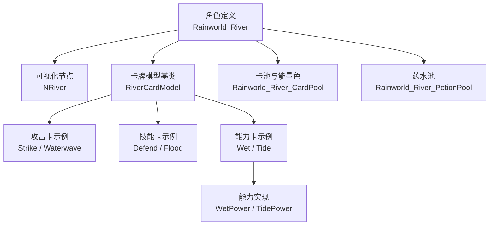
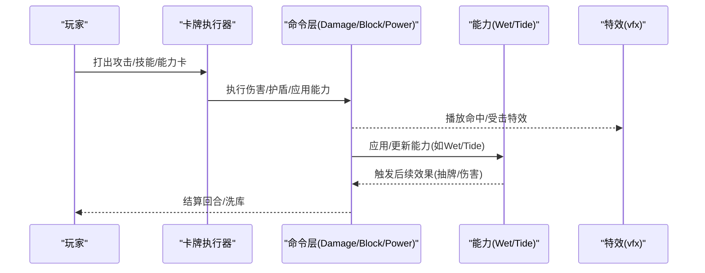
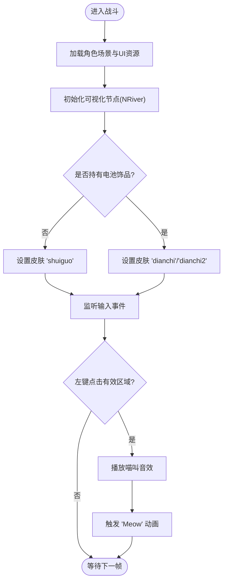
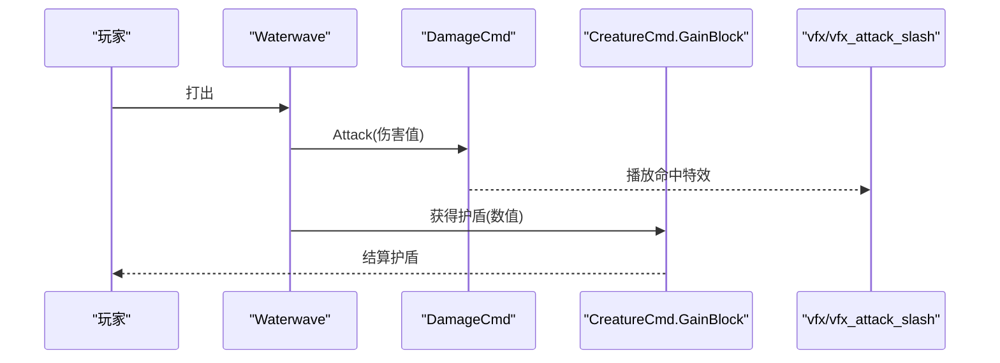
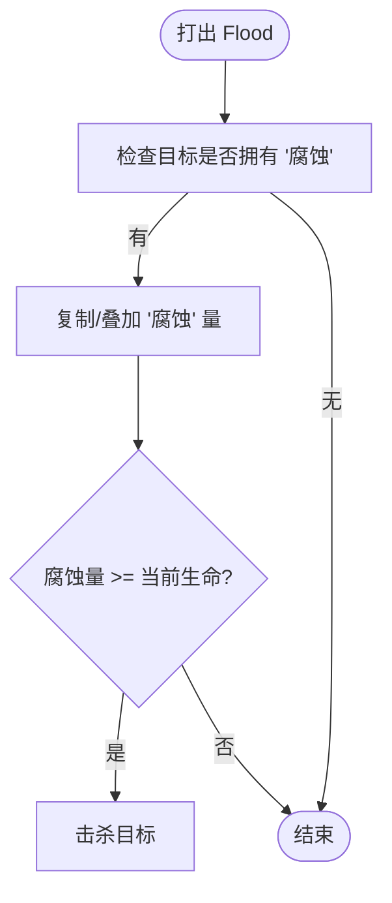
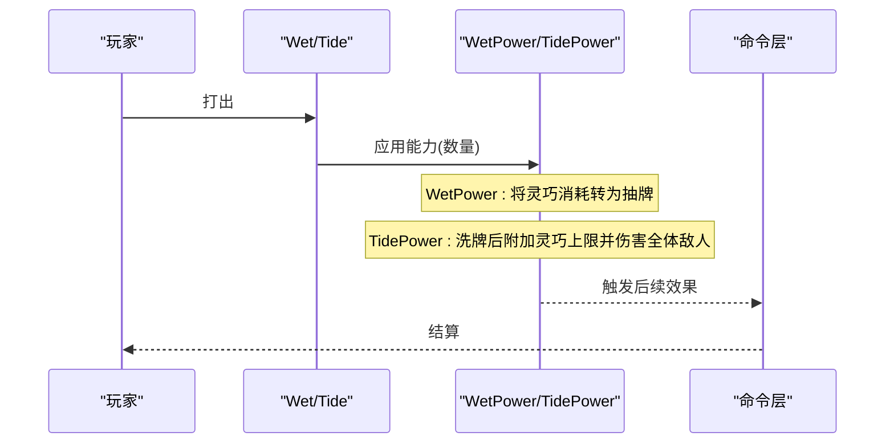
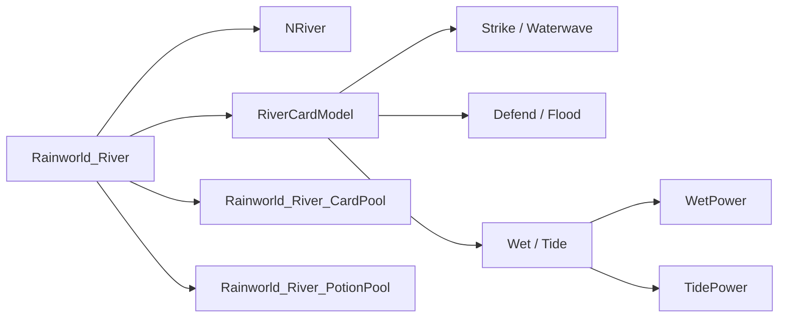

# 河流角色(River)

<cite>
**本文引用的文件**
- [Rainworld_River.cs](file://Scripts/Slugcat/Rainworld_River.cs)
- [NRiver.cs](file://Godot/Character/River/NRiver.cs)
- [RiverCardModel.cs](file://Scripts/Card/River/RiverCardModel.cs)
- [Rainworld_River_CardPool.cs](file://Scripts/Card/River/Rainworld_River_CardPool.cs)
- [Rainworld_River_Strike.cs](file://Scripts/Card/River/Attack/Rainworld_River_Strike.cs)
- [Rainworld_River_Defend.cs](file://Scripts/Card/River/Skill/Rainworld_River_Defend.cs)
- [Rainworld_River_Wet.cs](file://Scripts/Card/River/Power/Rainworld_River_Wet.cs)
- [WetPower.cs](file://Scripts/Powers/River/WetPower.cs)
- [Rainworld_River_Waterwave.cs](file://Scripts/Card/River/Attack/Rainworld_River_Waterwave.cs)
- [Rainworld_River_Flood.cs](file://Scripts/Card/River/Skill/Rainworld_River_Flood.cs)
- [Rainworld_River_Tide.cs](file://Scripts/Card/River/Power/Rainworld_River_Tide.cs)
- [TidePower.cs](file://Scripts/Powers/River/TidePower.cs)
- [Rainworld_River_PotionPool.cs](file://Scripts/Potions/Rainworld_River_PotionPool.cs)
</cite>

## 目录
1. [简介](#简介)
2. [项目结构](#项目结构)
3. [核心组件](#核心组件)
4. [架构总览](#架构总览)
5. [详细组件分析](#详细组件分析)
6. [依赖关系分析](#依赖关系分析)
7. [性能考量](#性能考量)
8. [故障排查指南](#故障排查指南)
9. [结论](#结论)
10. [附录](#附录)

## 简介
本文件为“河流角色（River）”的完整实现文档，聚焦其水元素机制与流体战斗风格。内容涵盖：
- 角色基础配置、资源绑定与动画系统
- 攻击、技能、能力三类卡牌的实现模式与水属性联动
- 环境互动与状态类能力（如“湿”“潮汐”“腐蚀”）的协同
- 粒子与命中特效调用方式
- 性能优化建议与差异化设计思路

## 项目结构
River 角色由以下关键部分组成：
- 角色定义与资产绑定：负责初始生命、起始牌组、视觉场景、UI图标、音效等
- 可视化节点：Spine 骨架皮肤切换、交互触发（点击喵叫）
- 卡牌模型基类与卡池：统一卡片外观、能量颜色与资源路径
- 具体卡牌实现：攻击/技能/能力三类，体现水流控制、护盾、抽牌、伤害与环境互动
- 能力（Power）：提供持续效果（如“湿”“潮汐”），在回合事件或洗库时触发

图表来源
- [Rainworld_River.cs:31-105](file://Scripts/Slugcat/Rainworld_River.cs#L31-L105)
- [NRiver.cs:11-84](file://Godot/Character/River/NRiver.cs#L11-L84)
- [RiverCardModel.cs:14-33](file://Scripts/Card/River/RiverCardModel.cs#L14-L33)
- [Rainworld_River_CardPool.cs:11-25](file://Scripts/Card/River/Rainworld_River_CardPool.cs#L11-L25)

章节来源
- [Rainworld_River.cs:31-105](file://Scripts/Slugcat/Rainworld_River.cs#L31-L105)
- [NRiver.cs:11-84](file://Godot/Character/River/NRiver.cs#L11-L84)
- [RiverCardModel.cs:14-33](file://Scripts/Card/River/RiverCardModel.cs#L14-L33)
- [Rainworld_River_CardPool.cs:11-25](file://Scripts/Card/River/Rainworld_River_CardPool.cs#L11-L25)

## 核心组件
- 角色定义（Rainworld_River）
  - 起始生命、金币、起始牌组（含基础攻击、防御、技能）
  - 视觉场景、UI图标、商店与休息点动画、多人手势贴图
  - 能量标签描边色、对话色、地图绘制色、远程瞄准线色
  - 攻击动画延迟、施法动画延迟
  - 怪物受击特效列表（用于通用打击反馈）
- 可视化节点（NRiver）
  - Spine 骨架加载与皮肤切换（默认“shuiguo”，根据饰品可切换“dianchi/dianchi2”）
  - 点击交互播放音效并触发“Meow”动画
- 卡牌模型与卡池
  - RiverCardModel 统一卡片资源路径与卡框
  - Rainworld_River_CardPool 定义卡池标题、能量色、牌面底色、能量图标
- 能力（Power）
  - WetPower：基于“灵巧”消耗进行抽牌补偿
  - TidePower：洗牌后附加“灵巧上限”并对全体敌人造成伤害

章节来源
- [Rainworld_River.cs:31-114](file://Scripts/Slugcat/Rainworld_River.cs#L31-L114)
- [NRiver.cs:11-116](file://Godot/Character/River/NRiver.cs#L11-L116)
- [RiverCardModel.cs:14-39](file://Scripts/Card/River/RiverCardModel.cs#L14-L39)
- [Rainworld_River_CardPool.cs:11-25](file://Scripts/Card/River/Rainworld_River_CardPool.cs#L11-L25)
- [WetPower.cs:22-65](file://Scripts/Powers/River/WetPower.cs#L22-L65)
- [TidePower.cs:23-47](file://Scripts/Powers/River/TidePower.cs#L23-L47)

## 架构总览
River 的战斗围绕“水”主题展开：以低费高频率的攻击与护盾为核心，通过“湿”“潮汐”“腐蚀”等能力形成连锁反应；同时强调“灵巧”资源的利用与回收，配合洗库时机打出爆发。

图表来源
- [Rainworld_River_Strike.cs:41-50](file://Scripts/Card/River/Attack/Rainworld_River_Strike.cs#L41-L50)
- [Rainworld_River_Defend.cs:31-34](file://Scripts/Card/River/Skill/Rainworld_River_Defend.cs#L31-L34)
- [Rainworld_River_Wet.cs:23-26](file://Scripts/Card/River/Power/Rainworld_River_Wet.cs#L23-L26)
- [WetPower.cs:36-65](file://Scripts/Powers/River/WetPower.cs#L36-L65)
- [Rainworld_River_Tide.cs:29-33](file://Scripts/Card/River/Power/Rainworld_River_Tide.cs#L29-L33)
- [TidePower.cs:35-45](file://Scripts/Powers/River/TidePower.cs#L35-L45)

## 详细组件分析

### 角色与动画系统
- 角色资源绑定
  - 场景、能量计数、商店与休息点动画路径
  - UI图标、选择背景、多人手势贴图
  - 音频事件（过渡、选择、攻击）
  - 颜色体系（名称、能量描边、对话、地图、远程瞄准线）
- 可视化节点
  - Spine 骨架初始化与皮肤切换逻辑
  - 点击交互播放音效并触发“Meow”动画
  - 重试机制确保骨架就绪后再应用皮肤

图表来源
- [Rainworld_River.cs:47-85](file://Scripts/Slugcat/Rainworld_River.cs#L47-L85)
- [NRiver.cs:17-84](file://Godot/Character/River/NRiver.cs#L17-L84)
- [NRiver.cs:86-114](file://Godot/Character/River/NRiver.cs#L86-L114)

章节来源
- [Rainworld_River.cs:47-105](file://Scripts/Slugcat/Rainworld_River.cs#L47-L105)
- [NRiver.cs:17-114](file://Godot/Character/River/NRiver.cs#L17-L114)

### 攻击卡牌：水流控制与连击
- 基础攻击（Strike）
  - 低费单体伤害，附带命中特效
  - 升级提升伤害
- 复合攻击（Waterwave）
  - 同时造成少量伤害与获得护盾
  - 标记“未使用灵巧”关键词，便于与“湿”能力联动

图表来源
- [Rainworld_River_Waterwave.cs:31-41](file://Scripts/Card/River/Attack/Rainworld_River_Waterwave.cs#L31-L41)
- [Rainworld_River_Strike.cs:41-50](file://Scripts/Card/River/Attack/Rainworld_River_Strike.cs#L41-L50)

章节来源
- [Rainworld_River_Strike.cs:9-57](file://Scripts/Card/River/Attack/Rainworld_River_Strike.cs#L9-L57)
- [Rainworld_River_Waterwave.cs:9-48](file://Scripts/Card/River/Attack/Rainworld_River_Waterwave.cs#L9-L48)

### 技能卡牌：护盾与爆发
- 防御（Defend）
  - 标准护盾获取，升级提升护盾量
- 洪水（Flood）
  - 对目标施加“腐蚀”能力，若腐蚀量达到当前生命则击杀
  - 稀有度较高，具备“耗尽”关键词（升级移除）

图表来源
- [Rainworld_River_Flood.cs:23-37](file://Scripts/Card/River/Skill/Rainworld_River_Flood.cs#L23-L37)

章节来源
- [Rainworld_River_Defend.cs:11-40](file://Scripts/Card/River/Skill/Rainworld_River_Defend.cs#L11-L40)
- [Rainworld_River_Flood.cs:9-43](file://Scripts/Card/River/Skill/Rainworld_River_Flood.cs#L9-L43)

### 能力卡牌：水之流转
- 湿（Wet）
  - 赋予“湿”能力，降低“灵巧”消耗并转化为抽牌
  - 当灵巧消耗较大时，按规则抽取多张牌
- 潮汐（Tide）
  - 赋予“潮汐”能力，提供“灵巧上限”并在每副牌首次洗库时触发
  - 触发时对全体敌人造成伤害

图表来源
- [Rainworld_River_Wet.cs:23-26](file://Scripts/Card/River/Power/Rainworld_River_Wet.cs#L23-L26)
- [WetPower.cs:36-65](file://Scripts/Powers/River/WetPower.cs#L36-L65)
- [Rainworld_River_Tide.cs:29-33](file://Scripts/Card/River/Power/Rainworld_River_Tide.cs#L29-L33)
- [TidePower.cs:35-45](file://Scripts/Powers/River/TidePower.cs#L35-L45)

章节来源
- [Rainworld_River_Wet.cs:11-32](file://Scripts/Card/River/Power/Rainworld_River_Wet.cs#L11-L32)
- [WetPower.cs:22-65](file://Scripts/Powers/River/WetPower.cs#L22-L65)
- [Rainworld_River_Tide.cs:12-39](file://Scripts/Card/River/Power/Rainworld_River_Tide.cs#L12-L39)
- [TidePower.cs:23-47](file://Scripts/Powers/River/TidePower.cs#L23-L47)

### 环境与状态联动
- “湿”能力将“灵巧”消耗转化为抽牌，鼓励高频低费出牌
- “潮汐”在洗库时触发，契合水系“涨落”的主题，提供节奏性爆发
- “腐蚀”作为环境伤害叠加，配合“洪水”可实现即死条件

章节来源
- [WetPower.cs:36-65](file://Scripts/Powers/River/WetPower.cs#L36-L65)
- [TidePower.cs:35-45](file://Scripts/Powers/River/TidePower.cs#L35-L45)
- [Rainworld_River_Flood.cs:23-37](file://Scripts/Card/River/Skill/Rainworld_River_Flood.cs#L23-L37)

## 依赖关系分析
- 角色依赖可视化节点（NRiver）以呈现Spine动画与交互
- 卡牌依赖命令层（Damage/Block/Power）执行效果
- 能力（Wet/Tide）与卡牌通过命令层协作，形成回合内/回合外联动
- 卡池与能量色统一视觉风格

图表来源
- [Rainworld_River.cs:31-105](file://Scripts/Slugcat/Rainworld_River.cs#L31-L105)
- [RiverCardModel.cs:14-33](file://Scripts/Card/River/RiverCardModel.cs#L14-L33)
- [Rainworld_River_CardPool.cs:11-25](file://Scripts/Card/River/Rainworld_River_CardPool.cs#L11-L25)
- [Rainworld_River_PotionPool.cs:5-8](file://Scripts/Potions/Rainworld_River_PotionPool.cs#L5-L8)

章节来源
- [Rainworld_River.cs:31-105](file://Scripts/Slugcat/Rainworld_River.cs#L31-L105)
- [RiverCardModel.cs:14-33](file://Scripts/Card/River/RiverCardModel.cs#L14-L33)
- [Rainworld_River_CardPool.cs:11-25](file://Scripts/Card/River/Rainworld_River_CardPool.cs#L11-L25)
- [Rainworld_River_PotionPool.cs:5-8](file://Scripts/Potions/Rainworld_River_PotionPool.cs#L5-L8)

## 性能考量
- 减少重复特效调用：命中特效通过命令层统一传入，避免在多处重复实例化
- 延迟与重试：NRiver 中骨架加载采用延迟重试，防止空引用导致的卡顿
- 动画触发节流：点击交互仅在有效区域内触发，避免无效计算
- 能力触发时机：TidePower 在洗牌后触发，集中处理伤害与附加效果，降低分散开销
- 资源路径集中：RiverCardModel 统一管理卡片资源路径，便于缓存与复用

[本节为通用指导，不直接分析具体文件]

## 故障排查指南
- 骨架未加载导致无法换肤
  - 现象：SetSkin 多次重试仍失败
  - 排查：确认 Visuals 节点存在且 get_skeleton 返回有效对象
  - 参考路径：[NRiver.cs:49-78](file://Godot/Character/River/NRiver.cs#L49-L78)
- 点击无响应
  - 现象：点击不播放音效或动画
  - 排查：检查 Bounds 节点是否存在、鼠标位置是否在矩形内、实体是否存活
  - 参考路径：[NRiver.cs:86-114](file://Godot/Character/River/NRiver.cs#L86-L114)
- 能力未生效
  - 现象：Wet/Tide 未产生预期效果
  - 排查：确认 OnPlay 已调用 PowerCmd.Apply，能力注册正确
  - 参考路径：[Rainworld_River_Wet.cs:23-26](file://Scripts/Card/River/Power/Rainworld_River_Wet.cs#L23-L26)、[Rainworld_River_Tide.cs:29-33](file://Scripts/Card/River/Power/Rainworld_River_Tide.cs#L29-L33)

章节来源
- [NRiver.cs:49-114](file://Godot/Character/River/NRiver.cs#L49-L114)
- [Rainworld_River_Wet.cs:23-26](file://Scripts/Card/River/Power/Rainworld_River_Wet.cs#L23-L26)
- [Rainworld_River_Tide.cs:29-33](file://Scripts/Card/River/Power/Rainworld_River_Tide.cs#L29-L33)

## 结论
River 角色以“水”为主题，构建了流畅而富有节奏的战斗循环：
- 低费攻击与护盾维持生存
- “湿”将灵巧消耗转化为抽牌，提升手牌质量
- “潮汐”在洗库时提供爆发，契合水系涨落
- “腐蚀”与环境伤害结合，形成即死条件
通过统一的卡牌模型与命令层，River 实现了清晰、可扩展的水元素机制，并与动画系统紧密集成，提供一致的视听反馈。

[本节为总结，不直接分析具体文件]

## 附录
- 差异化设计思路
  - 与其他角色的区别：River 强调“灵巧”资源管理与洗库时机爆发，区别于纯输出或纯防御路线
  - 视觉与音效：统一的蓝色调与水流主题特效，增强沉浸感
- 代码片段路径（用于定位实现）
  - 角色定义与资源：[Rainworld_River.cs:31-105](file://Scripts/Slugcat/Rainworld_River.cs#L31-L105)
  - 可视化节点：[NRiver.cs:17-114](file://Godot/Character/River/NRiver.cs#L17-L114)
  - 卡牌模型与卡池：[RiverCardModel.cs:14-33](file://Scripts/Card/River/RiverCardModel.cs#L14-L33)、[Rainworld_River_CardPool.cs:11-25](file://Scripts/Card/River/Rainworld_River_CardPool.cs#L11-L25)
  - 攻击卡：[Rainworld_River_Strike.cs:41-50](file://Scripts/Card/River/Attack/Rainworld_River_Strike.cs#L41-L50)、[Rainworld_River_Waterwave.cs:31-41](file://Scripts/Card/River/Attack/Rainworld_River_Waterwave.cs#L31-L41)
  - 技能卡：[Rainworld_River_Defend.cs:31-34](file://Scripts/Card/River/Skill/Rainworld_River_Defend.cs#L31-L34)、[Rainworld_River_Flood.cs:23-37](file://Scripts/Card/River/Skill/Rainworld_River_Flood.cs#L23-L37)
  - 能力卡与能力：[Rainworld_River_Wet.cs:23-26](file://Scripts/Card/River/Power/Rainworld_River_Wet.cs#L23-L26)、[WetPower.cs:36-65](file://Scripts/Powers/River/WetPower.cs#L36-L65)、[Rainworld_River_Tide.cs:29-33](file://Scripts/Card/River/Power/Rainworld_River_Tide.cs#L29-L33)、[TidePower.cs:35-45](file://Scripts/Powers/River/TidePower.cs#L35-L45)