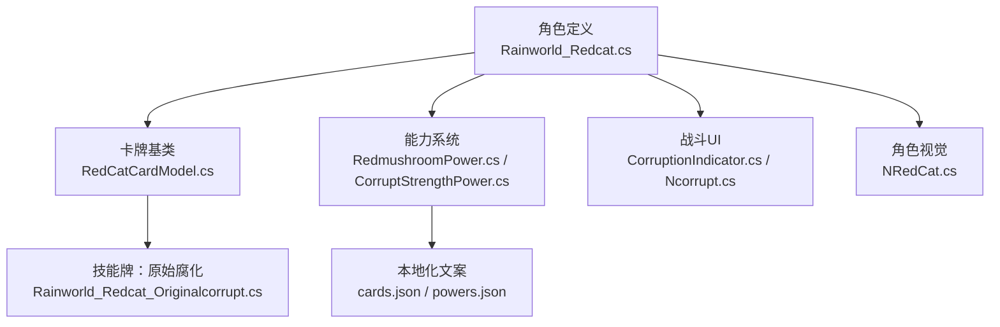
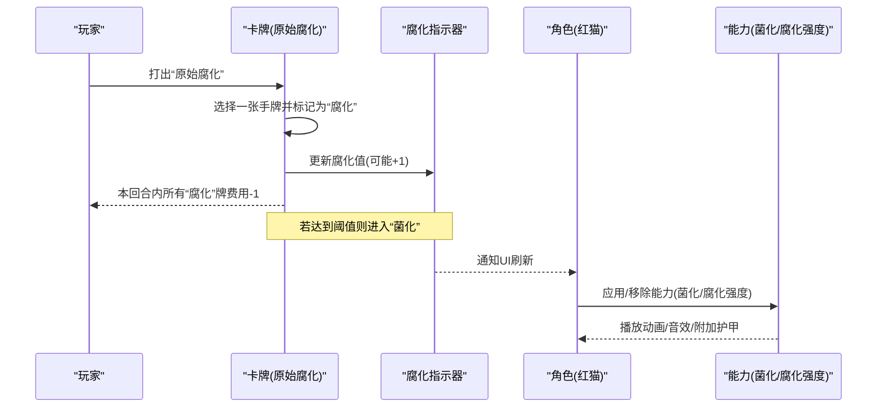
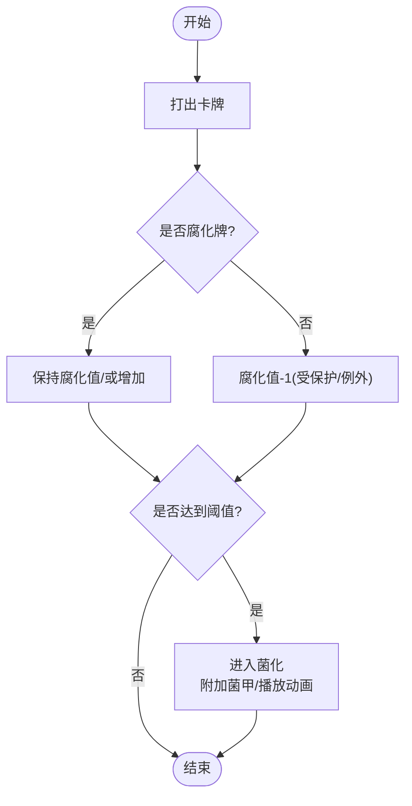
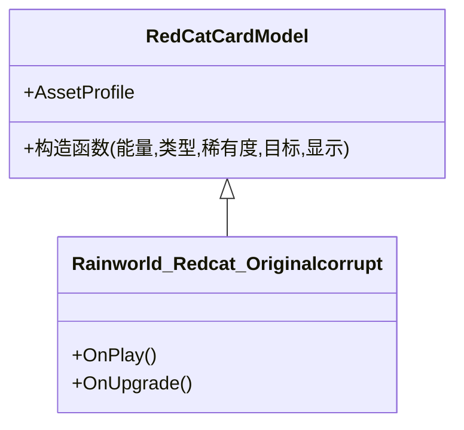
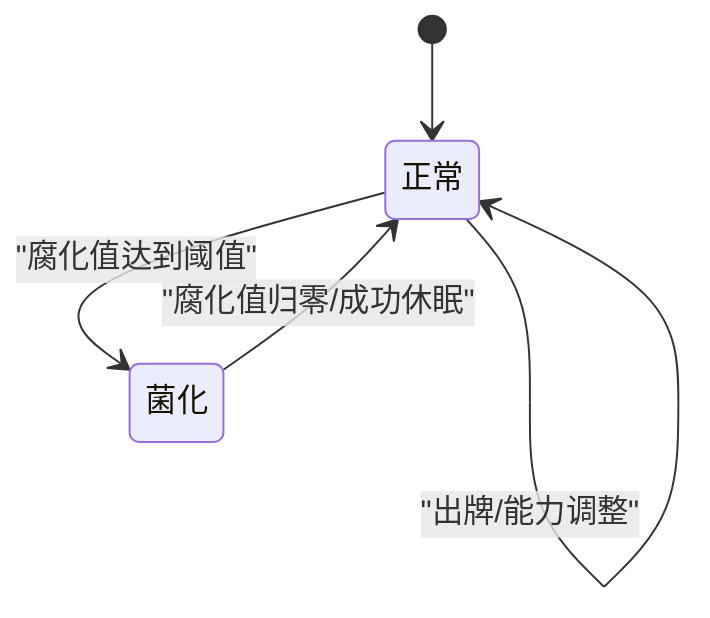
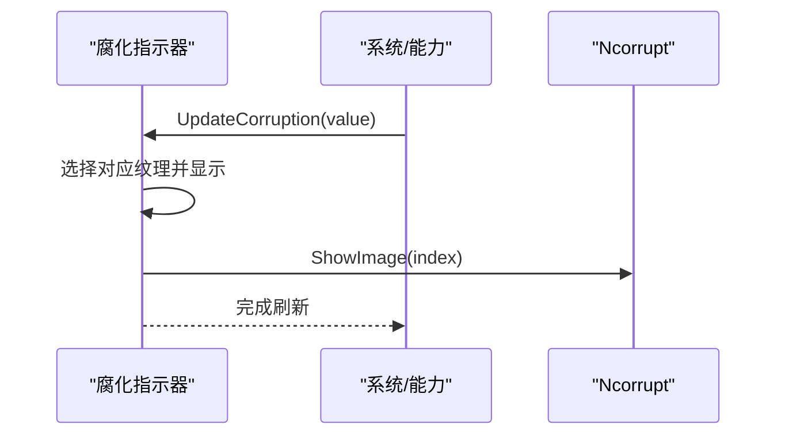
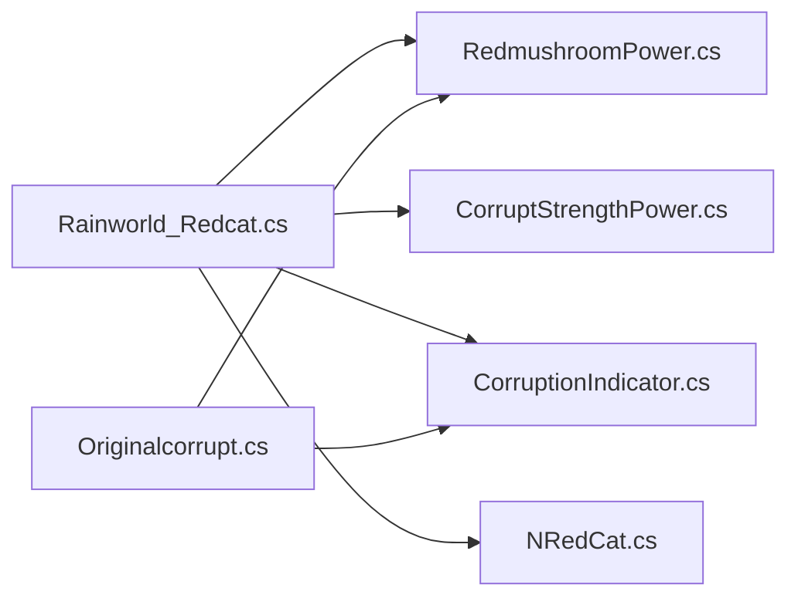

# 红猫角色(RedCat)

<cite>
**本文引用的文件**
- [Rainworld_Redcat.cs](file://Scripts/Slugcat/Rainworld_Redcat.cs)
- [RedCatCardModel.cs](file://Scripts/Card/RedCat/RedCatCardModel.cs)
- [Ncorrupt.cs](file://Godot/CombatUI/Ncorrupt.cs)
- [CorruptionIndicator.cs](file://Godot/CombatUI/CorruptionIndicator.cs)
- [NRedCat.cs](file://Godot/Character/RedCat/NRedCat.cs)
- [Rainworld_Redcat_Originalcorrupt.cs](file://Scripts/Card/RedCat/Skills/Rainworld_Redcat_Originalcorrupt.cs)
- [CorruptStrengthPower.cs](file://Scripts/Powers/RedCat/CorruptStrengthPower.cs)
- [RedmushroomPower.cs](file://Scripts/Powers/RedCat/RedmushroomPower.cs)
- [cards.json](file://SlugcatTheSpireII/localization/eng/cards.json)
- [powers.json](file://SlugcatTheSpireII/localization/eng/powers.json)
</cite>

## 目录
1. [简介](#简介)
2. [项目结构](#项目结构)
3. [核心组件](#核心组件)
4. [架构总览](#架构总览)
5. [详细组件分析](#详细组件分析)
6. [依赖关系分析](#依赖关系分析)
7. [性能与体验优化](#性能与体验优化)
8. [故障排查指南](#故障排查指南)
9. [结论](#结论)
10. [附录：卡牌与能力速查](#附录卡牌与能力速查)

## 简介
本文件为“红猫”角色的实现文档，聚焦其核心特色——腐化值系统与变异机制。内容涵盖：
- 腐化值的获取、消耗与对战斗机制的影响
- 攻击/技能/能力三类卡牌中与腐化相关的独特设计
- 形态转换（进入/退出“菌化”）的动画切换逻辑
- 关键代码路径与联动流程
- 调试技巧与常见问题解决方案

## 项目结构
围绕红猫角色的关键目录与职责：
- 角色定义与资源装配：Scripts/Slugcat/Rainworld_Redcat.cs
- 卡牌基类与卡池：Scripts/Card/RedCat/*
- 能力（Power）：Scripts/Powers/RedCat/*
- 战斗UI与腐化指示器：Godot/CombatUI/*
- 角色视觉与交互：Godot/Character/RedCat/*
- 本地化文案：SlugcatTheSpireII/localization/*/cards.json, powers.json

图表来源
- [Rainworld_Redcat.cs:29-128](file://Scripts/Slugcat/Rainworld_Redcat.cs#L29-L128)
- [RedCatCardModel.cs:13-39](file://Scripts/Card/RedCat/RedCatCardModel.cs#L13-L39)
- [CorruptionIndicator.cs:12-148](file://Godot/CombatUI/CorruptionIndicator.cs#L12-L148)
- [Ncorrupt.cs:4-78](file://Godot/CombatUI/Ncorrupt.cs#L4-L78)
- [NRedCat.cs:13-55](file://Godot/Character/RedCat/NRedCat.cs#L13-L55)
- [Rainworld_Redcat_Originalcorrupt.cs:11-51](file://Scripts/Card/RedCat/Skills/Rainworld_Redcat_Originalcorrupt.cs#L11-L51)
- [cards.json:294-302](file://SlugcatTheSpireII/localization/eng/cards.json#L294-L302)
- [powers.json:149-157](file://SlugcatTheSpireII/localization/eng/powers.json#L149-L157)

章节来源
- [Rainworld_Redcat.cs:29-128](file://Scripts/Slugcat/Rainworld_Redcat.cs#L29-L128)
- [RedCatCardModel.cs:13-39](file://Scripts/Card/RedCat/RedCatCardModel.cs#L13-L39)

## 核心组件
- 角色入口与资源装配：负责初始手牌、起始遗物、场景与UI资源绑定、颜色与音效等。
- 腐化值系统：通过能力与卡牌联动，控制腐化值的增减、进入/退出“菌化”状态、以及“菌甲”与伤害修正。
- 卡牌体系：以 RedCatCardModel 为基类，提供统一的卡面资源与类型区分；技能牌“原始腐化”为核心触发点。
- 战斗UI：腐化条显示、闪烁提示、悬浮说明；Ncorrupt 用于多段变体图片切换。
- 角色视觉：点击交互播放喵叫动画，并在进入/退出菌化时触发对应动画。

章节来源
- [Rainworld_Redcat.cs:29-128](file://Scripts/Slugcat/Rainworld_Redcat.cs#L29-L128)
- [RedCatCardModel.cs:13-39](file://Scripts/Card/RedCat/RedCatCardModel.cs#L13-L39)
- [CorruptionIndicator.cs:12-148](file://Godot/CombatUI/CorruptionIndicator.cs#L12-L148)
- [Ncorrupt.cs:4-78](file://Godot/CombatUI/Ncorrupt.cs#L4-L78)
- [NRedCat.cs:13-55](file://Godot/Character/RedCat/NRedCat.cs#L13-L55)

## 架构总览
红猫的腐化系统由“卡牌—能力—UI—视觉”四部分构成闭环：
- 卡牌：通过关键词与效果增加/减少腐化值，或临时降低费用。
- 能力：在出牌后扣减腐化值；进入/退出菌化时附加“菌甲”、修改伤害、播放特效与音效。
- UI：实时展示当前腐化等级，并提供悬浮说明。
- 视觉：根据状态切换动画（如“Meow”、“Corrupt”、“Idle”）。

图表来源
- [Rainworld_Redcat_Originalcorrupt.cs:30-45](file://Scripts/Card/RedCat/Skills/Rainworld_Redcat_Originalcorrupt.cs#L30-L45)
- [CorruptionIndicator.cs:135-148](file://Godot/CombatUI/CorruptionIndicator.cs#L135-L148)
- [RedmushroomPower.cs:44-69](file://Scripts/Powers/RedCat/RedmushroomPower.cs#L44-L69)
- [CorruptStrengthPower.cs:40-48](file://Scripts/Powers/RedCat/CorruptStrengthPower.cs#L40-L48)

## 详细组件分析

### 腐化值系统与“菌化”机制
- 腐化值获取：
  - 通过卡牌效果（例如“原始腐化”）将手牌标记为“腐化”，并在结算时可能增加腐化值。
  - 其他能力/卡牌也可按设计增加腐化值（具体数值由能力与卡牌描述决定）。
- 腐化值消耗：
  - 每打出一张非“腐化”牌，会尝试减少1点腐化值（受能力保护与例外规则影响）。
- 菌化状态：
  - 当腐化值达到一定阈值时，获得“菌化”能力，附加“菌甲”、播放动画/音效，并可能改变伤害计算。
  - 成功休眠或腐化值归零时退出“菌化”，并将“菌甲”转换为护盾。
- 伤害修正：
  - 在“菌化”状态下，特定伤害属性会被增强（由能力拦截并修正）。

图表来源
- [RedmushroomPower.cs:44-69](file://Scripts/Powers/RedCat/RedmushroomPower.cs#L44-L69)
- [CorruptStrengthPower.cs:40-48](file://Scripts/Powers/RedCat/CorruptStrengthPower.cs#L40-L48)
- [Rainworld_Redcat_Originalcorrupt.cs:30-45](file://Scripts/Card/RedCat/Skills/Rainworld_Redcat_Originalcorrupt.cs#L30-L45)

章节来源
- [RedmushroomPower.cs:44-94](file://Scripts/Powers/RedCat/RedmushroomPower.cs#L44-L94)
- [CorruptStrengthPower.cs:28-51](file://Scripts/Powers/RedCat/CorruptStrengthPower.cs#L28-L51)
- [Rainworld_Redcat_Originalcorrupt.cs:11-51](file://Scripts/Card/RedCat/Skills/Rainworld_Redcat_Originalcorrupt.cs#L11-L51)
- [powers.json:149-157](file://SlugcatTheSpireII/localization/eng/powers.json#L149-L157)

### 卡牌设计与联动
- 基础框架：
  - 所有红猫卡牌继承自 RedCatCardModel，统一卡面资源与类型判断。
- 关键技能牌：
  - “原始腐化”：从手牌中选择一张牌进行“腐化”，并使本回合内所有“腐化”牌费用-1。
- 联动机制：
  - 被腐化的牌在后续出牌时参与腐化值变化与费用减免。
  - 配合能力“菌化”与“腐化强度”，形成高风险高回报的玩法循环。

图表来源
- [RedCatCardModel.cs:13-39](file://Scripts/Card/RedCat/RedCatCardModel.cs#L13-L39)
- [Rainworld_Redcat_Originalcorrupt.cs:11-51](file://Scripts/Card/RedCat/Skills/Rainworld_Redcat_Originalcorrupt.cs#L11-L51)

章节来源
- [RedCatCardModel.cs:13-39](file://Scripts/Card/RedCat/RedCatCardModel.cs#L13-L39)
- [Rainworld_Redcat_Originalcorrupt.cs:11-51](file://Scripts/Card/RedCat/Skills/Rainworld_Redcat_Originalcorrupt.cs#L11-L51)
- [cards.json:294-302](file://SlugcatTheSpireII/localization/eng/cards.json#L294-L302)

### 形态转换与动画切换
- 进入菌化：
  - 触发“菌化”能力时，播放“Corrupt”动画，附加“菌甲”，播放音效，并可能抑制受伤动画。
- 退出菌化：
  - 成功休眠或腐化值归零时，恢复“Idle”动画，将“菌甲”转为护盾，移除相关能力。
- 交互反馈：
  - 点击角色区域可触发“Meow”动画与音效，提升交互感。

图表来源
- [RedmushroomPower.cs:55-94](file://Scripts/Powers/RedCat/RedmushroomPower.cs#L55-L94)
- [NRedCat.cs:21-55](file://Godot/Character/RedCat/NRedCat.cs#L21-L55)

章节来源
- [RedmushroomPower.cs:55-94](file://Scripts/Powers/RedCat/RedmushroomPower.cs#L55-L94)
- [NRedCat.cs:21-55](file://Godot/Character/RedCat/NRedCat.cs#L21-L55)

### 战斗UI与腐化指示器
- 腐化条：
  - 使用多张纹理表示不同腐化等级，支持闪烁与透明度渐变提示。
  - 悬停显示当前腐化值与说明。
- 变体指示：
  - Ncorrupt 提供多段图片切换，便于表现不同阶段或状态的视觉差异。

图表来源
- [CorruptionIndicator.cs:38-148](file://Godot/CombatUI/CorruptionIndicator.cs#L38-L148)
- [Ncorrupt.cs:22-78](file://Godot/CombatUI/Ncorrupt.cs#L22-L78)

章节来源
- [CorruptionIndicator.cs:38-148](file://Godot/CombatUI/CorruptionIndicator.cs#L38-L148)
- [Ncorrupt.cs:22-78](file://Godot/CombatUI/Ncorrupt.cs#L22-L78)

## 依赖关系分析
- 角色定义依赖：
  - 卡牌模型基类、能力系统、战斗UI、角色视觉。
- 能力与卡牌：
  - 能力监听出牌事件，调整腐化值；卡牌通过关键词与效果驱动能力变化。
- UI与数据：
  - 腐化指示器读取当前腐化值并渲染；Ncorrupt 提供多态图片切换。

图表来源
- [Rainworld_Redcat.cs:29-128](file://Scripts/Slugcat/Rainworld_Redcat.cs#L29-L128)
- [RedmushroomPower.cs:44-94](file://Scripts/Powers/RedCat/RedmushroomPower.cs#L44-L94)
- [CorruptStrengthPower.cs:28-51](file://Scripts/Powers/RedCat/CorruptStrengthPower.cs#L28-L51)
- [CorruptionIndicator.cs:38-148](file://Godot/CombatUI/CorruptionIndicator.cs#L38-L148)
- [NRedCat.cs:21-55](file://Godot/Character/RedCat/NRedCat.cs#L21-L55)
- [Rainworld_Redcat_Originalcorrupt.cs:11-51](file://Scripts/Card/RedCat/Skills/Rainworld_Redcat_Originalcorrupt.cs#L11-L51)

章节来源
- [Rainworld_Redcat.cs:29-128](file://Scripts/Slugcat/Rainworld_Redcat.cs#L29-L128)
- [RedmushroomPower.cs:44-94](file://Scripts/Powers/RedCat/RedmushroomPower.cs#L44-L94)
- [CorruptStrengthPower.cs:28-51](file://Scripts/Powers/RedCat/CorruptStrengthPower.cs#L28-L51)
- [CorruptionIndicator.cs:38-148](file://Godot/CombatUI/CorruptionIndicator.cs#L38-L148)
- [NRedCat.cs:21-55](file://Godot/Character/RedCat/NRedCat.cs#L21-L55)
- [Rainworld_Redcat_Originalcorrupt.cs:11-51](file://Scripts/Card/RedCat/Skills/Rainworld_Redcat_Originalcorrupt.cs#L11-L51)

## 性能与体验优化
- 纹理缓存：
  - Ncorrupt 在初始化时加载全部纹理，避免运行时重复加载导致的卡顿。
- 动画与音效：
  - 仅在状态变更时触发动画与音效，减少不必要的开销。
- UI刷新：
  - 腐化指示器仅在值变化时更新纹理与可见性，避免每帧重绘。
- 建议：
  - 对高频触发的能力回调进行节流或批处理。
  - 合理使用懒加载与对象池，降低内存峰值。

[本节为通用指导，不直接分析具体文件]

## 故障排查指南
- 腐化值未变化：
  - 检查是否被能力保护（如“抑制”），或卡牌是否带有免疫/不可腐化关键词。
  - 确认“原始腐化”是否正确选择了目标牌并执行了腐化流程。
- 菌化未生效：
  - 检查是否达到阈值；确认“菌化”能力已正确应用。
  - 查看动画触发是否被抑制（如假死/睡眠状态）。
- UI显示异常：
  - 核对腐化指示器的纹理路径与索引映射。
  - 确认 Ncorrupt 的图片数组长度与索引范围。
- 伤害修正异常：
  - 检查“腐化强度”能力是否在“菌化”状态下生效，且目标与来源符合拦截条件。

章节来源
- [Rainworld_Redcat_Originalcorrupt.cs:30-45](file://Scripts/Card/RedCat/Skills/Rainworld_Redcat_Originalcorrupt.cs#L30-L45)
- [RedmushroomPower.cs:44-94](file://Scripts/Powers/RedCat/RedmushroomPower.cs#L44-L94)
- [CorruptionIndicator.cs:135-148](file://Godot/CombatUI/CorruptionIndicator.cs#L135-L148)
- [Ncorrupt.cs:22-78](file://Godot/CombatUI/Ncorrupt.cs#L22-L78)
- [CorruptStrengthPower.cs:40-48](file://Scripts/Powers/RedCat/CorruptStrengthPower.cs#L40-L48)

## 结论
红猫的核心在于“腐化值—菌化—卡牌联动”的闭环设计。通过“原始腐化”等卡牌驱动腐化值变化，结合“菌化”能力实现形态转换与战斗增益，辅以直观的UI与流畅的动画反馈，形成高风险高回报的独特玩法。建议在扩展新卡牌与能力时，严格遵循现有接口与流程，确保数值平衡与体验一致。

[本节为总结，不直接分析具体文件]

## 附录：卡牌与能力速查
- 卡牌
  - 原始腐化：选择一张手牌进行腐化；本回合内所有腐化牌费用-1。
  - 其他红猫卡牌：基于 RedCatCardModel，按类型配置卡面资源。
- 能力
  - 菌化：出非腐化牌时腐化值-1；达到阈值进入菌化，附加菌甲；退出时菌甲转护盾。
  - 腐化强度：在菌化状态下对特定伤害进行修正增强。
- 本地化
  - cards.json：卡牌标题与描述。
  - powers.json：能力标题与描述。

章节来源
- [Rainworld_Redcat_Originalcorrupt.cs:11-51](file://Scripts/Card/RedCat/Skills/Rainworld_Redcat_Originalcorrupt.cs#L11-L51)
- [RedCatCardModel.cs:13-39](file://Scripts/Card/RedCat/RedCatCardModel.cs#L13-L39)
- [RedmushroomPower.cs:44-94](file://Scripts/Powers/RedCat/RedmushroomPower.cs#L44-L94)
- [CorruptStrengthPower.cs:28-51](file://Scripts/Powers/RedCat/CorruptStrengthPower.cs#L28-L51)
- [cards.json:294-302](file://SlugcatTheSpireII/localization/eng/cards.json#L294-L302)
- [powers.json:149-157](file://SlugcatTheSpireII/localization/eng/powers.json#L149-L157)