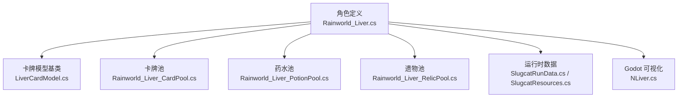
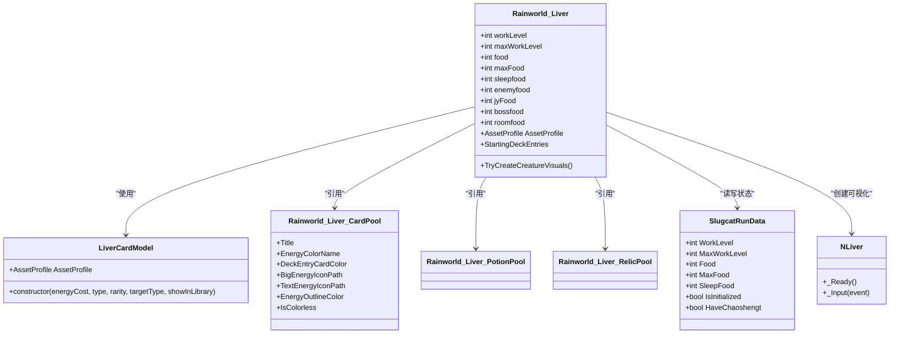
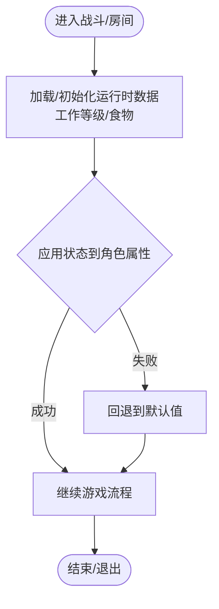
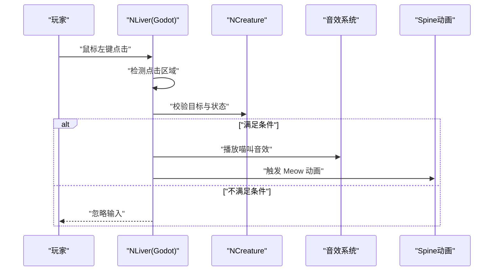
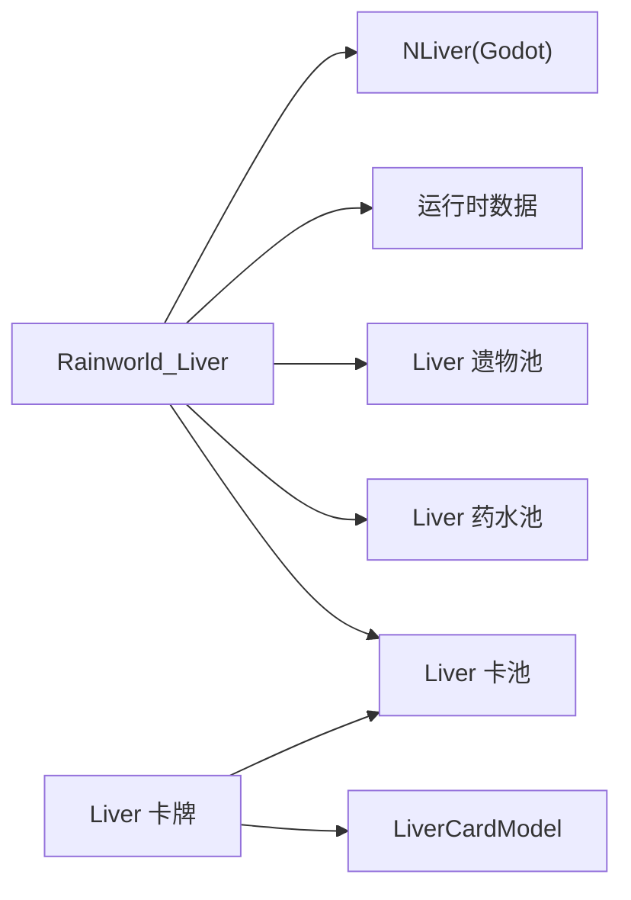

# 肝脏角色(Liver)

<cite>
**本文引用的文件**
- [Rainworld_Liver.cs](file://Scripts/Slugcat/Rainworld_Liver.cs)
- [NLiver.cs](file://Godot/Character/Liver/NLiver.cs)
- [LiverCardModel.cs](file://Scripts/Card/Liver/LiverCardModel.cs)
- [Rainworld_Liver_CardPool.cs](file://Scripts/Card/Liver/Rainworld_Liver_CardPool.cs)
- [Rainworld_Liver_PotionPool.cs](file://Scripts/Potions/Rainworld_Liver_PotionPool.cs)
- [Rainworld_Liver_RelicPool.cs](file://Scripts/relics/Rainworld_Liver_RelicPool.cs)
- [SlugcatRunData.cs](file://Scripts/Slugcat/SecondaryResource/SlugcatRunData.cs)
- [SlugcatResources.cs](file://Scripts/Slugcat/SecondaryResource/SlugcatResources.cs)
</cite>

## 目录
1. [简介](#简介)
2. [项目结构](#项目结构)
3. [核心组件](#核心组件)
4. [架构总览](#架构总览)
5. [详细组件分析](#详细组件分析)
6. [依赖关系分析](#依赖关系分析)
7. [性能与平衡性建议](#性能与平衡性建议)
8. [故障排查指南](#故障排查指南)
9. [结论](#结论)
10. [附录：卡牌与能力实现要点](#附录：卡牌与能力实现要点)

## 简介
本文件为“肝脏”角色的完整实现文档，聚焦其战斗风格、卡牌池设计、专属能力系统、工作等级机制与食物获取消耗策略。同时说明攻击/技能/能力三类卡牌的伤害计算、效果触发与资源管理方式，以及与 Godot 角色模型的绑定（动画与视觉反馈）。文末提供平衡性与性能优化建议，并给出关键流程的图示化说明。

## 项目结构
肝脏角色由以下模块组成：
- 角色定义与资产配置：注册角色、初始牌组、起始遗物、能量颜色、UI/场景路径等
- 卡牌模型与卡池：统一 LiverCardModel 基类、Liver 专属卡池、药水与遗物池
- 运行时数据：工作等级、食物等跨回合/跨房间持久化数据
- Godot 可视化：角色节点、交互输入、音效与动画触发

图表来源
- [Rainworld_Liver.cs:28-117](file://Scripts/Slugcat/Rainworld_Liver.cs#L28-L117)
- [LiverCardModel.cs:14-38](file://Scripts/Card/Liver/LiverCardModel.cs#L14-L38)
- [Rainworld_Liver_CardPool.cs:10-23](file://Scripts/Card/Liver/Rainworld_Liver_CardPool.cs#L10-L23)
- [Rainworld_Liver_PotionPool.cs:5-8](file://Scripts/Potions/Rainworld_Liver_PotionPool.cs#L5-L8)
- [Rainworld_Liver_RelicPool.cs:5-9](file://Scripts/relics/Rainworld_Liver_RelicPool.cs#L5-L9)
- [SlugcatRunData.cs:3-14](file://Scripts/Slugcat/SecondaryResource/SlugcatRunData.cs#L3-L14)
- [SlugcatResources.cs:7-49](file://Scripts/Slugcat/SecondaryResource/SlugcatResources.cs#L7-L49)
- [NLiver.cs:12-49](file://Godot/Character/Liver/NLiver.cs#L12-L49)

章节来源
- [Rainworld_Liver.cs:28-117](file://Scripts/Slugcat/Rainworld_Liver.cs#L28-L117)
- [LiverCardModel.cs:14-38](file://Scripts/Card/Liver/LiverCardModel.cs#L14-L38)
- [Rainworld_Liver_CardPool.cs:10-23](file://Scripts/Card/Liver/Rainworld_Liver_CardPool.cs#L10-L23)
- [Rainworld_Liver_PotionPool.cs:5-8](file://Scripts/Potions/Rainworld_Liver_PotionPool.cs#L5-L8)
- [Rainworld_Liver_RelicPool.cs:5-9](file://Scripts/relics/Rainworld_Liver_RelicPool.cs#L5-L9)
- [SlugcatRunData.cs:3-14](file://Scripts/Slugcat/SecondaryResource/SlugcatRunData.cs#L3-L14)
- [SlugcatResources.cs:7-49](file://Scripts/Slugcat/SecondaryResource/SlugcatResources.cs#L7-L49)
- [NLiver.cs:12-49](file://Godot/Character/Liver/NLiver.cs#L12-L49)

## 核心组件
- 角色主类：负责注册角色、设置资产、初始牌组、起始遗物、能量颜色、动画延迟、UI 颜色等
- 卡牌模型：统一 Liver 卡牌的素材路径与类型区分
- 卡池/药水/遗物池：为角色提供独立的抽取源与外观
- 运行时数据：保存工作等级、食物等状态
- Godot 可视化：处理点击交互、播放音效、触发 Spine 动画

章节来源
- [Rainworld_Liver.cs:28-117](file://Scripts/Slugcat/Rainworld_Liver.cs#L28-L117)
- [LiverCardModel.cs:14-38](file://Scripts/Card/Liver/LiverCardModel.cs#L14-L38)
- [Rainworld_Liver_CardPool.cs:10-23](file://Scripts/Card/Liver/Rainworld_Liver_CardPool.cs#L10-L23)
- [Rainworld_Liver_PotionPool.cs:5-8](file://Scripts/Potions/Rainworld_Liver_PotionPool.cs#L5-L8)
- [Rainworld_Liver_RelicPool.cs:5-9](file://Scripts/relics/Rainworld_Liver_RelicPool.cs#L5-L9)
- [SlugcatRunData.cs:3-14](file://Scripts/Slugcat/SecondaryResource/SlugcatRunData.cs#L3-L14)
- [SlugcatResources.cs:7-49](file://Scripts/Slugcat/SecondaryResource/SlugcatResources.cs#L7-L49)
- [NLiver.cs:12-49](file://Godot/Character/Liver/NLiver.cs#L12-L49)

## 架构总览
肝脏角色在 STS2 框架中以“角色 + 卡池 + 可视化”的方式组织。角色类声明了资产、初始牌组、起始遗物与 UI 样式；卡牌通过统一的基类与卡池进行注册；运行时数据用于跨回合/房间的状态持久化；Godot 层负责动画与交互。

图表来源
- [Rainworld_Liver.cs:28-117](file://Scripts/Slugcat/Rainworld_Liver.cs#L28-L117)
- [LiverCardModel.cs:14-38](file://Scripts/Card/Liver/LiverCardModel.cs#L14-L38)
- [Rainworld_Liver_CardPool.cs:10-23](file://Scripts/Card/Liver/Rainworld_Liver_CardPool.cs#L10-L23)
- [Rainworld_Liver_PotionPool.cs:5-8](file://Scripts/Potions/Rainworld_Liver_PotionPool.cs#L5-L8)
- [Rainworld_Liver_RelicPool.cs:5-9](file://Scripts/relics/Rainworld_Liver_RelicPool.cs#L5-L9)
- [SlugcatRunData.cs:3-14](file://Scripts/Slugcat/SecondaryResource/SlugcatRunData.cs#L3-L14)
- [NLiver.cs:12-49](file://Godot/Character/Liver/NLiver.cs#L12-L49)

## 详细组件分析

### 角色定义与资产配置
- 角色注册与继承：通过特性注册角色，继承通用 Slugcat 基类并指定 Liver 的卡池、遗物池、药水池
- 资产配置：合并默认资产并覆盖 Liver 的可视化场景、商店动画、休息点动画、图标、选择背景、音频事件等
- 初始牌组与遗物：定义起始攻击/防御/特殊牌的组合与数量；指定起始遗物类型
- 动画与 UI：设置攻击/施法动画延迟、能量标签描边色、对话色、地图绘制色、远程瞄准线颜色等
- 可视化创建：根据场景路径创建 NCreatureVisuals 实例

章节来源
- [Rainworld_Liver.cs:28-117](file://Scripts/Slugcat/Rainworld_Liver.cs#L28-L117)

### 卡牌模型与卡池
- 卡牌模型基类：统一 Liver 卡牌的素材路径与卡框资源，按类型（攻击/技能/能力）选择不同卡框
- 卡牌池：定义标题、能量颜色名、牌面颜色、大小能量图标、文本能量图标、能量描边色、是否无色等
- 与角色绑定：角色类通过泛型参数将 Liver 卡池注入到框架中

章节来源
- [LiverCardModel.cs:14-38](file://Scripts/Card/Liver/LiverCardModel.cs#L14-L38)
- [Rainworld_Liver_CardPool.cs:10-23](file://Scripts/Card/Liver/Rainworld_Liver_CardPool.cs#L10-L23)
- [Rainworld_Liver.cs:28-31](file://Scripts/Slugcat/Rainworld_Liver.cs#L28-L31)

### 药水与遗物池
- 药水池：继承通用 Slugcat 药水池，覆盖能量颜色名为铁卫风格
- 遗物池：基于类型列表的遗物池模型，能量颜色同样设置为铁卫风格

章节来源
- [Rainworld_Liver_PotionPool.cs:5-8](file://Scripts/Potions/Rainworld_Liver_PotionPool.cs#L5-L8)
- [Rainworld_Liver_RelicPool.cs:5-9](file://Scripts/relics/Rainworld_Liver_RelicPool.cs#L5-L9)

### 工作等级与食物机制（运行时数据）
- 运行期数据：包含工作等级、最大工作等级、食物、最大食物、睡眠所需食物、初始化标志、特殊标记等字段
- 数据注册：通过运行时数据注册器以玩家维度保存，支持写入策略与同步策略
- 与角色联动：角色类中的 workLevel、maxWorkLevel、food、maxFood 等属性与运行时数据配合，用于跨回合/房间的状态保持

图表来源
- [SlugcatRunData.cs:3-14](file://Scripts/Slugcat/SecondaryResource/SlugcatRunData.cs#L3-L14)
- [SlugcatResources.cs:7-49](file://Scripts/Slugcat/SecondaryResource/SlugcatResources.cs#L7-L49)
- [Rainworld_Liver.cs:31-39](file://Scripts/Slugcat/Rainworld_Liver.cs#L31-L39)

章节来源
- [SlugcatRunData.cs:3-14](file://Scripts/Slugcat/SecondaryResource/SlugcatRunData.cs#L3-L14)
- [SlugcatResources.cs:7-49](file://Scripts/Slugcat/SecondaryResource/SlugcatResources.cs#L7-L49)
- [Rainworld_Liver.cs:31-39](file://Scripts/Slugcat/Rainworld_Liver.cs#L31-L39)

### Godot 角色模型绑定与交互
- 可视化节点：通过角色资产配置的场景路径创建 NCreatureVisuals
- 输入处理：监听鼠标左键点击，判断是否在边界范围内
- 条件检查：确保目标存在、未死亡、当前玩家为 Slugcat、未抑制受伤动画、需要喵叫开关开启
- 音效与动画：根据状态播放不同音效，并触发 Spine 动画“Meow”

图表来源
- [NLiver.cs:12-49](file://Godot/Character/Liver/NLiver.cs#L12-L49)

章节来源
- [NLiver.cs:12-49](file://Godot/Character/Liver/NLiver.cs#L12-L49)

### 攻击/技能/能力卡牌的实现要点
- 伤害计算：在各自卡牌逻辑中读取角色工作等级与食物等资源，结合基础伤害与倍率进行结算
- 效果触发：依据卡牌关键词或自定义逻辑触发额外效果（如抽牌、护盾、增益、资源增减）
- 资源管理：对食物与工作等级的增减需遵循上限/下限约束，并在运行时数据中持久化
- 示例参考路径（仅列路径，不含代码内容）：
  - 攻击类：[Rainworld_Liver_Strike.cs](file://Scripts/Card/Liver/Attack/Rainworld_Liver_Strike.cs)、[Rainworld_Liver_Spear.cs](file://Scripts/Card/Liver/Attack/Rainworld_Liver_Spear.cs)、[Rainworld_Liver_Rock.cs](file://Scripts/Card/Liver/Attack/Rainworld_Liver_Rock.cs)
  - 技能类：[Rainworld_Liver_Defend.cs](file://Scripts/Card/Liver/Skills/Rainworld_Liver_Defend.cs)、[Rainworld_Liver_Bigjump.cs](file://Scripts/Card/Liver/Skills/Rainworld_Liver_Bigjump.cs)、[Rainworld_Liver_Fruit.cs](file://Scripts/Card/Liver/Skills/Rainworld_Liver_Fruit.cs)
  - 能力类：[Rainworld_Liver_Workcat.cs](file://Scripts/Card/Liver/Powers/Rainworld_Liver_Workcat.cs)、[Rainworld_Liver_Sharefood.cs](file://Scripts/Card/Liver/Powers/Rainworld_Liver_Sharefood.cs)、[Rainworld_Liver_Metabolize.cs](file://Scripts/Card/Liver/Powers/Rainworld_Liver_Metabolize.cs)

章节来源
- [Rainworld_Liver.cs:91-98](file://Scripts/Slugcat/Rainworld_Liver.cs#L91-L98)
- [LiverCardModel.cs:14-38](file://Scripts/Card/Liver/LiverCardModel.cs#L14-L38)

## 依赖关系分析
- 角色对卡池/药水/遗物池的依赖：通过泛型参数注入，保证抽取与展示的统一性
- 卡牌对模型基类的依赖：统一素材与卡框资源，降低重复配置
- 运行时数据对框架的依赖：通过 RitsuLib 的数据注册器进行跨会话持久化
- Godot 层对角色实体的依赖：通过父节点获取 NCreature，进行动画与音效控制

图表来源
- [Rainworld_Liver.cs:28-117](file://Scripts/Slugcat/Rainworld_Liver.cs#L28-L117)
- [LiverCardModel.cs:14-38](file://Scripts/Card/Liver/LiverCardModel.cs#L14-L38)
- [Rainworld_Liver_CardPool.cs:10-23](file://Scripts/Card/Liver/Rainworld_Liver_CardPool.cs#L10-L23)
- [Rainworld_Liver_PotionPool.cs:5-8](file://Scripts/Potions/Rainworld_Liver_PotionPool.cs#L5-L8)
- [Rainworld_Liver_RelicPool.cs:5-9](file://Scripts/relics/Rainworld_Liver_RelicPool.cs#L5-L9)
- [SlugcatRunData.cs:3-14](file://Scripts/Slugcat/SecondaryResource/SlugcatRunData.cs#L3-L14)
- [NLiver.cs:12-49](file://Godot/Character/Liver/NLiver.cs#L12-L49)

章节来源
- [Rainworld_Liver.cs:28-117](file://Scripts/Slugcat/Rainworld_Liver.cs#L28-L117)
- [LiverCardModel.cs:14-38](file://Scripts/Card/Liver/LiverCardModel.cs#L14-L38)
- [Rainworld_Liver_CardPool.cs:10-23](file://Scripts/Card/Liver/Rainworld_Liver_CardPool.cs#L10-L23)
- [Rainworld_Liver_PotionPool.cs:5-8](file://Scripts/Potions/Rainworld_Liver_PotionPool.cs#L5-L8)
- [Rainworld_Liver_RelicPool.cs:5-9](file://Scripts/relics/Rainworld_Liver_RelicPool.cs#L5-L9)
- [SlugcatRunData.cs:3-14](file://Scripts/Slugcat/SecondaryResource/SlugcatRunData.cs#L3-L14)
- [NLiver.cs:12-49](file://Godot/Character/Liver/NLiver.cs#L12-L49)

## 性能与平衡性建议
- 性能优化
  - 减少每回合频繁的对象分配，复用临时对象与缓存结果
  - 动画与音效触发前进行必要状态检查，避免无效调用
  - 运行时数据的读写集中在关键节点，避免高频序列化开销
  - 卡牌效果尽量使用批量更新，减少多次 UI 刷新
- 平衡性考虑
  - 工作等级与食物的阈值需与卡牌强度匹配，避免过强或过弱
  - 食物消耗与恢复应限制单回合上限，防止滚雪球效应
  - 能力卡的持续时间与叠加规则需明确，避免无限增益
  - 攻击卡的基础伤害与倍率需结合工作等级进行动态调整，保持曲线平滑

## 故障排查指南
- 点击无响应
  - 检查 NLiver 的输入监听是否启用，边界节点是否存在
  - 确认目标实体存在且未死亡，玩家是否为 Slugcat，抑制受伤动画是否关闭
  - 核对需要喵叫的开关是否开启
- 动画/音效异常
  - 检查 Spine 动画名称是否正确（如“Meow”）
  - 确认音效事件路径有效，音量设置合理
- 数据不同步
  - 检查运行时数据注册是否完成，写入策略与同步策略是否配置正确
  - 确认角色属性与运行时数据字段映射一致

章节来源
- [NLiver.cs:12-49](file://Godot/Character/Liver/NLiver.cs#L12-L49)
- [SlugcatResources.cs:7-49](file://Scripts/Slugcat/SecondaryResource/SlugcatResources.cs#L7-L49)

## 结论
肝脏角色通过清晰的模块化设计实现了独特的战斗风格与资源管理机制。角色类负责资产与初始配置，卡牌模型与卡池提供统一的扩展点，运行时数据保障状态持久化，Godot 层完成交互与表现。建议在后续迭代中持续完善卡牌细节、调优数值曲线，并加强性能与稳定性测试。

## 附录：卡牌与能力实现要点
- 攻击卡
  - 典型实现：基础伤害 + 工作等级加成 + 食物相关效果（如额外伤害或资源转换）
  - 参考路径：[Rainworld_Liver_Strike.cs](file://Scripts/Card/Liver/Attack/Rainworld_Liver_Strike.cs)、[Rainworld_Liver_Spear.cs](file://Scripts/Card/Liver/Attack/Rainworld_Liver_Spear.cs)、[Rainworld_Liver_Rock.cs](file://Scripts/Card/Liver/Attack/Rainworld_Liver_Rock.cs)
- 技能卡
  - 典型实现：护盾生成、位移/跳跃、资源获取（水果/食物）、准备/蓄力阶段
  - 参考路径：[Rainworld_Liver_Defend.cs](file://Scripts/Card/Liver/Skills/Rainworld_Liver_Defend.cs)、[Rainworld_Liver_Bigjump.cs](file://Scripts/Card/Liver/Skills/Rainworld_Liver_Bigjump.cs)、[Rainworld_Liver_Fruit.cs](file://Scripts/Card/Liver/Skills/Rainworld_Liver_Fruit.cs)
- 能力卡
  - 典型实现：工作等级提升、食物共享/转化、代谢/循环、持续增益
  - 参考路径：[Rainworld_Liver_Workcat.cs](file://Scripts/Card/Liver/Powers/Rainworld_Liver_Workcat.cs)、[Rainworld_Liver_Sharefood.cs](file://Scripts/Card/Liver/Powers/Rainworld_Liver_Sharefood.cs)、[Rainworld_Liver_Metabolize.cs](file://Scripts/Card/Liver/Powers/Rainworld_Liver_Metabolize.cs)

章节来源
- [Rainworld_Liver.cs:91-98](file://Scripts/Slugcat/Rainworld_Liver.cs#L91-L98)
- [LiverCardModel.cs:14-38](file://Scripts/Card/Liver/LiverCardModel.cs#L14-L38)