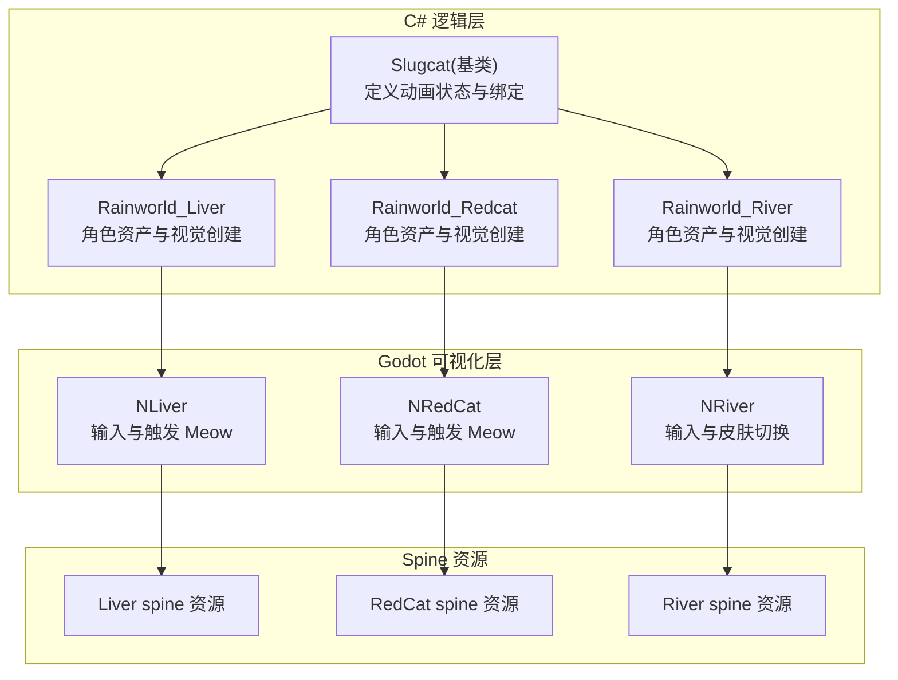
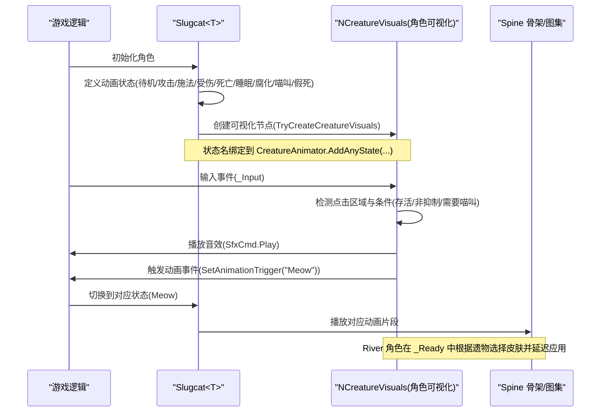
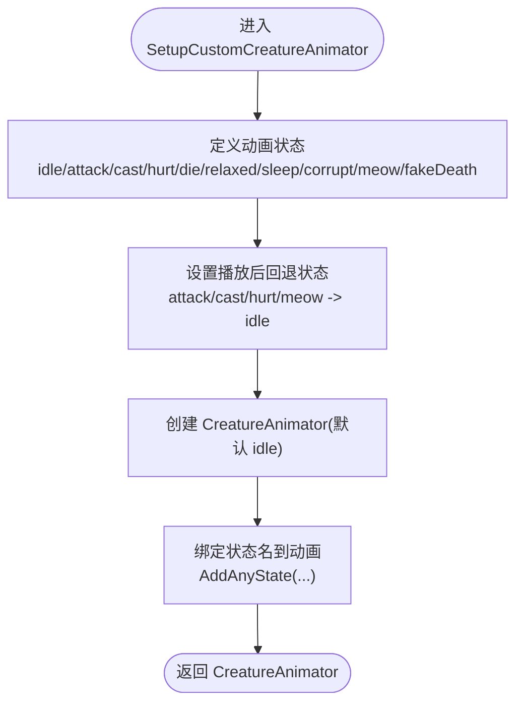
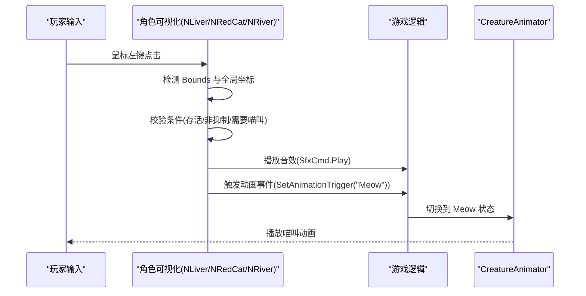
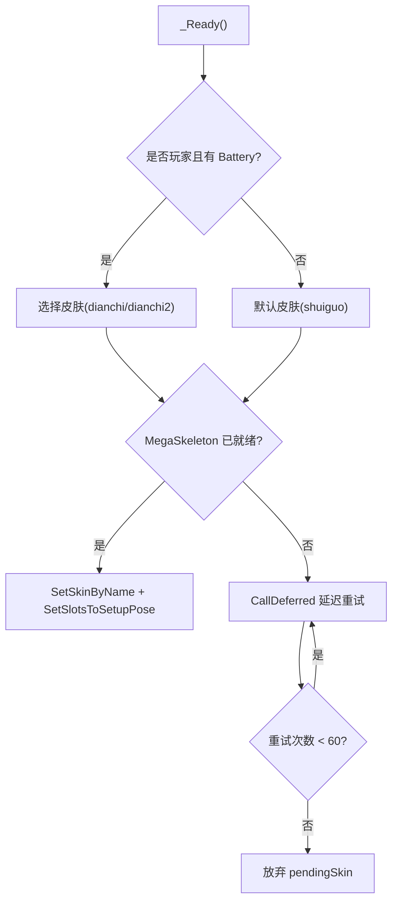
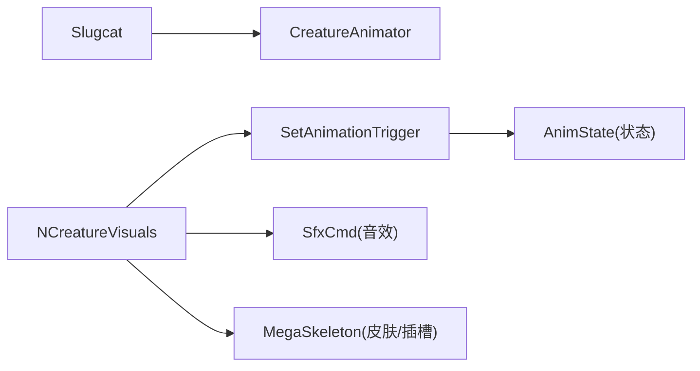

# 角色动画系统

<cite>
**本文引用的文件**
- [NLiver.cs](file://Godot/Character/Liver/NLiver.cs)
- [NRedCat.cs](file://Godot/Character/RedCat/NRedCat.cs)
- [NRiver.cs](file://Godot/Character/River/NRiver.cs)
- [Slugcat.cs](file://Scripts/Slugcat/Slugcat.cs)
- [Rainworld_Liver.cs](file://Scripts/Slugcat/Rainworld_Liver.cs)
- [Rainworld_Redcat.cs](file://Scripts/Slugcat/Rainworld_Redcat.cs)
- [Rainworld_River.cs](file://Scripts/Slugcat/Rainworld_River.cs)
- [rest.tres（肝脏）](file://Godot/Character/Liver/spine/rest.tres)
- [rest.tres（红猫）](file://Godot/Character/RedCat/spine/rest.tres)
- [SlugCat_River.tres（河）](file://Godot/Character/River/spine/SlugCat_River.tres)
</cite>

## 目录
1. [简介](#简介)
2. [项目结构](#项目结构)
3. [核心组件](#核心组件)
4. [架构总览](#架构总览)
5. [详细组件分析](#详细组件分析)
6. [依赖关系分析](#依赖关系分析)
7. [性能与内存优化](#性能与内存优化)
8. [故障排查指南](#故障排查指南)
9. [结论](#结论)
10. [附录：自定义状态与事件处理示例](#附录自定义状态与事件处理示例)

## 简介
本技术文档面向“角色动画系统”，聚焦于 Godot 引擎与 C# 逻辑层的动画集成，以及 Spine 动画在角色上的配置与使用。文档覆盖以下内容：
- 角色动画状态机设计：待机、攻击、施法、受伤、死亡、假死、睡眠、腐化、喵叫等状态的切换逻辑。
- 动画事件处理机制：如攻击命中、技能释放、受击反馈等时机的精确控制。
- 动画资源加载与管理策略：Spine 骨架与图集的加载、皮肤切换、延迟重试与资源释放建议。
- 代码级实现要点：基于 CreatureAnimator 的状态绑定、触发器调用、条件过滤。
- 调试工具与常见问题：如何定位动画未播放、皮肤未应用、输入未响应等问题。

## 项目结构
本项目将角色可视化层放在 Godot 场景下，C# 逻辑层通过框架提供的抽象类与命令进行交互。每个角色拥有独立的 Godot 可视化脚本与 Spine 资源，同时共享统一的动画状态机定义。

图表来源
- [Slugcat.cs:93-133](file://Scripts/Slugcat/Slugcat.cs#L93-L133)
- [Rainworld_Liver.cs:41-79](file://Scripts/Slugcat/Rainworld_Liver.cs#L41-L79)
- [Rainworld_Redcat.cs:44-84](file://Scripts/Slugcat/Rainworld_Redcat.cs#L44-L84)
- [Rainworld_River.cs:47-85](file://Scripts/Slugcat/Rainworld_River.cs#L47-L85)
- [NLiver.cs:14-47](file://Godot/Character/Liver/NLiver.cs#L14-L47)
- [NRedCat.cs:15-53](file://Godot/Character/RedCat/NRedCat.cs#L15-L53)
- [NRiver.cs:17-84](file://Godot/Character/River/NRiver.cs#L17-L84)

章节来源
- [Slugcat.cs:93-133](file://Scripts/Slugcat/Slugcat.cs#L93-L133)
- [Rainworld_Liver.cs:41-79](file://Scripts/Slugcat/Rainworld_Liver.cs#L41-L79)
- [Rainworld_Redcat.cs:44-84](file://Scripts/Slugcat/Rainworld_Redcat.cs#L44-L84)
- [Rainworld_River.cs:47-85](file://Scripts/Slugcat/Rainworld_River.cs#L47-L85)
- [NLiver.cs:14-47](file://Godot/Character/Liver/NLiver.cs#L14-L47)
- [NRedCat.cs:15-53](file://Godot/Character/RedCat/NRedCat.cs#L15-L53)
- [NRiver.cs:17-84](file://Godot/Character/River/NRiver.cs#L17-L84)

## 核心组件
- 动画状态机定义：在 Slugcat<T> 中集中定义各动画状态（待机、攻击、施法、受伤、死亡、放松、睡眠、腐化、喵叫、假死），并设置播放完成后自动回到待机状态；同时将状态名映射到 CreatureAnimator 的任意状态入口，支持条件过滤（例如受击动画可被抑制）。
- 角色资产与可视化创建：各具体角色类（Liver、Redcat、River）通过 CharacterAssetProfile 指定 Godot 场景路径（VisualsPath）、商店动画、休息点动画等，并在 TryCreateCreatureVisuals 中创建可视化节点。
- Godot 可视化脚本：每个角色的可视化脚本继承自 NCreatureVisuals，负责输入处理、音效播放、触发动画事件（如 Meow），以及 River 角色的皮肤切换逻辑。
- Spine 资源：每个角色目录下包含 SpineSkeletonDataResource 资源文件，引用对应的图集与骨架文件，用于运行时渲染。

章节来源
- [Slugcat.cs:93-133](file://Scripts/Slugcat/Slugcat.cs#L93-L133)
- [Rainworld_Liver.cs:41-79](file://Scripts/Slugcat/Rainworld_Liver.cs#L41-L79)
- [Rainworld_Redcat.cs:44-84](file://Scripts/Slugcat/Rainworld_Redcat.cs#L44-L84)
- [Rainworld_River.cs:47-85](file://Scripts/Slugcat/Rainworld_River.cs#L47-L85)
- [NLiver.cs:14-47](file://Godot/Character/Liver/NLiver.cs#L14-L47)
- [NRedCat.cs:15-53](file://Godot/Character/RedCat/NRedCat.cs#L15-L53)
- [NRiver.cs:17-84](file://Godot/Character/River/NRiver.cs#L17-L84)
- [rest.tres（肝脏）:1-9](file://Godot/Character/Liver/spine/rest.tres#L1-L9)
- [rest.tres（红猫）:1-9](file://Godot/Character/RedCat/spine/rest.tres#L1-L9)
- [SlugCat_River.tres（河）:1-9](file://Godot/Character/River/spine/SlugCat_River.tres#L1-L9)

## 架构总览
下图展示了从 C# 逻辑层到 Godot 可视化层再到 Spine 资源的完整调用链，包括状态机绑定、输入触发与皮肤切换流程。

图表来源
- [Slugcat.cs:93-133](file://Scripts/Slugcat/Slugcat.cs#L93-L133)
- [NLiver.cs:20-47](file://Godot/Character/Liver/NLiver.cs#L20-L47)
- [NRedCat.cs:21-53](file://Godot/Character/RedCat/NRedCat.cs#L21-L53)
- [NRiver.cs:17-84](file://Godot/Character/River/NRiver.cs#L17-L84)

## 详细组件分析

### 动画状态机与切换逻辑
- 状态定义：在 Slugcat<T> 中定义了多个动画状态，部分为循环播放（如 idle_loop、relaxed_loop、sleep、xianggu、relive_loop），部分为一次性播放（attack、cast、hurt、die、meow）。
- 自动回退：攻击、施法、受伤、喵叫等状态播放完成后自动回到待机状态，确保状态机稳定。
- 条件过滤：受击、攻击、施法、喵叫等状态可通过 SuppressHurtAnim 标志位进行抑制，避免在特定情况下播放不必要的动画。
- 状态映射：通过 AddAnyState 将字符串状态名（Idle、Dead、Hit、Attack、Cast、Relaxed、Sleep、Corrupt、Meow、FakeDeath）映射到具体 AnimState，供上层逻辑统一调度。

图表来源
- [Slugcat.cs:93-133](file://Scripts/Slugcat/Slugcat.cs#L93-L133)

章节来源
- [Slugcat.cs:93-133](file://Scripts/Slugcat/Slugcat.cs#L93-L133)

### Godot 输入与动画事件触发
- 输入处理：三个角色的可视化脚本均启用输入处理，监听鼠标左键点击，判断是否在 Bounds 区域内。
- 条件检查：仅在父节点存在、角色未死亡、玩家角色为 Slugcat、未抑制受击动画、且需要喵叫时执行后续逻辑。
- 音效与触发：根据角色播放不同音效，并通过 SetAnimationTrigger("Meow") 触发动画事件，由 C# 层切换到 Meow 状态。

图表来源
- [NLiver.cs:20-47](file://Godot/Character/Liver/NLiver.cs#L20-L47)
- [NRedCat.cs:21-53](file://Godot/Character/RedCat/NRedCat.cs#L21-L53)
- [NRiver.cs:86-113](file://Godot/Character/River/NRiver.cs#L86-L113)
- [Slugcat.cs:93-133](file://Scripts/Slugcat/Slugcat.cs#L93-L133)

章节来源
- [NLiver.cs:20-47](file://Godot/Character/Liver/NLiver.cs#L20-L47)
- [NRedCat.cs:21-53](file://Godot/Character/RedCat/NRedCat.cs#L21-L53)
- [NRiver.cs:86-113](file://Godot/Character/River/NRiver.cs#L86-L113)

### Spine 资源加载与皮肤切换
- 资源结构：每个角色目录下包含 SpineSkeletonDataResource 资源，引用 atlas 与 skeleton 文件。
- 皮肤切换：NRiver 在 _Ready 中根据遗物选择皮肤名称，若 MegaSkeleton 尚未就绪则延迟重试，最多尝试一定次数以避免阻塞。
- 应用流程：获取 Visuals 节点的骨架对象，封装为 MegaSkeleton，调用 SetSkinByName 与 SetSlotsToSetupPose 完成皮肤切换。

图表来源
- [NRiver.cs:17-84](file://Godot/Character/River/NRiver.cs#L17-L84)
- [rest.tres（肝脏）:1-9](file://Godot/Character/Liver/spine/rest.tres#L1-L9)
- [rest.tres（红猫）:1-9](file://Godot/Character/RedCat/spine/rest.tres#L1-L9)
- [SlugCat_River.tres（河）:1-9](file://Godot/Character/River/spine/SlugCat_River.tres#L1-L9)

章节来源
- [NRiver.cs:17-84](file://Godot/Character/River/NRiver.cs#L17-L84)
- [rest.tres（肝脏）:1-9](file://Godot/Character/Liver/spine/rest.tres#L1-L9)
- [rest.tres（红猫）:1-9](file://Godot/Character/RedCat/spine/rest.tres#L1-L9)
- [SlugCat_River.tres（河）:1-9](file://Godot/Character/River/spine/SlugCat_River.tres#L1-L9)

### 角色资产与可视化创建
- 资产配置：各角色通过 CharacterAssetProfile 指定可视化场景、能量计数器、商店动画、休息点动画、UI 图标、多人模式手势贴图、默认遗物视觉覆盖等。
- 可视化创建：TryCreateCreatureVisuals 使用 RitsuGodotNodeFactories 从场景路径创建 NCreatureVisuals 实例，使 C# 与 Godot 解耦。

章节来源
- [Rainworld_Liver.cs:41-79](file://Scripts/Slugcat/Rainworld_Liver.cs#L41-L79)
- [Rainworld_Redcat.cs:44-84](file://Scripts/Slugcat/Rainworld_Redcat.cs#L44-L84)
- [Rainworld_River.cs:47-85](file://Scripts/Slugcat/Rainworld_River.cs#L47-L85)

## 依赖关系分析
- 耦合度：C# 逻辑层通过 CreatureAnimator 与状态名进行松耦合交互；Godot 可视化层通过 SetAnimationTrigger 与 C# 层通信，降低直接依赖。
- 外部依赖：Spine 扩展通过 Godot 资源文件引入，运行时通过 MegaSkeleton 访问骨架与图集。
- 潜在循环：当前未见明显循环依赖；状态机与可视化脚本职责清晰。

图表来源
- [Slugcat.cs:93-133](file://Scripts/Slugcat/Slugcat.cs#L93-L133)
- [NLiver.cs:20-47](file://Godot/Character/Liver/NLiver.cs#L20-L47)
- [NRedCat.cs:21-53](file://Godot/Character/RedCat/NRedCat.cs#L21-L53)
- [NRiver.cs:17-84](file://Godot/Character/River/NRiver.cs#L17-L84)

章节来源
- [Slugcat.cs:93-133](file://Scripts/Slugcat/Slugcat.cs#L93-L133)
- [NLiver.cs:20-47](file://Godot/Character/Liver/NLiver.cs#L20-L47)
- [NRedCat.cs:21-53](file://Godot/Character/RedCat/NRedCat.cs#L21-L53)
- [NRiver.cs:17-84](file://Godot/Character/River/NRiver.cs#L17-L84)

## 性能与内存优化
- 动画状态复用：待机、放松、睡眠、腐化、假死等循环状态可减少频繁切换开销。
- 条件抑制：通过 SuppressHurtAnim 避免不必要动画播放，降低 CPU/GPU 压力。
- 延迟重试：皮肤切换采用 CallDeferred 与重试计数，避免主线程阻塞与空引用异常。
- 资源管理建议：
  - 图集与骨架按需加载，避免同时持有过多 Spine 资源。
  - 在场景切换或角色销毁时释放 MegaSkeleton 引用，减少内存占用。
  - 对长循环动画（如 sleep、xianggu、relive_loop）考虑帧率限制或暂停策略。

[本节提供通用指导，不直接分析具体文件]

## 故障排查指南
- 动画未触发：
  - 检查 Godot 输入是否启用（SetProcessInput(true)）。
  - 确认点击区域 Bounds 是否存在且包含鼠标位置。
  - 验证条件：角色存活、未抑制受击动画、需要喵叫标志位。
- 皮肤未应用：
  - 检查 Visuals 节点是否存在，get_skeleton 返回值是否为空。
  - 确认延迟重试是否达到上限（>60 次会放弃 pendingSkin）。
  - 核对 SpineSkeletonDataResource 是否正确引用 atlas 与 skeleton。
- 音效无输出：
  - 确认 SfxCmd 的事件路径正确，音频资源已导入。
- 状态机异常：
  - 检查 AddAnyState 绑定的状态名是否与上层调用一致。
  - 确认 NextState 设置是否合理，避免状态卡死。

章节来源
- [NLiver.cs:20-47](file://Godot/Character/Liver/NLiver.cs#L20-L47)
- [NRedCat.cs:21-53](file://Godot/Character/RedCat/NRedCat.cs#L21-L53)
- [NRiver.cs:17-84](file://Godot/Character/River/NRiver.cs#L17-L84)
- [Slugcat.cs:93-133](file://Scripts/Slugcat/Slugcat.cs#L93-L133)

## 结论
本项目通过 C# 逻辑层与 Godot 可视化层的协作，结合 Spine 动画资源，实现了稳定的角色动画状态机与事件驱动机制。状态机设计清晰，支持条件抑制与自动回退；Godot 侧输入处理与皮肤切换逻辑健壮，具备延迟重试与错误保护。建议在后续迭代中继续完善资源生命周期管理与性能监控，以提升整体体验。

[本节总结性内容，不直接分析具体文件]

## 附录：自定义状态与事件处理示例
以下为常见自定义需求的实现思路与参考路径（不包含具体代码内容）：
- 新增自定义状态：
  - 在 Slugcat<T> 中定义新的 AnimState，并设置 NextState 与循环属性。
  - 通过 AddAnyState 将状态名映射到 CreatureAnimator。
  - 参考路径：[Slugcat.cs:93-133](file://Scripts/Slugcat/Slugcat.cs#L93-L133)
- 在 Godot 侧触发状态：
  - 在角色的 _Input 中添加条件判断与 SetAnimationTrigger 调用。
  - 参考路径：[NLiver.cs:20-47](file://Godot/Character/Liver/NLiver.cs#L20-L47)、[NRedCat.cs:21-53](file://Godot/Character/RedCat/NRedCat.cs#L21-L53)、[NRiver.cs:86-113](file://Godot/Character/River/NRiver.cs#L86-L113)
- 动态皮肤切换：
  - 在 _Ready 中根据运行时条件选择皮肤名称，延迟应用并处理空引用。
  - 参考路径：[NRiver.cs:17-84](file://Godot/Character/River/NRiver.cs#L17-L84)
- 动画事件与音效联动：
  - 在触发动画前播放对应音效，确保时机一致。
  - 参考路径：[NLiver.cs:20-47](file://Godot/Character/Liver/NLiver.cs#L20-L47)、[NRedCat.cs:21-53](file://Godot/Character/RedCat/NRedCat.cs#L21-L53)、[NRiver.cs:86-113](file://Godot/Character/River/NRiver.cs#L86-L113)

[本节为概念性指导，不直接分析具体文件]