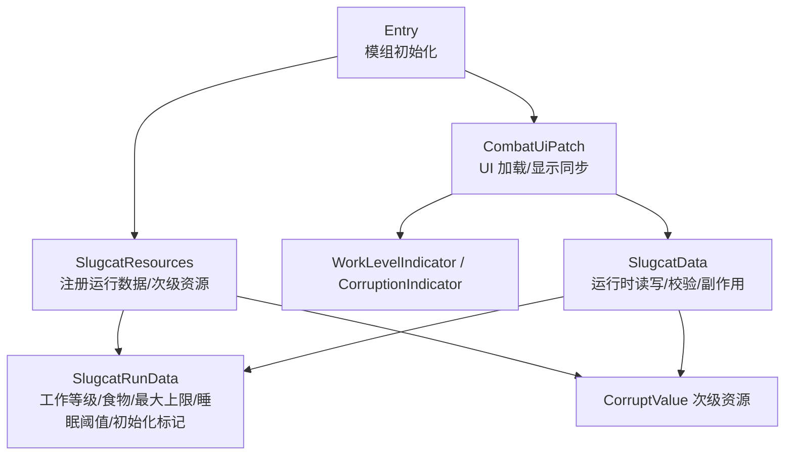
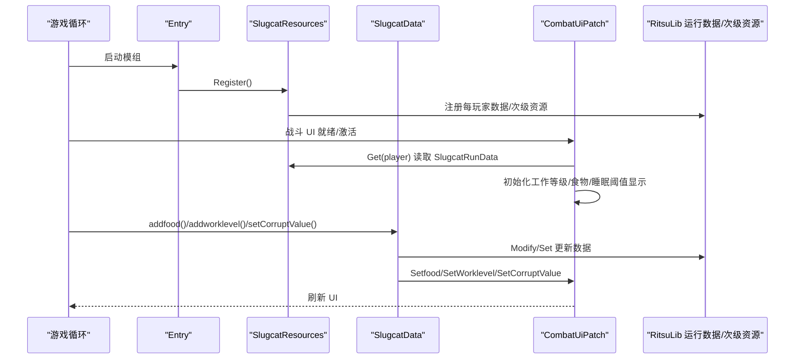
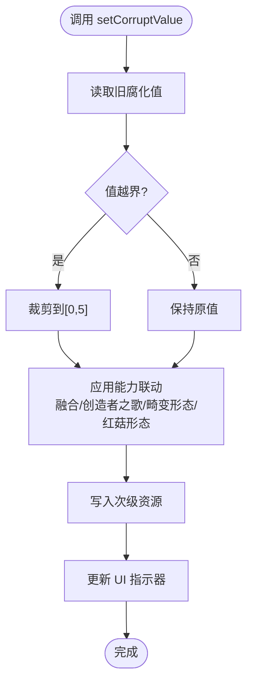
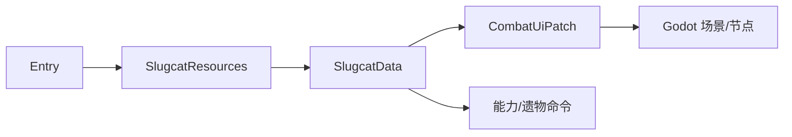

# 角色数据管理

<cite>
**本文引用的文件**
- [Scripts/Slugcat/SlugcatData.cs](file://Scripts/Slugcat/SlugcatData.cs)
- [Scripts/Slugcat/SecondaryResource/SlugcatResources.cs](file://Scripts/Slugcat/SecondaryResource/SlugcatResources.cs)
- [Scripts/Slugcat/SecondaryResource/SlugcatRunData.cs](file://Scripts/Slugcat/SecondaryResource/SlugcatRunData.cs)
- [Scripts/Slugcat/SecondaryResource/RelicFilterRunData.cs](file://Scripts/Slugcat/SecondaryResource/RelicFilterRunData.cs)
- [Scripts/Slugcat/Slugcat.cs](file://Scripts/Slugcat/Slugcat.cs)
- [Scripts/patches/CombatUiPatch.cs](file://Scripts/patches/CombatUiPatch.cs)
- [Scripts/Entry.cs](file://Scripts/Entry.cs)
</cite>

## 目录
1. [简介](#简介)
2. [项目结构](#项目结构)
3. [核心组件](#核心组件)
4. [架构总览](#架构总览)
5. [详细组件分析](#详细组件分析)
6. [依赖关系分析](#依赖关系分析)
7. [性能考量](#性能考量)
8. [故障排查指南](#故障排查指南)
9. [结论](#结论)
10. [附录：扩展与迁移](#附录：扩展与迁移)

## 简介
本文件面向“角色数据管理系统”，聚焦于蛞蝓猫（Slugcat）角色的持久化机制，包括工作等级（业力）、食物、腐化值等核心属性的存储、同步与生命周期管理。文档将详细说明 SlugcatData 类的职责边界、数据模型 SlugcatRunData 的结构、与游戏存档系统的集成方式（基于 RitsuLib 的 RunSavedData 与 SecondaryResource），以及运行时更新、跨会话保持和数据校验策略。同时解释 SecondaryResource 系统的设计模式与扩展方法，并提供添加新属性与数据字段的具体步骤示例，最后给出数据迁移与版本兼容性处理方案。

## 项目结构
围绕角色数据管理的代码主要分布在以下模块：
- 数据定义与注册：SlugcatRunData、RelicFilterRunData、SlugcatResources
- 运行时数据访问与业务逻辑：SlugcatData
- 战斗 UI 同步：CombatUiPatch
- 模组入口与初始化：Entry
- 角色基类与属性接口：Slugcat

图表来源
- [Scripts/Entry.cs:26-41](file://Scripts/Entry.cs#L26-L41)
- [Scripts/Slugcat/SecondaryResource/SlugcatResources.cs:15-48](file://Scripts/Slugcat/SecondaryResource/SlugcatResources.cs#L15-L48)
- [Scripts/Slugcat/SlugcatData.cs:76-104](file://Scripts/Slugcat/SlugcatData.cs#L76-L104)
- [Scripts/patches/CombatUiPatch.cs:138-260](file://Scripts/patches/CombatUiPatch.cs#L138-L260)

章节来源
- [Scripts/Entry.cs:26-41](file://Scripts/Entry.cs#L26-L41)
- [Scripts/Slugcat/SecondaryResource/SlugcatResources.cs:15-48](file://Scripts/Slugcat/SecondaryResource/SlugcatResources.cs#L15-L48)
- [Scripts/Slugcat/SlugcatData.cs:76-104](file://Scripts/Slugcat/SlugcatData.cs#L76-L104)
- [Scripts/patches/CombatUiPatch.cs:138-260](file://Scripts/patches/CombatUiPatch.cs#L138-L260)

## 核心组件
- SlugcatRunData：保存玩家级别的运行期数据，包含工作等级、最大工作等级、食物、最大食物、睡眠所需食物、是否已初始化、是否有超生标记等。
- SlugcatResources：集中注册运行数据与次级资源（如腐化值），提供按玩家的数据存取 API，并配置写入策略与多人同步策略。
- SlugcatData：封装角色数据的读取、修改、校验与副作用（如音效、UI 更新、能力应用、遗物联动）。
- CombatUiPatch：在战斗 UI 就绪/激活/停用阶段注入 UI 元素，并将数据变化同步到 UI。
- Entry：模组入口，负责注册补丁、配置、次级资源与内容发现。

章节来源
- [Scripts/Slugcat/SecondaryResource/SlugcatRunData.cs:1-14](file://Scripts/Slugcat/SecondaryResource/SlugcatRunData.cs#L1-L14)
- [Scripts/Slugcat/SecondaryResource/SlugcatResources.cs:15-48](file://Scripts/Slugcat/SecondaryResource/SlugcatResources.cs#L15-L48)
- [Scripts/Slugcat/SlugcatData.cs:32-367](file://Scripts/Slugcat/SlugcatData.cs#L32-L367)
- [Scripts/patches/CombatUiPatch.cs:16-260](file://Scripts/patches/CombatUiPatch.cs#L16-L260)
- [Scripts/Entry.cs:26-41](file://Scripts/Entry.cs#L26-L41)

## 架构总览
整体数据流分为三层：
- 数据层：SlugcatRunData 作为持久化载体；CorruptValue 作为次级资源用于战斗内状态。
- 逻辑层：SlugcatData 提供统一的读写与校验，确保数值范围、触发副作用、与能力/遗物交互。
- 表现层：CombatUiPatch 在战斗 UI 中展示工作等级、食物、腐化值，并在数据变更时刷新。

图表来源
- [Scripts/Entry.cs:26-41](file://Scripts/Entry.cs#L26-L41)
- [Scripts/Slugcat/SecondaryResource/SlugcatResources.cs:15-48](file://Scripts/Slugcat/SecondaryResource/SlugcatResources.cs#L15-L48)
- [Scripts/Slugcat/SlugcatData.cs:117-142](file://Scripts/Slugcat/SlugcatData.cs#L117-L142)
- [Scripts/Slugcat/SlugcatData.cs:185-221](file://Scripts/Slugcat/SlugcatData.cs#L185-L221)
- [Scripts/Slugcat/SlugcatData.cs:239-313](file://Scripts/Slugcat/SlugcatData.cs#L239-L313)
- [Scripts/patches/CombatUiPatch.cs:138-260](file://Scripts/patches/CombatUiPatch.cs#L138-L260)

## 详细组件分析

### SlugcatRunData 数据模型
- 字段说明
  - WorkLevel：当前工作等级（业力）
  - MaxWorkLevel：最大工作等级上限
  - Food：当前食物
  - MaxFood：最大食物容量
  - SleepFood：休眠所需食物阈值
  - IsInitialized：是否已完成初始同步
  - HaveChaoshengt：超生标记（用于控制重生行为）
- 复杂度
  - 数据结构为简单值对象，读写 O(1)，序列化开销低。
- 设计要点
  - 通过 SlugcatResources.Data.Get(player) 获取实例，使用 Modify 进行原子更新。
  - 使用 IsInitialized 避免重复初始化或覆盖已有数据。

章节来源
- [Scripts/Slugcat/SecondaryResource/SlugcatRunData.cs:1-14](file://Scripts/Slugcat/SecondaryResource/SlugcatRunData.cs#L1-L14)
- [Scripts/Slugcat/SlugcatData.cs:76-104](file://Scripts/Slugcat/SlugcatData.cs#L76-L104)

### SlugcatResources 注册与持久化
- 运行数据
  - 使用 PlayerRunSavedData<SlugcatRunData> 按玩家维度存储，写入策略为 WhenSet，开启多人房间同步。
- 次级资源
  - 注册 CorruptValue 次级资源，默认值为 0，基础最大值为 5，持久化策略为 Combat（仅战斗内有效）。
- 关键点
  - 所有数据变更通过 RitsuLib 框架统一处理，保证跨会话持久化与多人同步一致性。

章节来源
- [Scripts/Slugcat/SecondaryResource/SlugcatResources.cs:15-48](file://Scripts/Slugcat/SecondaryResource/SlugcatResources.cs#L15-L48)

### SlugcatData 运行时逻辑
- 初始化
  - Initialize：首次进入时从角色对象同步 workLevel/maxWorkLevel/food/maxFood/sleepfood，并设置 IsInitialized。
- 食物系统
  - addfood：增加食物，超过上限时可转化为力量（受能力影响），负数归零，上限裁剪，更新 UI，并尝试保存到遗物。
  - cansleep/trysleep/sleep：检查是否满足休眠条件（食物足够、存活、非假死），入队 SleepAction。
- 工作等级（业力）
  - addworklevel/setworklevel：调整工作等级，限制在 [0, MaxWorkLevel]，低于 0 时造成致命伤害，更新 UI，并保存到遗物。
  - canbekill：根据遗物/能力与工作等级判断是否可被击杀。
- 腐化值（次级资源）
  - getCorruptValue/setCorruptValue/addCorruptValue：读取/设置/增加腐化值，范围限制 [0,5]，触发能力联动（融合、创造者之歌扣血、畸变形态加力量、红菇形态切换），更新 UI。
- 胜利奖励
  - callVictory/getRewordFood：根据房间类型给予食物与工作等级提升，特定角色额外提升最大工作等级。
- 复活与死亡
  - reLive：根据能力/遗物决定恢复生命或降低工作等级，并执行工作回报。

图表来源
- [Scripts/Slugcat/SlugcatData.cs:239-313](file://Scripts/Slugcat/SlugcatData.cs#L239-L313)

章节来源
- [Scripts/Slugcat/SlugcatData.cs:76-104](file://Scripts/Slugcat/SlugcatData.cs#L76-L104)
- [Scripts/Slugcat/SlugcatData.cs:117-142](file://Scripts/Slugcat/SlugcatData.cs#L117-L142)
- [Scripts/Slugcat/SlugcatData.cs:185-221](file://Scripts/Slugcat/SlugcatData.cs#L185-L221)
- [Scripts/Slugcat/SlugcatData.cs:239-313](file://Scripts/Slugcat/SlugcatData.cs#L239-L313)
- [Scripts/Slugcat/SlugcatData.cs:339-365](file://Scripts/Slugcat/SlugcatData.cs#L339-L365)

### CombatUiPatch UI 同步
- 生命周期
  - Ready：创建并挂载 SleepButton、WorkLevelIndicator、CorruptionIndicator。
  - Activate：根据当前角色类型显示/隐藏对应 UI，并从运行数据初始化显示。
  - Deactivate：隐藏 UI 并禁用按钮。
- 数据绑定
  - Setfood/SetWorklevel/SetCorruptValue：在数据变更后刷新 UI。
  - callTurnStart：每回合开始时更新休眠按钮可用性与冷却。

章节来源
- [Scripts/patches/CombatUiPatch.cs:16-136](file://Scripts/patches/CombatUiPatch.cs#L16-L136)
- [Scripts/patches/CombatUiPatch.cs:138-260](file://Scripts/patches/CombatUiPatch.cs#L138-L260)

### 角色基类与属性接口
- Slugcat 接口定义了角色相关的工作等级、食物、睡眠阈值等属性，供具体角色实现。
- 抽象基类提供动画状态机与外观配置，支持自定义动画状态（如休眠、腐化、假死等）。

章节来源
- [Scripts/Slugcat/Slugcat.cs:40-60](file://Scripts/Slugcat/Slugcat.cs#L40-L60)
- [Scripts/Slugcat/Slugcat.cs:61-135](file://Scripts/Slugcat/Slugcat.cs#L61-L135)

## 依赖关系分析
- Entry 依赖 SlugcatResources.Register 以注册运行数据与次级资源。
- SlugcatData 依赖：
  - SlugcatResources.Data 读写运行数据
  - SecondaryResourceCmd 读写次级资源（腐化值）
  - CombatUiPatch 更新 UI
  - 能力/遗物命令（PowerCmd/CreatureCmd）触发副作用
- CombatUiPatch 依赖：
  - Godot 场景加载与节点管理
  - SlugcatResources 读取运行数据
  - SlugcatData 的业务方法（如 callVictory）

图表来源
- [Scripts/Entry.cs:26-41](file://Scripts/Entry.cs#L26-L41)
- [Scripts/Slugcat/SecondaryResource/SlugcatResources.cs:15-48](file://Scripts/Slugcat/SecondaryResource/SlugcatResources.cs#L15-L48)
- [Scripts/Slugcat/SlugcatData.cs:117-142](file://Scripts/Slugcat/SlugcatData.cs#L117-L142)
- [Scripts/patches/CombatUiPatch.cs:138-260](file://Scripts/patches/CombatUiPatch.cs#L138-L260)

章节来源
- [Scripts/Entry.cs:26-41](file://Scripts/Entry.cs#L26-L41)
- [Scripts/Slugcat/SecondaryResource/SlugcatResources.cs:15-48](file://Scripts/Slugcat/SecondaryResource/SlugcatResources.cs#L15-L48)
- [Scripts/Slugcat/SlugcatData.cs:117-142](file://Scripts/Slugcat/SlugcatData.cs#L117-L142)
- [Scripts/patches/CombatUiPatch.cs:138-260](file://Scripts/patches/CombatUiPatch.cs#L138-L260)

## 性能考量
- 数据写入策略：WhenSet 仅在显式设置时写入，减少不必要的磁盘 IO。
- 多人同步：SyncLobbyOnChange 开启后，数据变更会同步到房间其他玩家，注意批量更新以避免频繁网络传输。
- UI 更新：CombatUiPatch 对无效实例进行保护，避免空引用异常导致的卡顿。
- 异步操作：大量能力/命令调用采用异步任务，避免阻塞主线程。

[本节为通用指导，不直接分析具体文件]

## 故障排查指南
- 常见问题
  - UI 未显示：检查 CombatUiPatch 的 Ready/Activate 是否成功加载场景与节点。
  - 数据不同步：确认 SlugcatResources 的 WritePolicy 与 SyncLobbyOnChange 配置正确。
  - 腐化值异常：检查 setCorruptValue 的范围限制与能力联动逻辑。
  - 工作等级越界：验证 setworklevel 的上限裁剪与下限致命伤害逻辑。
- 调试建议
  - 在关键路径添加日志输出（如 Log.Debug）。
  - 断点检查 SlugcatResources.Data.Get(player) 返回的对象是否为预期实例。
  - 检查能力/遗物是否存在导致副作用异常的条件。

章节来源
- [Scripts/Slugcat/SlugcatData.cs:239-313](file://Scripts/Slugcat/SlugcatData.cs#L239-L313)
- [Scripts/patches/CombatUiPatch.cs:138-260](file://Scripts/patches/CombatUiPatch.cs#L138-L260)

## 结论
该角色数据管理系统通过 RitsuLib 的运行数据与次级资源机制，实现了工作等级、食物、腐化值的持久化与同步。SlugcatData 提供了统一的业务逻辑封装，CombatUiPatch 负责 UI 同步，Entry 完成初始化与注册。系统设计清晰、可扩展性强，适合后续新增属性与复杂联动逻辑。

[本节为总结性内容，不直接分析具体文件]

## 附录：扩展与迁移

### 添加新的角色属性与数据字段
- 步骤
  1. 在 SlugcatRunData 中添加新字段（例如 NewStat: int）。
  2. 在 SlugcatData 中提供读取/修改方法，并在修改时调用 SlugcatResources.Data.Modify 进行原子更新。
  3. 如需战斗内实时显示，在 CombatUiPatch 中添加对应的 UI 更新方法。
  4. 若需要跨会话持久化，确保写入策略为 WhenSet 且启用多人同步。
  5. 在初始化流程中为新字段设置默认值或从角色对象同步。
- 参考路径
  - 数据模型：[Scripts/Slugcat/SecondaryResource/SlugcatRunData.cs:1-14](file://Scripts/Slugcat/SecondaryResource/SlugcatRunData.cs#L1-L14)
  - 数据注册：[Scripts/Slugcat/SecondaryResource/SlugcatResources.cs:15-48](file://Scripts/Slugcat/SecondaryResource/SlugcatResources.cs#L15-L48)
  - 业务逻辑：[Scripts/Slugcat/SlugcatData.cs:117-142](file://Scripts/Slugcat/SlugcatData.cs#L117-L142)
  - UI 同步：[Scripts/patches/CombatUiPatch.cs:138-260](file://Scripts/patches/CombatUiPatch.cs#L138-L260)

### 数据迁移与版本兼容性
- 策略
  - 使用 IsInitialized 标记区分新旧数据，避免覆盖已有存档。
  - 在 Initialize 中检测缺失字段并赋予默认值，保证向后兼容。
  - 对于重大结构变更，可在运行时进行一次性迁移脚本，将旧格式转换为新格式。
- 注意事项
  - 迁移过程中避免并发写入，确保数据一致性。
  - 记录迁移日志以便回溯问题。
  - 测试多版本共存场景，确保旧存档能正常加载与新功能兼容。

[本节为通用指导，不直接分析具体文件]