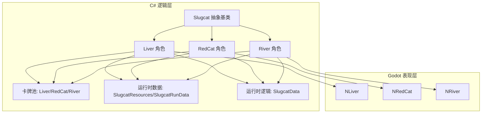
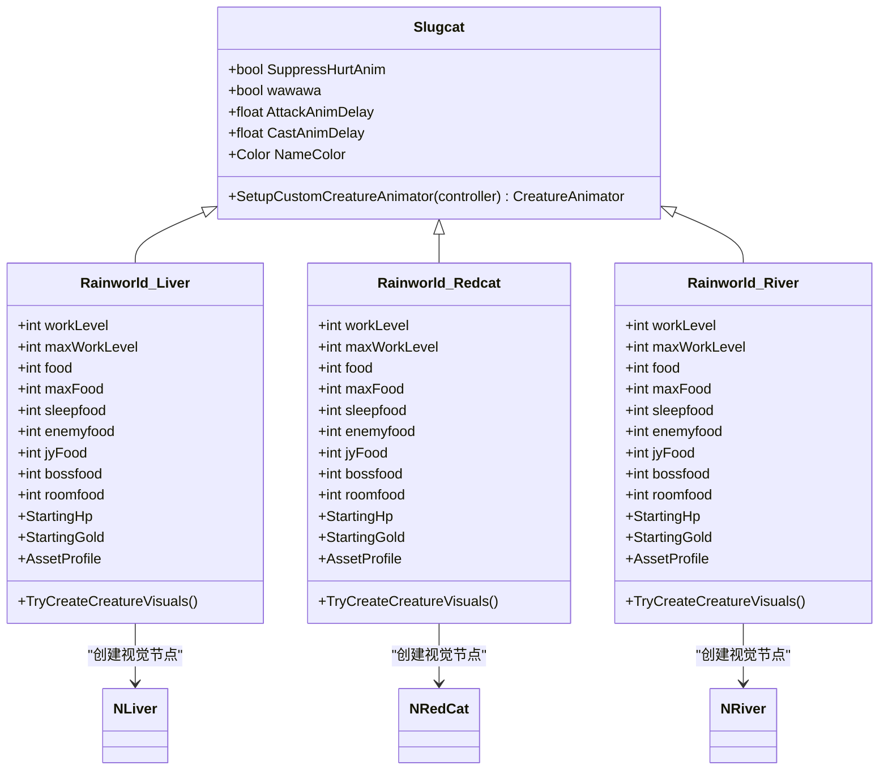
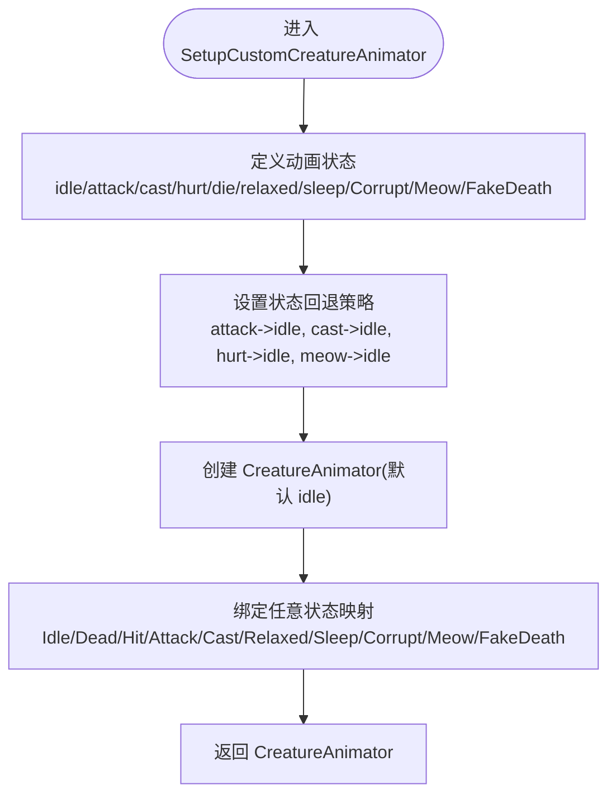
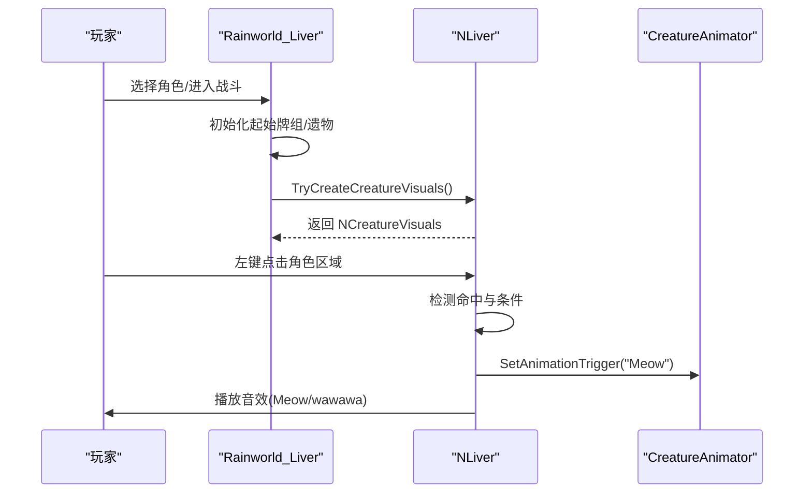
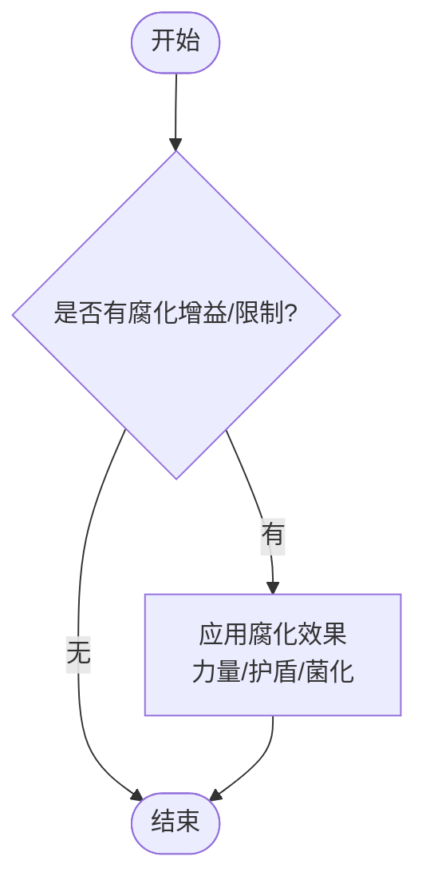
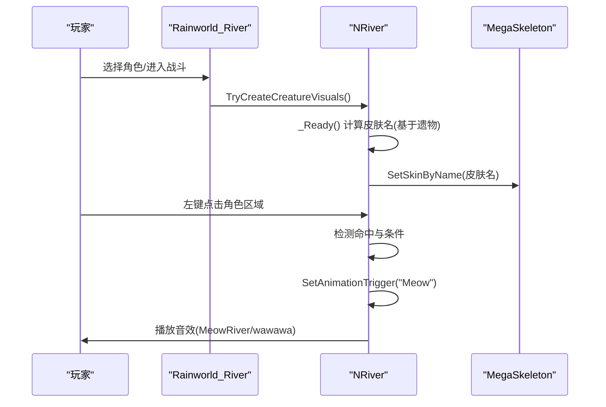
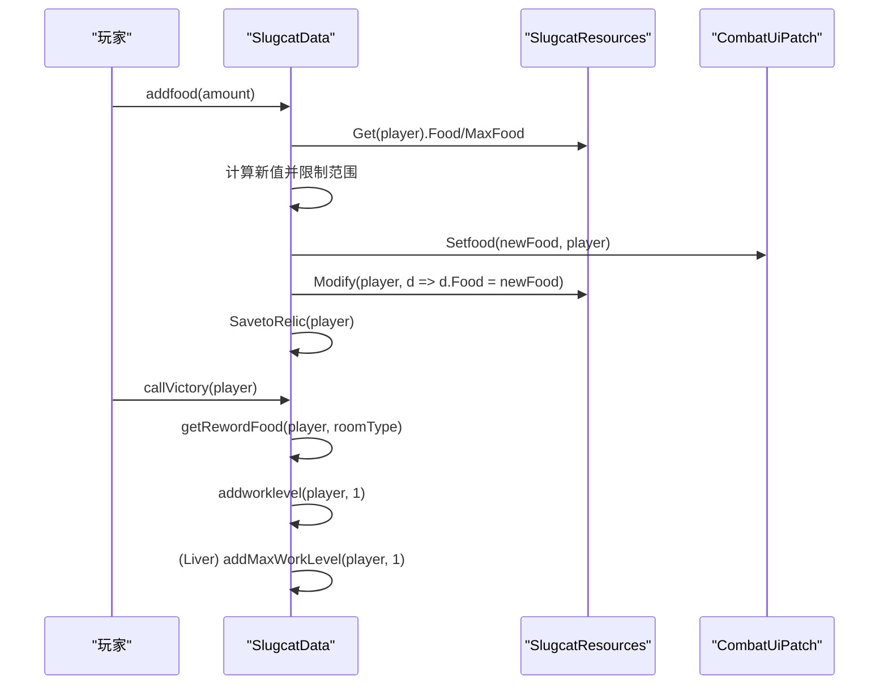
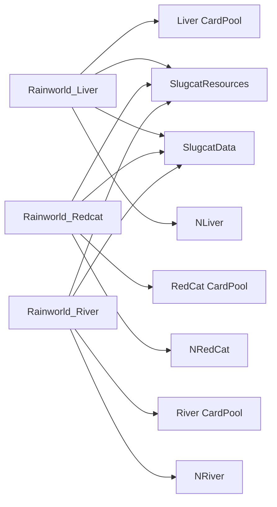

# 角色系统

<cite>
**本文引用的文件**
- [Scripts/Slugcat/Slugcat.cs](file://Scripts/Slugcat/Slugcat.cs)
- [Scripts/Slugcat/Rainworld_Liver.cs](file://Scripts/Slugcat/Rainworld_Liver.cs)
- [Scripts/Slugcat/Rainworld_Redcat.cs](file://Scripts/Slugcat/Rainworld_Redcat.cs)
- [Scripts/Slugcat/Rainworld_River.cs](file://Scripts/Slugcat/Rainworld_River.cs)
- [Scripts/Slugcat/SlugcatData.cs](file://Scripts/Slugcat/SlugcatData.cs)
- [Scripts/Slugcat/SecondaryResource/SlugcatResources.cs](file://Scripts/Slugcat/SecondaryResource/SlugcatResources.cs)
- [Scripts/Slugcat/SecondaryResource/SlugcatRunData.cs](file://Scripts/Slugcat/SecondaryResource/SlugcatRunData.cs)
- [Scripts/Card/Liver/Rainworld_Liver_CardPool.cs](file://Scripts/Card/Liver/Rainworld_Liver_CardPool.cs)
- [Scripts/Card/RedCat/Rainworld_Redcat_CardPool.cs](file://Scripts/Card/RedCat/Rainworld_Redcat_CardPool.cs)
- [Scripts/Card/River/Rainworld_River_CardPool.cs](file://Scripts/Card/River/Rainworld_River_CardPool.cs)
- [Godot/Character/Liver/NLiver.cs](file://Godot/Character/Liver/NLiver.cs)
- [Godot/Character/RedCat/NRedCat.cs](file://Godot/Character/RedCat/NRedCat.cs)
- [Godot/Character/River/NRiver.cs](file://Godot/Character/River/NRiver.cs)
</cite>

## 目录
1. [简介](#简介)
2. [项目结构](#项目结构)
3. [核心组件](#核心组件)
4. [架构总览](#架构总览)
5. [详细组件分析](#详细组件分析)
6. [依赖关系分析](#依赖关系分析)
7. [性能考量](#性能考量)
8. [故障排查指南](#故障排查指南)
9. [结论](#结论)
10. [附录：自定义角色实现指南](#附录自定义角色实现指南)

## 简介
本文件系统性梳理“角色系统”的设计与实现，覆盖抽象基类 Slugcat、三个具体角色（肝脏 Liver、红猫 RedCat、河流 River）的机制差异、卡牌池与能力体系、动画系统集成、资源管理、状态管理与数据持久化，以及与 Godot 引擎的角色模型集成方式。文档同时提供流程图与时序图，帮助读者快速理解从选择角色到战斗中的完整流程。

## 项目结构
- 角色抽象层与具体角色定义位于 Scripts/Slugcat 下，统一继承自通用模板并实现各自起始牌组、初始遗物、资产配置等。
- 每个角色拥有独立的卡牌池类型，用于限定可获取的卡牌集合。
- 运行时状态通过 SecondaryResource 与 RunSavedData 进行持久化，包括工作等级、食物、腐化值等。
- Godot 侧为各角色的 NCreatureVisuals 子类，负责 Spine 动画、皮肤切换、交互触发等。

图表来源
- [Scripts/Slugcat/Slugcat.cs:61-135](file://Scripts/Slugcat/Slugcat.cs#L61-L135)
- [Scripts/Slugcat/Rainworld_Liver.cs:28-117](file://Scripts/Slugcat/Rainworld_Liver.cs#L28-L117)
- [Scripts/Slugcat/Rainworld_Redcat.cs:29-128](file://Scripts/Slugcat/Rainworld_Redcat.cs#L29-L128)
- [Scripts/Slugcat/Rainworld_River.cs:31-114](file://Scripts/Slugcat/Rainworld_River.cs#L31-L114)
- [Scripts/Card/Liver/Rainworld_Liver_CardPool.cs:10-23](file://Scripts/Card/Liver/Rainworld_Liver_CardPool.cs#L10-L23)
- [Scripts/Card/RedCat/Rainworld_Redcat_CardPool.cs:9-23](file://Scripts/Card/RedCat/Rainworld_Redcat_CardPool.cs#L9-L23)
- [Scripts/Card/River/Rainworld_River_CardPool.cs:11-26](file://Scripts/Card/River/Rainworld_River_CardPool.cs#L11-L26)
- [Scripts/Slugcat/SecondaryResource/SlugcatResources.cs:7-49](file://Scripts/Slugcat/SecondaryResource/SlugcatResources.cs#L7-L49)
- [Scripts/Slugcat/SecondaryResource/SlugcatRunData.cs:3-14](file://Scripts/Slugcat/SecondaryResource/SlugcatRunData.cs#L3-L14)
- [Godot/Character/Liver/NLiver.cs:12-50](file://Godot/Character/Liver/NLiver.cs#L12-L50)
- [Godot/Character/RedCat/NRedCat.cs:13-55](file://Godot/Character/RedCat/NRedCat.cs#L13-L55)
- [Godot/Character/River/NRiver.cs:11-116](file://Godot/Character/River/NRiver.cs#L11-L116)

章节来源
- [Scripts/Slugcat/Slugcat.cs:61-135](file://Scripts/Slugcat/Slugcat.cs#L61-L135)
- [Scripts/Slugcat/Rainworld_Liver.cs:28-117](file://Scripts/Slugcat/Rainworld_Liver.cs#L28-L117)
- [Scripts/Slugcat/Rainworld_Redcat.cs:29-128](file://Scripts/Slugcat/Rainworld_Redcat.cs#L29-L128)
- [Scripts/Slugcat/Rainworld_River.cs:31-114](file://Scripts/Slugcat/Rainworld_River.cs#L31-L114)

## 核心组件
- Slugcat 抽象基类：统一动画状态机、攻击/施法动画延迟、名称颜色、地图绘制色、远程目标线颜色等；提供 CreatureAnimator 初始化与状态绑定，支持抑制受伤动画、特殊状态（如假死、畸变）。
- 具体角色：
  - Liver：起始生命较低，具备工作等级与食物系统，Boss 房间额外提升工作等级并可增加最大工作等级。
  - RedCat：起始生命较高，拥有腐化值相关能力与独特起始牌组，强调高风险高回报。
  - River：起始生命最低，具备水元素主题能力与皮肤切换（基于遗物），强调灵活性与环境互动。
- 卡牌池：每个角色独立 TypeListCardPoolModel，定义卡框材质、能量图标、文本能量图标、是否无色牌等。
- 运行时数据：通过 SlugcatResources 注册每玩家运行数据与次级资源（腐化值），由 SlugcatData 提供读写接口与业务逻辑。
- Godot 表现层：NCreatureVisuals 子类处理输入事件、播放音效、触发动画、切换皮肤等。

章节来源
- [Scripts/Slugcat/Slugcat.cs:61-135](file://Scripts/Slugcat/Slugcat.cs#L61-L135)
- [Scripts/Slugcat/Rainworld_Liver.cs:28-117](file://Scripts/Slugcat/Rainworld_Liver.cs#L28-L117)
- [Scripts/Slugcat/Rainworld_Redcat.cs:29-128](file://Scripts/Slugcat/Rainworld_Redcat.cs#L29-L128)
- [Scripts/Slugcat/Rainworld_River.cs:31-114](file://Scripts/Slugcat/Rainworld_River.cs#L31-L114)
- [Scripts/Card/Liver/Rainworld_Liver_CardPool.cs:10-23](file://Scripts/Card/Liver/Rainworld_Liver_CardPool.cs#L10-L23)
- [Scripts/Card/RedCat/Rainworld_Redcat_CardPool.cs:9-23](file://Scripts/Card/RedCat/Rainworld_Redcat_CardPool.cs#L9-L23)
- [Scripts/Card/River/Rainworld_River_CardPool.cs:11-26](file://Scripts/Card/River/Rainworld_River_CardPool.cs#L11-L26)
- [Scripts/Slugcat/SecondaryResource/SlugcatResources.cs:7-49](file://Scripts/Slugcat/SecondaryResource/SlugcatResources.cs#L7-L49)
- [Scripts/Slugcat/SecondaryResource/SlugcatRunData.cs:3-14](file://Scripts/Slugcat/SecondaryResource/SlugcatRunData.cs#L3-L14)
- [Godot/Character/Liver/NLiver.cs:12-50](file://Godot/Character/Liver/NLiver.cs#L12-L50)
- [Godot/Character/RedCat/NRedCat.cs:13-55](file://Godot/Character/RedCat/NRedCat.cs#L13-L55)
- [Godot/Character/River/NRiver.cs:11-116](file://Godot/Character/River/NRiver.cs#L11-L116)

## 架构总览
角色系统采用“抽象基类 + 具体角色 + 卡牌池 + 运行时数据 + Godot 表现层”的分层设计。抽象基类封装通用行为，具体角色仅关注差异化配置与特性；卡牌池隔离内容扩展点；运行时数据确保跨房间/回合的状态一致性；Godot 层负责动画与交互。

图表来源
- [Scripts/Slugcat/Slugcat.cs:61-135](file://Scripts/Slugcat/Slugcat.cs#L61-L135)
- [Scripts/Slugcat/Rainworld_Liver.cs:28-117](file://Scripts/Slugcat/Rainworld_Liver.cs#L28-L117)
- [Scripts/Slugcat/Rainworld_Redcat.cs:29-128](file://Scripts/Slugcat/Rainworld_Redcat.cs#L29-L128)
- [Scripts/Slugcat/Rainworld_River.cs:31-114](file://Scripts/Slugcat/Rainworld_River.cs#L31-L114)
- [Godot/Character/Liver/NLiver.cs:12-50](file://Godot/Character/Liver/NLiver.cs#L12-L50)
- [Godot/Character/RedCat/NRedCat.cs:13-55](file://Godot/Character/RedCat/NRedCat.cs#L13-L55)
- [Godot/Character/River/NRiver.cs:11-116](file://Godot/Character/River/NRiver.cs#L11-L116)

## 详细组件分析

### Slugcat 抽象基类与动画系统
- 动画状态机：在 SetupCustomCreatureAnimator 中定义 idle、attack、cast、hurt、die、relaxed、sleep、Corrupt、Meow、FakeDeath 等状态，并设置自动回退策略。
- 动画抑制：通过 SuppressHurtAnim 控制 Hit/Attack/Cast/Meow 的触发条件，便于特定场景禁用伤害动画。
- 动画延迟：AttackAnimDelay 与 CastAnimDelay 统一控制出牌动作节奏。
- 外观与UI：NameColor、EnergyLabelOutlineColor、MapDrawingColor、RemoteTargetingLineColor/Outline 等属性统一外观风格。

图表来源
- [Scripts/Slugcat/Slugcat.cs:93-133](file://Scripts/Slugcat/Slugcat.cs#L93-L133)

章节来源
- [Scripts/Slugcat/Slugcat.cs:61-135](file://Scripts/Slugcat/Slugcat.cs#L61-L135)

### 角色：肝脏（Liver）
- 核心玩法：工作等级与食物系统。Boss 房间提升工作等级，且 Liver 可增加最大工作等级上限。
- 起始牌组：包含基础攻击、防御、技能与一张特色牌。
- 起始遗物：水果类遗物，配合工作等级与食物机制。
- 资产配置：场景路径、商店动画、休息站动画、UI 图标、多人模式手势贴图、替换默认饼干图标。
- 动画与交互：点击角色触发喵叫音效与 Meow 动画。

图表来源
- [Scripts/Slugcat/Rainworld_Liver.cs:28-117](file://Scripts/Slugcat/Rainworld_Liver.cs#L28-L117)
- [Godot/Character/Liver/NLiver.cs:12-50](file://Godot/Character/Liver/NLiver.cs#L12-L50)

章节来源
- [Scripts/Slugcat/Rainworld_Liver.cs:28-117](file://Scripts/Slugcat/Rainworld_Liver.cs#L28-L117)
- [Godot/Character/Liver/NLiver.cs:12-50](file://Godot/Character/Liver/NLiver.cs#L12-L50)

### 角色：红猫（RedCat）
- 核心玩法：腐化值系统与高风险高回报能力。腐化值影响力量、护盾、菌化形态等。
- 起始牌组：包含攻击、防御、技能与腐化相关牌。
- 起始遗物：书籍类遗物，强化腐化收益或提供保护。
- 资产配置：红色主题 UI、地图标记、音效。
- 动画与交互：点击触发喵叫与 Meow 动画。

图表来源
- [Scripts/Slugcat/SlugcatData.cs:239-325](file://Scripts/Slugcat/SlugcatData.cs#L239-L325)
- [Scripts/Slugcat/Rainworld_Redcat.cs:29-128](file://Scripts/Slugcat/Rainworld_Redcat.cs#L29-L128)
- [Godot/Character/RedCat/NRedCat.cs:13-55](file://Godot/Character/RedCat/NRedCat.cs#L13-L55)

章节来源
- [Scripts/Slugcat/Rainworld_Redcat.cs:29-128](file://Scripts/Slugcat/Rainworld_Redcat.cs#L29-L128)
- [Scripts/Slugcat/SlugcatData.cs:239-325](file://Scripts/Slugcat/SlugcatData.cs#L239-L325)
- [Godot/Character/RedCat/NRedCat.cs:13-55](file://Godot/Character/RedCat/NRedCat.cs#L13-L55)

### 角色：河流（River）
- 核心玩法：水元素主题能力与皮肤切换。根据遗物 Battery 的使用状态切换不同皮肤。
- 起始牌组：包含攻击、防御、技能与惯性相关牌。
- 起始遗物：水球类遗物，增强水系能力。
- 资产配置：蓝色主题 UI、音效。
- 动画与交互：点击触发喵叫与 Meow 动画；动态切换 Spine 皮肤。

图表来源
- [Scripts/Slugcat/Rainworld_River.cs:31-114](file://Scripts/Slugcat/Rainworld_River.cs#L31-L114)
- [Godot/Character/River/NRiver.cs:11-116](file://Godot/Character/River/NRiver.cs#L11-L116)

章节来源
- [Scripts/Slugcat/Rainworld_River.cs:31-114](file://Scripts/Slugcat/Rainworld_River.cs#L31-L114)
- [Godot/Character/River/NRiver.cs:11-116](file://Godot/Character/River/NRiver.cs#L11-L116)

### 卡牌池设计
- 每个角色拥有独立的 TypeListCardPoolModel，定义卡框材质、能量图标、文本能量图标、是否无色牌等。
- 通过 AssetProfile 与 StartingDeckEntries 将角色与卡牌池关联，保证内容扩展性。

章节来源
- [Scripts/Card/Liver/Rainworld_Liver_CardPool.cs:10-23](file://Scripts/Card/Liver/Rainworld_Liver_CardPool.cs#L10-L23)
- [Scripts/Card/RedCat/Rainworld_Redcat_CardPool.cs:9-23](file://Scripts/Card/RedCat/Rainworld_Redcat_CardPool.cs#L9-L23)
- [Scripts/Card/River/Rainworld_River_CardPool.cs:11-26](file://Scripts/Card/River/Rainworld_River_CardPool.cs#L11-L26)

### 状态管理与数据持久化
- 运行时数据：通过 SlugcatResources 注册每玩家运行数据（工作等级、食物、睡眠消耗、是否已初始化等）与次级资源（腐化值）。
- 读写接口：SlugcatData 提供 addfood、addworklevel、setCorruptValue、cansleep、reLive 等方法，封装业务逻辑与副作用（音效、UI 更新、遗物同步）。
- 胜利奖励：callVictory 根据房间类型发放食物与工作等级提升，Liver 额外增加最大工作等级。

图表来源
- [Scripts/Slugcat/SlugcatData.cs:117-142](file://Scripts/Slugcat/SlugcatData.cs#L117-L142)
- [Scripts/Slugcat/SlugcatData.cs:185-221](file://Scripts/Slugcat/SlugcatData.cs#L185-L221)
- [Scripts/Slugcat/SlugcatData.cs:339-365](file://Scripts/Slugcat/SlugcatData.cs#L339-L365)
- [Scripts/Slugcat/SecondaryResource/SlugcatResources.cs:7-49](file://Scripts/Slugcat/SecondaryResource/SlugcatResources.cs#L7-L49)

章节来源
- [Scripts/Slugcat/SlugcatData.cs:76-104](file://Scripts/Slugcat/SlugcatData.cs#L76-L104)
- [Scripts/Slugcat/SlugcatData.cs:117-142](file://Scripts/Slugcat/SlugcatData.cs#L117-L142)
- [Scripts/Slugcat/SlugcatData.cs:185-221](file://Scripts/Slugcat/SlugcatData.cs#L185-L221)
- [Scripts/Slugcat/SlugcatData.cs:239-325](file://Scripts/Slugcat/SlugcatData.cs#L239-L325)
- [Scripts/Slugcat/SlugcatData.cs:339-365](file://Scripts/Slugcat/SlugcatData.cs#L339-L365)
- [Scripts/Slugcat/SecondaryResource/SlugcatResources.cs:7-49](file://Scripts/Slugcat/SecondaryResource/SlugcatResources.cs#L7-L49)
- [Scripts/Slugcat/SecondaryResource/SlugcatRunData.cs:3-14](file://Scripts/Slugcat/SecondaryResource/SlugcatRunData.cs#L3-L14)

## 依赖关系分析
- 角色与卡牌池：每个角色通过泛型参数绑定对应卡牌池类型，确保内容隔离。
- 角色与运行时数据：通过 SlugcatResources.Data 与 SecondaryResource 读写工作等级、食物、腐化值等。
- 角色与 Godot 表现层：通过 TryCreateCreatureVisuals 创建 NCreatureVisuals 子类实例，处理动画与交互。
- 潜在循环依赖：当前结构清晰，未见直接循环引用；若新增全局单例需警惕。

图表来源
- [Scripts/Slugcat/Rainworld_Liver.cs:28-117](file://Scripts/Slugcat/Rainworld_Liver.cs#L28-L117)
- [Scripts/Slugcat/Rainworld_Redcat.cs:29-128](file://Scripts/Slugcat/Rainworld_Redcat.cs#L29-L128)
- [Scripts/Slugcat/Rainworld_River.cs:31-114](file://Scripts/Slugcat/Rainworld_River.cs#L31-L114)
- [Scripts/Slugcat/SecondaryResource/SlugcatResources.cs:7-49](file://Scripts/Slugcat/SecondaryResource/SlugcatResources.cs#L7-L49)
- [Scripts/Slugcat/SlugcatData.cs:76-104](file://Scripts/Slugcat/SlugcatData.cs#L76-L104)
- [Godot/Character/Liver/NLiver.cs:12-50](file://Godot/Character/Liver/NLiver.cs#L12-L50)
- [Godot/Character/RedCat/NRedCat.cs:13-55](file://Godot/Character/RedCat/NRedCat.cs#L13-L55)
- [Godot/Character/River/NRiver.cs:11-116](file://Godot/Character/River/NRiver.cs#L11-L116)

章节来源
- [Scripts/Slugcat/Rainworld_Liver.cs:28-117](file://Scripts/Slugcat/Rainworld_Liver.cs#L28-L117)
- [Scripts/Slugcat/Rainworld_Redcat.cs:29-128](file://Scripts/Slugcat/Rainworld_Redcat.cs#L29-L128)
- [Scripts/Slugcat/Rainworld_River.cs:31-114](file://Scripts/Slugcat/Rainworld_River.cs#L31-L114)
- [Scripts/Slugcat/SecondaryResource/SlugcatResources.cs:7-49](file://Scripts/Slugcat/SecondaryResource/SlugcatResources.cs#L7-L49)
- [Scripts/Slugcat/SlugcatData.cs:76-104](file://Scripts/Slugcat/SlugcatData.cs#L76-L104)

## 性能考量
- 动画状态机：合理设置 NextState 与循环状态，避免频繁状态切换导致卡顿。
- 资源加载：Godot 场景与 Spine 资源按需加载，避免启动时大量 IO。
- 数据写入：使用 WhenSet 策略减少不必要的持久化频率，仅在关键变更时写入。
- 音效播放：在战斗 UI 上下文中播放音效，注意音量与并发限制。

[本节为通用指导，不直接分析具体文件]

## 故障排查指南
- 无法触发喵叫动画：检查 SuppressHurtAnim 与 needmeow 标志位；确认点击命中 Bounds 区域。
- 腐化值异常：检查 MixPower、CreatesongPower、TwistformPower 等能力对腐化值的修改逻辑；确认 setCorruptValue 边界处理。
- 工作等级无法提升：检查 WorkerrorPower、WorklockPower、Redmushroom 遗物对加血/升级的限制；确认 Boss 房间奖励逻辑。
- 皮肤未切换：确认 NRiver 的 SetSkin 调用时机与 MegaSkeleton 初始化；重试计数与延迟调用是否正确。

章节来源
- [Godot/Character/Liver/NLiver.cs:20-48](file://Godot/Character/Liver/NLiver.cs#L20-L48)
- [Godot/Character/RedCat/NRedCat.cs:21-53](file://Godot/Character/RedCat/NRedCat.cs#L21-L53)
- [Godot/Character/River/NRiver.cs:17-84](file://Godot/Character/River/NRiver.cs#L17-L84)
- [Scripts/Slugcat/SlugcatData.cs:185-221](file://Scripts/Slugcat/SlugcatData.cs#L185-L221)
- [Scripts/Slugcat/SlugcatData.cs:239-325](file://Scripts/Slugcat/SlugcatData.cs#L239-L325)

## 结论
本角色系统通过清晰的抽象层与模块化设计，实现了可扩展的角色、卡牌池与运行时状态管理。三个角色各具特色：Liver 侧重工作等级与生存，RedCat 强调腐化值的高风险高回报，River 提供灵活的水系能力与皮肤切换。结合 Godot 动画系统与二次资源持久化，整体架构具备良好的可维护性与扩展性。

[本节为总结，不直接分析具体文件]

## 附录：自定义角色实现指南
- 步骤概览：
  1. 新建角色类，继承 Slugcat<TCardPool, TRelicPool, TPotionPool>，实现起始生命、金币、起始牌组、起始遗物、资产配置。
  2. 创建角色专属卡牌池，继承 TypeListCardPoolModel，定义卡框材质、能量图标等。
  3. 在 Godot 中创建 NCreatureVisuals 子类，处理输入事件、播放音效、触发动画。
  4. 如需新增运行时状态，注册 SecondaryResource 并在 SlugcatData 中提供读写接口。
  5. 配置 AssetProfile 的场景、UI、音频与多人模式贴图。
- 参考路径：
  - 角色定义：[Rainworld_Liver.cs:28-117](file://Scripts/Slugcat/Rainworld_Liver.cs#L28-L117)、[Rainworld_Redcat.cs:29-128](file://Scripts/Slugcat/Rainworld_Redcat.cs#L29-L128)、[Rainworld_River.cs:31-114](file://Scripts/Slugcat/Rainworld_River.cs#L31-L114)
  - 卡牌池：[Rainworld_Liver_CardPool.cs:10-23](file://Scripts/Card/Liver/Rainworld_Liver_CardPool.cs#L10-L23)、[Rainworld_Redcat_CardPool.cs:9-23](file://Scripts/Card/RedCat/Rainworld_Redcat_CardPool.cs#L9-L23)、[Rainworld_River_CardPool.cs:11-26](file://Scripts/Card/River/Rainworld_River_CardPool.cs#L11-L26)
  - 运行时数据：[SlugcatResources.cs:7-49](file://Scripts/Slugcat/SecondaryResource/SlugcatResources.cs#L7-L49)、[SlugcatRunData.cs:3-14](file://Scripts/Slugcat/SecondaryResource/SlugcatRunData.cs#L3-L14)
  - Godot 表现层：[NLiver.cs:12-50](file://Godot/Character/Liver/NLiver.cs#L12-L50)、[NRedCat.cs:13-55](file://Godot/Character/RedCat/NRedCat.cs#L13-L55)、[NRiver.cs:11-116](file://Godot/Character/River/NRiver.cs#L11-L116)

[本节为操作指南，不直接分析具体文件]