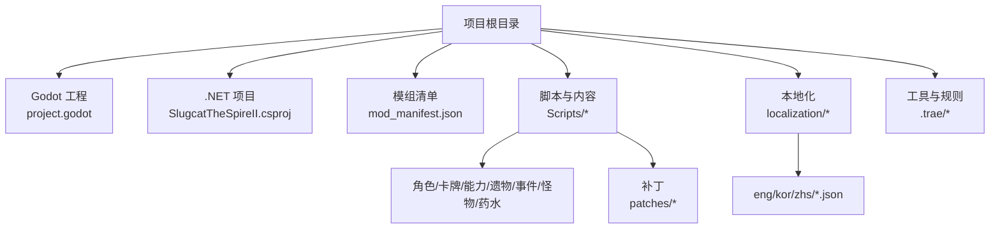
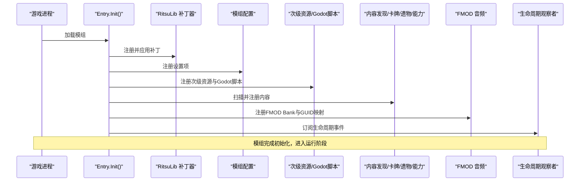
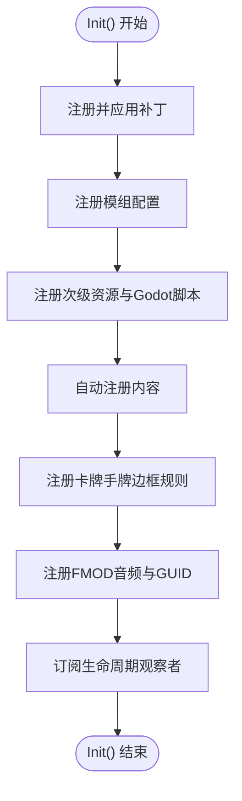
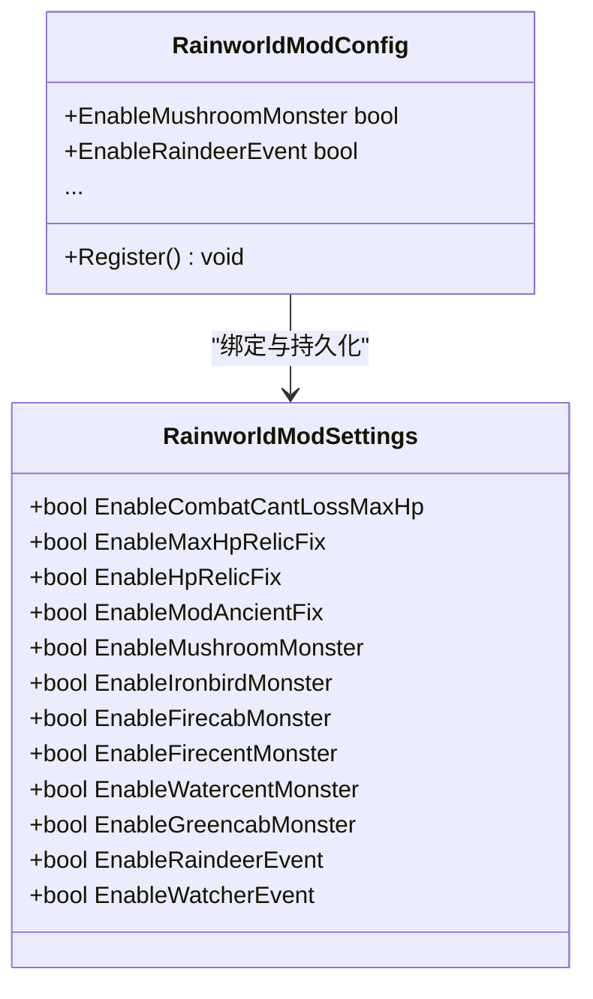
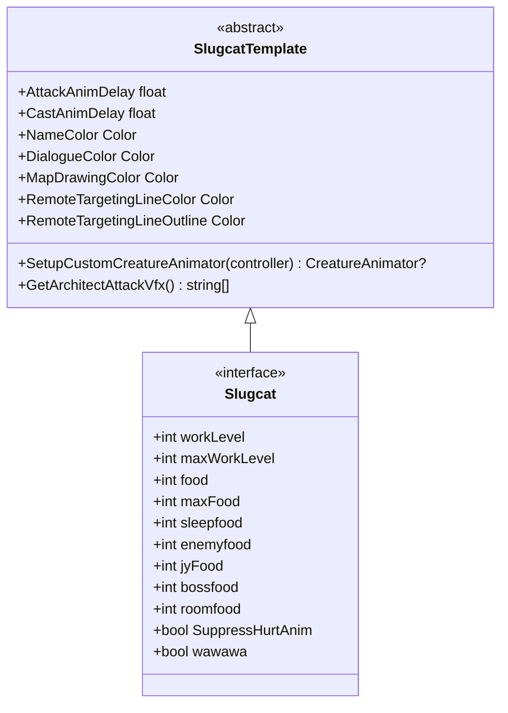
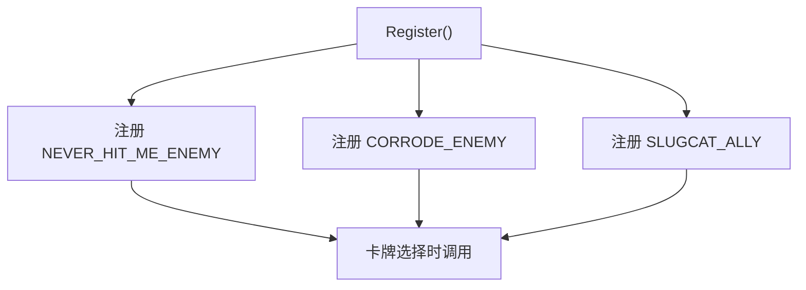
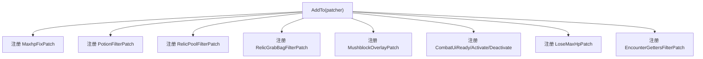
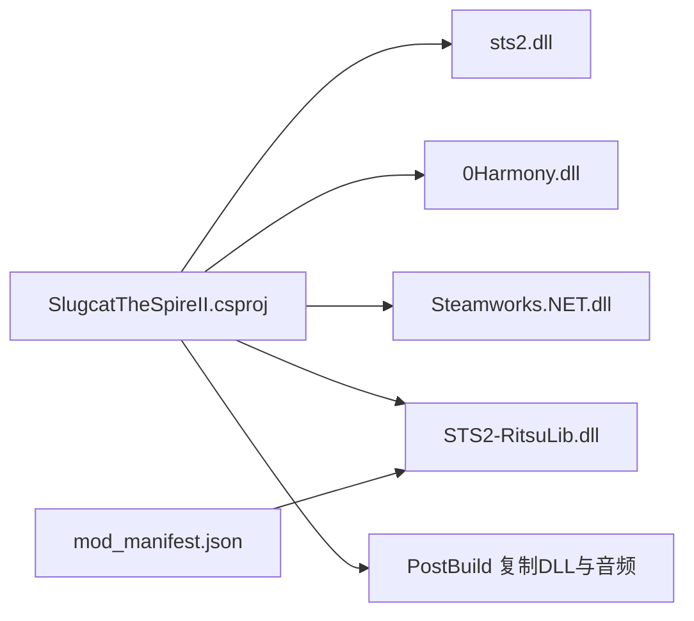

# 贡献指南

<cite>
**本文引用的文件**
- [mod_manifest.json](file://mod_manifest.json)
- [project.godot](file://project.godot)
- [SlugcatTheSpireII.csproj](file://SlugcatTheSpireII.csproj)
- [Entry.cs](file://Scripts/Entry.cs)
- [RainworldModConfig.cs](file://Scripts/RainworldModConfig.cs)
- [Slugcat.cs](file://Scripts/Slugcat/Slugcat.cs)
- [SlugCatCardTargets.cs](file://Scripts/Card/SlugCatCardTargets.cs)
- [RainworldPatches.cs](file://Scripts/patches/RainworldPatches.cs)
- [createcard.md](file://.trae/rules/createcard.md)
- [general.md](file://.trae/rules/general.md)
- [SKILL.md](file://.trae/skills/sts2-ritsulib-mod/SKILL.md)
- [log.txt](file://log.txt)
</cite>

## 目录
1. [简介](#简介)
2. [项目结构](#项目结构)
3. [核心组件](#核心组件)
4. [架构总览](#架构总览)
5. [详细组件分析](#详细组件分析)
6. [依赖分析](#依赖分析)
7. [性能与构建注意事项](#性能与构建注意事项)
8. [故障排查指南](#故障排查指南)
9. [结论](#结论)
10. [附录：贡献流程与模板](#附录贡献流程与模板)

## 简介
本贡献指南面向希望参与 SlugcatTheSpireII 模组开发的贡献者，涵盖开发环境搭建、代码提交规范、Pull Request 流程、测试要求、代码审查标准、问题报告模板、功能请求流程、社区沟通渠道、治理结构与版本发布计划，以及新贡献者的入门指导和学习资源。本项目基于 Godot + C#（STS2 RitsuLib）进行开发，使用 Harmony 补丁扩展游戏行为，并通过本地化 JSON 管理多语言文本。

## 项目结构
- 引擎与项目配置
  - Godot 工程配置位于 project.godot，启用 C# 与移动端渲染目标。
  - .NET 项目文件 SlugcatTheSpireII.csproj 定义目标框架、引用 sts2.dll、Harmony、Steamworks.NET、RitsuLib，并包含自动复制 DLL 与 FMOD 音频的构建后任务。
- 模组清单
  - mod_manifest.json 声明模组 ID、名称、作者、描述、版本、最低游戏版本、是否包含 PCK/DLL、依赖项（STS2-RitsuLib）及是否影响玩法。
- 脚本与内容
  - Scripts 下按功能域组织：角色、卡牌、能力、遗物、事件、怪物、药水、补丁等。
  - Godot 场景与资源用于角色动画、战斗 UI、怪物模型等。
  - localization 下按语言存放 JSON 本地化文件。
- 工具与规则
  - .trae/rules 提供编码与生成约束；.trae/skills 提供 STS2 RitsuLib 开发技能说明与自动化工作流。

**图表来源**
- [project.godot:1-28](file://project.godot#L1-L28)
- [SlugcatTheSpireII.csproj:1-101](file://SlugcatTheSpireII.csproj#L1-L101)
- [mod_manifest.json:1-14](file://mod_manifest.json#L1-L14)

**章节来源**
- [project.godot:1-28](file://project.godot#L1-L28)
- [SlugcatTheSpireII.csproj:1-101](file://SlugcatTheSpireII.csproj#L1-L101)
- [mod_manifest.json:1-14](file://mod_manifest.json#L1-L14)

## 核心组件
- 模组入口与初始化
  - Entry.cs 作为模组初始化入口，注册补丁、配置、次级资源、Godot 脚本、内容发现、卡牌手牌边框规则、FMOD 音频、生命周期观察者等。
- 模组配置
  - RainworldModConfig.cs 通过 RitsuLib 设置系统暴露可开关的功能项（如怪物启用、事件启用、HP/最大生命修复等），并提供本地化的设置界面。
- 角色基类与动画
  - Slugcat.cs 提供角色抽象基类，定义动画状态机、攻击/施法延迟、颜色主题等，便于各角色继承扩展。
- 卡牌目标类型
  - SlugCatCardTargets.cs 注册自定义卡牌目标类型（如“不可命中”、“腐蚀敌人”、“蛞蝓猫盟友”）。
- 补丁集合
  - RainworldPatches.cs 集中注册所有运行时补丁，包括最大生命修复、药水过滤、遗物池过滤、蘑菇块覆盖、战斗 UI 就绪/激活/停用、失去最大生命、遭遇获取器过滤等。

**章节来源**
- [Entry.cs:20-77](file://Scripts/Entry.cs#L20-L77)
- [RainworldModConfig.cs:11-235](file://Scripts/RainworldModConfig.cs#L11-L235)
- [Slugcat.cs:40-135](file://Scripts/Slugcat/Slugcat.cs#L40-L135)
- [SlugCatCardTargets.cs:8-34](file://Scripts/Card/SlugCatCardTargets.cs#L8-L34)
- [RainworldPatches.cs:8-34](file://Scripts/patches/RainworldPatches.cs#L8-L34)

## 架构总览
模组以 RitsuLib 为框架，结合 Godot 资源与 C# 逻辑，通过 Harmony 补丁修改原版行为，并使用本地化 JSON 提供多语言支持。

**图表来源**
- [Entry.cs:26-77](file://Scripts/Entry.cs#L26-L77)

**章节来源**
- [Entry.cs:20-77](file://Scripts/Entry.cs#L20-L77)

## 详细组件分析

### 模组入口与初始化（Entry）
- 职责
  - 创建日志器、补丁器，注册核心补丁集合。
  - 注册模组配置、次级资源、Godot 脚本。
  - 通过 ModTypeDiscoveryHub 自动发现并注册内容。
  - 注册卡牌手牌边框规则（根据关键词高亮）。
  - 注册 FMOD 音频资源与 GUID 映射。
  - 订阅生命周期观察者（如生物死亡观察）。
- 关键流程
  - 初始化顺序：补丁 → 配置 → 资源 → 内容 → 音频 → 生命周期。
  - 若补丁失败则抛出异常，确保核心功能可用。

**图表来源**
- [Entry.cs:26-77](file://Scripts/Entry.cs#L26-L77)

**章节来源**
- [Entry.cs:20-77](file://Scripts/Entry.cs#L20-L77)

### 模组配置（RainworldModConfig）
- 职责
  - 定义可开关的配置项（怪物、事件、修复项等）。
  - 通过 ModSettingsValueBinding 绑定到全局存储。
  - 在设置页面中分组展示（通用、怪物、事件）。
- 使用方式
  - 通过静态属性读写配置值，自动持久化。
  - 新增配置需添加 Binding、属性与设置页项。

**图表来源**
- [RainworldModConfig.cs:11-235](file://Scripts/RainworldModConfig.cs#L11-L235)

**章节来源**
- [RainworldModConfig.cs:11-235](file://Scripts/RainworldModConfig.cs#L11-L235)

### 角色基类与动画（Slugcat）
- 职责
  - 定义角色基础属性（性别、颜色、动画延迟等）。
  - 建立 CreatureAnimator 状态机，绑定 Idle/Attack/Cast/Hurt/Relaxed/Sleep/Corrupt/Meow/FakeDeath 等状态。
  - 提供接口与字段（如 SuppressHurtAnim、wawawa）供具体角色实现。
- 扩展点
  - 子类可重写动画、颜色、攻击特效列表等。
  - 可通过接口字段控制受击动画抑制等行为。

**图表来源**
- [Slugcat.cs:40-135](file://Scripts/Slugcat/Slugcat.cs#L40-L135)

**章节来源**
- [Slugcat.cs:40-135](file://Scripts/Slugcat/Slugcat.cs#L40-L135)

### 卡牌目标类型（SlugCatCardTargets）
- 职责
  - 注册自定义目标类型：不可命中、腐蚀敌人、蛞蝓猫盟友。
  - 通过 CustomTargetType.RegisterSingleTargetType 将判定逻辑注入卡牌选择流程。
- 使用示例
  - 在卡牌逻辑中调用对应 TargetType 限制或引导目标选择。

**图表来源**
- [SlugCatCardTargets.cs:14-34](file://Scripts/Card/SlugCatCardTargets.cs#L14-L34)

**章节来源**
- [SlugCatCardTargets.cs:8-34](file://Scripts/Card/SlugCatCardTargets.cs#L8-L34)

### 补丁集合（RainworldPatches）
- 职责
  - 集中注册运行时补丁：最大生命修复、药水过滤、遗物池过滤、蘑菇块覆盖、战斗 UI 就绪/激活/停用、失去最大生命、遭遇获取器过滤等。
- 扩展建议
  - 新增补丁应在此处注册，保持统一入口。
  - 避免重复注册或遗漏导致的行为不一致。

**图表来源**
- [RainworldPatches.cs:10-34](file://Scripts/patches/RainworldPatches.cs#L10-L34)

**章节来源**
- [RainworldPatches.cs:8-34](file://Scripts/patches/RainworldPatches.cs#L8-L34)

## 依赖分析
- 外部依赖
  - STS2 游戏 DLL（sts2.dll）、Harmony（0Harmony）、Steamworks.NET。
  - RitsuLib（STS2-RitsuLib）及其 NuGet 包。
- 构建与部署
  - 构建后自动复制 DLL 至游戏 mods 目录。
  - 自动复制 FMOD bank 与 GUIDs 到 Resource/Sound。
- 模组清单依赖
  - 依赖 STS2-RitsuLib 最低版本 0.4.41。

**图表来源**
- [SlugcatTheSpireII.csproj:17-44](file://SlugcatTheSpireII.csproj#L17-L44)
- [SlugcatTheSpireII.csproj:91-101](file://SlugcatTheSpireII.csproj#L91-L101)
- [mod_manifest.json:10-13](file://mod_manifest.json#L10-L13)

**章节来源**
- [SlugcatTheSpireII.csproj:1-101](file://SlugcatTheSpireII.csproj#L1-L101)
- [mod_manifest.json:1-14](file://mod_manifest.json#L1-L14)

## 性能与构建注意事项
- 构建优化
  - 使用 Godot.NET.Sdk 与 .NET 9 目标框架，启用隐式 using、可空检查、不安全块。
  - 构建后任务仅复制必要产物，避免污染游戏目录。
- 运行时性能
  - 合理使用补丁，避免频繁 Hook 或复杂计算。
  - 利用 RitsuLib 的内容注册与模板减少样板代码。
- 资源管理
  - 音频通过 FMOD 异步加载，注意 Bank 与 GUID 映射的正确性。
  - Godot 场景与图集按需加载，避免过多常驻资源。

[本节为通用指导，不直接分析具体文件]

## 故障排查指南
- 常见问题定位
  - 补丁未生效：检查 RainworldPatches.cs 是否正确注册对应补丁。
  - 配置未保存：确认 RainworldModConfig 中的 Binding 与 SaveScope 设置。
  - 音频无声音：核对 FMOD Bank 路径与 GUIDs 映射是否被正确注册。
  - 多人模式不同步：关注日志中关于多人同步的已知问题记录。
- 日志与版本历史
  - log.txt 记录了版本迭代、平衡调整与 Bug 修复，可作为问题回溯参考。

**章节来源**
- [RainworldPatches.cs:10-34](file://Scripts/patches/RainworldPatches.cs#L10-L34)
- [RainworldModConfig.cs:166-235](file://Scripts/RainworldModConfig.cs#L166-L235)
- [log.txt:1-215](file://log.txt#L1-L215)

## 结论
本贡献指南提供了从环境搭建到代码提交、测试与审查的全流程指引。通过遵循统一的编码规则、清晰的模块划分与完善的补丁管理，贡献者可以高效地为 SlugcatTheSpireII 贡献内容。建议在提交前阅读相关规则与技能文档，确保代码质量与兼容性。

[本节为总结性内容，不直接分析具体文件]

## 附录：贡献流程与模板

### 开发环境搭建
- 前置条件
  - 安装 .NET SDK 与 Godot 编辑器（启用 C#）。
  - 准备 Slay the Spire 2 游戏目录与数据目录。
- 项目配置
  - 在 SlugcatTheSpireII.csproj 中设置 Sts2Dir 与 Sts2DataDir。
  - 确保 RitsuLib 已安装并可被引用。
- 构建与运行
  - 执行 dotnet build，构建后 DLL 会自动复制到游戏 mods 目录。
  - 启动游戏加载模组，验证功能。

**章节来源**
- [SlugcatTheSpireII.csproj:9-15](file://SlugcatTheSpireII.csproj#L9-L15)
- [SlugcatTheSpireII.csproj:91-101](file://SlugcatTheSpireII.csproj#L91-L101)

### 代码提交规范
- 命名与风格
  - 卡牌命名格式遵循首段首字母大写，不使用驼峰（参考 createcard.md）。
  - Owner 区分：卡牌 Owner 为 player，能力 Owner 为 creature。
  - 连击伤害请使用指定 API，避免 for 循环。
- 禁止事项
  - 禁止生成 diff（遵循 general.md）。
  - 不要声称生成的代码绝对没有问题。
- 提交流程
  - 分支命名：feature/xxx、fix/xxx、chore/xxx。
  - 提交信息：简洁明确，关联 Issue 编号（如有）。
  - 提交前自检：构建通过、本地化键完整、补丁注册齐全。

**章节来源**
- [createcard.md:1-21](file://.trae/rules/createcard.md#L1-L21)
- [general.md:1-7](file://.trae/rules/general.md#L1-L7)

### Pull Request 流程
- 步骤
  - 推送分支至仓库，创建 PR。
  - 填写变更摘要、影响范围、测试情况。
  - 等待代码审查与 CI 结果。
- 审查要点
  - 是否符合编码规范与命名约定。
  - 补丁是否合理且必要。
  - 本地化键是否完整且一致。
  - 是否引入新的依赖或破坏现有行为。

[本节为通用流程说明，不直接分析具体文件]

### 测试要求
- 单元测试与集成测试
  - 当前 Test 目录为空，建议在新增功能时补充最小化测试用例。
  - 重点测试补丁逻辑、配置开关、卡牌目标选择。
- 手动测试
  - 在多人模式下验证同步与稳定性。
  - 验证配置项对行为的影响。
  - 验证音频与动画是否正常播放。

[本节为通用测试指导，不直接分析具体文件]

### 代码审查标准
- 可读性与可维护性
  - 方法职责单一，命名清晰。
  - 避免深层嵌套与过长函数。
- 兼容性与安全性
  - 补丁尽量局部化，避免全局副作用。
  - 不修改游戏安装目录，不提交反编译源码。
- 文档与本地化
  - 新增内容需提供本地化键与文案。
  - 更新 README 或内部文档（如有）。

[本节为通用审查标准，不直接分析具体文件]

### 问题报告模板
- 标题：简明扼要描述问题。
- 复现步骤：
  - 环境信息（游戏版本、模组版本）。
  - 操作步骤。
  - 期望行为与实际行为。
- 日志与截图：附上 log.txt 片段与截图。
- 影响范围：是否影响多人模式、特定角色或内容。

[本节为通用模板，不直接分析具体文件]

### 功能请求流程
- 提出需求：在 Issue 中描述功能背景与价值。
- 讨论方案：与核心维护者讨论实现方式与影响。
- 实施与验收：按规范实现并提交 PR，通过审查与测试。

[本节为通用流程说明，不直接分析具体文件]

### 社区沟通渠道
- 建议使用 Issue 跟踪问题与功能请求。
- 通过评论与讨论达成共识。
- 重要决策记录于 Issue 或 Wiki（如有）。

[本节为通用沟通指导，不直接分析具体文件]

### 治理结构与决策流程
- 维护者负责合并 PR 与发布版本。
- 重大变更需经过讨论与共识。
- 版本发布依据 log.txt 中的变更记录与平衡调整。

**章节来源**
- [log.txt:1-215](file://log.txt#L1-L215)

### 版本发布计划
- 版本号遵循语义化版本（主版本.次版本.修订号）。
- 发布前进行回归测试与本地化校对。
- 更新 mod_manifest.json 的版本与最低游戏版本。

**章节来源**
- [mod_manifest.json:1-14](file://mod_manifest.json#L1-L14)

### 新贡献者入门指导
- 学习资源
  - 阅读 SKILL.md 了解 STS2 RitsuLib 开发技能与工作流。
  - 参考 createcard.md 与 general.md 的编码规则。
- 实践建议
  - 从简单补丁或本地化文案入手。
  - 逐步尝试新增卡牌、能力或事件。
  - 使用 Entry.cs 与 RainworldPatches.cs 作为扩展入口。

**章节来源**
- [SKILL.md:1-391](file://.trae/skills/sts2-ritsulib-mod/SKILL.md#L1-L391)
- [createcard.md:1-21](file://.trae/rules/createcard.md#L1-L21)
- [general.md:1-7](file://.trae/rules/general.md#L1-L7)

### 具体贡献示例
- 新增一张卡牌
  - 在 Scripts/Card 下创建卡牌类，遵循命名与 Owner 规则。
  - 在 Entry.cs 中通过内容发现自动注册。
  - 在 localization 中添加本地化键与文案。
  - 如需自定义目标，参考 SlugCatCardTargets.cs 注册目标类型。
  - 提交前构建并通过本地测试。

**章节来源**
- [Entry.cs:45-70](file://Scripts/Entry.cs#L45-L70)
- [SlugCatCardTargets.cs:14-34](file://Scripts/Card/SlugCatCardTargets.cs#L14-L34)
- [createcard.md:1-21](file://.trae/rules/createcard.md#L1-L21)