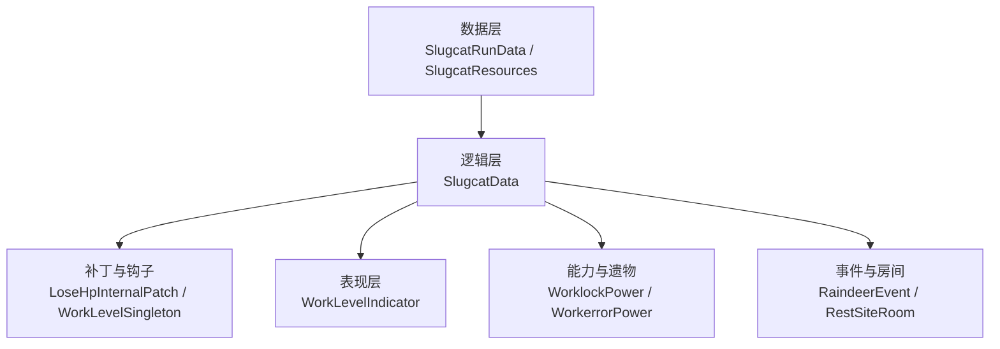
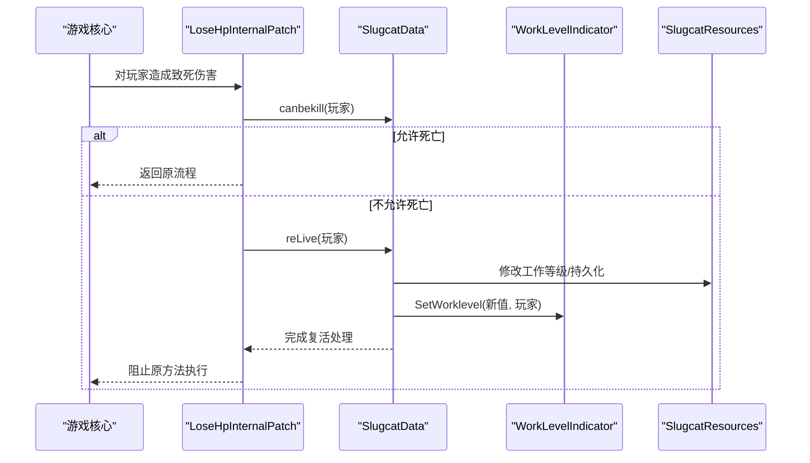
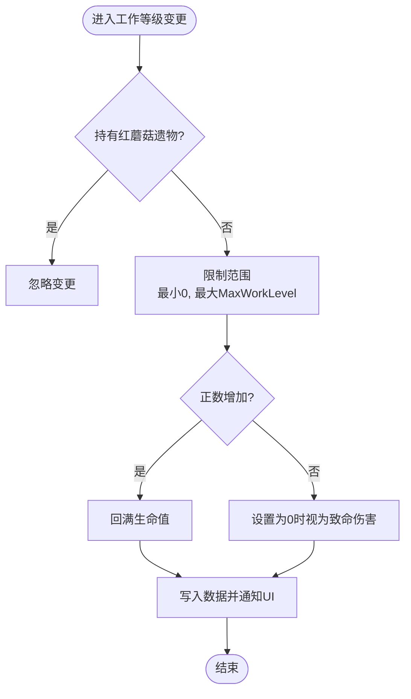
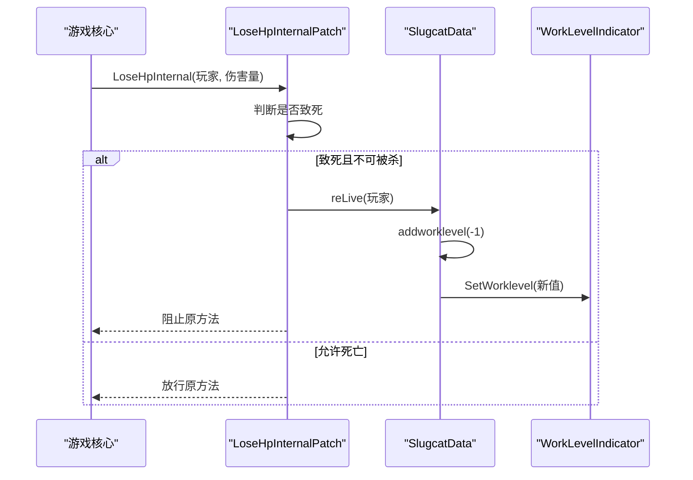
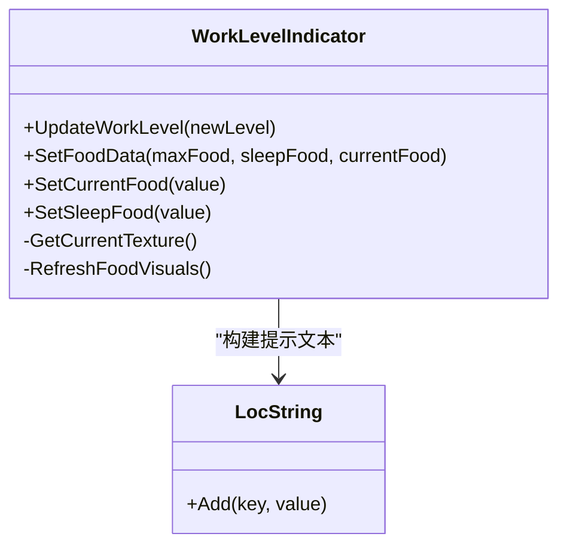
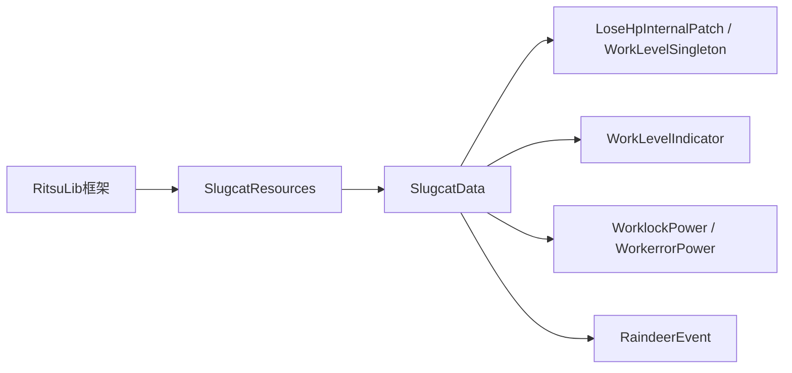

# 工作等级系统

<cite>
**本文引用的文件**
- [WorkLevelSingleton.cs](file://Scripts/patches/Singleton/WorkLevelSingleton.cs)
- [SlugcatData.cs](file://Scripts/Slugcat/SlugcatData.cs)
- [SlugcatResources.cs](file://Scripts/Slugcat/SecondaryResource/SlugcatResources.cs)
- [SlugcatRunData.cs](file://Scripts/Slugcat/SecondaryResource/SlugcatRunData.cs)
- [LoseHpInternalPatch.cs](file://Scripts/patches/LoseHpInternalPatch.cs)
- [WorkLevelIndicator.cs](file://Godot/CombatUI/WorkLevelIndicator.cs)
- [WorkLevel.tscn](file://Godot/CombatUI/WorkLevel.tscn)
- [settings_ui.json（简中）](file://SlugcatTheSpireII/localization/zhs/settings_ui.json)
- [settings_ui.json（英文）](file://SlugcatTheSpireII/localization/eng/settings_ui.json)
- [WorklockPower.cs](file://Scripts/Powers/WorklockPower.cs)
- [WorkerrorPower.cs](file://Scripts/Powers/WorkerrorPower.cs)
- [RaindeerEvent.cs](file://Scripts/Event/RaindeerEvent.cs)
</cite>

## 目录
1. [简介](#简介)
2. [项目结构](#项目结构)
3. [核心组件](#核心组件)
4. [架构总览](#架构总览)
5. [详细组件分析](#详细组件分析)
6. [依赖关系分析](#依赖关系分析)
7. [性能与同步考虑](#性能与同步考虑)
8. [故障排查指南](#故障排查指南)
9. [结论](#结论)
10. [附录：API 参考与使用示例](#附录api-参考与使用示例)

## 简介
本技术文档围绕“工作等级”（亦称“业力/Karma”）系统展开，说明其概念、获取方式、使用机制以及在游戏中的具体作用。该系统用于控制角色在受到致命伤害时的复活行为、资源恢复、以及最大生命提升效率等关键玩法；同时与饱食度、休眠、事件、战斗、休息站点等系统交互。文档还涵盖数据结构设计、验证规则、持久化与网络同步机制，并提供 API 接口说明与实际使用流程示例。

## 项目结构
工作等级系统由以下部分组成：
- 数据层：玩家运行期数据存储（工作等级、最大工作等级、饱食度等）
- 逻辑层：工作等级的增减、复活判定、休眠判定、奖励发放
- 表现层：战斗 UI 显示工作等级与饱食度
- 补丁与钩子：拦截致死伤害、强制击杀等游戏流程以接入工作等级逻辑
- 能力与遗物：通过能力（如 WorklockPower、WorkerrorPower）和遗物影响工作等级行为
- 事件与房间：事件与休息站点间接影响工作等级相关体验

图表来源
- [SlugcatRunData.cs:1-14](file://Scripts/Slugcat/SecondaryResource/SlugcatRunData.cs#L1-L14)
- [SlugcatResources.cs:1-49](file://Scripts/Slugcat/SecondaryResource/SlugcatResources.cs#L1-L49)
- [SlugcatData.cs:32-367](file://Scripts/Slugcat/SlugcatData.cs#L32-L367)
- [LoseHpInternalPatch.cs:21-119](file://Scripts/patches/LoseHpInternalPatch.cs#L21-L119)
- [WorkLevelIndicator.cs:14-270](file://Godot/CombatUI/WorkLevelIndicator.cs#L14-L270)
- [WorklockPower.cs:27-41](file://Scripts/Powers/WorklockPower.cs#L27-L41)
- [WorkerrorPower.cs:28-48](file://Scripts/Powers/WorkerrorPower.cs#L28-L48)
- [RaindeerEvent.cs:105-133](file://Scripts/Event/RaindeerEvent.cs#L105-L133)

章节来源
- [SlugcatRunData.cs:1-14](file://Scripts/Slugcat/SecondaryResource/SlugcatRunData.cs#L1-L14)
- [SlugcatResources.cs:1-49](file://Scripts/Slugcat/SecondaryResource/SlugcatResources.cs#L1-L49)
- [SlugcatData.cs:32-367](file://Scripts/Slugcat/SlugcatData.cs#L32-L367)
- [LoseHpInternalPatch.cs:21-119](file://Scripts/patches/LoseHpInternalPatch.cs#L21-L119)
- [WorkLevelIndicator.cs:14-270](file://Godot/CombatUI/WorkLevelIndicator.cs#L14-L270)
- [WorklockPower.cs:27-41](file://Scripts/Powers/WorklockPower.cs#L27-L41)
- [WorkerrorPower.cs:28-48](file://Scripts/Powers/WorkerrorPower.cs#L28-L48)
- [RaindeerEvent.cs:105-133](file://Scripts/Event/RaindeerEvent.cs#L105-L133)

## 核心组件
- 数据模型：工作等级、最大工作等级、饱食度、睡眠阈值、初始化标记
- 数据注册与同步：按玩家存储，设置写入策略与联机同步策略
- 逻辑入口：工作等级增减、复活、休眠判定、奖励发放
- 补丁与钩子：拦截致死伤害、强制击杀时重置工作等级
- 表现层：战斗 UI 显示工作等级与饱食度，支持动画与提示
- 能力与遗物：锁定工作等级、错误工作等级带来的增益、红蘑菇遗物豁免
- 事件与房间：事件跳转休息站点、进入非战斗房间获得饱食度

章节来源
- [SlugcatRunData.cs:1-14](file://Scripts/Slugcat/SecondaryResource/SlugcatRunData.cs#L1-L14)
- [SlugcatResources.cs:1-49](file://Scripts/Slugcat/SecondaryResource/SlugcatResources.cs#L1-L49)
- [SlugcatData.cs:32-367](file://Scripts/Slugcat/SlugcatData.cs#L32-L367)
- [LoseHpInternalPatch.cs:21-119](file://Scripts/patches/LoseHpInternalPatch.cs#L21-L119)
- [WorkLevelIndicator.cs:14-270](file://Godot/CombatUI/WorkLevelIndicator.cs#L14-L270)
- [WorklockPower.cs:27-41](file://Scripts/Powers/WorklockPower.cs#L27-L41)
- [WorkerrorPower.cs:28-48](file://Scripts/Powers/WorkerrorPower.cs#L28-L48)
- [RaindeerEvent.cs:105-133](file://Scripts/Event/RaindeerEvent.cs#L105-L133)

## 架构总览
工作等级系统的整体调用链如下：
- 战斗伤害路径：基础伤害计算 → 补丁拦截致死伤害 → 判断是否可被杀 → 若不可被杀则触发复活并扣减工作等级 → 更新 UI 与持久化
- 战斗胜利路径：结算奖励 → 根据房间类型增加饱食度 → BOSS 战额外增加工作等级与最大工作等级（特定角色）→ 更新 UI
- 休眠路径：检查饱食度与状态 → 入队休眠动作 → 执行后恢复资源
- 事件路径：随机进入休息站点或受到伤害 → 休息站点可间接影响饱食度与工作等级体验

图表来源
- [LoseHpInternalPatch.cs:31-93](file://Scripts/patches/LoseHpInternalPatch.cs#L31-L93)
- [SlugcatData.cs:165-221](file://Scripts/Slugcat/SlugcatData.cs#L165-L221)
- [SlugcatResources.cs:15-49](file://Scripts/Slugcat/SecondaryResource/SlugcatResources.cs#L15-L49)
- [WorkLevelIndicator.cs:239-256](file://Godot/CombatUI/WorkLevelIndicator.cs#L239-L256)

## 详细组件分析

### 数据模型与持久化
- 字段定义
  - 工作等级：整数，表示当前“业力”层级
  - 最大工作等级：整数，上限为 9
  - 饱食度：整数，战斗中消耗进行休眠
  - 睡眠阈值：整数，达到该饱食度方可休眠
  - 初始化标记：布尔，用于首次初始化
  - 其他：如“超生”标记等
- 数据类型与验证
  - 所有数值均为整型，边界校验包括：
    - 最大工作等级不超过 9
    - 工作等级不低于 0
    - 饱食度不低于 0，且不超过最大值
- 持久化与同步
  - 使用 RitsuLib 的 RunSavedData 按玩家存储，写入策略为“当设置时写入”，并开启“大厅变化时同步”
  - 战斗内次要资源（腐化值）采用战斗内持久化策略

章节来源
- [SlugcatRunData.cs:1-14](file://Scripts/Slugcat/SecondaryResource/SlugcatRunData.cs#L1-L14)
- [SlugcatResources.cs:15-49](file://Scripts/Slugcat/SecondaryResource/SlugcatResources.cs#L15-L49)
- [SlugcatData.cs:144-155](file://Scripts/Slugcat/SlugcatData.cs#L144-L155)
- [SlugcatData.cs:200-221](file://Scripts/Slugcat/SlugcatData.cs#L200-L221)

### 工作等级逻辑与 API
- 获取工作等级
  - 通过数据访问器读取当前工作等级与最大工作等级
- 设置/修改工作等级
  - 增加/减少工作等级：自动回满生命值，播放音效，受能力与遗物影响
  - 直接设置工作等级：限制在最大范围内，低于 0 时视为致命伤害并刷新 UI
- 复活机制
  - 当受到致命伤害且满足条件时，不死亡而是复活并扣减工作等级
  - 持有特定能力或遗物时可豁免或改变复活行为
- 休眠机制
  - 检查饱食度与状态，满足条件则入队休眠动作
- 奖励发放
  - 完成普通/精英/Boss 战斗后增加饱食度，Boss 战额外增加工作等级与最大工作等级（特定角色）

图表来源
- [SlugcatData.cs:185-221](file://Scripts/Slugcat/SlugcatData.cs#L185-L221)
- [SlugcatData.cs:144-155](file://Scripts/Slugcat/SlugcatData.cs#L144-L155)

章节来源
- [SlugcatData.cs:34-66](file://Scripts/Slugcat/SlugcatData.cs#L34-L66)
- [SlugcatData.cs:117-155](file://Scripts/Slugcat/SlugcatData.cs#L117-L155)
- [SlugcatData.cs:165-221](file://Scripts/Slugcat/SlugcatData.cs#L165-L221)
- [SlugcatData.cs:339-365](file://Scripts/Slugcat/SlugcatData.cs#L339-L365)

### 战斗系统与复活流程
- 致死伤害拦截
  - 拦截原生致死伤害方法，判断是否为蛞蝓猫、是否持有豁免遗物
  - 若不可被杀，则触发复活并扣减工作等级，阻止原方法继续执行
- 强制击杀
  - 在强制击杀流程中将工作等级重置为 0，并移除锁定能力
- 战斗胜利
  - 根据房间类型发放饱食度与工作等级奖励

图表来源
- [LoseHpInternalPatch.cs:31-93](file://Scripts/patches/LoseHpInternalPatch.cs#L31-L93)
- [LoseHpInternalPatch.cs:95-119](file://Scripts/patches/LoseHpInternalPatch.cs#L95-L119)
- [SlugcatData.cs:165-221](file://Scripts/Slugcat/SlugcatData.cs#L165-L221)
- [WorkLevelIndicator.cs:239-256](file://Godot/CombatUI/WorkLevelIndicator.cs#L239-L256)

章节来源
- [LoseHpInternalPatch.cs:21-119](file://Scripts/patches/LoseHpInternalPatch.cs#L21-L119)
- [SlugcatData.cs:165-221](file://Scripts/Slugcat/SlugcatData.cs#L165-L221)

### 表现层：工作等级与饱食度 UI
- 工作等级显示
  - 使用精灵切片显示不同等级图标，支持动画过渡
  - 根据能力与遗物切换外观（锁定、错误工作等级、红蘑菇）
  - 提供悬浮提示，展示当前工作等级与最大工作等级
- 饱食度显示
  - 动态生成图标容器，显示当前饱食度与睡眠阈值分隔线
  - 支持实时更新与视觉刷新

图表来源
- [WorkLevelIndicator.cs:14-270](file://Godot/CombatUI/WorkLevelIndicator.cs#L14-L270)
- [WorkLevel.tscn:1-29](file://Godot/CombatUI/WorkLevel.tscn#L1-L29)

章节来源
- [WorkLevelIndicator.cs:53-103](file://Godot/CombatUI/WorkLevelIndicator.cs#L53-L103)
- [WorkLevelIndicator.cs:127-211](file://Godot/CombatUI/WorkLevelIndicator.cs#L127-L211)
- [WorkLevelIndicator.cs:229-256](file://Godot/CombatUI/WorkLevelIndicator.cs#L229-L256)
- [WorkLevel.tscn:1-29](file://Godot/CombatUI/WorkLevel.tscn#L1-L29)

### 能力与遗物的交互
- WorklockPower（工作等级锁定）
  - 类型为增益，堆叠方式为计数器
  - 持有该能力时，阻止工作等级扣减（复活不走工作等级路径）
- WorkerrorPower（错误工作等级）
  - 类型为增益，单实例
  - 每回合开始为玩家增加能量
- 红蘑菇遗物
  - 持有该遗物时，豁免工作等级机制（不复活、不扣减）

章节来源
- [WorklockPower.cs:27-41](file://Scripts/Powers/WorklockPower.cs#L27-L41)
- [WorkerrorPower.cs:28-48](file://Scripts/Powers/WorkerrorPower.cs#L28-L48)
- [LoseHpInternalPatch.cs:44-47](file://Scripts/patches/LoseHpInternalPatch.cs#L44-L47)
- [SlugcatData.cs:106-115](file://Scripts/Slugcat/SlugcatData.cs#L106-L115)

### 事件系统与休息站点
- 事件跳转
  - 部分事件中随机进入休息站点或受到伤害
- 休息站点
  - 进入非战斗房间可获得饱食度
  - 与休眠机制配合，提供资源恢复体验

章节来源
- [RaindeerEvent.cs:105-133](file://Scripts/Event/RaindeerEvent.cs#L105-L133)
- [SlugcatData.cs:339-365](file://Scripts/Slugcat/SlugcatData.cs#L339-L365)

## 依赖关系分析
- 数据层依赖 RitsuLib 的 RunSavedData 与 SecondaryResource 注册
- 逻辑层依赖命令式 API（CreatureCmd、PowerCmd、SfxCmd）与运行时上下文
- 补丁层依赖游戏核心方法进行流程拦截
- 表现层依赖 Godot 节点与纹理资源，并通过数据访问器更新 UI
- 能力与遗物通过全局能力系统与遗物系统进行状态管理

图表来源
- [SlugcatResources.cs:15-49](file://Scripts/Slugcat/SecondaryResource/SlugcatResources.cs#L15-L49)
- [SlugcatData.cs:32-367](file://Scripts/Slugcat/SlugcatData.cs#L32-L367)
- [LoseHpInternalPatch.cs:21-119](file://Scripts/patches/LoseHpInternalPatch.cs#L21-L119)
- [WorkLevelIndicator.cs:14-270](file://Godot/CombatUI/WorkLevelIndicator.cs#L14-L270)
- [WorklockPower.cs:27-41](file://Scripts/Powers/WorklockPower.cs#L27-L41)
- [WorkerrorPower.cs:28-48](file://Scripts/Powers/WorkerrorPower.cs#L28-L48)
- [RaindeerEvent.cs:105-133](file://Scripts/Event/RaindeerEvent.cs#L105-L133)

章节来源
- [SlugcatResources.cs:15-49](file://Scripts/Slugcat/SecondaryResource/SlugcatResources.cs#L15-L49)
- [SlugcatData.cs:32-367](file://Scripts/Slugcat/SlugcatData.cs#L32-L367)
- [LoseHpInternalPatch.cs:21-119](file://Scripts/patches/LoseHpInternalPatch.cs#L21-L119)
- [WorkLevelIndicator.cs:14-270](file://Godot/CombatUI/WorkLevelIndicator.cs#L14-L270)
- [WorklockPower.cs:27-41](file://Scripts/Powers/WorklockPower.cs#L27-L41)
- [WorkerrorPower.cs:28-48](file://Scripts/Powers/WorkerrorPower.cs#L28-L48)
- [RaindeerEvent.cs:105-133](file://Scripts/Event/RaindeerEvent.cs#L105-L133)

## 性能与同步考虑
- 性能
  - UI 更新仅在值变化时触发，避免每帧重绘
  - 动画使用 Tween 平滑过渡，降低卡顿
- 同步
  - 数据写入策略为“当设置时写入”，并开启“大厅变化时同步”，确保多人模式一致性
  - 日志记录已知未修复问题：战斗外失去工作等级可能引发多人联机不同步

章节来源
- [SlugcatResources.cs:15-49](file://Scripts/Slugcat/SecondaryResource/SlugcatResources.cs#L15-L49)
- [log.txt:34-39](file://log.txt#L34-L39)

## 故障排查指南
- 常见问题
  - 多人模式下工作等级不同步：检查是否在战斗外修改工作等级，确认写入策略与同步开关
  - 休眠无法触发：检查饱食度是否达到睡眠阈值，确认无假死能力影响
  - 工作等级异常：检查是否持有红蘑菇遗物或错误工作等级能力，确认最大工作等级上限
- 调试建议
  - 查看日志输出，定位工作等级变更点
  - 检查能力与遗物状态，确认是否覆盖默认行为

章节来源
- [log.txt:34-39](file://log.txt#L34-L39)
- [SlugcatData.cs:223-238](file://Scripts/Slugcat/SlugcatData.cs#L223-L238)
- [LoseHpInternalPatch.cs:44-47](file://Scripts/patches/LoseHpInternalPatch.cs#L44-L47)

## 结论
工作等级系统通过数据层、逻辑层、补丁层与表现层的协同，实现了角色复活、资源恢复与特殊能力解锁等核心玩法。系统在多人模式下具备基本的同步机制，但仍需关注战斗外修改导致的潜在不同步问题。通过合理的 API 使用与能力/遗物组合，开发者可以灵活扩展工作等级相关的游戏体验。

## 附录：API 参考与使用示例

### 数据访问与修改 API
- 获取工作等级
  - 方法：GetWorkLevel(player)
  - 用途：读取当前工作等级
- 获取最大工作等级
  - 方法：GetMaxWorkLevel(player)
  - 用途：读取工作等级上限
- 增加/减少工作等级
  - 方法：addworklevel(player, level)
  - 用途：在工作等级范围内增减，自动回满生命值，播放音效
- 设置工作等级
  - 方法：setworklevel(player, level, show = true)
  - 用途：直接设置工作等级，低于 0 时视为致命伤害并刷新 UI
- 增加最大工作等级
  - 方法：addMaxWorkLevel(player, amount)
  - 用途：增加最大工作等级，上限为 9，并调整当前工作等级

章节来源
- [SlugcatData.cs:34-66](file://Scripts/Slugcat/SlugcatData.cs#L34-L66)
- [SlugcatData.cs:144-155](file://Scripts/Slugcat/SlugcatData.cs#L144-L155)
- [SlugcatData.cs:185-221](file://Scripts/Slugcat/SlugcatData.cs#L185-L221)

### 饱食度与休眠 API
- 获取/设置饱食度
  - 方法：GetFood(player)、addfood(player, amount)
  - 用途：读取与增加饱食度，超过上限时溢出处理
- 休眠判定与执行
  - 方法：cansleep(player)、trysleep(player)、sleep(player)
  - 用途：检查休眠条件并执行休眠动作

章节来源
- [SlugcatData.cs:49-61](file://Scripts/Slugcat/SlugcatData.cs#L49-L61)
- [SlugcatData.cs:117-142](file://Scripts/Slugcat/SlugcatData.cs#L117-L142)
- [SlugcatData.cs:223-238](file://Scripts/Slugcat/SlugcatData.cs#L223-L238)
- [SlugcatData.cs:327-333](file://Scripts/Slugcat/SlugcatData.cs#L327-L333)

### 战斗胜利与奖励 API
- 获取饱食度奖励
  - 方法：getRewordFood(player, roomType)
  - 用途：根据房间类型发放饱食度，Boss 战额外增加工作等级与最大工作等级（特定角色）
- 战斗胜利回调
  - 方法：callVictory(player)
  - 用途：统一入口，触发奖励发放

章节来源
- [SlugcatData.cs:339-365](file://Scripts/Slugcat/SlugcatData.cs#L339-L365)

### 使用示例（流程说明）
- 示例一：战斗胜利后增加工作等级
  - 步骤
    - 调用 callVictory(player)
    - 内部根据房间类型增加饱食度
    - Boss 战增加工作等级与最大工作等级（特定角色）
    - 更新 UI 与持久化
- 示例二：受到致命伤害时的复活
  - 步骤
    - 游戏核心调用致死伤害方法
    - 补丁拦截并判断是否可被杀
    - 若不可被杀，调用 reLive(player)
    - 内部扣减工作等级并回满生命值
    - 更新 UI 与持久化

章节来源
- [SlugcatData.cs:339-365](file://Scripts/Slugcat/SlugcatData.cs#L339-L365)
- [LoseHpInternalPatch.cs:31-93](file://Scripts/patches/LoseHpInternalPatch.cs#L31-L93)
- [SlugcatData.cs:165-221](file://Scripts/Slugcat/SlugcatData.cs#L165-L221)

### 本地化与提示
- 标题与描述
  - 键名：RAINWORLD-WorkLevel_title、RAINWORLD-WorkLevel_description
  - 内容：工作等级名称与效果说明，包含当前与最大工作等级占位符
- 饱食度提示
  - 键名：RAINWORLD-Food_title、RAINWORLD-Food_Liver_description、RAINWORLD-Food_River_description、RAINWORLD-Food_RedCat_description
  - 内容：饱食度名称与不同角色的食性说明

章节来源
- [settings_ui.json（简中）:1-10](file://SlugcatTheSpireII/localization/zhs/settings_ui.json#L1-L10)
- [settings_ui.json（英文）:1-10](file://SlugcatTheSpireII/localization/eng/settings_ui.json#L1-L10)