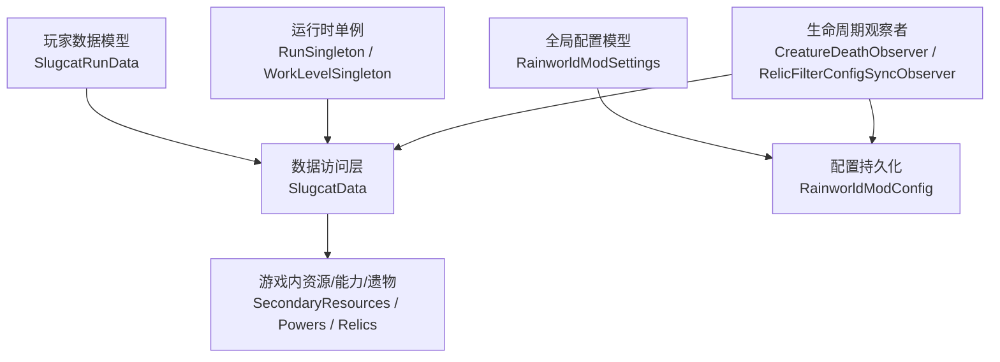
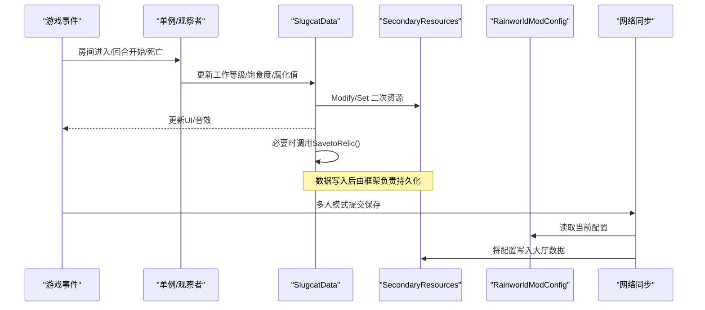
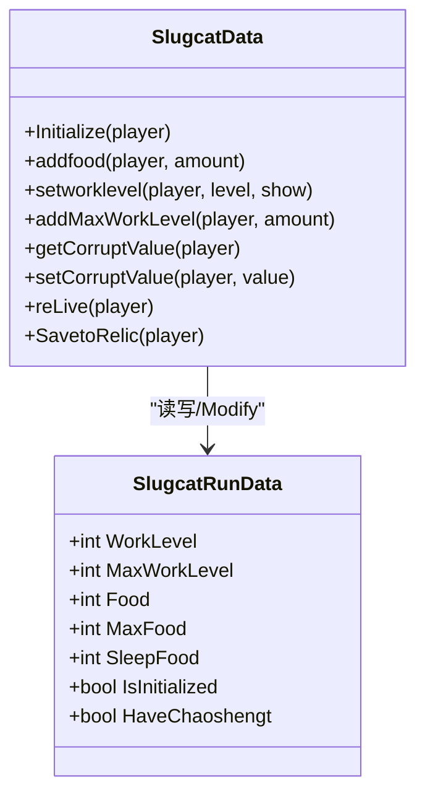
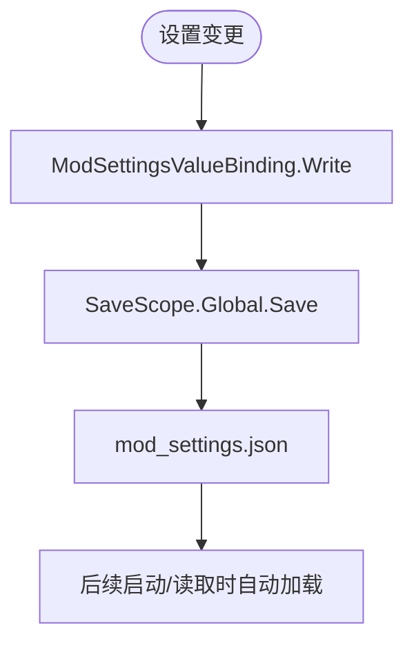
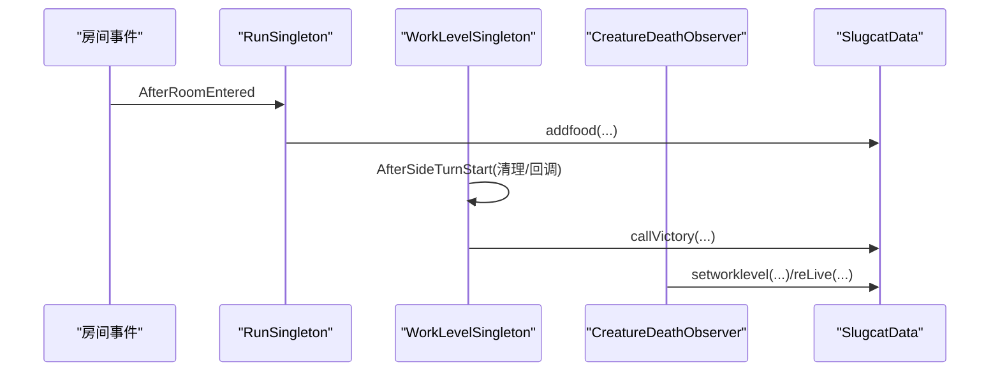
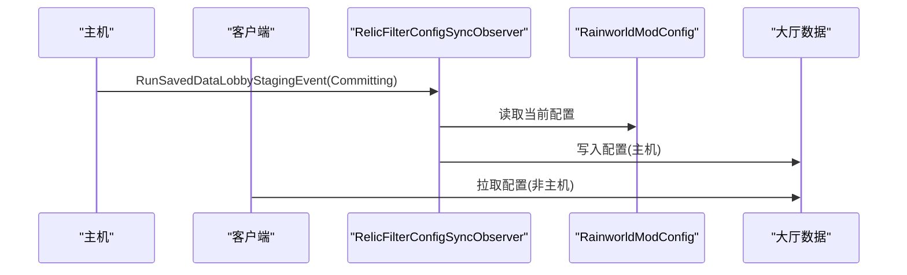
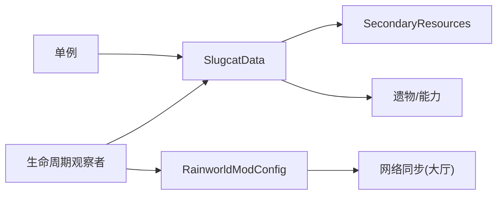

# 数据持久化

<cite>
**本文引用的文件**
- [Scripts/Slugcat/SlugcatData.cs](file://Scripts/Slugcat/SlugcatData.cs)
- [Scripts/Slugcat/SecondaryResource/SlugcatRunData.cs](file://Scripts/Slugcat/SecondaryResource/SlugcatRunData.cs)
- [Scripts/Slugcat/SecondaryResource/RelicFilterRunData.cs](file://Scripts/Slugcat/SecondaryResource/RelicFilterRunData.cs)
- [Scripts/RainworldModConfig.cs](file://Scripts/RainworldModConfig.cs)
- [Scripts/patches/Singleton/RunSingleton.cs](file://Scripts/patches/Singleton/RunSingleton.cs)
- [Scripts/patches/Singleton/WorkLevelSingleton.cs](file://Scripts/patches/Singleton/WorkLevelSingleton.cs)
- [Scripts/patches/Lifecycle/CreatureDeathObserver.cs](file://Scripts/patches/Lifecycle/CreatureDeathObserver.cs)
- [Scripts/patches/Lifecycle/RelicFilterConfigSyncObserver.cs](file://Scripts/patches/Lifecycle/RelicFilterConfigSyncObserver.cs)
</cite>

## 目录
1. [简介](#简介)
2. [项目结构](#项目结构)
3. [核心组件](#核心组件)
4. [架构总览](#架构总览)
5. [详细组件分析](#详细组件分析)
6. [依赖关系分析](#依赖关系分析)
7. [性能考虑](#性能考虑)
8. [故障排查指南](#故障排查指南)
9. [结论](#结论)
10. [附录](#附录)

## 简介
本技术文档聚焦于该模组的数据持久化系统，覆盖运行期数据的保存与加载、序列化格式与存储位置、不同数据类型（玩家状态、遗物过滤配置等）的持久化策略、版本管理与迁移、备份恢复与清理、网络同步与冲突解决、完整性校验与错误处理，以及性能优化与最佳实践。目标是帮助开发者与维护者理解并扩展该系统的持久化能力。

## 项目结构
与数据持久化直接相关的代码主要分布在以下模块：
- 玩家运行时数据模型与访问器：位于 Scripts/Slugcat/SecondaryResource 下的数据模型与 Scripts/Slugcat/SlugcatData.cs 中的统一访问接口。
- 全局配置与设置：位于 Scripts/RainworldModConfig.cs，负责将用户配置持久化为 JSON。
- 生命周期钩子与单例：位于 Scripts/patches/Singleton 与 Scripts/patches/Lifecycle，用于在房间进入、回合开始、死亡等时机触发数据更新与同步。
- 网络同步：通过生命周期事件在多人模式下将配置同步到大厅。

图表来源
- [Scripts/Slugcat/SecondaryResource/SlugcatRunData.cs:1-14](file://Scripts/Slugcat/SecondaryResource/SlugcatRunData.cs#L1-L14)
- [Scripts/Slugcat/SlugcatData.cs:1-367](file://Scripts/Slugcat/SlugcatData.cs#L1-L367)
- [Scripts/RainworldModConfig.cs:1-235](file://Scripts/RainworldModConfig.cs#L1-L235)
- [Scripts/patches/Singleton/RunSingleton.cs:1-131](file://Scripts/patches/Singleton/RunSingleton.cs#L1-L131)
- [Scripts/patches/Singleton/WorkLevelSingleton.cs:1-84](file://Scripts/patches/Singleton/WorkLevelSingleton.cs#L1-L84)
- [Scripts/patches/Lifecycle/CreatureDeathObserver.cs:1-27](file://Scripts/patches/Lifecycle/CreatureDeathObserver.cs#L1-L27)
- [Scripts/patches/Lifecycle/RelicFilterConfigSyncObserver.cs:1-31](file://Scripts/patches/Lifecycle/RelicFilterConfigSyncObserver.cs#L1-L31)

章节来源
- [Scripts/Slugcat/SlugcatData.cs:1-367](file://Scripts/Slugcat/SlugcatData.cs#L1-L367)
- [Scripts/RainworldModConfig.cs:1-235](file://Scripts/RainworldModConfig.cs#L1-L235)
- [Scripts/patches/Singleton/RunSingleton.cs:1-131](file://Scripts/patches/Singleton/RunSingleton.cs#L1-L131)
- [Scripts/patches/Singleton/WorkLevelSingleton.cs:1-84](file://Scripts/patches/Singleton/WorkLevelSingleton.cs#L1-L84)
- [Scripts/patches/Lifecycle/CreatureDeathObserver.cs:1-27](file://Scripts/patches/Lifecycle/CreatureDeathObserver.cs#L1-L27)
- [Scripts/patches/Lifecycle/RelicFilterConfigSyncObserver.cs:1-31](file://Scripts/patches/Lifecycle/RelicFilterConfigSyncObserver.cs#L1-L31)

## 核心组件
- 玩家运行时数据模型
  - 字段包括工作等级、最大工作等级、饱食度、最大饱食度、休眠消耗阈值、初始化标记、特殊状态标记等。
  - 通过 SecondaryResources 框架进行读写与持久化。
- 数据访问层
  - 提供统一的读取/修改接口，封装边界检查、UI 更新、音效播放、与遗物/能力的联动逻辑，并在关键变更时触发持久化。
- 全局配置与设置
  - 使用 ModSettingsValueBinding 将布尔开关绑定到 JSON 文件，支持自动创建与全局作用域持久化。
- 生命周期与单例
  - 在房间进入、回合开始、战斗胜利、死亡等时机更新或同步数据。
  - 在多人模式提交保存数据时将配置同步到大厅。

章节来源
- [Scripts/Slugcat/SecondaryResource/SlugcatRunData.cs:1-14](file://Scripts/Slugcat/SecondaryResource/SlugcatRunData.cs#L1-L14)
- [Scripts/Slugcat/SlugcatData.cs:1-367](file://Scripts/Slugcat/SlugcatData.cs#L1-L367)
- [Scripts/RainworldModConfig.cs:1-235](file://Scripts/RainworldModConfig.cs#L1-L235)
- [Scripts/patches/Singleton/RunSingleton.cs:1-131](file://Scripts/patches/Singleton/RunSingleton.cs#L1-L131)
- [Scripts/patches/Singleton/WorkLevelSingleton.cs:1-84](file://Scripts/patches/Singleton/WorkLevelSingleton.cs#L1-L84)
- [Scripts/patches/Lifecycle/CreatureDeathObserver.cs:1-27](file://Scripts/patches/Lifecycle/CreatureDeathObserver.cs#L1-L27)
- [Scripts/patches/Lifecycle/RelicFilterConfigSyncObserver.cs:1-31](file://Scripts/patches/Lifecycle/RelicFilterConfigSyncObserver.cs#L1-L31)

## 架构总览
下图展示了从 UI/游戏事件到数据模型、再到持久化与同步的整体流程。

图表来源
- [Scripts/patches/Singleton/RunSingleton.cs:37-89](file://Scripts/patches/Singleton/RunSingleton.cs#L37-L89)
- [Scripts/patches/Singleton/WorkLevelSingleton.cs:45-83](file://Scripts/patches/Singleton/WorkLevelSingleton.cs#L45-L83)
- [Scripts/Slugcat/SlugcatData.cs:76-163](file://Scripts/Slugcat/SlugcatData.cs#L76-L163)
- [Scripts/RainworldModConfig.cs:166-173](file://Scripts/RainworldModConfig.cs#L166-L173)
- [Scripts/patches/Lifecycle/RelicFilterConfigSyncObserver.cs:7-31](file://Scripts/patches/Lifecycle/RelicFilterConfigSyncObserver.cs#L7-L31)

## 详细组件分析

### 玩家数据模型与访问器
- 数据模型
  - 包含工作等级、最大工作等级、饱食度、最大饱食度、休眠消耗阈值、初始化标记、特殊状态标记等字段。
- 访问器与业务逻辑
  - 提供获取/设置工作等级、饱食度、腐化值等方法；在修改时进行边界限制、联动能力/遗物效果、UI 更新与音效播放。
  - 在关键修改后调用统一持久化入口，确保数据落盘。

图表来源
- [Scripts/Slugcat/SecondaryResource/SlugcatRunData.cs:1-14](file://Scripts/Slugcat/SecondaryResource/SlugcatRunData.cs#L1-L14)
- [Scripts/Slugcat/SlugcatData.cs:76-163](file://Scripts/Slugcat/SlugcatData.cs#L76-L163)
- [Scripts/Slugcat/SlugcatData.cs:185-221](file://Scripts/Slugcat/SlugcatData.cs#L185-L221)
- [Scripts/Slugcat/SlugcatData.cs:239-325](file://Scripts/Slugcat/SlugcatData.cs#L239-L325)

章节来源
- [Scripts/Slugcat/SecondaryResource/SlugcatRunData.cs:1-14](file://Scripts/Slugcat/SecondaryResource/SlugcatRunData.cs#L1-L14)
- [Scripts/Slugcat/SlugcatData.cs:76-163](file://Scripts/Slugcat/SlugcatData.cs#L76-L163)
- [Scripts/Slugcat/SlugcatData.cs:185-221](file://Scripts/Slugcat/SlugcatData.cs#L185-L221)
- [Scripts/Slugcat/SlugcatData.cs:239-325](file://Scripts/Slugcat/SlugcatData.cs#L239-L325)

### 全局配置与设置持久化
- 配置模型
  - 包含多项布尔开关，控制怪物出现、事件启用、HP相关修复等。
- 持久化机制
  - 使用 ModSettingsValueBinding 将每个开关绑定到全局作用域的 JSON 文件，键名为固定字符串，文件名固定为 mod_settings.json。
  - 提供 Register 方法注册配置页面与默认工厂，缺失时自动创建。

图表来源
- [Scripts/RainworldModConfig.cs:36-93](file://Scripts/RainworldModConfig.cs#L36-L93)
- [Scripts/RainworldModConfig.cs:95-161](file://Scripts/RainworldModConfig.cs#L95-L161)
- [Scripts/RainworldModConfig.cs:166-173](file://Scripts/RainworldModConfig.cs#L166-L173)

章节来源
- [Scripts/RainworldModConfig.cs:1-235](file://Scripts/RainworldModConfig.cs#L1-L235)

### 运行时数据更新与持久化触发点
- 房间进入
  - 为蛞蝓猫角色发放/初始化特定遗物，非战斗房间按角色类型增加饱食度。
- 回合开始
  - 清理伤害记录、重置动画标志、调用回合开始回调。
- 战斗胜利
  - 根据房间类型奖励饱食度与工作等级，必要时提升最大工作等级。
- 死亡处理
  - 在满足条件时重置工作等级或执行复活逻辑，移除睡眠能力等。

图表来源
- [Scripts/patches/Singleton/RunSingleton.cs:37-89](file://Scripts/patches/Singleton/RunSingleton.cs#L37-L89)
- [Scripts/patches/Singleton/WorkLevelSingleton.cs:45-83](file://Scripts/patches/Singleton/WorkLevelSingleton.cs#L45-L83)
- [Scripts/patches/Lifecycle/CreatureDeathObserver.cs:11-24](file://Scripts/patches/Lifecycle/CreatureDeathObserver.cs#L11-L24)
- [Scripts/Slugcat/SlugcatData.cs:339-365](file://Scripts/Slugcat/SlugcatData.cs#L339-L365)

章节来源
- [Scripts/patches/Singleton/RunSingleton.cs:37-89](file://Scripts/patches/Singleton/RunSingleton.cs#L37-L89)
- [Scripts/patches/Singleton/WorkLevelSingleton.cs:45-83](file://Scripts/patches/Singleton/WorkLevelSingleton.cs#L45-L83)
- [Scripts/patches/Lifecycle/CreatureDeathObserver.cs:11-24](file://Scripts/patches/Lifecycle/CreatureDeathObserver.cs#L11-L24)
- [Scripts/Slugcat/SlugcatData.cs:339-365](file://Scripts/Slugcat/SlugcatData.cs#L339-L365)

### 网络环境下的数据同步与冲突解决
- 配置同步
  - 在多人模式提交保存数据时，仅主机将当前配置写入大厅数据，供其他客户端拉取。
- 冲突解决策略
  - 采用“主机权威”模式：以主机配置为准，避免多端并发写导致的冲突。

图表来源
- [Scripts/patches/Lifecycle/RelicFilterConfigSyncObserver.cs:7-31](file://Scripts/patches/Lifecycle/RelicFilterConfigSyncObserver.cs#L7-L31)
- [Scripts/RainworldModConfig.cs:166-173](file://Scripts/RainworldModConfig.cs#L166-L173)

章节来源
- [Scripts/patches/Lifecycle/RelicFilterConfigSyncObserver.cs:7-31](file://Scripts/patches/Lifecycle/RelicFilterConfigSyncObserver.cs#L7-L31)
- [Scripts/RainworldModConfig.cs:166-173](file://Scripts/RainworldModConfig.cs#L166-L173)

### 数据版本管理与迁移
- 现状
  - 玩家运行时数据通过 SecondaryResources 管理，具备 IsInitialized 标记用于区分首次初始化与后续加载。
  - 全局配置通过 JSON 文件持久化，新增字段时建议提供默认值以避免旧配置解析失败。
- 建议
  - 为运行数据引入版本号字段，配合迁移脚本在版本升级时进行数据转换。
  - 对 JSON 配置采用向后兼容的默认值策略，并在读取时做容错处理。

章节来源
- [Scripts/Slugcat/SecondaryResource/SlugcatRunData.cs:1-14](file://Scripts/Slugcat/SecondaryResource/SlugcatRunData.cs#L1-L14)
- [Scripts/RainworldModConfig.cs:166-173](file://Scripts/RainworldModConfig.cs#L166-L173)

### 数据备份、恢复与清理
- 备份
  - 全局配置存储在 mod_settings.json，可定期复制该文件实现备份。
  - 运行期数据由框架管理，建议在存档节点或房间切换时触发一次显式保存。
- 恢复
  - 恢复配置时替换 JSON 文件即可；运行期数据需通过框架提供的加载机制重新载入。
- 清理
  - 清理配置前建议先备份；对于运行期数据，可通过重置 IsInitialized 或重新初始化流程恢复默认值。

章节来源
- [Scripts/RainworldModConfig.cs:166-173](file://Scripts/RainworldModConfig.cs#L166-L173)
- [Scripts/Slugcat/SlugcatData.cs:76-98](file://Scripts/Slugcat/SlugcatData.cs#L76-L98)

### 数据完整性验证与错误处理
- 完整性验证
  - 在设置工作等级、饱食度、腐化值时进行边界检查，防止越界。
  - 在初始化时检查必要对象是否存在，避免空引用异常。
- 错误处理
  - 初始化过程包裹异常捕获，确保即使出错也不中断主流程。
  - 日志输出用于追踪腐化值变化等关键路径。

章节来源
- [Scripts/Slugcat/SlugcatData.cs:76-104](file://Scripts/Slugcat/SlugcatData.cs#L76-L104)
- [Scripts/Slugcat/SlugcatData.cs:185-221](file://Scripts/Slugcat/SlugcatData.cs#L185-L221)
- [Scripts/Slugcat/SlugcatData.cs:239-325](file://Scripts/Slugcat/SlugcatData.cs#L239-L325)

## 依赖关系分析
- 组件耦合
  - SlugcatData 依赖 SecondaryResources 进行数据读写，并通过单例/观察者在关键时机触发更新。
  - RainworldModConfig 独立于运行时数据，但会被网络同步观察者读取并写入大厅数据。
- 外部依赖
  - STS2RitsuLib 提供设置绑定、生命周期事件、单例框架等基础设施。
  - 游戏引擎/框架提供房间、回合、战斗等生命周期钩子。

图表来源
- [Scripts/Slugcat/SlugcatData.cs:1-367](file://Scripts/Slugcat/SlugcatData.cs#L1-L367)
- [Scripts/RainworldModConfig.cs:1-235](file://Scripts/RainworldModConfig.cs#L1-L235)
- [Scripts/patches/Lifecycle/RelicFilterConfigSyncObserver.cs:1-31](file://Scripts/patches/Lifecycle/RelicFilterConfigSyncObserver.cs#L1-L31)
- [Scripts/patches/Singleton/RunSingleton.cs:1-131](file://Scripts/patches/Singleton/RunSingleton.cs#L1-L131)

章节来源
- [Scripts/Slugcat/SlugcatData.cs:1-367](file://Scripts/Slugcat/SlugcatData.cs#L1-L367)
- [Scripts/RainworldModConfig.cs:1-235](file://Scripts/RainworldModConfig.cs#L1-L235)
- [Scripts/patches/Lifecycle/RelicFilterConfigSyncObserver.cs:1-31](file://Scripts/patches/Lifecycle/RelicFilterConfigSyncObserver.cs#L1-L31)
- [Scripts/patches/Singleton/RunSingleton.cs:1-131](file://Scripts/patches/Singleton/RunSingleton.cs#L1-L131)

## 性能考虑
- 减少频繁写盘
  - 将多次修改合并后再调用持久化入口，降低 I/O 频率。
- 批量更新
  - 在房间进入或回合开始时集中更新数据，避免逐条触发。
- 缓存与延迟
  - 对只读配置使用内存缓存，仅在变更时刷新。
- 异步操作
  - 对可能阻塞的操作使用异步任务，避免卡顿。

[本节为通用指导，不直接分析具体文件]

## 故障排查指南
- 常见问题
  - 数据未持久化：检查是否在关键修改后调用统一持久化入口。
  - 配置未生效：确认 JSON 文件存在且键名正确，重启后重新加载。
  - 多人不同步：确认主机是否正确写入大厅数据，客户端是否拉取成功。
- 定位方法
  - 查看日志输出，关注腐化值变化、工作等级变更等关键路径。
  - 在生命周期事件中打断点，确认触发顺序与数据流向。

章节来源
- [Scripts/Slugcat/SlugcatData.cs:239-325](file://Scripts/Slugcat/SlugcatData.cs#L239-L325)
- [Scripts/RainworldModConfig.cs:166-173](file://Scripts/RainworldModConfig.cs#L166-L173)
- [Scripts/patches/Lifecycle/RelicFilterConfigSyncObserver.cs:7-31](file://Scripts/patches/Lifecycle/RelicFilterConfigSyncObserver.cs#L7-L31)

## 结论
该模组的持久化系统围绕 SecondaryResources 与全局配置 JSON 构建，通过单例与生命周期观察者在游戏关键时机触发数据更新与同步。整体设计简洁清晰，具备良好的可扩展性。建议在未来版本中引入版本化管理、更完善的备份恢复机制与更强的错误恢复能力，以提升稳定性与用户体验。

[本节为总结，不直接分析具体文件]

## 附录
- 关键数据字段说明
  - 工作等级：影响复活与死亡判定，受遗物与能力影响。
  - 饱食度：用于休眠与战斗外恢复，随房间类型变化。
  - 腐化值：影响能力与状态，达到上限时触发菌化。
- 配置项说明
  - 怪物启用开关：控制特定怪物是否出现在遭遇中。
  - HP相关修复：禁用原版回血相关遗物或事件。
  - 事件启用开关：控制特定事件是否出现。

章节来源
- [Scripts/Slugcat/SecondaryResource/SlugcatRunData.cs:1-14](file://Scripts/Slugcat/SecondaryResource/SlugcatRunData.cs#L1-L14)
- [Scripts/RainworldModConfig.cs:11-30](file://Scripts/RainworldModConfig.cs#L11-L30)
- [Scripts/RainworldModConfig.cs:166-235](file://Scripts/RainworldModConfig.cs#L166-L235)