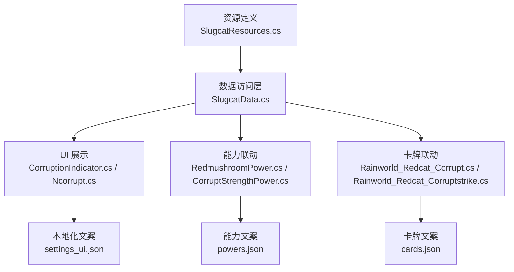
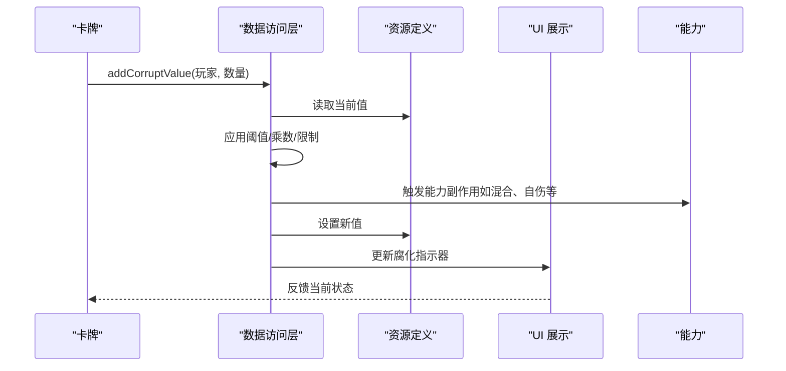
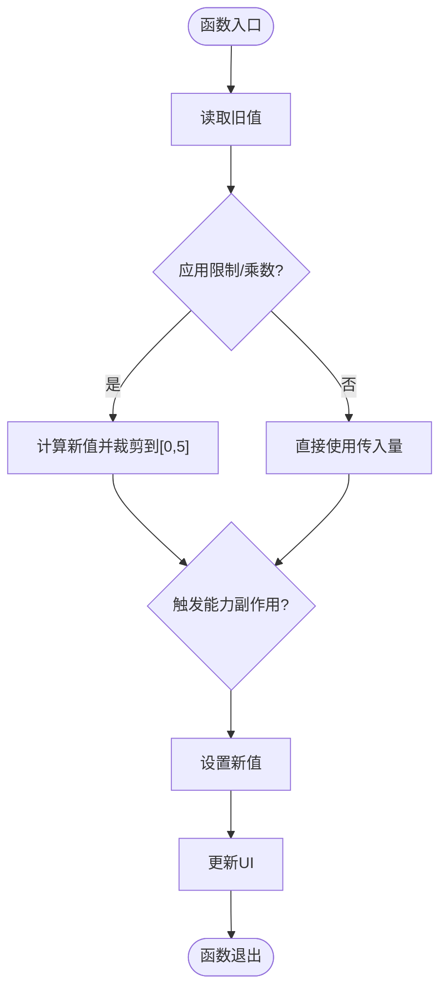
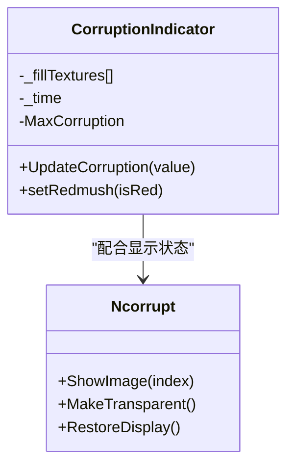
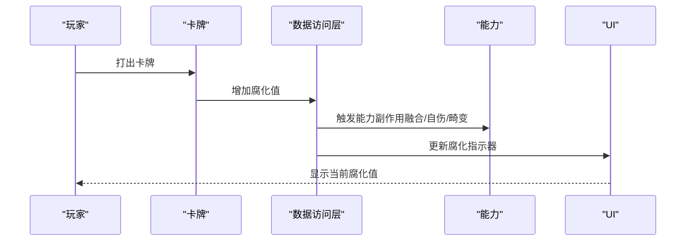
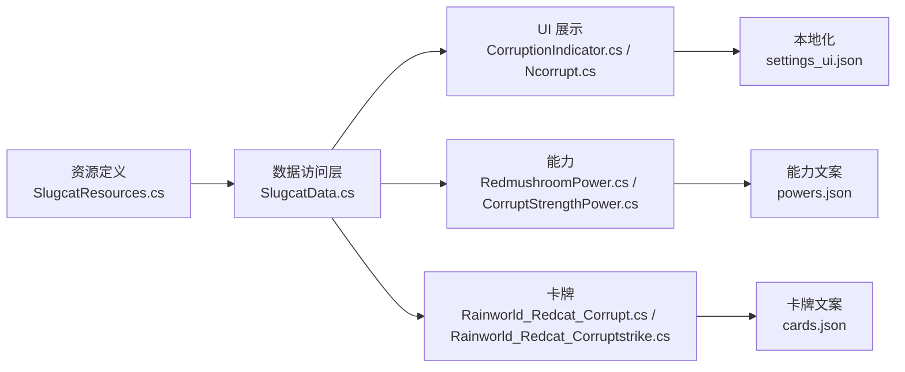

# 腐化值系统

<cite>
**本文引用的文件**
- [SlugcatResources.cs](file://Scripts/Slugcat/SecondaryResource/SlugcatResources.cs)
- [SlugcatData.cs](file://Scripts/Slugcat/SlugcatData.cs)
- [CorruptionIndicator.cs](file://Godot/CombatUI/CorruptionIndicator.cs)
- [Ncorrupt.cs](file://Godot/CombatUI/Ncorrupt.cs)
- [RedmushroomPower.cs](file://Scripts/Powers/RedCat/RedmushroomPower.cs)
- [CorruptStrengthPower.cs](file://Scripts/Powers/RedCat/CorruptStrengthPower.cs)
- [Rainworld_Redcat_Corrupt.cs](file://Scripts/Card/RedCat/Skills/Rainworld_Redcat_Corrupt.cs)
- [Rainworld_Redcat_Corruptstrike.cs](file://Scripts/Card/RedCat/Attack/Rainworld_Redcat_Corruptstrike.cs)
- [settings_ui.json（英文）](file://SlugcatTheSpireII/localization/eng/settings_ui.json)
- [settings_ui.json（中文）](file://SlugcatTheSpireII/localization/zhs/settings_ui.json)
- [powers.json（英文）](file://SlugcatTheSpireII/localization/eng/powers.json)
- [cards.json（英文）](file://SlugcatTheSpireII/localization/eng/cards.json)
</cite>

## 目录
1. [简介](#简介)
2. [项目结构](#项目结构)
3. [核心组件](#核心组件)
4. [架构总览](#架构总览)
5. [详细组件分析](#详细组件分析)
6. [依赖关系分析](#依赖关系分析)
7. [性能考量](#性能考量)
8. [故障排查指南](#故障排查指南)
9. [结论](#结论)
10. [附录](#附录)

## 简介
本技术文档围绕“腐化值”系统展开，系统性说明其概念、增长机制、影响效果与平衡性设计；记录数据模型（数值范围、阈值、状态转换）、API接口（获取、增加、减少、重置）、对角色行为与卡牌效果的联动机制；并覆盖UI显示与动画、持久化存储、网络同步、错误恢复以及调试与测试方法。目标是让非专业读者也能理解该系统的运作方式，同时为开发者提供可操作的实现参考。

## 项目结构
腐化值系统由以下关键部分组成：
- 资源定义与持久化：通过 SecondaryResourceDefinition 注册“腐化值”，设定默认值、最大值、回合策略与持久化策略。
- 数据访问层：统一的读写 API，封装了取值、设值、增量变化及副作用触发。
- UI 展示：战斗界面中的腐化指示器，负责渲染当前腐化等级、闪烁动画与悬浮提示。
- 能力与卡牌联动：在特定能力或卡牌生效时增减腐化值，触发状态切换与额外效果。
- 本地化：多语言文案用于 UI 提示与描述。

图表来源
- [SlugcatResources.cs:15-49](file://Scripts/Slugcat/SecondaryResource/SlugcatResources.cs#L15-L49)
- [SlugcatData.cs:239-325](file://Scripts/Slugcat/SlugcatData.cs#L239-L325)
- [CorruptionIndicator.cs:12-148](file://Godot/CombatUI/CorruptionIndicator.cs#L12-L148)
- [Ncorrupt.cs:1-78](file://Godot/CombatUI/Ncorrupt.cs#L1-L78)
- [RedmushroomPower.cs:44-94](file://Scripts/Powers/RedCat/RedmushroomPower.cs#L44-L94)
- [CorruptStrengthPower.cs:28-51](file://Scripts/Powers/RedCat/CorruptStrengthPower.cs#L28-L51)
- [Rainworld_Redcat_Corrupt.cs:70-79](file://Scripts/Card/RedCat/Skills/Rainworld_Redcat_Corrupt.cs#L70-L79)
- [Rainworld_Redcat_Corruptstrike.cs:42-58](file://Scripts/Card/RedCat/Attack/Rainworld_Redcat_Corruptstrike.cs#L42-L58)
- [settings_ui.json（英文）:10-13](file://SlugcatTheSpireII/localization/eng/settings_ui.json#L10-L13)
- [settings_ui.json（中文）:10-13](file://SlugcatTheSpireII/localization/zhs/settings_ui.json#L10-L13)
- [powers.json（英文）:122-157](file://SlugcatTheSpireII/localization/eng/powers.json#L122-L157)
- [cards.json（英文）:294-341](file://SlugcatTheSpireII/localization/eng/cards.json#L294-L341)

章节来源
- [SlugcatResources.cs:15-49](file://Scripts/Slugcat/SecondaryResource/SlugcatResources.cs#L15-L49)
- [SlugcatData.cs:239-325](file://Scripts/Slugcat/SlugcatData.cs#L239-L325)
- [CorruptionIndicator.cs:12-148](file://Godot/CombatUI/CorruptionIndicator.cs#L12-L148)
- [Ncorrupt.cs:1-78](file://Godot/CombatUI/Ncorrupt.cs#L1-L78)
- [RedmushroomPower.cs:44-94](file://Scripts/Powers/RedCat/RedmushroomPower.cs#L44-L94)
- [CorruptStrengthPower.cs:28-51](file://Scripts/Powers/RedCat/CorruptStrengthPower.cs#L28-L51)
- [Rainworld_Redcat_Corrupt.cs:70-79](file://Scripts/Card/RedCat/Skills/Rainworld_Redcat_Corrupt.cs#L70-L79)
- [Rainworld_Redcat_Corruptstrike.cs:42-58](file://Scripts/Card/RedCat/Attack/Rainworld_Redcat_Corruptstrike.cs#L42-L58)
- [settings_ui.json（英文）:10-13](file://SlugcatTheSpireII/localization/eng/settings_ui.json#L10-L13)
- [settings_ui.json（中文）:10-13](file://SlugcatTheSpireII/localization/zhs/settings_ui.json#L10-L13)
- [powers.json（英文）:122-157](file://SlugcatTheSpireII/localization/eng/powers.json#L122-L157)
- [cards.json（英文）:294-341](file://SlugcatTheSpireII/localization/eng/cards.json#L294-L341)

## 核心组件
- 资源定义与持久化
  - 使用 SecondaryResourceDefinition 注册“腐化值”，默认值为 0，基础最大值为 5，回合开始不自动变化，持久化策略为“战斗中”。
  - 通过 ID 进行跨模块访问，确保一致性。
- 数据访问层
  - 提供 get/set/add 三类 API，统一处理边界、阈值、状态转换与副作用。
  - 在变更时调用 UI 更新，保证视图与数据一致。
- UI 展示
  - 腐化指示器根据当前值选择对应纹理，支持闪烁动画与悬浮提示。
  - 辅助精灵用于切换不同状态的视觉表现。
- 能力与卡牌联动
  - 能力在获得/移除时触发腐化值变化或状态切换。
  - 卡牌在打出时可能增加腐化值或受腐化值影响伤害等。

章节来源
- [SlugcatResources.cs:15-49](file://Scripts/Slugcat/SecondaryResource/SlugcatResources.cs#L15-L49)
- [SlugcatData.cs:239-325](file://Scripts/Slugcat/SlugcatData.cs#L239-L325)
- [CorruptionIndicator.cs:12-148](file://Godot/CombatUI/CorruptionIndicator.cs#L12-L148)
- [Ncorrupt.cs:1-78](file://Godot/CombatUI/Ncorrupt.cs#L1-L78)
- [RedmushroomPower.cs:44-94](file://Scripts/Powers/RedCat/RedmushroomPower.cs#L44-L94)
- [CorruptStrengthPower.cs:28-51](file://Scripts/Powers/RedCat/CorruptStrengthPower.cs#L28-L51)
- [Rainworld_Redcat_Corrupt.cs:70-79](file://Scripts/Card/RedCat/Skills/Rainworld_Redcat_Corrupt.cs#L70-L79)
- [Rainworld_Redcat_Corruptstrike.cs:42-58](file://Scripts/Card/RedCat/Attack/Rainworld_Redcat_Corruptstrike.cs#L42-L58)

## 架构总览
腐化值系统采用“资源定义 + 数据访问 + UI + 能力/卡牌联动”的分层架构。资源定义集中管理数值范围与持久化策略；数据访问层封装所有变更逻辑与副作用；UI 层仅关注展示与交互；能力与卡牌通过数据访问层触发变更，形成松耦合的扩展点。

图表来源
- [SlugcatData.cs:314-325](file://Scripts/Slugcat/SlugcatData.cs#L314-L325)
- [SlugcatResources.cs:41-47](file://Scripts/Slugcat/SecondaryResource/SlugcatResources.cs#L41-L47)
- [CorruptionIndicator.cs:135-148](file://Godot/CombatUI/CorruptionIndicator.cs#L135-L148)
- [RedmushroomPower.cs:44-54](file://Scripts/Powers/RedCat/RedmushroomPower.cs#L44-L54)

## 详细组件分析

### 数据模型与状态转换
- 数值范围
  - 默认值：0
  - 基础最大值：5
  - 超出上限时，多余部分按能力转换为力量（畸变形态）。
- 阈值与状态
  - 达到 5：进入“菌化”状态（获得相应能力），并附加格挡与特效。
  - 降至 0：退出“菌化”状态，清理相关临时增益，并将“菌甲”转为格挡（若未保留）。
- 状态转换流程
  - 增加腐化值：检查限制（如“束缚”）、乘数（如“畸变形态”），计算新值，触发能力副作用，设置新值并更新 UI。
  - 减少腐化值：直接减少，若归零则退出“菌化”状态并执行清理逻辑。

图表来源
- [SlugcatData.cs:243-325](file://Scripts/Slugcat/SlugcatData.cs#L243-L325)

章节来源
- [SlugcatResources.cs:41-47](file://Scripts/Slugcat/SecondaryResource/SlugcatResources.cs#L41-L47)
- [SlugcatData.cs:243-325](file://Scripts/Slugcat/SlugcatData.cs#L243-L325)

### 腐化值 API
- 获取
  - 通过数据访问层读取当前腐化值。
- 增加
  - 支持批量增加，考虑限制与乘数，最终调用设值逻辑。
- 减少
  - 直接减少，若归零触发退出“菌化”状态。
- 重置
  - 将腐化值设置为 0，触发退出“菌化”状态与清理逻辑。

章节来源
- [SlugcatData.cs:239-325](file://Scripts/Slugcat/SlugcatData.cs#L239-L325)

### UI 显示与动画
- 腐化指示器
  - 根据当前值选择对应纹理，0 时隐藏填充。
  - 支持背景闪烁动画，增强高腐化时的视觉反馈。
  - 悬浮提示显示当前腐化值与标题。
- 辅助精灵
  - 用于在不同状态下切换图片与透明度。

图表来源
- [CorruptionIndicator.cs:12-148](file://Godot/CombatUI/CorruptionIndicator.cs#L12-L148)
- [Ncorrupt.cs:1-78](file://Godot/CombatUI/Ncorrupt.cs#L1-L78)

章节来源
- [CorruptionIndicator.cs:12-148](file://Godot/CombatUI/CorruptionIndicator.cs#L12-L148)
- [Ncorrupt.cs:1-78](file://Godot/CombatUI/Ncorrupt.cs#L1-L78)
- [settings_ui.json（英文）:10-13](file://SlugcatTheSpireII/localization/eng/settings_ui.json#L10-L13)
- [settings_ui.json（中文）:10-13](file://SlugcatTheSpireII/localization/zhs/settings_ui.json#L10-L13)

### 能力与卡牌联动
- 能力
  - “菌化”：在非腐化卡牌打出后减少腐化值；进入/退出时触发特效、格挡与状态清理。
  - “畸变形态”：增加腐化值时翻倍，并将超出上限的部分转换为力量。
  - “融合”：腐化值增加时获得“菌甲”，减少时获得活力。
- 卡牌
  - “腐蚀”：获得“菌甲”。
  - “腐化打击”：基于“菌甲”层数提升伤害。

图表来源
- [RedmushroomPower.cs:44-94](file://Scripts/Powers/RedCat/RedmushroomPower.cs#L44-L94)
- [CorruptStrengthPower.cs:28-51](file://Scripts/Powers/RedCat/CorruptStrengthPower.cs#L28-L51)
- [Rainworld_Redcat_Corrupt.cs:70-79](file://Scripts/Card/RedCat/Skills/Rainworld_Redcat_Corrupt.cs#L70-L79)
- [Rainworld_Redcat_Corruptstrike.cs:42-58](file://Scripts/Card/RedCat/Attack/Rainworld_Redcat_Corruptstrike.cs#L42-L58)

章节来源
- [RedmushroomPower.cs:44-94](file://Scripts/Powers/RedCat/RedmushroomPower.cs#L44-L94)
- [CorruptStrengthPower.cs:28-51](file://Scripts/Powers/RedCat/CorruptStrengthPower.cs#L28-L51)
- [Rainworld_Redcat_Corrupt.cs:70-79](file://Scripts/Card/RedCat/Skills/Rainworld_Redcat_Corrupt.cs#L70-L79)
- [Rainworld_Redcat_Corruptstrike.cs:42-58](file://Scripts/Card/RedCat/Attack/Rainworld_Redcat_Corruptstrike.cs#L42-L58)
- [powers.json（英文）:122-157](file://SlugcatTheSpireII/localization/eng/powers.json#L122-L157)
- [cards.json（英文）:294-341](file://SlugcatTheSpireII/localization/eng/cards.json#L294-L341)

### 平衡性与角色差异
- 红猫角色
  - 腐化值与“菌甲”、“菌化”状态深度绑定，强调高风险高回报。
  - 通过能力与卡牌组合，可在腐化与防御之间取得平衡。
- 其他角色
  - 腐化值作为通用资源，可通过能力与遗物调整收益与风险。
- 平衡要点
  - 上限控制与溢出转化避免无限增长。
  - 限制类能力（如“束缚”）防止单回合过度腐化。
  - 退出状态时的清理逻辑确保不会遗留异常增益。

章节来源
- [SlugcatData.cs:243-325](file://Scripts/Slugcat/SlugcatData.cs#L243-L325)
- [RedmushroomPower.cs:44-94](file://Scripts/Powers/RedCat/RedmushroomPower.cs#L44-L94)
- [powers.json（英文）:122-157](file://SlugcatTheSpireII/localization/eng/powers.json#L122-L157)

## 依赖关系分析
- 资源定义依赖框架提供的 SecondaryResourceRegistry，用于注册腐化值。
- 数据访问层依赖资源定义与命令系统，负责数值变更与副作用。
- UI 层依赖数据访问层获取当前值，并通过本地化文案显示信息。
- 能力与卡牌依赖数据访问层触发腐化值变化，形成双向联动。

图表来源
- [SlugcatResources.cs:15-49](file://Scripts/Slugcat/SecondaryResource/SlugcatResources.cs#L15-L49)
- [SlugcatData.cs:239-325](file://Scripts/Slugcat/SlugcatData.cs#L239-L325)
- [CorruptionIndicator.cs:12-148](file://Godot/CombatUI/CorruptionIndicator.cs#L12-L148)
- [Ncorrupt.cs:1-78](file://Godot/CombatUI/Ncorrupt.cs#L1-L78)
- [RedmushroomPower.cs:44-94](file://Scripts/Powers/RedCat/RedmushroomPower.cs#L44-L94)
- [CorruptStrengthPower.cs:28-51](file://Scripts/Powers/RedCat/CorruptStrengthPower.cs#L28-L51)
- [Rainworld_Redcat_Corrupt.cs:70-79](file://Scripts/Card/RedCat/Skills/Rainworld_Redcat_Corrupt.cs#L70-L79)
- [Rainworld_Redcat_Corruptstrike.cs:42-58](file://Scripts/Card/RedCat/Attack/Rainworld_Redcat_Corruptstrike.cs#L42-L58)
- [settings_ui.json（英文）:10-13](file://SlugcatTheSpireII/localization/eng/settings_ui.json#L10-L13)
- [settings_ui.json（中文）:10-13](file://SlugcatTheSpireII/localization/zhs/settings_ui.json#L10-L13)
- [powers.json（英文）:122-157](file://SlugcatTheSpireII/localization/eng/powers.json#L122-L157)
- [cards.json（英文）:294-341](file://SlugcatTheSpireII/localization/eng/cards.json#L294-L341)

章节来源
- [SlugcatResources.cs:15-49](file://Scripts/Slugcat/SecondaryResource/SlugcatResources.cs#L15-L49)
- [SlugcatData.cs:239-325](file://Scripts/Slugcat/SlugcatData.cs#L239-L325)
- [CorruptionIndicator.cs:12-148](file://Godot/CombatUI/CorruptionIndicator.cs#L12-L148)
- [Ncorrupt.cs:1-78](file://Godot/CombatUI/Ncorrupt.cs#L1-L78)
- [RedmushroomPower.cs:44-94](file://Scripts/Powers/RedCat/RedmushroomPower.cs#L44-L94)
- [CorruptStrengthPower.cs:28-51](file://Scripts/Powers/RedCat/CorruptStrengthPower.cs#L28-L51)
- [Rainworld_Redcat_Corrupt.cs:70-79](file://Scripts/Card/RedCat/Skills/Rainworld_Redcat_Corrupt.cs#L70-L79)
- [Rainworld_Redcat_Corruptstrike.cs:42-58](file://Scripts/Card/RedCat/Attack/Rainworld_Redcat_Corruptstrike.cs#L42-L58)
- [settings_ui.json（英文）:10-13](file://SlugcatTheSpireII/localization/eng/settings_ui.json#L10-L13)
- [settings_ui.json（中文）:10-13](file://SlugcatTheSpireII/localization/zhs/settings_ui.json#L10-L13)
- [powers.json（英文）:122-157](file://SlugcatTheSpireII/localization/eng/powers.json#L122-L157)
- [cards.json（英文）:294-341](file://SlugcatTheSpireII/localization/eng/cards.json#L294-L341)

## 性能考量
- 资源持久化策略为“战斗中”，避免频繁写入导致的性能开销。
- UI 动画使用轻量级纹理切换与透明度插值，降低渲染压力。
- 数据访问层集中处理变更逻辑，减少重复计算与分支判断。

## 故障排查指南
- 常见问题
  - 腐化值无法增加：检查是否存在“束缚”能力限制。
  - 腐化值超过上限：确认是否已正确转换为力量（畸变形态）。
  - 退出“菌化”状态异常：检查清理逻辑是否正确移除临时增益。
- 调试建议
  - 在数据访问层添加日志输出，记录每次变更前后的值与触发能力。
  - 使用 UI 悬浮提示验证当前值与预期一致。
  - 通过能力与卡牌的本地化文案快速定位问题来源。

章节来源
- [SlugcatData.cs:314-325](file://Scripts/Slugcat/SlugcatData.cs#L314-L325)
- [CorruptionIndicator.cs:101-117](file://Godot/CombatUI/CorruptionIndicator.cs#L101-L117)
- [RedmushroomPower.cs:73-94](file://Scripts/Powers/RedCat/RedmushroomPower.cs#L73-L94)

## 结论
腐化值系统通过清晰的分层设计与严格的数值控制，实现了高风险高回报的游戏体验。资源定义与数据访问层确保了数值的一致性与可扩展性；UI 与能力/卡牌联动提供了丰富的玩法维度。未来可进一步优化动画与日志输出，提升调试效率与用户体验。

## 附录
- 术语表
  - 腐化值：衡量角色腐化程度的资源，范围 0-5。
  - 菌化：腐化值达到上限时的状态，提供额外效果。
  - 菌甲：一种临时护盾资源，可与腐化值联动。
- 配置项
  - 腐化值默认值与最大值在资源定义中配置。
  - 本地化文案用于 UI 提示与描述。