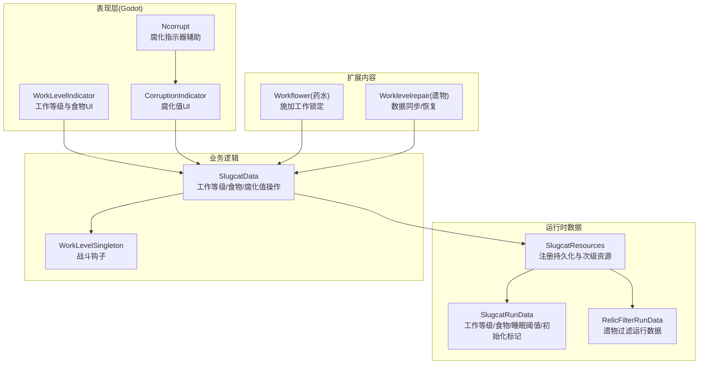
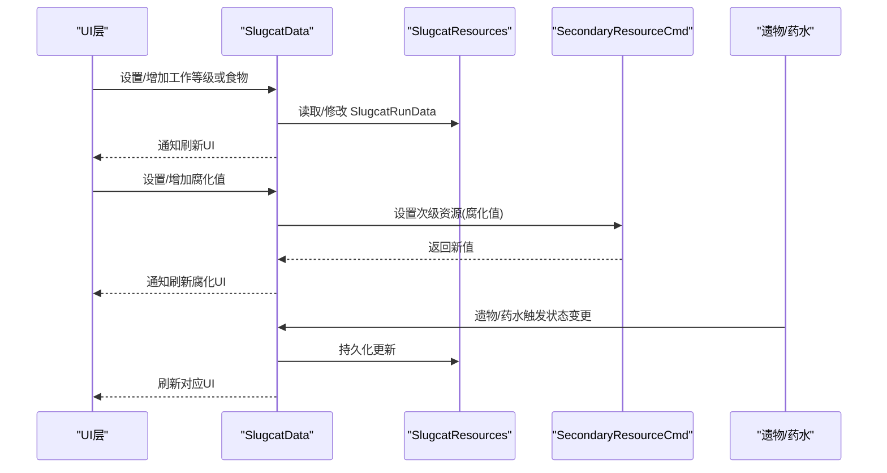
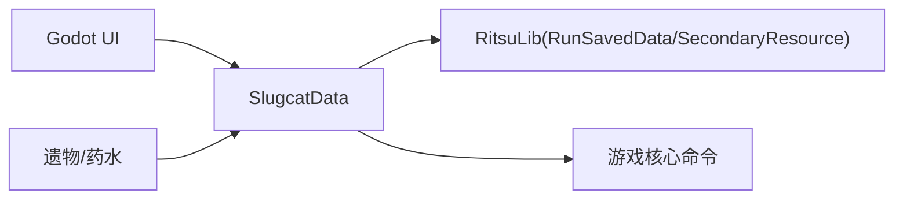
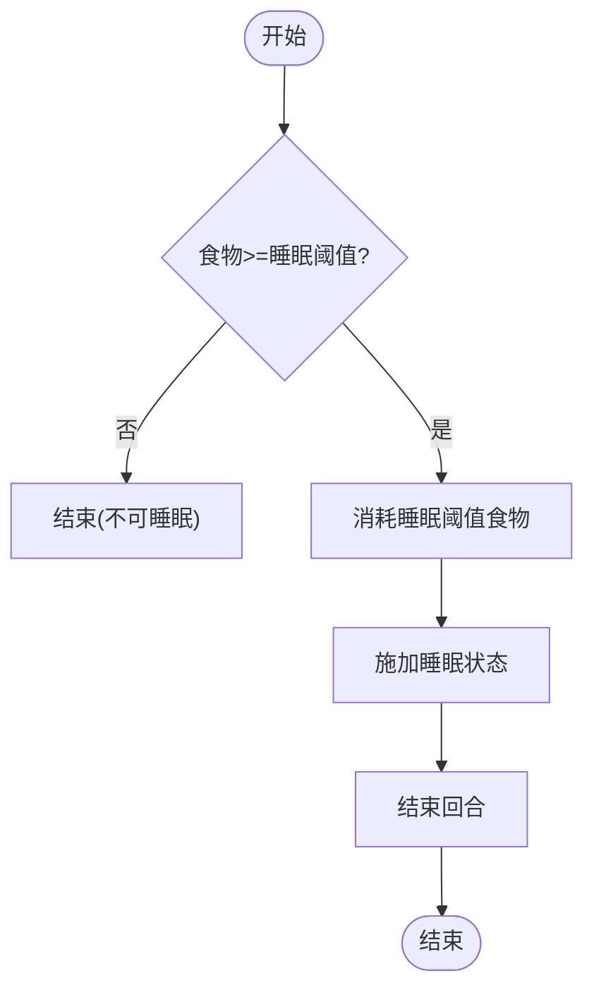

# 资源管理系统

<cite>
**本文引用的文件**
- [SlugcatResources.cs](file://Scripts/Slugcat/SecondaryResource/SlugcatResources.cs)
- [SlugcatRunData.cs](file://Scripts/Slugcat/SecondaryResource/SlugcatRunData.cs)
- [RelicFilterRunData.cs](file://Scripts/Slugcat/SecondaryResource/RelicFilterRunData.cs)
- [SlugcatData.cs](file://Scripts/Slugcat/SlugcatData.cs)
- [WorkLevelSingleton.cs](file://Scripts/patches/Singleton/WorkLevelSingleton.cs)
- [CorruptionIndicator.cs](file://Godot/CombatUI/CorruptionIndicator.cs)
- [WorkLevelIndicator.cs](file://Godot/CombatUI/WorkLevelIndicator.cs)
- [Ncorrupt.cs](file://Godot/CombatUI/Ncorrupt.cs)
- [SleepAction.cs](file://Scripts/Action/SleepAction.cs)
- [Workflower.cs](file://Scripts/Potions/Workflower.cs)
- [Worklevelrepair.cs](file://Scripts/relics/Worklevelrepair.cs)
- [mod_manifest.json](file://mod_manifest.json)
</cite>

## 目录
1. [简介](#简介)
2. [项目结构](#项目结构)
3. [核心组件](#核心组件)
4. [架构总览](#架构总览)
5. [详细组件分析](#详细组件分析)
6. [依赖关系分析](#依赖关系分析)
7. [性能考虑](#性能考虑)
8. [故障排查指南](#故障排查指南)
9. [结论](#结论)
10. [附录](#附录)

## 简介
本文件为“资源管理系统”的数据模型与业务规则文档，聚焦于次级资源系统：工作等级（Work Level）、食物（Food）、腐化值（Corruption）。内容涵盖实体关系、字段定义、数据类型、数据验证与业务规则、数据库模式图与示例数据、数据访问模式与缓存策略、生命周期与归档、迁移与版本管理、数据安全与访问控制等。

## 项目结构
- 运行时持久化数据通过 RitsuLib 的 RunSavedData 机制注册与读写，按玩家维度存储。
- 次级资源（如腐化值）通过 SecondaryResourceDefinition 注册，具备默认值、上限、回合策略与持久化策略。
- UI 层（Godot）负责展示工作等级、食物槽位与腐化值进度条，并通过补丁/单例在战斗流程中触发更新。
- 遗物（Relic）用于跨局或特殊场景的数据同步与恢复；药水（Potion）提供临时状态变更。



图表来源
- [SlugcatResources.cs:15-48](file://Scripts/Slugcat/SecondaryResource/SlugcatResources.cs#L15-L48)
- [SlugcatRunData.cs:3-13](file://Scripts/Slugcat/SecondaryResource/SlugcatRunData.cs#L3-L13)
- [SlugcatData.cs:32-366](file://Scripts/Slugcat/SlugcatData.cs#L32-L366)
- [WorkLevelIndicator.cs:14-269](file://Godot/CombatUI/WorkLevelIndicator.cs#L14-L269)
- [CorruptionIndicator.cs:12-148](file://Godot/CombatUI/CorruptionIndicator.cs#L12-L148)
- [Workflower.cs:20-48](file://Scripts/Potions/Workflower.cs#L20-L48)
- [Worklevelrepair.cs:24-91](file://Scripts/relics/Worklevelrepair.cs#L24-L91)

章节来源
- [SlugcatResources.cs:15-48](file://Scripts/Slugcat/SecondaryResource/SlugcatResources.cs#L15-L48)
- [SlugcatRunData.cs:3-13](file://Scripts/Slugcat/SecondaryResource/SlugcatRunData.cs#L3-L13)
- [WorkLevelIndicator.cs:14-269](file://Godot/CombatUI/WorkLevelIndicator.cs#L14-L269)
- [CorruptionIndicator.cs:12-148](file://Godot/CombatUI/CorruptionIndicator.cs#L12-L148)
- [Workflower.cs:20-48](file://Scripts/Potions/Workflower.cs#L20-L48)
- [Worklevelrepair.cs:24-91](file://Scripts/relics/Worklevelrepair.cs#L24-L91)

## 核心组件
- SlugcatResources：集中注册玩家级持久化数据与次级资源（腐化值），定义写入策略与同步策略。
- SlugcatRunData：保存当前跑局的次级资源状态（工作等级、最大工作等级、食物、最大食物、睡眠阈值、初始化标记、是否已超生）。
- SlugcatData：封装工作等级、食物、腐化值的读取与修改，包含大量业务规则（如升级/降级、睡眠、死亡回退、腐化融合等）。
- WorkLevelSingleton：战斗钩子，处理回合开始、胜利结算等时机的事件。
- Godot UI：WorkLevelIndicator、CorruptionIndicator、Ncorrupt 负责渲染与交互提示。
- 遗物与药水：Worklevelrepair 负责数据同步/恢复；Workflower 施加工作锁定状态。

章节来源
- [SlugcatResources.cs:15-48](file://Scripts/Slugcat/SecondaryResource/SlugcatResources.cs#L15-L48)
- [SlugcatRunData.cs:3-13](file://Scripts/Slugcat/SecondaryResource/SlugcatRunData.cs#L3-L13)
- [SlugcatData.cs:32-366](file://Scripts/Slugcat/SlugcatData.cs#L32-L366)
- [WorkLevelSingleton.cs:25-84](file://Scripts/patches/Singleton/WorkLevelSingleton.cs#L25-L84)
- [WorkLevelIndicator.cs:14-269](file://Godot/CombatUI/WorkLevelIndicator.cs#L14-L269)
- [CorruptionIndicator.cs:12-148](file://Godot/CombatUI/CorruptionIndicator.cs#L12-L148)
- [Workflower.cs:20-48](file://Scripts/Potions/Workflower.cs#L20-L48)
- [Worklevelrepair.cs:24-91](file://Scripts/relics/Worklevelrepair.cs#L24-L91)

## 架构总览
下图展示了从 UI 到数据层的调用链与数据流向，包括工作等级、食物与腐化值的核心路径。



图表来源
- [SlugcatData.cs:117-221](file://Scripts/Slugcat/SlugcatData.cs#L117-L221)
- [SlugcatData.cs:239-325](file://Scripts/Slugcat/SlugcatData.cs#L239-L325)
- [SlugcatResources.cs:15-48](file://Scripts/Slugcat/SecondaryResource/SlugcatResources.cs#L15-L48)
- [WorkLevelIndicator.cs:143-256](file://Godot/CombatUI/WorkLevelIndicator.cs#L143-L256)
- [CorruptionIndicator.cs:128-148](file://Godot/CombatUI/CorruptionIndicator.cs#L128-L148)

## 详细组件分析

### 数据模型与实体关系
- 玩家级运行数据（RunSavedData）：
  - 键名：slugcat_data
  - 类型：SlugcatRunData
  - 写入策略：WhenSet
  - 同步策略：跨房间同步开启
- 次级资源（SecondaryResource）：
  - ID：CorruptValue
  - 默认值：0
  - 基础最大值：5
  - 回合开始策略：None
  - 持久化策略：Combat（仅战斗内持久化）

```mermaid
erDiagram
PLAYER_RUN_DATA {
int WorkLevel
int MaxWorkLevel
int Food
int MaxFood
int SleepFood
bool IsInitialized
bool HaveChaoshengt
}
SECONDARY_RESOURCE_CORRUPT {
int value
int max = 5
string id = "CorruptValue"
}
RELIC_FILTER_RUN_DATA {
// 由框架提供具体字段
}
PLAYER_RUN_DATA ||--|| SECONDARY_RESOURCE_CORRUPT : "关联(通过玩家上下文)"
```

图表来源
- [SlugcatRunData.cs:3-13](file://Scripts/Slugcat/SecondaryResource/SlugcatRunData.cs#L3-L13)
- [SlugcatResources.cs:39-47](file://Scripts/Slugcat/SecondaryResource/SlugcatResources.cs#L39-L47)
- [RelicFilterRunData.cs](file://Scripts/Slugcat/SecondaryResource/RelicFilterRunData.cs)

章节来源
- [SlugcatRunData.cs:3-13](file://Scripts/Slugcat/SecondaryResource/SlugcatRunData.cs#L3-L13)
- [SlugcatResources.cs:15-48](file://Scripts/Slugcat/SecondaryResource/SlugcatResources.cs#L15-L48)
- [RelicFilterRunData.cs](file://Scripts/Slugcat/SecondaryResource/RelicFilterRunData.cs)

### 字段定义与数据类型
- 工作等级（WorkLevel）：int，范围受 MaxWorkLevel 限制，最小为 0。
- 最大工作等级（MaxWorkLevel）：int，上限为 9，下限为 0。
- 食物（Food）：int，范围 [0, MaxFood]。
- 最大食物（MaxFood）：int，非负。
- 睡眠阈值（SleepFood）：int，非负，表示可睡眠所需食物量。
- 初始化标记（IsInitialized）：bool，标识数据是否已完成初始化。
- 超生标记（HaveChaoshengt）：bool，记录是否已超生。
- 腐化值（Corruption）：次级资源，int，范围 [0, 5]。

章节来源
- [SlugcatRunData.cs:3-13](file://Scripts/Slugcat/SecondaryResource/SlugcatRunData.cs#L3-L13)
- [SlugcatData.cs:144-155](file://Scripts/Slugcat/SlugcatData.cs#L144-L155)
- [SlugcatData.cs:239-325](file://Scripts/Slugcat/SlugcatData.cs#L239-L325)

### 数据验证规则与业务规则
- 工作等级
  - 增加时若存在 WorkerrorPower 则阻止提升。
  - 设置超过 MaxWorkLevel 会被截断至 MaxWorkLevel。
  - 设置为负数会清零并造成巨额伤害。
  - 升级/降级的音效与回血逻辑在特定条件下触发。
- 食物
  - 增加时不超过 MaxFood，超出部分可通过 FatworldPower 转化为力量。
  - 减少时不低于 0。
  - 睡眠需满足 Food >= SleepFood，且角色存活且无 FakedeathPower。
  - 睡眠动作消耗 SleepFood 并施加 SleepPower。
- 腐化值
  - 范围 [0, 5]，超过 5 被截断。
  - 达到 5 自动获得 RedmushroomPower。
  - 降至 0 移除 RedmushroomPower。
  - 增加腐化时若拥有 CreatesongPower 将造成伤害。
  - MixPower 在腐化变化时根据增减方向给予 VigorPower 或生成蘑菇护盾。
  - TwistformPower 使腐化增加翻倍。
  - RestrainPower 可阻止腐化增加。
- 遗物与工作锁定
  - Workflower 药水施加 WorklockPower，影响能否死亡判定与复活行为。
  - Worklevelrepair 遗物在获取时同步当前状态，并在后续数据变动时加载最新值。

章节来源
- [SlugcatData.cs:106-221](file://Scripts/Slugcat/SlugcatData.cs#L106-L221)
- [SlugcatData.cs:239-325](file://Scripts/Slugcat/SlugcatData.cs#L239-L325)
- [SleepAction.cs:31-41](file://Scripts/Action/SleepAction.cs#L31-L41)
- [Workflower.cs:45-48](file://Scripts/Potions/Workflower.cs#L45-L48)
- [Worklevelrepair.cs:41-91](file://Scripts/relics/Worklevelrepair.cs#L41-L91)

### 数据访问模式与缓存策略
- 数据访问
  - 通过 SlugcatResources.Data 获取/修改玩家级运行数据。
  - 使用 Modify 进行原子更新，避免并发写冲突。
  - 腐化值通过 SecondaryResourceCmd 进行设置/读取。
- 缓存策略
  - 运行时内存缓存由框架管理，WritePolicy=WhenSet 确保仅在显式设置时落盘。
  - SyncLobbyOnChange=true 保证多房间/多人环境下的状态同步。
- UI 刷新
  - 工作等级与食物通过 WorkLevelIndicator 的 SetCurrentFood/SetSleepFood/UpdateWorkLevel 等方法刷新。
  - 腐化值通过 CorruptionIndicator.UpdateCorruption 刷新显示。

章节来源
- [SlugcatResources.cs:15-48](file://Scripts/Slugcat/SecondaryResource/SlugcatResources.cs#L15-L48)
- [SlugcatData.cs:117-221](file://Scripts/Slugcat/SlugcatData.cs#L117-L221)
- [SlugcatData.cs:239-325](file://Scripts/Slugcat/SlugcatData.cs#L239-L325)
- [WorkLevelIndicator.cs:143-256](file://Godot/CombatUI/WorkLevelIndicator.cs#L143-L256)
- [CorruptionIndicator.cs:128-148](file://Godot/CombatUI/CorruptionIndicator.cs#L128-L148)

### 数据生命周期、保留策略与归档规则
- 生命周期
  - 数据在玩家进入战斗/房间时初始化（IsInitialized=false 时填充初始值）。
  - 战斗期间通过次级资源与运行数据共同维护状态。
- 保留策略
  - 腐化值：Combat 持久化，仅战斗内有效。
  - 工作等级/食物：当 Set 时写入（WhenSet），跨房间保持。
- 归档规则
  - 未实现显式归档；数据随 RunSavedData 生命周期管理。
  - 遗物 Worklevelrepair 可在获取时快照当前状态，便于恢复或回溯。

章节来源
- [SlugcatResources.cs:15-48](file://Scripts/Slugcat/SecondaryResource/SlugcatResources.cs#L15-L48)
- [SlugcatData.cs:76-104](file://Scripts/Slugcat/SlugcatData.cs#L76-L104)
- [Worklevelrepair.cs:41-91](file://Scripts/relics/Worklevelrepair.cs#L41-L91)

### 数据迁移路径与版本管理
- 版本信息
  - mod_manifest.json 声明版本号与最低游戏版本要求。
- 迁移建议
  - 新增字段时应在 SlugcatRunData 中添加并提供默认值。
  - 对旧存档兼容：在 Initialize 中检测 IsInitialized 并做增量迁移。
  - 次级资源变更：调整 SecondaryResourceDefinition 的默认值/上限，并确保向后兼容。

章节来源
- [mod_manifest.json:1-14](file://mod_manifest.json#L1-L14)
- [SlugcatRunData.cs:3-13](file://Scripts/Slugcat/SecondaryResource/SlugcatRunData.cs#L3-L13)
- [SlugcatResources.cs:39-47](file://Scripts/Slugcat/SecondaryResource/SlugcatResources.cs#L39-L47)

### 数据安全、隐私要求与访问控制
- 安全
  - 所有关键数值均通过统一 API（SlugcatData）修改，避免绕过校验。
  - 次级资源通过框架命令设置，具备一致性保障。
- 隐私
  - 数据为本地运行态数据，不涉及敏感个人信息。
- 访问控制
  - 通过 Player 上下文限定数据作用域，防止跨玩家污染。
  - 遗物/药水对状态的影响遵循既定规则，避免非法状态。

章节来源
- [SlugcatData.cs:117-221](file://Scripts/Slugcat/SlugcatData.cs#L117-L221)
- [SlugcatData.cs:239-325](file://Scripts/Slugcat/SlugcatData.cs#L239-L325)

## 依赖关系分析
- 模块耦合
  - UI 依赖业务层（SlugcatData）提供的查询与更新接口。
  - 业务层依赖框架的 RunSavedData 与 SecondaryResource 能力。
  - 遗物/药水通过业务层间接影响数据。
- 外部依赖
  - STS2-RitsuLib：提供运行时数据与次级资源框架。
  - Godot：UI 渲染与动画。
  - 游戏核心（MegaCrit.Sts2.Core.*）：战斗、命令、房间管理等。



图表来源
- [WorkLevelIndicator.cs:14-269](file://Godot/CombatUI/WorkLevelIndicator.cs#L14-L269)
- [CorruptionIndicator.cs:12-148](file://Godot/CombatUI/CorruptionIndicator.cs#L12-L148)
- [SlugcatData.cs:32-366](file://Scripts/Slugcat/SlugcatData.cs#L32-L366)
- [Workflower.cs:20-48](file://Scripts/Potions/Workflower.cs#L20-L48)
- [Worklevelrepair.cs:24-91](file://Scripts/relics/Worklevelrepair.cs#L24-L91)

章节来源
- [WorkLevelIndicator.cs:14-269](file://Godot/CombatUI/WorkLevelIndicator.cs#L14-L269)
- [CorruptionIndicator.cs:12-148](file://Godot/CombatUI/CorruptionIndicator.cs#L12-L148)
- [SlugcatData.cs:32-366](file://Scripts/Slugcat/SlugcatData.cs#L32-L366)
- [Workflower.cs:20-48](file://Scripts/Potions/Workflower.cs#L20-L48)
- [Worklevelrepair.cs:24-91](file://Scripts/relics/Worklevelrepair.cs#L24-L91)

## 性能考虑
- 写入频率
  - WhenSet 策略降低不必要的磁盘写入，提高性能。
- 同步开销
  - SyncLobbyOnChange 在多人环境下可能带来网络同步成本，应尽量减少频繁小步更新。
- UI 刷新
  - 批量更新 UI（如一次设置多个属性后再刷新）可减少重绘次数。
- 次级资源
  - 腐化值 Combat 持久化，避免跨局负担。

[本节为通用指导，不直接分析具体文件]

## 故障排查指南
- 工作等级异常
  - 检查是否存在 WorkerrorPower 阻止升级。
  - 确认 MaxWorkLevel 是否被正确设置。
- 食物无法睡眠
  - 检查 Food 是否小于 SleepFood，或角色是否处于假死/不可睡眠状态。
- 腐化值不生效
  - 确认次级资源 ID 是否正确，是否在战斗内设置。
  - 检查是否有 RestrainPower 阻止增加。
- 遗物数据不同步
  - 确认 Worklevelrepair 的 LoadData 是否被调用。

章节来源
- [SlugcatData.cs:185-221](file://Scripts/Slugcat/SlugcatData.cs#L185-L221)
- [SleepAction.cs:31-41](file://Scripts/Action/SleepAction.cs#L31-L41)
- [SlugcatData.cs:239-325](file://Scripts/Slugcat/SlugcatData.cs#L239-L325)
- [Worklevelrepair.cs:62-91](file://Scripts/relics/Worklevelrepair.cs#L62-L91)

## 结论
本资源管理系统以 RitsuLib 的运行数据与次级资源为核心，结合 Godot UI 与游戏核心命令，实现了工作等级、食物与腐化值的完整闭环。通过统一的业务层封装，确保了数据一致性与规则约束。未来可扩展更多次级资源与遗物/药水组合，进一步提升玩法深度。

[本节为总结性内容，不直接分析具体文件]

## 附录

### 数据库模式图（概念）
```mermaid
erDiagram
RUN_DATA {
int work_level
int max_work_level
int food
int max_food
int sleep_food
bool is_initialized
bool have_chaoshengt
}
CORRUPTION {
int value
int max = 5
}
RUN_DATA ||--|| CORRUPTION : "玩家上下文关联"
```

图表来源
- [SlugcatRunData.cs:3-13](file://Scripts/Slugcat/SecondaryResource/SlugcatRunData.cs#L3-L13)
- [SlugcatResources.cs:39-47](file://Scripts/Slugcat/SecondaryResource/SlugcatResources.cs#L39-L47)

### 示例数据
- 初始状态
  - 工作等级：0
  - 最大工作等级：0
  - 食物：0
  - 最大食物：0
  - 睡眠阈值：0
  - 腐化值：0
- 典型状态
  - 工作等级：3，最大工作等级：5
  - 食物：4，最大食物：6，睡眠阈值：3
  - 腐化值：2

[本节为概念性示例，不直接分析具体文件]

### 关键流程图（睡眠）


图表来源
- [SleepAction.cs:31-41](file://Scripts/Action/SleepAction.cs#L31-L41)
- [SlugcatData.cs:223-238](file://Scripts/Slugcat/SlugcatData.cs#L223-L238)