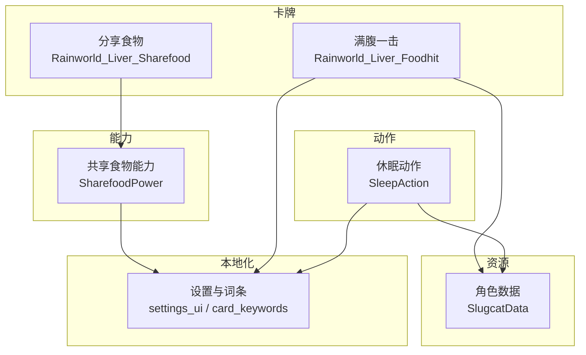
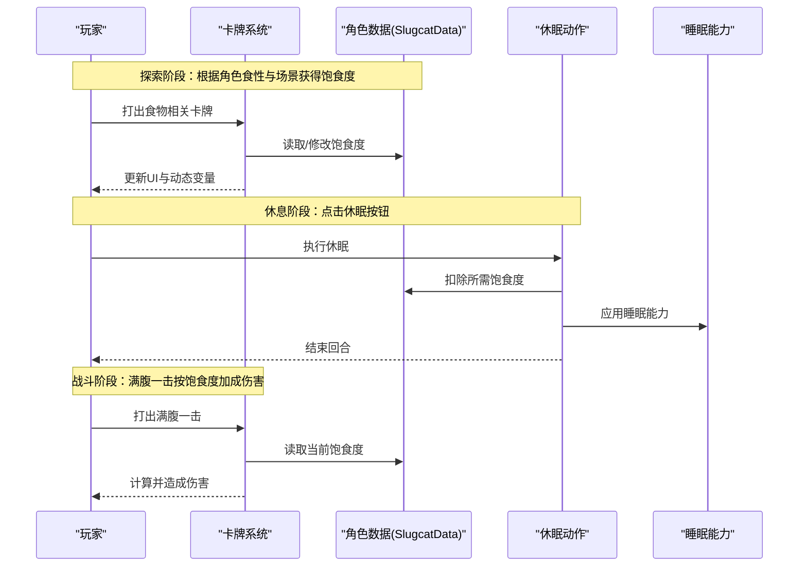
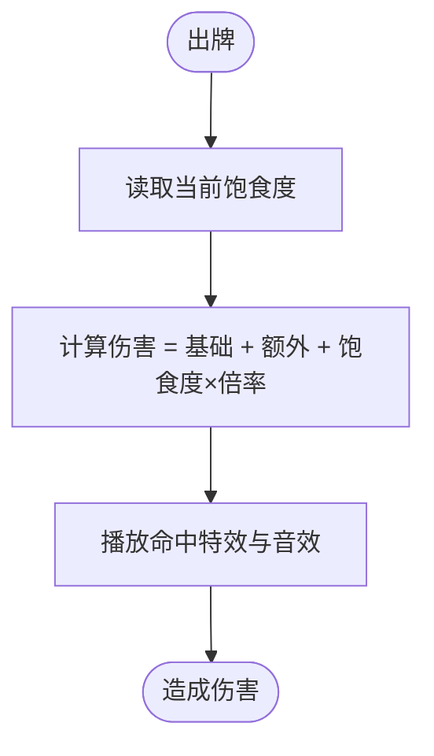
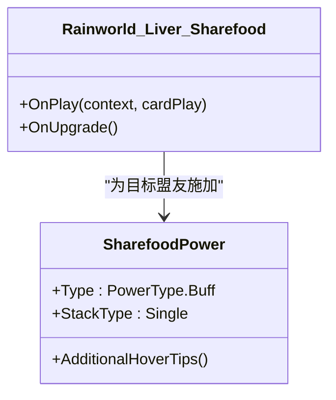
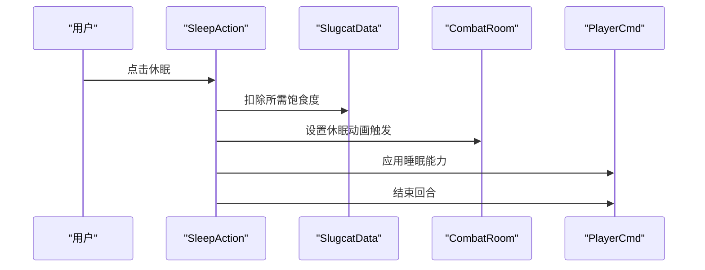
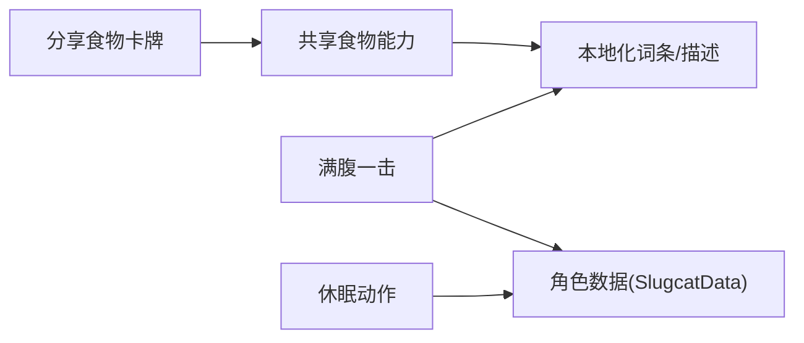

# 食物系统

<cite>
**本文引用的文件**
- [Rainworld_Liver_Foodhit.cs](file://Scripts/Card/Liver/Attack/Rainworld_Liver_Foodhit.cs)
- [SharefoodPower.cs](file://Scripts/Powers/Liver/SharefoodPower.cs)
- [Rainworld_Liver_Sharefood.cs](file://Scripts/Card/Liver/Powers/Rainworld_Liver_Sharefood.cs)
- [SleepAction.cs](file://Scripts/Action/SleepAction.cs)
- [settings_ui.json（英文）](file://SlugcatTheSpireII/localization/eng/settings_ui.json)
- [settings_ui.json（中文）](file://SlugcatTheSpireII/localization/zhs/settings_ui.json)
- [card_keywords.json（英文）](file://SlugcatTheSpireII/localization/eng/card_keywords.json)
- [powers.json（英文）](file://SlugcatTheSpireII/localization/eng/powers.json)
- [cards.json（英文）](file://SlugcatTheSpireII/localization/eng/cards.json)
</cite>

## 目录
1. [简介](#简介)
2. [项目结构](#项目结构)
3. [核心组件](#核心组件)
4. [架构总览](#架构总览)
5. [详细组件分析](#详细组件分析)
6. [依赖关系分析](#依赖关系分析)
7. [性能考量](#性能考量)
8. [故障排查指南](#故障排查指南)
9. [结论](#结论)
10. [附录](#附录)

## 简介
本技术文档围绕“食物系统”展开，聚焦饱食度（Fullness）的获取、消耗与效果实现，覆盖战斗、探索与休息阶段的完整流程；记录不同角色在饱食度上的差异与平衡设计；说明数据模型（数量管理、类型区分、状态跟踪）、事件处理与回调机制；阐述与角色能力的交互（如共享食物、额外获得等），以及持久化、网络同步与版本兼容性要点；最后提供扩展接口与自定义实现指南。

## 项目结构
食物系统在本项目中以“卡牌—能力—动作—资源”的方式组织：
- 卡牌层：通过卡牌打出或升级影响饱食度，或在战斗中根据当前饱食度计算伤害。
- 能力层：为全局或玩家施加与食物相关的被动效果（例如“共享食物”）。
- 动作层：在休息阶段执行休眠动作，消耗饱食度并触发后续状态变化。
- 资源层：通过角色数据访问器读取/修改饱食度数值。
- 本地化层：定义UI展示、词条解释与角色差异化描述。

图表来源
- [Rainworld_Liver_Foodhit.cs:19-79](file://Scripts/Card/Liver/Attack/Rainworld_Liver_Foodhit.cs#L19-L79)
- [Rainworld_Liver_Sharefood.cs:12-41](file://Scripts/Card/Liver/Powers/Rainworld_Liver_Sharefood.cs#L12-L41)
- [SharefoodPower.cs:25-37](file://Scripts/Powers/Liver/SharefoodPower.cs#L25-L37)
- [SleepAction.cs:19-41](file://Scripts/Action/SleepAction.cs#L19-L41)
- [settings_ui.json（英文）:4-8](file://SlugcatTheSpireII/localization/eng/settings_ui.json#L4-L8)
- [card_keywords.json（英文）:14-15](file://SlugcatTheSpireII/localization/eng/card_keywords.json#L14-L15)

章节来源
- [Rainworld_Liver_Foodhit.cs:19-79](file://Scripts/Card/Liver/Attack/Rainworld_Liver_Foodhit.cs#L19-L79)
- [Rainworld_Liver_Sharefood.cs:12-41](file://Scripts/Card/Liver/Powers/Rainworld_Liver_Sharefood.cs#L12-L41)
- [SharefoodPower.cs:25-37](file://Scripts/Powers/Liver/SharefoodPower.cs#L25-L37)
- [SleepAction.cs:19-41](file://Scripts/Action/SleepAction.cs#L19-L41)
- [settings_ui.json（英文）:4-8](file://SlugcatTheSpireII/localization/eng/settings_ui.json#L4-L8)
- [card_keywords.json（英文）:14-15](file://SlugcatTheSpireII/localization/eng/card_keywords.json#L14-L15)

## 核心组件
- 饱食度词条与说明：通过本地化文件定义“饱食度”词条与角色差异化描述，明确在不同角色中的获取规则与用途。
- 战斗阶段：卡牌“满腹一击”将伤害与当前饱食度挂钩，体现“越多越伤”的设计。
- 休息阶段：休眠动作消耗特定数量的饱食度，结束回合并附加睡眠能力，用于后续业力增长判定。
- 共享食物：通过能力与卡牌组合，使食物类卡牌对全体友方生效，提升多人协作体验。

章节来源
- [settings_ui.json（英文）:4-8](file://SlugcatTheSpireII/localization/eng/settings_ui.json#L4-L8)
- [settings_ui.json（中文）:4-8](file://SlugcatTheSpireII/localization/zhs/settings_ui.json#L4-L8)
- [card_keywords.json（英文）:14-15](file://SlugcatTheSpireII/localization/eng/card_keywords.json#L14-L15)
- [Rainworld_Liver_Foodhit.cs:39-71](file://Scripts/Card/Liver/Attack/Rainworld_Liver_Foodhit.cs#L39-L71)
- [SleepAction.cs:31-41](file://Scripts/Action/SleepAction.cs#L31-L41)
- [Rainworld_Liver_Sharefood.cs:30-36](file://Scripts/Card/Liver/Powers/Rainworld_Liver_Sharefood.cs#L30-L36)
- [SharefoodPower.cs:25-37](file://Scripts/Powers/Liver/SharefoodPower.cs#L25-L37)

## 架构总览
食物系统贯穿三个主要阶段：
- 探索阶段：进入非战斗房间或完成战斗后，依据角色食性给予饱食度（由本地化配置驱动）。
- 战斗阶段：部分卡牌基于当前饱食度计算伤害；部分卡牌直接增加饱食度；“共享食物”能力可将食物类卡牌效果扩散至所有盟友。
- 休息阶段：使用休眠动作消耗饱食度，结束回合并附加睡眠能力，若下一回合开始未受伤害则获得业力。

图表来源
- [settings_ui.json（英文）:4-8](file://SlugcatTheSpireII/localization/eng/settings_ui.json#L4-L8)
- [Rainworld_Liver_Foodhit.cs:39-71](file://Scripts/Card/Liver/Attack/Rainworld_Liver_Foodhit.cs#L39-L71)
- [SleepAction.cs:31-41](file://Scripts/Action/SleepAction.cs#L31-L41)

## 详细组件分析

### 满腹一击（战斗阶段）
- 功能：攻击牌，基础伤害随当前饱食度线性放大，升级后每点饱食度额外伤害提升。
- 关键逻辑：
  - 伤害乘数来源于角色当前饱食度。
  - 动态变量包含基础值、额外伤害与按饱食度计算的最终伤害。
  - 升级时提升基础值与额外伤害。
- 交互：与“共享食物”能力配合时，可考虑将食物类卡牌效果扩展到全体盟友（见下节）。

图表来源
- [Rainworld_Liver_Foodhit.cs:39-71](file://Scripts/Card/Liver/Attack/Rainworld_Liver_Foodhit.cs#L39-L71)

章节来源
- [Rainworld_Liver_Foodhit.cs:19-79](file://Scripts/Card/Liver/Attack/Rainworld_Liver_Foodhit.cs#L19-L79)

### 共享食物（能力与卡牌）
- 能力“共享食物”：标记食物类卡牌对所有盟友生效（由能力持有者决定）。
- 卡牌“分享食物”：为所有盟友施加“共享食物”能力，支持多人模式限制。
- 升级：降低费用以提升性价比。

图表来源
- [SharefoodPower.cs:25-37](file://Scripts/Powers/Liver/SharefoodPower.cs#L25-L37)
- [Rainworld_Liver_Sharefood.cs:12-41](file://Scripts/Card/Liver/Powers/Rainworld_Liver_Sharefood.cs#L12-L41)

章节来源
- [SharefoodPower.cs:25-37](file://Scripts/Powers/Liver/SharefoodPower.cs#L25-L37)
- [Rainworld_Liver_Sharefood.cs:12-41](file://Scripts/Card/Liver/Powers/Rainworld_Liver_Sharefood.cs#L12-L41)
- [powers.json（英文）:187-188](file://SlugcatTheSpireII/localization/eng/powers.json#L187-L188)

### 休眠动作（休息阶段）
- 功能：消耗指定数量的饱食度，结束当前回合，并为该回合附加“睡眠”能力，用于判断是否获得业力。
- 关键点：
  - 扣减饱食度：调用角色数据访问器进行扣减。
  - 动画触发：通知战斗室节点播放休眠动画。
  - 能力应用：为当前玩家附加睡眠能力。
  - 回合结束：调用结束回合命令。

图表来源
- [SleepAction.cs:31-41](file://Scripts/Action/SleepAction.cs#L31-L41)

章节来源
- [SleepAction.cs:19-41](file://Scripts/Action/SleepAction.cs#L19-L41)
- [settings_ui.json（中文）:10-11](file://SlugcatTheSpireII/localization/zhs/settings_ui.json#L10-L11)

### 角色差异与平衡性
- 食性设定：
  - 求生者（Liver）：杂食，完成普通/精英/Boss战斗后分别获得固定饱食度；进入非战斗房间也获得饱食度。
  - 溪流（River）：杂食，收益略低于求生者。
  - 猎手（RedCat）：肉食，战斗后获得更高饱食度，强调进攻节奏。
- 平衡要点：
  - 通过不同角色的饱食度获取量控制节奏与资源循环。
  - 战斗阶段“满腹一击”将饱食度转化为输出，鼓励资源利用。
  - 休息阶段休眠提供安全回合与潜在业力增长，形成风险回报。

章节来源
- [settings_ui.json（英文）:4-8](file://SlugcatTheSpireII/localization/eng/settings_ui.json#L4-L8)
- [settings_ui.json（中文）:4-8](file://SlugcatTheSpireII/localization/zhs/settings_ui.json#L4-L8)

## 依赖关系分析
- 卡牌依赖角色数据：满腹一击通过角色数据读取当前饱食度，作为伤害乘数。
- 动作依赖角色数据：休眠动作通过角色数据扣减饱食度。
- 能力与卡牌联动：分享食物卡牌为盟友施加共享食物能力，改变食物类卡牌的作用范围。
- 本地化驱动UI与词条：设置与词条文件提供饱食度说明、角色差异与能力描述。

图表来源
- [Rainworld_Liver_Foodhit.cs:39-71](file://Scripts/Card/Liver/Attack/Rainworld_Liver_Foodhit.cs#L39-L71)
- [SleepAction.cs:31-41](file://Scripts/Action/SleepAction.cs#L31-L41)
- [Rainworld_Liver_Sharefood.cs:30-36](file://Scripts/Card/Liver/Powers/Rainworld_Liver_Sharefood.cs#L30-L36)
- [SharefoodPower.cs:25-37](file://Scripts/Powers/Liver/SharefoodPower.cs#L25-L37)
- [card_keywords.json（英文）:14-15](file://SlugcatTheSpireII/localization/eng/card_keywords.json#L14-L15)
- [powers.json（英文）:187-188](file://SlugcatTheSpireII/localization/eng/powers.json#L187-L188)

章节来源
- [Rainworld_Liver_Foodhit.cs:39-71](file://Scripts/Card/Liver/Attack/Rainworld_Liver_Foodhit.cs#L39-L71)
- [SleepAction.cs:31-41](file://Scripts/Action/SleepAction.cs#L31-L41)
- [Rainworld_Liver_Sharefood.cs:30-36](file://Scripts/Card/Liver/Powers/Rainworld_Liver_Sharefood.cs#L30-L36)
- [SharefoodPower.cs:25-37](file://Scripts/Powers/Liver/SharefoodPower.cs#L25-L37)
- [card_keywords.json（英文）:14-15](file://SlugcatTheSpireII/localization/eng/card_keywords.json#L14-L15)
- [powers.json（英文）:187-188](file://SlugcatTheSpireII/localization/eng/powers.json#L187-L188)

## 性能考量
- 动态变量计算：满腹一击的伤害计算在出牌时进行，复杂度低，仅涉及一次角色数据读取与简单算术运算。
- 网络同步：休眠动作实现了网络序列化接口，确保多人模式下行为一致。
- UI刷新：通过本地化与动态变量绑定，减少重复渲染开销。

[本节为通用指导，不直接分析具体文件]

## 故障排查指南
- 饱食度异常：检查角色数据访问器的读写路径是否正确，确认卡牌与动作均通过统一接口操作饱食度。
- 休眠无效：确认休眠动作已正确扣减饱食度并应用睡眠能力；检查战斗室节点是否能响应动画触发。
- 共享食物未生效：确认目标盟友是否成功施加共享食物能力；检查卡牌是否为多人模式限制。
- 文本显示错误：核对本地化键值与动态变量占位符是否匹配。

章节来源
- [SleepAction.cs:31-41](file://Scripts/Action/SleepAction.cs#L31-L41)
- [Rainworld_Liver_Sharefood.cs:30-36](file://Scripts/Card/Liver/Powers/Rainworld_Liver_Sharefood.cs#L30-L36)
- [card_keywords.json（英文）:14-15](file://SlugcatTheSpireII/localization/eng/card_keywords.json#L14-L15)

## 结论
食物系统通过“卡牌—能力—动作—资源”的分层设计，将饱食度贯穿探索、战斗与休息三大阶段，既提供了资源管理的深度，又保持了玩法的直观性。角色差异化食性与共享食物能力增强了策略多样性与团队协作空间。未来可在更多卡牌中引入饱食度互动，进一步丰富战术维度。

[本节为总结，不直接分析具体文件]

## 附录

### 数据模型与字段说明
- 饱食度（Fullness）：
  - 类型：数值型资源
  - 管理：通过角色数据访问器进行读取与修改
  - 用途：战斗阶段影响伤害；休息阶段用于休眠
- 角色食性：
  - 类型：枚举或配置项
  - 作用：决定不同角色在完成战斗或进入非战斗房间时的饱食度获取量
- 状态跟踪：
  - 睡眠能力：用于判断下一回合是否获得业力
  - 共享食物能力：标记食物类卡牌对全体盟友生效

章节来源
- [settings_ui.json（英文）:4-8](file://SlugcatTheSpireII/localization/eng/settings_ui.json#L4-L8)
- [card_keywords.json（英文）:14-15](file://SlugcatTheSpireII/localization/eng/card_keywords.json#L14-L15)
- [powers.json（英文）:187-188](file://SlugcatTheSpireII/localization/eng/powers.json#L187-L188)

### 事件处理与回调机制
- 出牌回调：卡牌在出牌时读取/修改饱食度，并触发相应效果（如伤害计算、能力施加）。
- 动作回调：休眠动作在执行时扣减饱食度、应用能力并结束回合。
- 网络回调：休眠动作提供网络序列化接口，保证多人模式一致性。

章节来源
- [Rainworld_Liver_Foodhit.cs:65-71](file://Scripts/Card/Liver/Attack/Rainworld_Liver_Foodhit.cs#L65-L71)
- [SleepAction.cs:31-41](file://Scripts/Action/SleepAction.cs#L31-L41)
- [SleepAction.cs:43-46](file://Scripts/Action/SleepAction.cs#L43-L46)

### 持久化存储、网络同步与版本兼容
- 持久化：饱食度属于角色运行时资源，通常由游戏框架负责保存与恢复；如需跨局或存档，需通过角色数据访问器暴露持久化接口。
- 网络同步：休眠动作已实现网络序列化，确保多人模式下行为一致。
- 版本兼容：本地化文件与卡牌/能力描述应保持一致，避免新特性导致旧客户端解析失败。

章节来源
- [SleepAction.cs:43-46](file://Scripts/Action/SleepAction.cs#L43-L46)
- [settings_ui.json（英文）:4-8](file://SlugcatTheSpireII/localization/eng/settings_ui.json#L4-L8)

### 扩展接口与自定义实现指南
- 新增食物类卡牌：
  - 继承基础卡牌模型，定义能量消耗、目标类型与稀有度。
  - 在出牌回调中通过角色数据访问器修改饱食度。
  - 使用动态变量绑定UI显示。
- 新增共享食物能力：
  - 定义能力属性与堆叠类型。
  - 在卡牌中为目标盟友施加能力。
- 扩展休眠逻辑：
  - 在休眠动作中增加额外条件或奖励。
  - 确保网络序列化接口保持空实现或必要字段序列化。

章节来源
- [Rainworld_Liver_Foodhit.cs:19-79](file://Scripts/Card/Liver/Attack/Rainworld_Liver_Foodhit.cs#L19-L79)
- [Rainworld_Liver_Sharefood.cs:12-41](file://Scripts/Card/Liver/Powers/Rainworld_Liver_Sharefood.cs#L12-L41)
- [SharefoodPower.cs:25-37](file://Scripts/Powers/Liver/SharefoodPower.cs#L25-L37)
- [SleepAction.cs:19-41](file://Scripts/Action/SleepAction.cs#L19-L41)