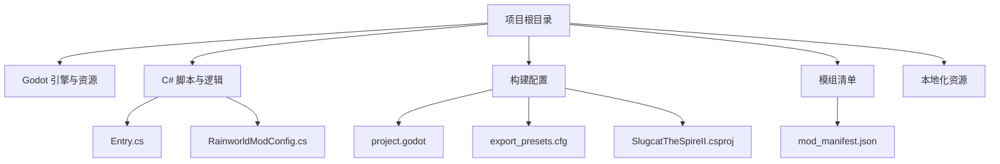
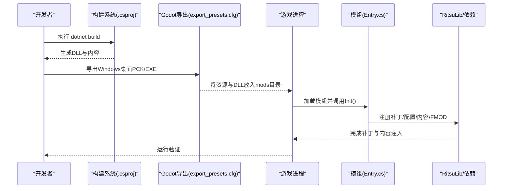
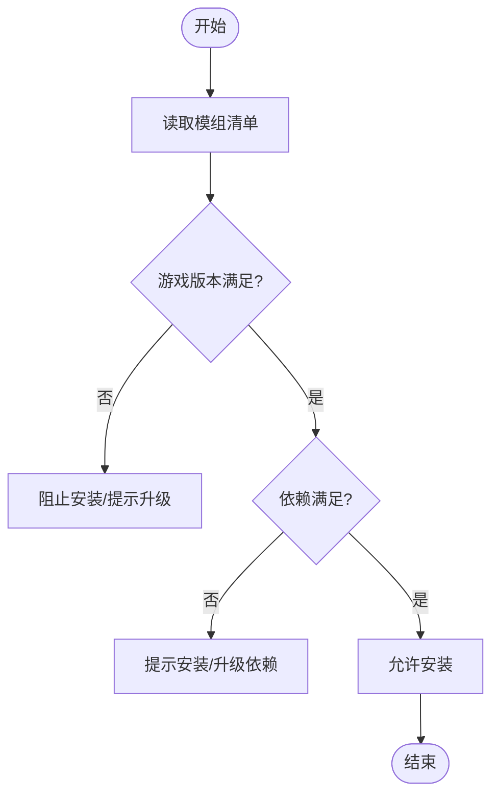
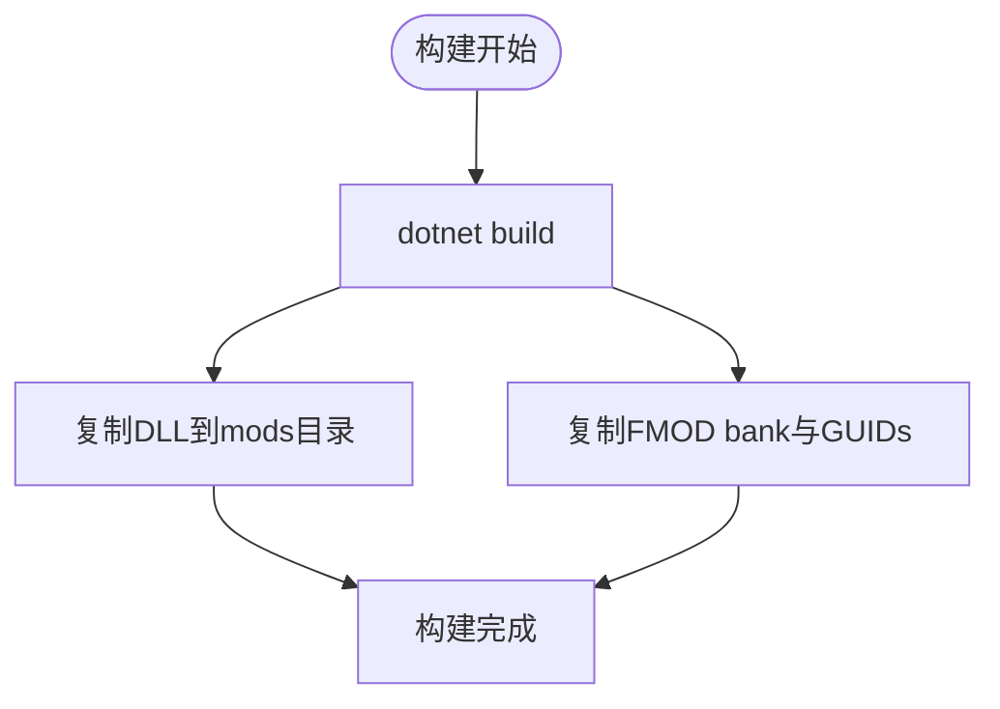
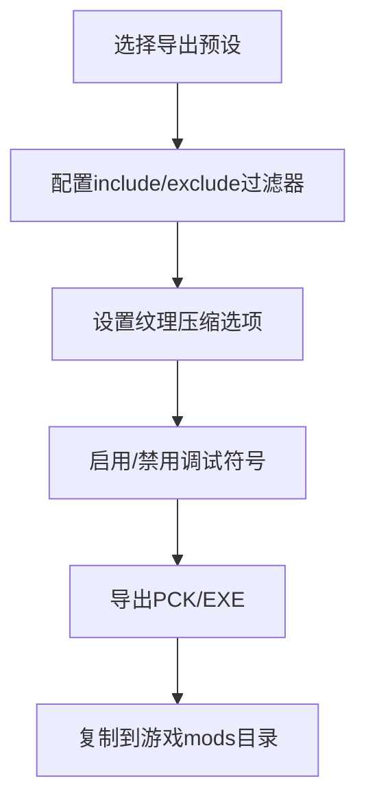
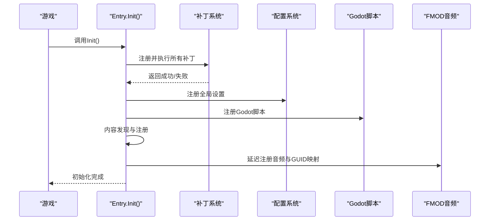
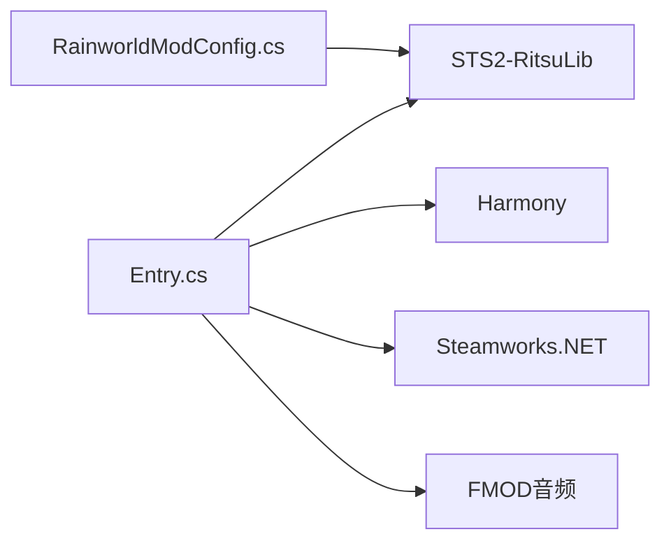

# 部署和发布

<cite>
**本文引用的文件**
- [mod_manifest.json](file://mod_manifest.json)
- [export_presets.cfg](file://export_presets.cfg)
- [project.godot](file://project.godot)
- [SlugcatTheSpireII.csproj](file://SlugcatTheSpireII.csproj)
- [Entry.cs](file://Scripts/Entry.cs)
- [RainworldModConfig.cs](file://Scripts/RainworldModConfig.cs)
- [log.txt](file://log.txt)
</cite>

## 目录
1. [简介](#简介)
2. [项目结构](#项目结构)
3. [核心组件](#核心组件)
4. [架构总览](#架构总览)
5. [详细组件分析](#详细组件分析)
6. [依赖分析](#依赖分析)
7. [性能与体积优化](#性能与体积优化)
8. [故障排查指南](#故障排查指南)
9. [结论](#结论)
10. [附录：命令行与脚本示例](#附录命令行与脚本示例)

## 简介
本指南面向《杀戮尖塔2》模组的构建、打包与发布全流程，覆盖模组清单配置、依赖管理、版本控制、导出设置优化、资源打包策略、签名与上传准备、发布前质量检查、兼容性测试与回滚策略，并提供可直接复用的命令行与自动化脚本示例。本项目基于 Godot 4.5 + C#（.NET 9）开发，使用 RitsuLib 框架进行内容注册与补丁注入，并通过 .csproj 的 PostBuild 目标将产物自动复制到游戏 mods 目录以便快速验证。

## 项目结构
- 引擎与导出配置
  - project.godot：定义引擎版本、C# 特性、渲染后端等。
  - export_presets.cfg：Windows 桌面导出预设，包含资源过滤、纹理格式、调试符号、远程调试脚本等。
- 构建与依赖
  - SlugcatTheSpireII.csproj：.NET SDK 项目，引用游戏 DLL、Harmony、Steamworks.NET、RitsuLib；PostBuild 目标复制 DLL 与 FMOD 音频资源到游戏目录。
- 运行时入口
  - Entry.cs：模组初始化入口，注册补丁、配置、Godot 脚本、内容发现、卡牌边框规则、FMOD 音频等。
- 模组清单
  - mod_manifest.json：声明模组 ID、名称、作者、描述、版本、最低游戏版本、是否包含 PCK/DLL、依赖项、是否影响玩法等。
- 本地化与资源
  - localization/*：多语言 JSON 资源。
  - Godot/*：场景、动画、贴图、Spine 资源等。
- 日志与变更记录
  - log.txt：版本更新记录与已知问题。

图表来源
- [project.godot:11-27](file://project.godot#L11-L27)
- [export_presets.cfg:1-71](file://export_presets.cfg#L1-L71)
- [SlugcatTheSpireII.csproj:1-101](file://SlugcatTheSpireII.csproj#L1-L101)
- [mod_manifest.json:1-14](file://mod_manifest.json#L1-L14)
- [Entry.cs:20-76](file://Scripts/Entry.cs#L20-L76)
- [RainworldModConfig.cs:166-234](file://Scripts/RainworldModConfig.cs#L166-L234)

章节来源
- [project.godot:11-27](file://project.godot#L11-L27)
- [export_presets.cfg:1-71](file://export_presets.cfg#L1-L71)
- [SlugcatTheSpireII.csproj:1-101](file://SlugcatTheSpireII.csproj#L1-L101)
- [mod_manifest.json:1-14](file://mod_manifest.json#L1-L14)
- [Entry.cs:20-76](file://Scripts/Entry.cs#L20-L76)
- [RainworldModConfig.cs:166-234](file://Scripts/RainworldModConfig.cs#L166-L234)

## 核心组件
- 模组清单（mod_manifest.json）
  - 关键字段：id、name、author、description、version、min_game_version、has_pck、has_dll、dependencies、affects_gameplay。
  - 作用：平台校验、依赖解析、功能开关、兼容性约束。
- 构建与发布（.csproj + export_presets.cfg）
  - .csproj：定义目标框架、引用路径、内容资源、PostBuild 自动复制 DLL 与 FMOD 资源到游戏目录。
  - export_presets.cfg：导出 Windows 桌面应用，配置资源过滤、纹理压缩、调试符号、远程调试脚本等。
- 运行时入口（Entry.cs）
  - 初始化流程：创建日志器、注册补丁、注册配置、注册 Godot 脚本、内容发现、卡牌边框规则、FMOD 音频注册、生命周期订阅。
- 配置系统（RainworldModConfig.cs）
  - 提供可持久化的全局开关，支持在模组设置界面中启用/禁用怪物、事件、修复项等。

章节来源
- [mod_manifest.json:1-14](file://mod_manifest.json#L1-L14)
- [SlugcatTheSpireII.csproj:17-101](file://SlugcatTheSpireII.csproj#L17-L101)
- [export_presets.cfg:1-71](file://export_presets.cfg#L1-L71)
- [Entry.cs:20-76](file://Scripts/Entry.cs#L20-L76)
- [RainworldModConfig.cs:11-235](file://Scripts/RainworldModConfig.cs#L11-L235)

## 架构总览
下图展示从源码到游戏运行时的关键阶段：构建（dotnet build）、资源处理（Godot 导出/打包）、运行时加载（Entry 初始化）、补丁注入与内容注册。

图表来源
- [SlugcatTheSpireII.csproj:91-101](file://SlugcatTheSpireII.csproj#L91-L101)
- [export_presets.cfg:1-71](file://export_presets.cfg#L1-L71)
- [Entry.cs:20-76](file://Scripts/Entry.cs#L20-L76)

## 详细组件分析

### 模组清单与依赖管理
- 清单字段说明
  - id/name/author/description：标识与元信息。
  - version/min_game_version：版本与最低游戏版本约束。
  - has_pck/has_dll：是否包含 PCK 与 DLL，用于平台分发判断。
  - dependencies：声明依赖模组及最低版本（如 STS2-RitsuLib）。
  - affects_gameplay：是否影响玩法，用于平台筛选与提示。
- 依赖管理要点
  - 通过 .csproj 引用 RitsuLib、Harmony、Steamworks.NET 等库。
  - PostBuild 目标将 DLL 与 FMOD 资源复制到游戏 mods 目录，便于热插拔验证。
  - 发布时确保依赖满足 min_game_version 与依赖模组版本要求。

图表来源
- [mod_manifest.json:1-14](file://mod_manifest.json#L1-L14)
- [SlugcatTheSpireII.csproj:17-44](file://SlugcatTheSpireII.csproj#L17-L44)

章节来源
- [mod_manifest.json:1-14](file://mod_manifest.json#L1-L14)
- [SlugcatTheSpireII.csproj:17-44](file://SlugcatTheSpireII.csproj#L17-L44)

### 构建流程与自动复制
- 构建命令
  - 使用 dotnet build 编译 C# 代码，生成 DLL。
- 自动复制（PostBuild）
  - 将生成的 DLL 复制到游戏 mods 目录。
  - 将 FMOD bank 与 GUIDs 复制到 Resource/Sound 目录，供运行时加载。
- 注意事项
  - Sts2Dir 与 FmodBuildDir 需根据实际环境配置。
  - 若修改了资源或音频，需重新构建以确保最新产物生效。

图表来源
- [SlugcatTheSpireII.csproj:91-101](file://SlugcatTheSpireII.csproj#L91-L101)

章节来源
- [SlugcatTheSpireII.csproj:91-101](file://SlugcatTheSpireII.csproj#L91-L101)

### 导出设置与资源打包
- 导出预设（export_presets.cfg）
  - 平台：Windows Desktop。
  - 资源过滤：include_filter 指定需要包含的资源（如 *.bank、*/GUIDs.txt）。
  - 纹理格式：启用 s3tc_bptc，关闭 etc2_astc。
  - 调试符号：dotnet/include_debug_symbols=true。
  - 远程调试：提供 PowerShell 远程调试脚本。
- 资源打包策略
  - 将必要的音频与本地化资源纳入导出范围。
  - 避免包含无关资源以减少包体大小。
  - 合理选择纹理压缩格式以平衡画质与体积。

图表来源
- [export_presets.cfg:1-71](file://export_presets.cfg#L1-L71)

章节来源
- [export_presets.cfg:1-71](file://export_presets.cfg#L1-L71)

### 运行时初始化与补丁注入
- 初始化顺序（Entry.Init）
  - 创建日志器。
  - 注册补丁集并执行 PatchAll。
  - 注册模组配置（RainworldModConfig.Register）。
  - 注册次级资源与 Godot 脚本。
  - 内容发现与注册（卡牌、遗物、能力等）。
  - 注册卡牌边框规则（高亮特定关键词）。
  - 延迟注册 FMOD 音频与 GUID 映射。
  - 订阅生命周期事件（如生物死亡观察）。
- 错误处理
  - 若关键补丁失败，抛出异常终止加载，便于快速定位问题。

图表来源
- [Entry.cs:20-76](file://Scripts/Entry.cs#L20-L76)
- [RainworldModConfig.cs:166-234](file://Scripts/RainworldModConfig.cs#L166-L234)

章节来源
- [Entry.cs:20-76](file://Scripts/Entry.cs#L20-L76)
- [RainworldModConfig.cs:166-234](file://Scripts/RainworldModConfig.cs#L166-L234)

## 依赖分析
- 外部依赖
  - STS2-RitsuLib：模组框架，提供内容注册、补丁、设置、本地化等能力。
  - Harmony：方法修补。
  - Steamworks.NET：Steam 集成。
- 内部依赖
  - Entry.cs 依赖补丁、配置、Godot 脚本、FMOD 音频。
  - RainworldModConfig.cs 提供设置绑定与 UI 注册。
- 版本约束
  - 模组清单声明最低游戏版本与依赖最低版本，确保兼容性。

图表来源
- [SlugcatTheSpireII.csproj:17-44](file://SlugcatTheSpireII.csproj#L17-L44)
- [Entry.cs:20-76](file://Scripts/Entry.cs#L20-L76)
- [RainworldModConfig.cs:166-234](file://Scripts/RainworldModConfig.cs#L166-L234)

章节来源
- [SlugcatTheSpireII.csproj:17-44](file://SlugcatTheSpireII.csproj#L17-L44)
- [Entry.cs:20-76](file://Scripts/Entry.cs#L20-L76)
- [RainworldModConfig.cs:166-234](file://Scripts/RainworldModConfig.cs#L166-L234)

## 性能与体积优化
- 纹理与资源
  - 启用 s3tc_bptc 纹理压缩，关闭不必要的格式（如 etc2_astc）。
  - 仅 include 必要资源（*.bank、GUIDs.txt），减少导出体积。
- 构建与调试
  - 发布构建时关闭调试符号（dotnet/include_debug_symbols=false）以降低体积。
  - 使用 Release 配置构建，避免 Debug 开销。
- 运行时
  - 延迟注册 FMOD 音频，减少启动时 I/O。
  - 合理使用 Godot 资源过滤，避免加载未使用场景或贴图。
- 建议
  - 定期清理未使用的资源与本地化键。
  - 对大资源进行分块或按需加载。

[本节为通用指导，不直接分析具体文件]

## 故障排查指南
- 常见构建问题
  - 路径配置错误：Sts2Dir、FmodBuildDir 与实际不符会导致复制失败。
  - 依赖缺失：RitsuLib、Harmony、Steamworks.NET 未正确引用。
- 常见运行时问题
  - 补丁失败：关键补丁未成功会导致初始化中断。
  - 音频未加载：FMOD bank 或 GUIDs 未复制到 Resource/Sound。
- 日志与版本记录
  - 查看 log.txt 了解历史版本变更与已知问题。
  - 使用 RitsuLib 日志器输出关键步骤日志，辅助定位问题。

章节来源
- [log.txt:1-215](file://log.txt#L1-L215)
- [Entry.cs:20-76](file://Scripts/Entry.cs#L20-L76)
- [SlugcatTheSpireII.csproj:91-101](file://SlugcatTheSpireII.csproj#L91-L101)

## 结论
本指南提供了从构建、打包到发布的完整流程，涵盖模组清单配置、依赖管理、导出优化、资源打包、运行时初始化与补丁注入、以及故障排查。遵循本文档的步骤与最佳实践，可稳定产出高质量发布包，并确保与游戏版本及依赖兼容。

[本节为总结性内容，不直接分析具体文件]

## 附录：命令行与脚本示例
- 基础构建
  - 执行构建：dotnet build
  - 发布构建（Release）：dotnet build -c Release
- 导出与复制
  - 在 Godot 编辑器中选择“Windows Desktop”预设导出 PCK/EXE。
  - 或通过 .csproj 的 PostBuild 自动复制 DLL 与音频到游戏目录。
- 环境变量与路径
  - 确保 Sts2Dir 指向游戏安装目录。
  - 确保 FmodBuildDir 指向 FMOD 构建输出目录。
- 发布前检查清单
  - 确认 mod_manifest.json 的版本与最低游戏版本正确。
  - 确认依赖模组已安装且版本满足要求。
  - 确认资源已包含在导出范围内。
  - 确认补丁全部成功加载。
  - 确认 FMOD 音频与 GUIDs 已复制到 Resource/Sound。
- 兼容性测试
  - 在不同游戏版本下验证最小版本约束。
  - 测试多人模式、不同分辨率、不同显卡驱动。
- 回滚策略
  - 保留上一个稳定版本的模组文件夹备份。
  - 若新版本出现严重问题，替换回旧版本并重启游戏。
  - 通过日志与版本记录快速定位问题版本。

[本节提供操作指引，不直接分析具体文件]