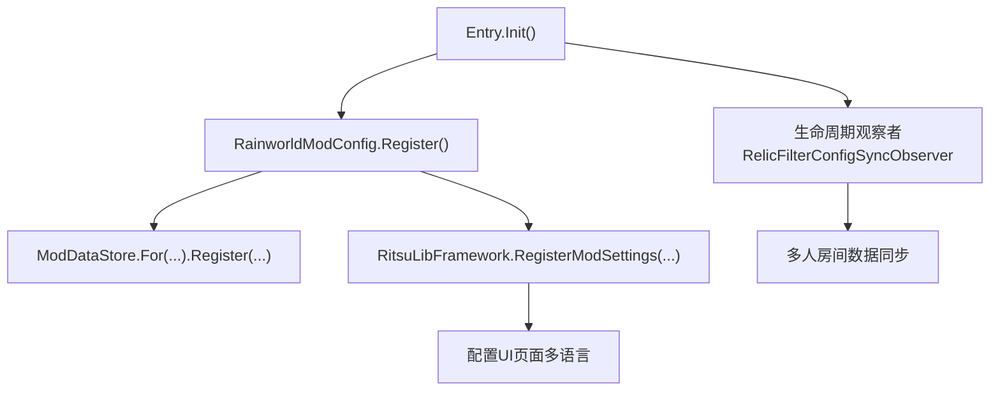
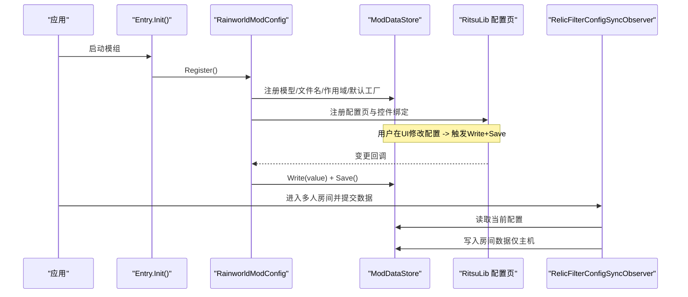
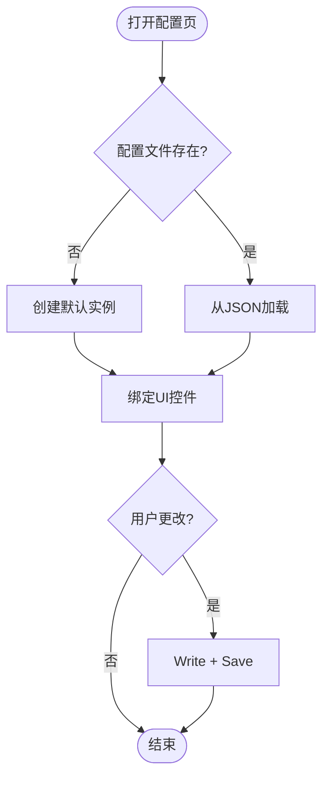
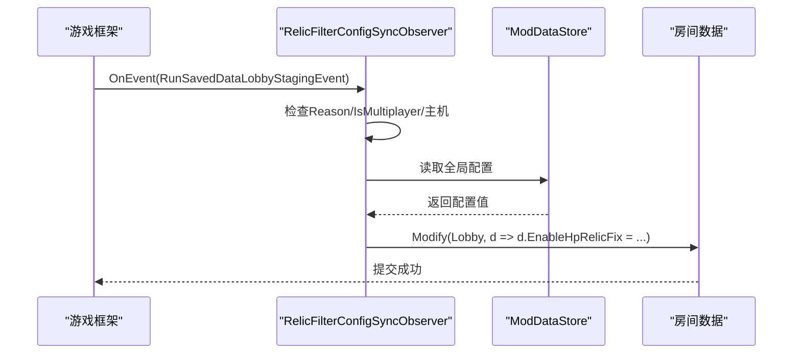
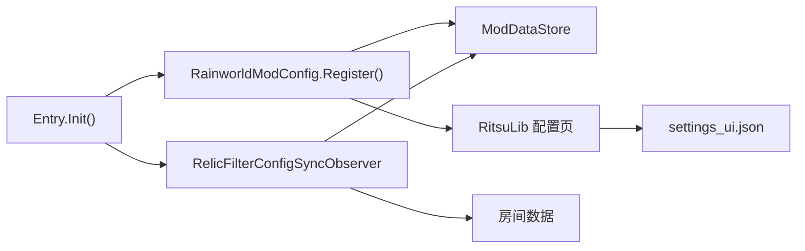

# 配置系统

<cite>
**本文引用的文件**
- [RainworldModConfig.cs](file://Scripts/RainworldModConfig.cs)
- [Entry.cs](file://Scripts/Entry.cs)
- [mod_manifest.json](file://mod_manifest.json)
- [settings_ui.json（简中）](file://SlugcatTheSpireII/localization/zhs/settings_ui.json)
- [RelicFilterConfigSyncObserver.cs](file://Scripts/patches/Lifecycle/RelicFilterConfigSyncObserver.cs)
</cite>

## 目录
1. [简介](#简介)
2. [项目结构](#项目结构)
3. [核心组件](#核心组件)
4. [架构总览](#架构总览)
5. [详细组件分析](#详细组件分析)
6. [依赖关系分析](#依赖关系分析)
7. [性能与可靠性](#性能与可靠性)
8. [故障排查指南](#故障排查指南)
9. [结论](#结论)
10. [附录：扩展指南](#附录：扩展指南)

## 简介
本文件为“雨世界蛞蝓猫模组”的配置系统实现文档，聚焦运行时配置的加载、验证与持久化机制；记录配置项定义、默认值设置、用户界面集成；说明配置文件格式、热重载支持与版本兼容性处理；并提供如何添加新配置项、创建配置界面、校验用户输入的最佳实践、错误处理策略与调试方法。

该配置系统基于 RitsuLib 的 ModSettingsValueBinding 与 ModDataStore，提供类型安全、可本地化的配置读写与 UI 绑定能力，并通过生命周期事件在多人模式下同步关键配置到房间数据。

## 项目结构
- 配置模型与绑定：位于 Scripts/RainworldModConfig.cs，定义了配置数据结构、绑定与注册逻辑。
- 初始化入口：位于 Scripts/Entry.cs，在模组初始化阶段调用配置注册。
- 本地化资源：位于 SlugcatTheSpireII/localization/*/settings_ui.json，提供多语言配置界面文案。
- 运行期同步：位于 Scripts/patches/Lifecycle/RelicFilterConfigSyncObserver.cs，将配置同步至多人房间数据。
- 元数据：mod_manifest.json 声明模组 ID、版本与依赖（STS2-RitsuLib）。

图表来源
- [Entry.cs:26-37](file://Scripts/Entry.cs#L26-L37)
- [RainworldModConfig.cs:166-233](file://Scripts/RainworldModConfig.cs#L166-L233)
- [RelicFilterConfigSyncObserver.cs:7-30](file://Scripts/patches/Lifecycle/RelicFilterConfigSyncObserver.cs#L7-L30)

章节来源
- [Entry.cs:20-37](file://Scripts/Entry.cs#L20-L37)
- [mod_manifest.json:1-14](file://mod_manifest.json#L1-L14)

## 核心组件
- 配置模型 RainworldModSettings：集中声明所有开关型配置项及其默认值。
- 配置绑定 ModSettingsValueBinding：为每个配置项建立读取/写入/保存的通道，并关联存储键与作用域。
- 配置注册器 RainworldModConfig：
  - 通过 ModDataStore 注册配置模型、文件名与作用域，支持自动创建缺失文件。
  - 通过 RitsuLibFramework.RegisterModSettings 构建配置 UI 页面，按分组组织控件，绑定到具体配置项。
- 本地化 settings_ui.json：为 UI 标题、描述、选项文本提供多语言支持。
- 运行时同步 RelicFilterConfigSyncObserver：在多人模式提交房间数据时，将相关配置同步到房间数据，确保一致性。

章节来源
- [RainworldModConfig.cs:11-30](file://Scripts/RainworldModConfig.cs#L11-L30)
- [RainworldModConfig.cs:32-164](file://Scripts/RainworldModConfig.cs#L32-L164)
- [RainworldModConfig.cs:166-233](file://Scripts/RainworldModConfig.cs#L166-L233)
- [settings_ui.json（简中）:15-46](file://SlugcatTheSpireII/localization/zhs/settings_ui.json#L15-L46)
- [RelicFilterConfigSyncObserver.cs:7-30](file://Scripts/patches/Lifecycle/RelicFilterConfigSyncObserver.cs#L7-L30)

## 架构总览
配置系统采用“模型 + 绑定 + 注册 + UI + 持久化 + 同步”的分层设计：
- 模型层：RainworldModSettings 定义配置结构与默认值。
- 绑定层：ModSettingsValueBinding 封装读/写/存，屏蔽底层存储细节。
- 注册层：RainworldModConfig.Register 统一注册数据源与 UI。
- UI 层：RitsuLib 提供的配置页，使用本地化文案渲染。
- 持久化层：ModDataStore 负责 JSON 文件的读写与版本兼容（由框架保障）。
- 同步层：生命周期观察者将关键配置同步到多人房间数据。

图表来源
- [Entry.cs:26-37](file://Scripts/Entry.cs#L26-L37)
- [RainworldModConfig.cs:166-233](file://Scripts/RainworldModConfig.cs#L166-L233)
- [RelicFilterConfigSyncObserver.cs:7-30](file://Scripts/patches/Lifecycle/RelicFilterConfigSyncObserver.cs#L7-L30)

## 详细组件分析

### 配置模型与默认值
- 位置：RainworldModSettings
- 职责：集中声明所有布尔型配置项及默认值，便于后续绑定与 UI 展示。
- 复杂度：O(1) 访问，内存占用与字段数线性相关。
- 建议：新增配置项时，优先保持布尔或简单类型，复杂类型需配合自定义序列化。

章节来源
- [RainworldModConfig.cs:11-30](file://Scripts/RainworldModConfig.cs#L11-L30)

### 配置绑定与存取
- 位置：RainworldModConfig 中的静态属性与绑定实例
- 职责：为每个配置项创建 ModSettingsValueBinding，暴露统一的 Read/Write/Save 语义。
- 关键点：
  - 绑定包含 ModId、DataKey、SaveScope，保证跨会话一致性与隔离。
  - 属性 setter 同时执行 Write 与 Save，确保 UI 变更后立即落盘。
- 性能：读写为轻量操作，Save 可能涉及 I/O，但频率低且由框架控制。

章节来源
- [RainworldModConfig.cs:32-164](file://Scripts/RainworldModConfig.cs#L32-L164)

### 配置注册与 UI 集成
- 位置：RainworldModConfig.Register
- 职责：
  - 通过 ModDataStore 注册配置模型、文件名与作用域，并启用自动创建缺失文件。
  - 通过 RitsuLibFramework.RegisterModSettings 构建配置页，按 section 分组，AddToggle 绑定到对应配置项。
  - 使用本地化键 T("...") 获取显示文案，支持多语言。
- 流程：
  - 首次打开配置页时，若文件不存在则根据 defaultFactory 创建默认实例。
  - 用户切换开关即触发绑定 Write 与 Save，更新 JSON。

图表来源
- [RainworldModConfig.cs:166-233](file://Scripts/RainworldModConfig.cs#L166-L233)

章节来源
- [RainworldModConfig.cs:166-233](file://Scripts/RainworldModConfig.cs#L166-L233)
- [settings_ui.json（简中）:15-46](file://SlugcatTheSpireII/localization/zhs/settings_ui.json#L15-L46)

### 运行时同步（多人模式）
- 位置：RelicFilterConfigSyncObserver
- 职责：在多人模式提交房间数据时，将相关配置同步到房间数据（仅主机），保证联机一致性。
- 触发条件：RunSavedDataLobbyStagingEvent 且 Reason 为 Committing，且 IsMultiplayer 为真，且为主机。
- 行为：读取全局配置并写入 Lobby 数据，供其他客户端拉取。

图表来源
- [RelicFilterConfigSyncObserver.cs:7-30](file://Scripts/patches/Lifecycle/RelicFilterConfigSyncObserver.cs#L7-L30)

章节来源
- [RelicFilterConfigSyncObserver.cs:7-30](file://Scripts/patches/Lifecycle/RelicFilterConfigSyncObserver.cs#L7-L30)

### 配置文件格式与持久化
- 存储位置与文件名：由注册时指定，例如 mod_settings.json。
- 作用域：Global，表示全局持久化，跨会话生效。
- 自动创建：autoCreateIfMissing=true，首次运行自动生成默认配置。
- 版本兼容：由框架内部处理（如迁移、回退默认值等），开发者无需手动维护迁移脚本。

章节来源
- [RainworldModConfig.cs:166-173](file://Scripts/RainworldModConfig.cs#L166-L173)

### 热重载支持
- 行为：每次 Write 后立即 Save，UI 变更即时落盘，下次读取即为最新值。
- 注意：对于需要热生效的配置，应在业务侧监听变化或在合适时机重新读取配置。

章节来源
- [RainworldModConfig.cs:95-161](file://Scripts/RainworldModConfig.cs#L95-L161)

### 版本兼容性处理
- 通过框架的 ModDataStore 进行版本管理，新增字段时保持向后兼容。
- 建议在新增配置时保留旧字段的默认行为，避免破坏已有存档。

章节来源
- [RainworldModConfig.cs:166-173](file://Scripts/RainworldModConfig.cs#L166-L173)

## 依赖关系分析
- Entry.Init 在模组初始化阶段调用 RainworldModConfig.Register，完成配置注册。
- RainworldModConfig 依赖 STS2RitsuLib 的 ModDataStore 与 RitsuLibFramework。
- 配置 UI 依赖本地化资源 settings_ui.json。
- 多人同步依赖生命周期事件与房间数据接口。

图表来源
- [Entry.cs:26-37](file://Scripts/Entry.cs#L26-L37)
- [RainworldModConfig.cs:166-233](file://Scripts/RainworldModConfig.cs#L166-L233)
- [RelicFilterConfigSyncObserver.cs:7-30](file://Scripts/patches/Lifecycle/RelicFilterConfigSyncObserver.cs#L7-L30)

章节来源
- [Entry.cs:20-37](file://Scripts/Entry.cs#L20-L37)
- [mod_manifest.json:1-14](file://mod_manifest.json#L1-L14)

## 性能与可靠性
- 读写性能：配置项为布尔值，读写开销极低；Save 仅在用户交互时触发，I/O 频率可控。
- 可靠性：
  - 自动创建缺失文件，避免首次运行异常。
  - 多人模式下仅主机写入房间数据，避免冲突。
- 可扩展性：新增配置项只需增加模型字段、绑定与 UI 控件，无需改动核心流程。

[本节为通用指导，不直接分析具体文件]

## 故障排查指南
- 配置未生效：
  - 确认 Entry.Init 已调用 RainworldModConfig.Register。
  - 检查 UI 是否绑定了正确的绑定实例。
- 多人不同步：
  - 确认 RelicFilterConfigSyncObserver 被订阅到生命周期事件。
  - 检查是否为多人模式且为主机。
- 本地化缺失：
  - 确认 settings_ui.json 中包含对应 key 的翻译。
- 日志定位：
  - 使用 Entry.Logger 输出关键路径信息，辅助定位问题。

章节来源
- [Entry.cs:20-37](file://Scripts/Entry.cs#L20-L37)
- [RelicFilterConfigSyncObserver.cs:7-30](file://Scripts/patches/Lifecycle/RelicFilterConfigSyncObserver.cs#L7-L30)
- [settings_ui.json（简中）:15-46](file://SlugcatTheSpireII/localization/zhs/settings_ui.json#L15-L46)

## 结论
该配置系统以 RitsuLib 为基础，提供了类型安全、可本地化、易扩展的配置管理能力。通过绑定与注册机制，实现了配置项的定义、默认值、UI 集成、持久化与多人同步。遵循本文档的扩展指南与最佳实践，可快速新增配置项并确保稳定性与可维护性。

[本节为总结，不直接分析具体文件]

## 附录：扩展指南

### 如何添加新的配置选项
- 步骤：
  1. 在 RainworldModSettings 中添加新字段并设置默认值。
  2. 在 RainworldModConfig 中为该字段创建 ModSettingsValueBinding。
  3. 在 Register 中为新字段添加对应的 AddToggle 绑定。
  4. 在 settings_ui.json 中添加对应 key 的多语言文案。
  5. 如需多人同步，在 RelicFilterConfigSyncObserver 中同步该配置。
- 示例路径参考：
  - 新增字段与默认值：[RainworldModConfig.cs:11-30](file://Scripts/RainworldModConfig.cs#L11-L30)
  - 新增绑定与属性：[RainworldModConfig.cs:32-164](file://Scripts/RainworldModConfig.cs#L32-L164)
  - 新增 UI 控件：[RainworldModConfig.cs:166-233](file://Scripts/RainworldModConfig.cs#L166-L233)
  - 本地化文案：[settings_ui.json（简中）:15-46](file://SlugcatTheSpireII/localization/zhs/settings_ui.json#L15-L46)
  - 多人同步：[RelicFilterConfigSyncObserver.cs:7-30](file://Scripts/patches/Lifecycle/RelicFilterConfigSyncObserver.cs#L7-L30)

### 如何创建配置界面
- 使用 RitsuLibFramework.RegisterModSettings 构建页面，按 section 分组，AddToggle/AddNumber/AddString 等控件绑定到对应绑定实例。
- 使用 T("key") 获取本地化文案，确保多语言支持。
- 参考现有分组与控件用法：
  - 分组与控件绑定：[RainworldModConfig.cs:166-233](file://Scripts/RainworldModConfig.cs#L166-L233)
  - 本地化键：[settings_ui.json（简中）:15-46](file://SlugcatTheSpireII/localization/zhs/settings_ui.json#L15-L46)

### 如何验证用户输入
- 对于布尔型配置，UI 控件本身限制输入范围。
- 对于数值或字符串，可在 Write 前进行校验，或使用框架提供的验证钩子（如有）。
- 建议在业务侧对关键配置进行二次校验，避免非法状态。

[本节为通用指导，不直接分析具体文件]

### 最佳实践
- 单一职责：配置模型只声明字段与默认值，逻辑放在业务侧。
- 最小变更：新增配置尽量保持向后兼容，避免破坏已有存档。
- 明确作用域：合理选择 SaveScope，避免不必要的跨会话影响。
- 本地化先行：新增配置项必须提供多语言文案。
- 多人一致性：在多人模式中及时同步关键配置。

[本节为通用指导，不直接分析具体文件]

### 错误处理策略
- 文件不存在：框架自动创建默认配置。
- 多人冲突：仅主机写入房间数据，避免并发冲突。
- 日志记录：在关键路径使用 Logger 输出诊断信息。

章节来源
- [RainworldModConfig.cs:166-173](file://Scripts/RainworldModConfig.cs#L166-L173)
- [RelicFilterConfigSyncObserver.cs:7-30](file://Scripts/patches/Lifecycle/RelicFilterConfigSyncObserver.cs#L7-L30)
- [Entry.cs:20-37](file://Scripts/Entry.cs#L20-L37)

### 调试方法
- 开启日志：使用 Entry.Logger 输出配置读写与同步过程。
- 检查文件：查看生成的 mod_settings.json 内容是否符合预期。
- 断点调试：在绑定 Write/Save 处设置断点，观察调用栈与参数。
- 多人测试：在多人环境中验证同步逻辑是否正确。

章节来源
- [Entry.cs:20-37](file://Scripts/Entry.cs#L20-L37)
- [RainworldModConfig.cs:166-233](file://Scripts/RainworldModConfig.cs#L166-L233)
- [RelicFilterConfigSyncObserver.cs:7-30](file://Scripts/patches/Lifecycle/RelicFilterConfigSyncObserver.cs#L7-L30)