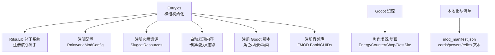
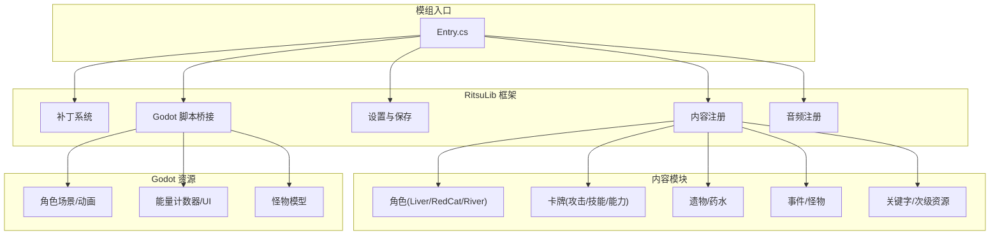
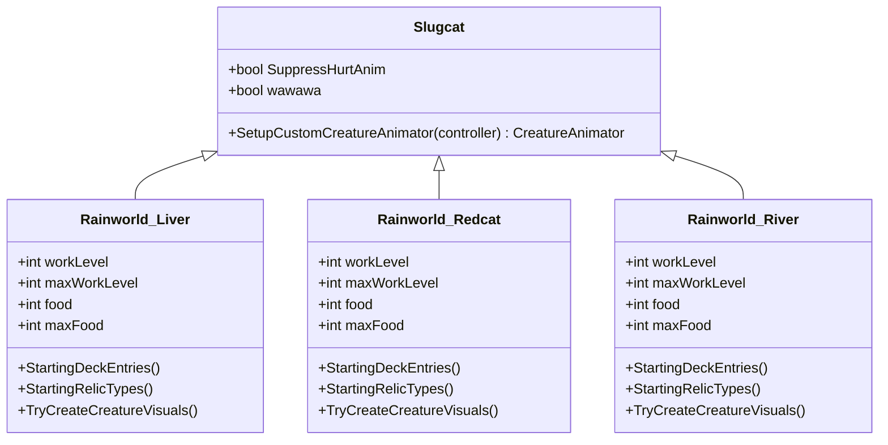
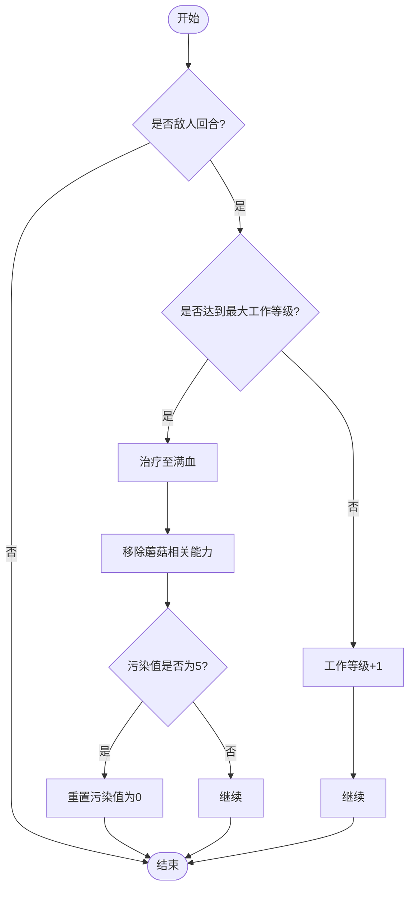
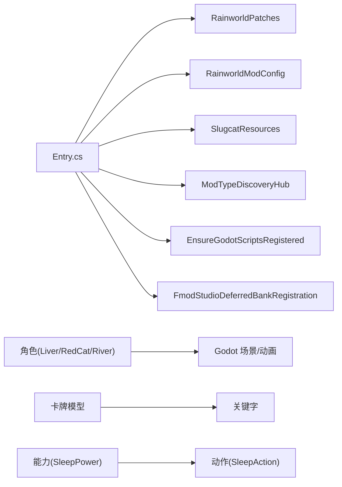

# 项目概述

<cite>
**本文引用的文件**
- [mod_manifest.json](file://mod_manifest.json)
- [Entry.cs](file://Scripts/Entry.cs)
- [RainworldModConfig.cs](file://Scripts/RainworldModConfig.cs)
- [Slugcat.cs](file://Scripts/Slugcat/Slugcat.cs)
- [Rainworld_Liver.cs](file://Scripts/Slugcat/Rainworld_Liver.cs)
- [Rainworld_Redcat.cs](file://Scripts/Slugcat/Rainworld_Redcat.cs)
- [Rainworld_River.cs](file://Scripts/Slugcat/Rainworld_River.cs)
- [SlugcatResources.cs](file://Scripts/Slugcat/SecondaryResource/SlugcatResources.cs)
- [Keywords.cs](file://Scripts/Keywords.cs)
- [LiverCardModel.cs](file://Scripts/Card/Liver/LiverCardModel.cs)
- [SleepPower.cs](file://Scripts/Powers/SleepPower.cs)
- [SleepAction.cs](file://Scripts/Action/SleepAction.cs)
</cite>

## 目录
1. [简介](#简介)
2. [项目结构](#项目结构)
3. [核心组件](#核心组件)
4. [架构总览](#架构总览)
5. [详细组件分析](#详细组件分析)
6. [依赖关系分析](#依赖关系分析)
7. [性能与扩展性考虑](#性能与扩展性考虑)
8. [故障排查指南](#故障排查指南)
9. [结论](#结论)
10. [附录：常见用例示例](#附录：常见用例示例)

## 简介
本项目是一个基于《杀戮尖塔2》的模组，将《雨世界》中的蛞蝓猫（Slugcat）引入卡牌对战。项目通过 RitsuLib 框架与 Godot 引擎集成，实现了三位可玩角色（Liver、RedCat、River）的三角色系统，并围绕“工作等级”“食物”“污染值”等次级资源构建独特的战斗循环与策略体验。项目提供大量专属卡牌、能力、遗物、事件与怪物，并通过补丁系统与游戏核心进行深度交互。

## 项目结构
- 脚本层（C#）：位于 Scripts 目录，包含角色定义、卡牌模型、能力、遗物、事件、补丁、关键字、配置与入口等。
- 资源层（Godot）：位于 Godot 目录，包含角色场景、动画、UI、能量计数器、怪物模型与休息点动画等。
- 本地化与元数据：位于 SlugcatTheSpireII/localization，提供多语言文本；根目录 mod_manifest.json 描述模组基本信息与依赖。
- 构建与导出：根目录包含 Godot 工程配置与 C# 项目文件，用于打包为 .pck/.dll 内容。

图表来源
- [Entry.cs:26-76](file://Scripts/Entry.cs#L26-L76)
- [RainworldModConfig.cs:166-234](file://Scripts/RainworldModConfig.cs#L166-L234)
- [SlugcatResources.cs:15-48](file://Scripts/Slugcat/SecondaryResource/SlugcatResources.cs#L15-L48)
- [mod_manifest.json:1-14](file://mod_manifest.json#L1-L14)

章节来源
- [Entry.cs:26-76](file://Scripts/Entry.cs#L26-L76)
- [mod_manifest.json:1-14](file://mod_manifest.json#L1-L14)

## 核心组件
- 角色基类与三角色：
  - Slugcat 抽象基类统一了动画状态机、视觉与行为模板。
  - Liver、RedCat、River 分别继承基类，定义各自初始卡组、起始遗物、资源上限与视觉资源。
- 次级资源系统：
  - 食物、工作等级、污染值等通过 RitsuLib 的 SecondaryResource 与 RunSavedData 持久化与同步。
- 关键字体系：
  - Spear、Treasure、Corrupt、Food、Worklevel 等关键字贯穿卡牌与能力逻辑。
- 内容注册与自动发现：
  - Entry 中通过 ModTypeDiscoveryHub 自动注册卡牌、能力、遗物等，减少手工维护成本。
- 配置系统：
  - RainworldModConfig 暴露多种开关（如怪物启用、事件启用、HP修复等），支持全局保存与 UI 设置页。

章节来源
- [Slugcat.cs:61-135](file://Scripts/Slugcat/Slugcat.cs#L61-L135)
- [Rainworld_Liver.cs:28-117](file://Scripts/Slugcat/Rainworld_Liver.cs#L28-L117)
- [Rainworld_Redcat.cs:29-128](file://Scripts/Slugcat/Rainworld_Redcat.cs#L29-L128)
- [Rainworld_River.cs:31-114](file://Scripts/Slugcat/Rainworld_River.cs#L31-L114)
- [SlugcatResources.cs:15-48](file://Scripts/Slugcat/SecondaryResource/SlugcatResources.cs#L15-L48)
- [Keywords.cs:9-50](file://Scripts/Keywords.cs#L9-L50)
- [RainworldModConfig.cs:11-234](file://Scripts/RainworldModConfig.cs#L11-L234)

## 架构总览
项目采用“模组入口 + 框架集成 + 内容分层”的架构：
- 入口层：Entry 负责补丁注册、配置、资源、自动发现与生命周期钩子。
- 框架层：RitsuLib 提供补丁、内容注册、二次资源、设置、Godot 脚本桥接、音频等能力。
- 内容层：角色、卡牌、能力、遗物、事件、怪物、关键字、本地化等按模块组织。
- 资源层：Godot 场景与动画驱动角色表现，能量计数器与休息点动画增强交互反馈。

图表来源
- [Entry.cs:26-76](file://Scripts/Entry.cs#L26-L76)
- [Slugcat.cs:93-135](file://Scripts/Slugcat/Slugcat.cs#L93-L135)
- [Rainworld_Liver.cs:41-79](file://Scripts/Slugcat/Rainworld_Liver.cs#L41-L79)
- [Rainworld_Redcat.cs:44-84](file://Scripts/Slugcat/Rainworld_Redcat.cs#L44-L84)
- [Rainworld_River.cs:47-85](file://Scripts/Slugcat/Rainworld_River.cs#L47-L85)

## 详细组件分析

### 三角色系统设计与实现
- 设计目标：
  - 将《雨世界》的生存与探索元素融入《杀戮尖塔2》的回合制卡牌对战，形成差异化玩法。
  - 通过“工作等级”“食物”“污染值”等资源管理，驱动休息、恢复、风险与收益的权衡。
- 角色差异：
  - Liver：稳健型，起始生命较低但具备稳定的输出与防御，初始遗物偏向资源增益。
  - RedCat：高机动与爆发，起始生命较高，强调连击与状态切换。
  - River：灵活多变，擅长利用环境与状态变化，拥有独特的水系机制。
- 技术实现：
  - 统一基类 Slugcat 提供动画状态机与通用行为。
  - 各角色通过 CharacterAssetProfile 绑定 Godot 场景、UI 图标、音效与多人模式手势。
  - 初始卡组与起始遗物在角色类中声明，便于扩展与维护。

图表来源
- [Slugcat.cs:61-135](file://Scripts/Slugcat/Slugcat.cs#L61-L135)
- [Rainworld_Liver.cs:28-117](file://Scripts/Slugcat/Rainworld_Liver.cs#L28-L117)
- [Rainworld_Redcat.cs:29-128](file://Scripts/Slugcat/Rainworld_Redcat.cs#L29-L128)
- [Rainworld_River.cs:31-114](file://Scripts/Slugcat/Rainworld_River.cs#L31-L114)

章节来源
- [Slugcat.cs:61-135](file://Scripts/Slugcat/Slugcat.cs#L61-L135)
- [Rainworld_Liver.cs:28-117](file://Scripts/Slugcat/Rainworld_Liver.cs#L28-L117)
- [Rainworld_Redcat.cs:29-128](file://Scripts/Slugcat/Rainworld_Redcat.cs#L29-L128)
- [Rainworld_River.cs:31-114](file://Scripts/Slugcat/Rainworld_River.cs#L31-L114)

### 次级资源与工作等级循环
- 资源定义：
  - 通过 SlugcatResources 注册玩家运行数据与次级资源（如污染值）。
  - 支持每局保存、多人同步与运行时修改。
- 工作等级与睡眠：
  - SleepPower 在敌人回合结束时推进工作等级或触发回血/锁工作等级。
  - SleepAction 消耗食物并进入睡眠状态，结束当前回合，配合动画与能力移除逻辑。
- 流程图：

图表来源
- [SleepPower.cs:54-74](file://Scripts/Powers/SleepPower.cs#L54-L74)

章节来源
- [SlugcatResources.cs:15-48](file://Scripts/Slugcat/SecondaryResource/SlugcatResources.cs#L15-L48)
- [SleepPower.cs:45-115](file://Scripts/Powers/SleepPower.cs#L45-L115)
- [SleepAction.cs:31-41](file://Scripts/Action/SleepAction.cs#L31-L41)

### 关键字与卡牌边框发光
- 关键字：
  - 定义了 Spear、Treasure、Corrupt、Food、Worklevel、CatStrike 等关键字，并在卡牌描述前显示。
- 边框发光：
  - 通过 ModCardHandOutlineRegistry 为特定关键字（如 Corrupt、Treasurespear）注册边框发光规则，提升可读性与辨识度。

章节来源
- [Keywords.cs:9-50](file://Scripts/Keywords.cs#L9-L50)
- [Entry.cs:58-70](file://Scripts/Entry.cs#L58-L70)

### 卡牌模型与资源路径
- 卡牌基类：
  - LiverCardModel 统一了卡牌资源路径与卡框选择逻辑，简化新增卡牌的开发。
- 资源映射：
  - 根据卡牌类型（攻击/技能/能力）自动选择对应卡框纹理，便于视觉一致性。

章节来源
- [LiverCardModel.cs:14-38](file://Scripts/Card/Liver/LiverCardModel.cs#L14-L38)

### 角色与 Godot 场景集成
- 角色场景：
  - 每个角色通过 CharacterAssetProfile 指定 Godot 场景路径（主场景、商店动画、休息点动画、能量计数器等）。
- 动画状态机：
  - 基类 SetupCustomCreatureAnimator 定义了 idle、attack、cast、hurt、sleep、corrupt、meow、fake death 等状态，并支持条件触发（如抑制受伤动画）。
- 多人模式：
  - 为每个角色配置多人模式手势贴图（手指、石头、布、剪刀），提升联机体验。

章节来源
- [Rainworld_Liver.cs:41-79](file://Scripts/Slugcat/Rainworld_Liver.cs#L41-L79)
- [Rainworld_Redcat.cs:44-84](file://Scripts/Slugcat/Rainworld_Redcat.cs#L44-L84)
- [Rainworld_River.cs:47-85](file://Scripts/Slugcat/Rainworld_River.cs#L47-L85)
- [Slugcat.cs:93-135](file://Scripts/Slugcat/Slugcat.cs#L93-L135)

### 配置系统与功能开关
- 配置项：
  - 包括 HP 修复、怪物启用、事件启用等开关，支持全局保存与 UI 设置页。
- 使用方式：
  - 通过 RainworldModConfig 提供的静态属性读写配置，并在运行时读取以控制行为。

章节来源
- [RainworldModConfig.cs:11-234](file://Scripts/RainworldModConfig.cs#L11-L234)

## 依赖关系分析
- 外部依赖：
  - STS2-RitsuLib（最低版本要求），提供补丁、内容注册、设置、二次资源、Godot 桥接等能力。
- 内部依赖：
  - Entry 依赖补丁、配置、资源、自动发现、音频注册与生命周期观察者。
  - 角色依赖 Godot 场景与动画，卡牌依赖关键字与资源路径。
- 耦合与内聚：
  - 角色与资源强耦合（场景/图标/音效），通过 CharacterAssetProfile 解耦具体路径。
  - 关键字与卡牌逻辑松耦合，通过关键字常量与边框注册规则扩展。

图表来源
- [Entry.cs:26-76](file://Scripts/Entry.cs#L26-L76)
- [RainworldModConfig.cs:166-234](file://Scripts/RainworldModConfig.cs#L166-L234)
- [SlugcatResources.cs:15-48](file://Scripts/Slugcat/SecondaryResource/SlugcatResources.cs#L15-L48)
- [LiverCardModel.cs:14-38](file://Scripts/Card/Liver/LiverCardModel.cs#L14-L38)
- [SleepPower.cs:45-115](file://Scripts/Powers/SleepPower.cs#L45-L115)
- [SleepAction.cs:31-41](file://Scripts/Action/SleepAction.cs#L31-L41)

章节来源
- [mod_manifest.json:1-14](file://mod_manifest.json#L1-L14)
- [Entry.cs:26-76](file://Scripts/Entry.cs#L26-L76)

## 性能与扩展性考虑
- 动画与渲染：
  - 使用 Godot 场景与 Spine 动画，合理拆分状态与循环播放，避免频繁切换造成卡顿。
- 资源加载：
  - 通过 CharacterAssetProfile 集中管理资源路径，便于优化与替换。
- 内容扩展：
  - 基于基类与自动发现机制，新增角色/卡牌/能力时只需遵循约定命名与注册规则。
- 网络同步：
  - 次级资源与运行数据支持多人同步，确保联机一致性。

[本节为通用指导，不直接分析具体文件]

## 故障排查指南
- 启动失败：
  - 检查 RitsuLib 版本是否符合最低要求，确认补丁注册成功。
- 角色无动画：
  - 确认 CharacterAssetProfile 中的场景路径正确，Godot 脚本已注册。
- 配置未生效：
  - 检查 RainworldModConfig 的开关是否正确读写与保存。
- 睡眠机制异常：
  - 检查 SleepPower 与 SleepAction 的触发条件与副作用（如工作等级、污染值、能力移除）。

章节来源
- [Entry.cs:26-76](file://Scripts/Entry.cs#L26-L76)
- [RainworldModConfig.cs:166-234](file://Scripts/RainworldModConfig.cs#L166-L234)
- [SleepPower.cs:45-115](file://Scripts/Powers/SleepPower.cs#L45-L115)
- [SleepAction.cs:31-41](file://Scripts/Action/SleepAction.cs#L31-L41)

## 结论
本项目通过 RitsuLib 与 Godot 的深度集成，成功将《雨世界》的蛞蝓猫引入《杀戮尖塔2》，构建了以三角色为核心的差异化玩法。借助关键字、次级资源与丰富的内容生态，玩家在资源管理与策略选择上获得全新体验。项目结构清晰、扩展性强，适合进一步丰富卡牌池、事件与怪物，持续完善三角色系统的深度与广度。

[本节为总结，不直接分析具体文件]

## 附录：常见用例示例
- 新增一张 Liver 攻击牌：
  - 继承 LiverCardModel，设置能量消耗、类型、稀有度与目标类型。
  - 在角色初始卡组中添加该牌类型与数量。
  - 如需边框发光，可在 Entry 中注册关键字规则。
- 实现一个基于工作等级的能力：
  - 创建 ModPowerTemplate 子类，在 AfterApplied/AfterSideTurnEnd 中读取/更新工作等级。
  - 结合 SleepPower 的工作等级推进逻辑，形成联动。
- 调整角色资源上限：
  - 在角色类中修改 maxFood、maxWorkLevel 等属性，验证对游戏平衡的影响。

章节来源
- [LiverCardModel.cs:14-38](file://Scripts/Card/Liver/LiverCardModel.cs#L14-L38)
- [Rainworld_Liver.cs:91-99](file://Scripts/Slugcat/Rainworld_Liver.cs#L91-L99)
- [Entry.cs:58-70](file://Scripts/Entry.cs#L58-L70)
- [SleepPower.cs:54-74](file://Scripts/Powers/SleepPower.cs#L54-L74)